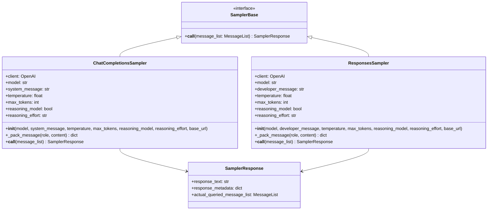
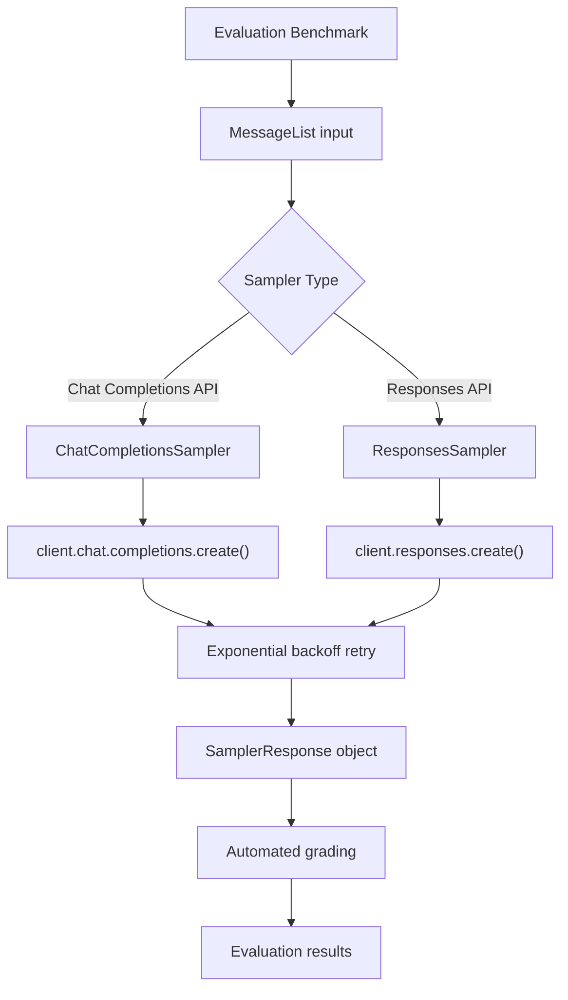
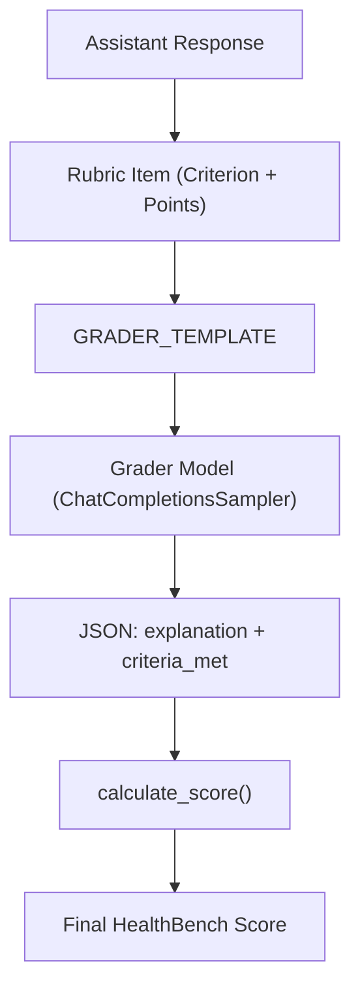
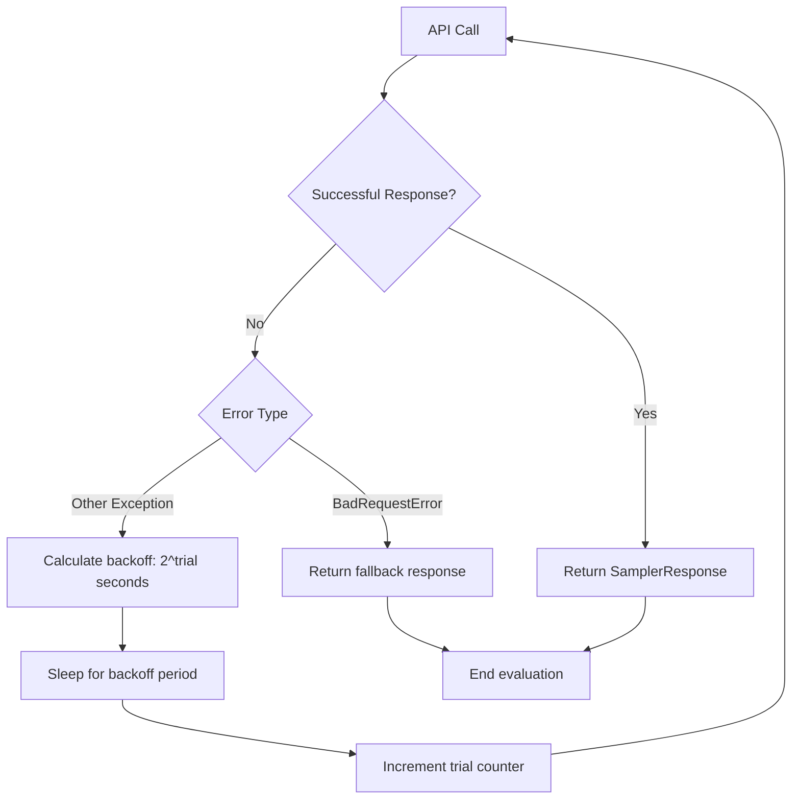
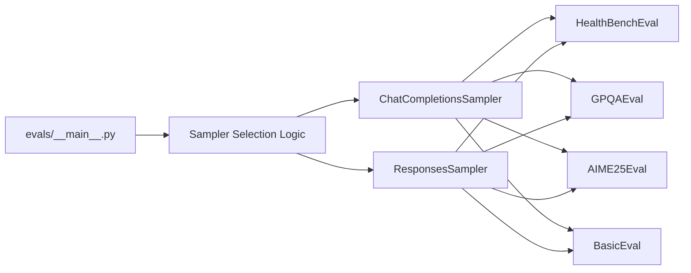

<!-- source: DeepWiki mcp.deepwiki.com · repo openai/gpt-oss · page 7.3 Samplers and Grading · fetched 2026-10-26 -->

# Samplers and Grading

<details>
<summary>Relevant source files</summary>

The following files were used as context for generating this wiki page:

- [gpt_oss/evals/__main__.py](gpt_oss/evals/__main__.py)
- [gpt_oss/evals/basic_eval.py](gpt_oss/evals/basic_eval.py)
- [gpt_oss/evals/chat_completions_sampler.py](gpt_oss/evals/chat_completions_sampler.py)
- [gpt_oss/evals/healthbench_eval.py](gpt_oss/evals/healthbench_eval.py)
- [gpt_oss/evals/responses_sampler.py](gpt_oss/evals/responses_sampler.py)
- [gpt_oss/responses_api/inference/ollama.py](gpt_oss/responses_api/inference/ollama.py)

</details>


This document describes the sampler implementations used by the evaluation framework to interface with different API endpoints and the automated grading systems that assess model responses. Samplers provide a unified interface for generating model responses across different API formats, while grading systems automatically score those responses against benchmark expectations.

For information about running evaluations and benchmark implementations, see [Running Evaluations](#7.1) and [Benchmark Implementations](#7.2). For evaluation reports and metrics, see [Report Generation](#7.4).

## Sampler Architecture

The evaluation framework uses a common sampler interface to abstract different API endpoints and model types. This allows benchmarks to be run against any compatible API without modification.

### Sampler Class Hierarchy



Sources: [gpt_oss/evals/chat_completions_sampler.py:17-29](), [gpt_oss/evals/responses_sampler.py:10-32](), [gpt_oss/evals/types.py:33-33]()

### Data Flow Through Samplers



Sources: [gpt_oss/evals/chat_completions_sampler.py:42-94](), [gpt_oss/evals/responses_sampler.py:37-92]()

## ChatCompletionsSampler

The `ChatCompletionsSampler` class provides compatibility with OpenAI's Chat Completions API format. It handles both standard and reasoning models with configurable parameters.

### Key Features

| Feature | Implementation | Configuration |
|---------|---------------|---------------|
| **API Endpoint** | `client.chat.completions.create()` | `base_url` parameter [gpt_oss/evals/chat_completions_sampler.py:30-30]() |
| **Retry Logic** | Exponential backoff | `2 ** trial` seconds [gpt_oss/evals/chat_completions_sampler.py:86-86]() |
| **System Messages** | Configurable system prompt | `system_message` parameter [gpt_oss/evals/chat_completions_sampler.py:43-46]() |
| **Reasoning Models** | Support for reasoning effort | `reasoning_model`, `reasoning_effort` [gpt_oss/evals/chat_completions_sampler.py:50-57]() |
| **Error Handling** | BadRequestError, rate limits | Returns fallback response [gpt_oss/evals/chat_completions_sampler.py:78-84]() |

### Configuration Parameters

The sampler accepts several configuration options through its constructor:

```python
# Default configuration from chat_completions_sampler.py:20-29
ChatCompletionsSampler(
    model="gpt-3.5-turbo",           # Model identifier
    system_message=None,             # Optional system prompt
    temperature=0.5,                 # Sampling temperature
    max_tokens=1024,                 # Maximum response length
    reasoning_model=False,           # Enable reasoning model features
    reasoning_effort=None,           # Reasoning effort level
    base_url="http://localhost:8000/v1"  # API endpoint
)
```

### System Message Handling

The sampler provides predefined system messages for different use cases:

- `OPENAI_SYSTEM_MESSAGE_API`: Standard helpful assistant message [gpt_oss/evals/chat_completions_sampler.py:10-10]()
- `OPENAI_SYSTEM_MESSAGE_CHATGPT`: ChatGPT-style system message with knowledge cutoff [gpt_oss/evals/chat_completions_sampler.py:11-14]()

Sources: [gpt_oss/evals/chat_completions_sampler.py:10-37]()

## ResponsesSampler

The `ResponsesSampler` class interfaces with OpenAI's Responses API, which provides enhanced response handling and developer message support.

### Key Differences from Chat Completions

| Aspect | ChatCompletionsSampler | ResponsesSampler |
|--------|----------------------|------------------|
| **API Method** | `chat.completions.create()` | `responses.create()` [gpt_oss/evals/responses_sampler.py:55-55]() |
| **Input Parameter** | `messages` | `input` [gpt_oss/evals/responses_sampler.py:47-47]() |
| **System Role** | `system` | `developer` [gpt_oss/evals/responses_sampler.py:40-40]() |
| **Output Handling** | `response.choices[0].message.content` | `response.output_text` [gpt_oss/evals/responses_sampler.py:66-66]() |
| **Default Max Tokens** | 1024 | 131,072 [gpt_oss/evals/responses_sampler.py:20-20]() |

### Reasoning Model Support

Both samplers support reasoning models but with different parameter structures:

```python
# ChatCompletionsSampler reasoning parameters
response = self.client.chat.completions.create(
    model=self.model,
    messages=message_list,
    reasoning_effort=self.reasoning_effort,  # Direct parameter
    temperature=self.temperature,
    max_tokens=self.max_tokens,
)

# ResponsesSampler reasoning parameters  
reasoning = (
    {"effort": self.reasoning_effort}
    if self.reasoning_effort
    else None
)
response = self.client.responses.create(
    model=self.model,
    input=message_list,
    reasoning=reasoning,  # Nested object
)
```

Sources: [gpt_oss/evals/responses_sampler.py:45-62](), [gpt_oss/evals/chat_completions_sampler.py:50-64]()

## Automated Grading and LLM-as-Judge

Automated grading is critical for benchmarks like HealthBench where correctness isn't just a simple string match.

### LLM-as-Judge Pattern (HealthBench)

HealthBench uses a high-capability model (e.g., `gpt-4.1`) as a grader to evaluate response turns against specific rubric items.



- **Grader Template**: Defines instructions for the judge, including handling "such as" clauses and negative point criteria [gpt_oss/evals/healthbench_eval.py:39-88]().
- **Rubric Item**: A structured object containing a criterion string, point value, and tags [gpt_oss/evals/healthbench_eval.py:110-132]().
- **Score Calculation**: Sums achieved points divided by total possible points based on boolean `criteria_met` flags returned by the judge [gpt_oss/evals/healthbench_eval.py:135-153]().

### Multiple Choice Grading (ABCD Grader)

Benchmarks like GPQA use a simpler pattern where the model is prompted to provide an answer in a specific format (e.g., "Answer: (A)"), and the evaluator extracts the choice to compare against the ground truth.

Sources: [gpt_oss/evals/healthbench_eval.py:39-153](), [gpt_oss/evals/__main__.py:90-95]()

## Error Handling and Retry Logic

Both samplers implement robust error handling with exponential backoff for reliable evaluation runs.

### Retry Mechanism



### Error Response Handling

When errors occur, samplers return structured fallback responses:

```python
# BadRequestError handling - returns empty/fallback response
return SamplerResponse(
    response_text="No response (bad request).",  # ChatCompletions
    # or response_text=""                        # Responses
    response_metadata={"usage": None},
    actual_queried_message_list=message_list,
)
```

Sources: [gpt_oss/evals/chat_completions_sampler.py:78-84](), [gpt_oss/evals/responses_sampler.py:70-76](), [gpt_oss/evals/chat_completions_sampler.py:85-93](), [gpt_oss/evals/responses_sampler.py:77-85]()

## Integration with Evaluation Framework

Samplers integrate with the broader evaluation system to enable automated testing across multiple benchmarks and models.

### Sampler Selection in Evaluations



### Response Processing Pipeline

The evaluation framework processes sampler responses through automated grading systems that compare generated responses against expected answers or use LLM-based judging for more complex evaluations.

Each benchmark implements its own grading logic that takes the `SamplerResponse.response_text` and evaluates it according to benchmark-specific criteria, producing numerical scores and detailed feedback for evaluation reports.

Sources: [gpt_oss/evals/__main__.py:74-86](), [gpt_oss/evals/basic_eval.py:15-37]()

---

