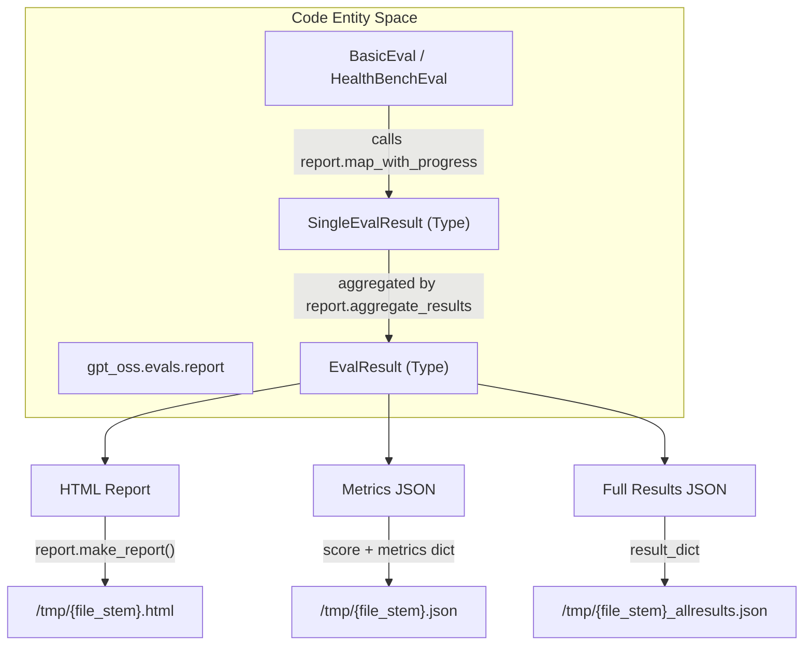
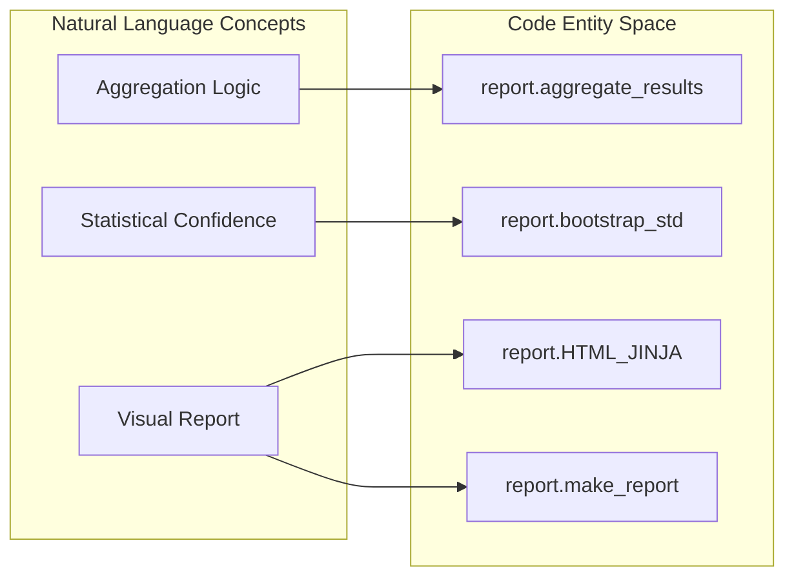

<!-- source: DeepWiki mcp.deepwiki.com · repo openai/gpt-oss · page 7.4 Report Generation · fetched 2026-10-26 -->

# Report Generation

<details>
<summary>Relevant source files</summary>

The following files were used as context for generating this wiki page:

- [gpt_oss/evals/__main__.py](gpt_oss/evals/__main__.py)
- [gpt_oss/evals/basic_eval.py](gpt_oss/evals/basic_eval.py)
- [gpt_oss/evals/chat_completions_sampler.py](gpt_oss/evals/chat_completions_sampler.py)
- [gpt_oss/evals/healthbench_eval.py](gpt_oss/evals/healthbench_eval.py)
- [gpt_oss/evals/responses_sampler.py](gpt_oss/evals/responses_sampler.py)
- [gpt_oss/responses_api/inference/ollama.py](gpt_oss/responses_api/inference/ollama.py)

</details>


This section covers the evaluation report generation system in gpt-oss, including the implementation of result aggregation, metric computation (such as bootstrap standard deviation), and HTML report generation using Jinja2 templates.

## Overview of Report Types

The evaluation system generates three distinct types of reports for each evaluation run, each serving different purposes for analysis and review.

Title: Report Generation Data Flow


Sources: [gpt_oss/evals/__main__.py:164-189](), [gpt_oss/evals/report.py:100-115](), [gpt_oss/evals/types.py:30-45]()

## Core Data Structures

The reporting system relies on standardized types defined in `gpt_oss.evals.types` to ensure consistency across different benchmark implementations.

### SingleEvalResult
Represents the result of a single example within an evaluation.
- `html`: A rendered HTML string for the specific example [gpt_oss/evals/types.py:31]().
- `score`: The numerical score for this example [gpt_oss/evals/types.py:32]().
- `convo`: The list of messages (`MessageList`) representing the full interaction [gpt_oss/evals/types.py:33]().
- `metrics`: A dictionary of secondary metrics (e.g., character count, token usage) [gpt_oss/evals/types.py:34]().

### EvalResult
The aggregated output of an entire evaluation suite.
- `score`: The mean score across all examples [gpt_oss/evals/types.py:39]().
- `metrics`: Aggregated metrics, including `bootstrap_std` [gpt_oss/evals/types.py:40]().
- `htmls`: A list of all individual HTML strings [gpt_oss/evals/types.py:41]().
- `convos`: A list of all conversation logs [gpt_oss/evals/types.py:42]().
- `metadata`: A dictionary containing execution context like model names and timestamps [gpt_oss/evals/types.py:43]().

Sources: [gpt_oss/evals/types.py:30-45]()

## Result Aggregation and Metrics

The `aggregate_results` function in `report.py` is responsible for transforming a list of `SingleEvalResult` objects into a final `EvalResult`.

### Bootstrap Standard Deviation
To provide statistical confidence in evaluation scores, the system computes a bootstrap standard deviation. This is implemented by resampling the scores with replacement 1000 times and calculating the standard deviation of the resulting means [gpt_oss/evals/report.py:110-114]().

### Metric Aggregation Logic
1. **Score Calculation**: Computes the mean of all `SingleEvalResult.score` values [gpt_oss/evals/report.py:104]().
2. **Metric Merging**: Aggregates secondary metrics by averaging numerical values found in the `metrics` dictionaries of individual results [gpt_oss/evals/report.py:105-108]().
3. **HTML/Convo Collection**: Flattens individual example data into lists for the final report [gpt_oss/evals/report.py:116-118]().

Sources: [gpt_oss/evals/report.py:100-123]()

## HTML Report Generation

Reports are rendered using **Jinja2** templates. The system uses a base template (`HTML_JINJA`) that is sometimes extended by specific evaluations (e.g., `HealthBenchEval`).

### Template Structure
The standard template includes:
- **Prompt Messages**: Visualizes the conversation history [gpt_oss/evals/report.py:20]().
- **Assistant Response**: Displays the model's output [gpt_oss/evals/report.py:23]().
- **Grading Info**: Shows the score, correct answer, and extracted answer [gpt_oss/evals/report.py:25-29]().

### Specialized Templates
Benchmarks like HealthBench customize the report format. For instance, `HealthBenchEval` removes the "Correct Answer" field and adds a specific "Rubrics with grades" section to display complex multi-criteria grading [gpt_oss/evals/healthbench_eval.py:90-96]().

Title: Natural Language to Code Entity Mapping (Reporting)


Sources: [gpt_oss/evals/report.py:13-35](), [gpt_oss/evals/healthbench_eval.py:90-96]()

## File Naming and Storage

Reports are written to `/tmp/` using a structured naming convention to prevent collisions and aid organization.

### Naming Structure
```
{eval_name}_{model_name}_temp{temperature}_{timestamp}{debug_suffix}
```

| Component | Description | Source |
|-----------|-------------|--------|
| `eval_name` | Benchmark identifier (e.g., `gpqa`) | [gpt_oss/evals/__main__.py:162]() |
| `model_name` | Model name + reasoning effort | [gpt_oss/evals/__main__.py:157-158]() |
| `timestamp` | `YYYYMMDD_HHMMSS` format | [gpt_oss/evals/__main__.py:156]() |
| `debug_suffix` | `_DEBUG` if `--debug` is used | [gpt_oss/evals/__main__.py:149]() |

### Output Files
- **HTML**: Human-readable report containing all rendered example HTMLs joined together [gpt_oss/evals/__main__.py:168]().
- **Metrics JSON**: A compact JSON containing the final score and metrics dictionary [gpt_oss/evals/__main__.py:175-176]().
- **Full Results JSON**: A complete dump of the `EvalResult` object, including all conversation logs [gpt_oss/evals/__main__.py:181-188]().

Sources: [gpt_oss/evals/__main__.py:149-189]()

## Multi-Model Result Aggregation

The evaluation framework supports comparing multiple models by merging their results. This is handled at the end of the `main()` execution loop.

1. **Merge Key**: A dictionary `mergekey2resultpath` maps the file stem to the resulting JSON path [gpt_oss/evals/__main__.py:151]().
2. **Metric Selection**: The merger prefers `f1_score` if available, falling back to the standard `score` [gpt_oss/evals/__main__.py:202]().
3. **Consolidated Output**: Prints a summary of all evaluations run during the session, facilitating quick comparison across reasoning efforts or model variants [gpt_oss/evals/__main__.py:193-206]().

Sources: [gpt_oss/evals/__main__.py:151-206]()

---

