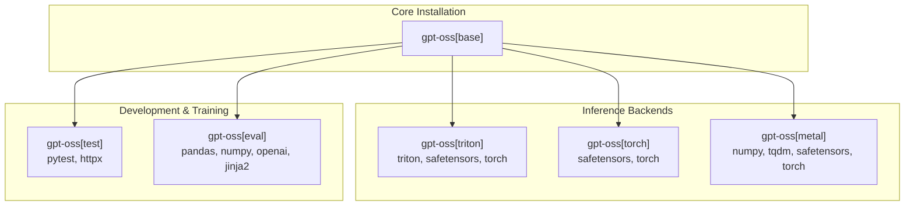
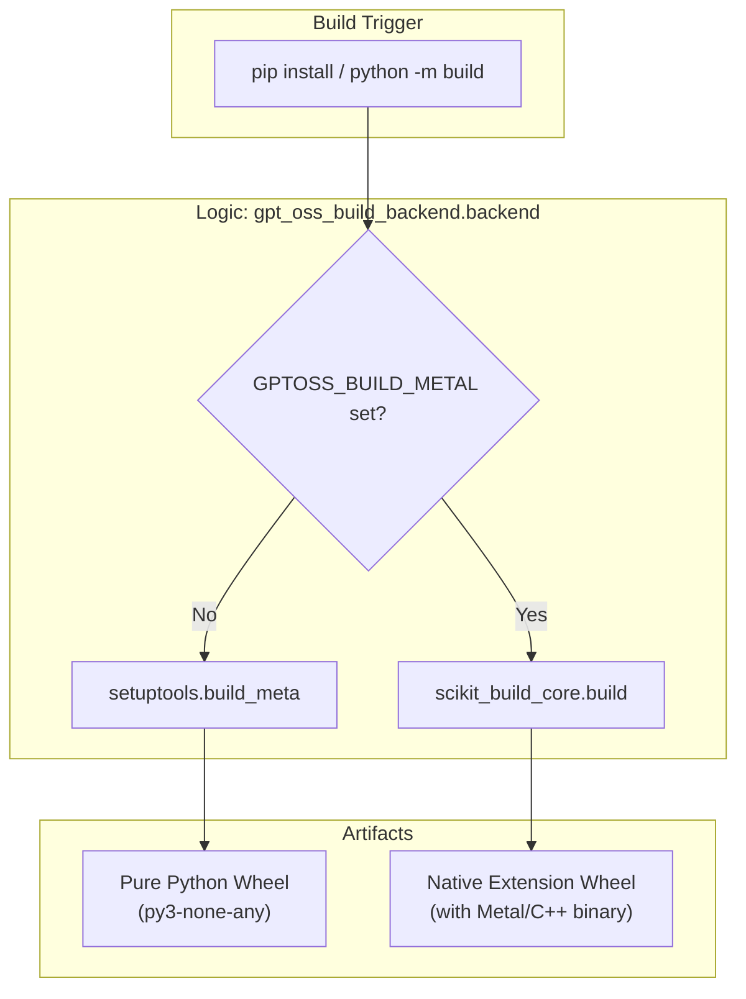

<!-- source: DeepWiki mcp.deepwiki.com · repo openai/gpt-oss · page 8 Development · fetched 2026-10-26 -->

# Development

Relevant source files

The following files were used as context for generating this wiki page:

- [.github/workflows/CI.yml](.github/workflows/CI.yml)
- [MANIFEST.in](MANIFEST.in)
- [_build/gpt_oss_build_backend/__init__.py](_build/gpt_oss_build_backend/__init__.py)
- [_build/gpt_oss_build_backend/backend.py](_build/gpt_oss_build_backend/backend.py)
- [gpt_oss/triton/attention.py](gpt_oss/triton/attention.py)
- [pyproject.toml](pyproject.toml)

This page provides developer resources for building, testing, and contributing to the gpt-oss codebase. It covers the build system, dependency management, testing infrastructure, package organization, and reinforcement fine-tuning. For specific details about the build backend implementation, see [Build System](#8.1). For testing procedures and API compatibility validation, see [Testing](#8.2). For understanding the project's modular structure, see [Package Structure](#8.3). For information on model training and RL, see [Reinforcement Fine-Tuning](#8.4).

## Development Environment Setup

The gpt-oss project requires Python 3.12 and uses a custom PEP 517 build backend for compilation. The project supports multiple optional dependency groups for different inference backends and development workflows.

### Core Dependencies

The base installation requires several essential packages for API handling, Docker integration, and structured logging:

| Category | Dependencies |
|----------|-------------|
| Core Framework | `openai-harmony`, `tiktoken>=0.9.0` |
| HTTP/API | `aiohttp>=3.12.14`, `fastapi>=0.116.1`, `uvicorn>=0.35.0` |
| Tools Integration | `docker>=7.1.0`, `requests>=2.31.0`, `jupyter-client>=8.6.3` |
| Data Processing | `pydantic>=2.11.7`, `lxml>=4.9.4`, `html2text>=2025.4.15` |
| Infrastructure | `structlog>=25.4.0`, `tenacity>=9.1.2`, `chz>=0.3.0` |

Sources: [pyproject.toml:5-21]()

### Optional Backend Dependencies

Different inference backends and development tasks require specific dependency groups:

Sources: [pyproject.toml:26-31]()

## Build System Architecture

The project uses a custom PEP 517 build backend defined in `_build/gpt_oss_build_backend/backend.py` [pyproject.toml:35-36](). This backend supports two modes: a pure Python wheel for standard distribution and an optional Metal/C extension build for local development [gpt_oss_build_backend/backend.py:1-30]().

### Build Backend Logic

The backend dynamically selects between `setuptools` and `scikit-build-core` based on the environment:

When `GPTOSS_BUILD_METAL` is enabled, the backend injects dynamic build requirements including `scikit-build-core`, `pybind11`, `cmake`, and `ninja` [gpt_oss_build_backend/backend.py:100-110]().

Sources: [_build/gpt_oss_build_backend/backend.py:39-54](), [pyproject.toml:33-47]()

## Continuous Integration and Publishing

The project uses GitHub Actions for automated building and publishing to PyPI. The CI workflow utilizes "Trusted Publishing" via OIDC to handle PyPI authentication without manual tokens [.github/workflows/CI.yml:56-61]().

### CI Pipeline

| Step | Action | Command/Detail |
|------|--------|----------------|
| **Setup** | Python 3.12 | `actions/setup-python@v4` |
| **Tools** | Install Build Tools | `pip install setuptools wheel build uv` |
| **Build** | Package Creation | `uv build` |
| **Publish** | PyPI Release | `pypa/gh-action-pypi-publish` |

Sources: [.github/workflows/CI.yml:33-61]()

## Performance Optimization (Triton)

For developers working on GPU performance, the project includes specialized Triton kernels. A key component is the `FlashAttention` implementation which supports learned sinks and banded attention [gpt_oss/triton/attention.py:1-7]().

### Triton Attention Kernel (`_attn_fwd`)

The kernel manages high-performance attention computation with the following features:
- **Learned Sinks**: Loads attention sinks into the softmax calculation [gpt_oss/triton/attention.py:45-48]().
- **Banded Attention**: Implements sliding window constraints using `BANDWIDTH` [gpt_oss/triton/attention.py:61-64]().
- **Tiling**: Uses `BLOCK_M` and `BLOCK_N` (default 64) for efficient memory access [gpt_oss/triton/attention.py:121-122]().

Sources: [gpt_oss/triton/attention.py:18-102]()

## Version and Discovery Configuration

The project maintains specific metadata for discovery and compatibility:

| Component | Specification |
|-----------|--------------|
| **Version** | `0.0.9` [pyproject.toml:24]() |
| **Python** | `>=3.12` [pyproject.toml:23]() |
| **Package Discovery** | `gpt_oss*` pattern [pyproject.toml:39]() |
| **CMake Source** | Root directory `.` [pyproject.toml:42]() |

The build system ensures all sub-packages under the `gpt_oss` namespace are included in the final wheel [pyproject.toml:49]().

Sources: [pyproject.toml:22-50]()

---

