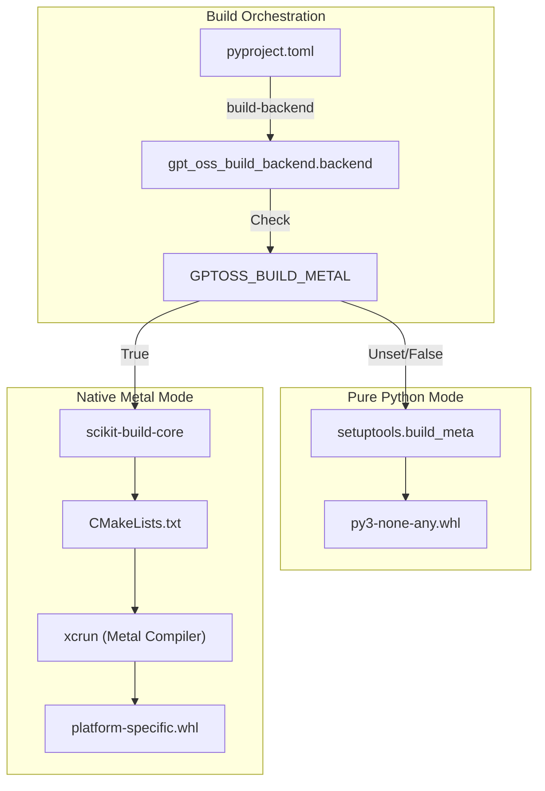
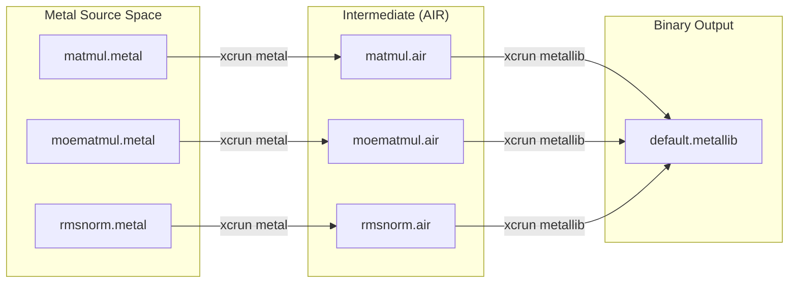
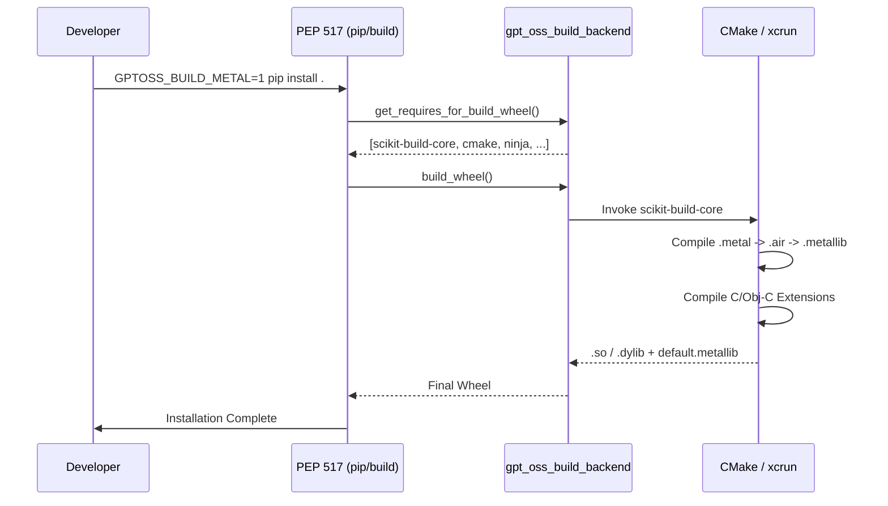

<!-- source: DeepWiki mcp.deepwiki.com · repo openai/gpt-oss · page 8.1 Build System · fetched 2026-10-26 -->

# Build System

Relevant source files

The following files were used as context for generating this wiki page:

- [MANIFEST.in](MANIFEST.in)
- [_build/gpt_oss_build_backend/__init__.py](_build/gpt_oss_build_backend/__init__.py)
- [_build/gpt_oss_build_backend/backend.py](_build/gpt_oss_build_backend/backend.py)
- [gpt_oss/metal/CMakeLists.txt](gpt_oss/metal/CMakeLists.txt)
- [gpt_oss/metal/source/expert_routing_metadata.metal](gpt_oss/metal/source/expert_routing_metadata.metal)
- [gpt_oss/metal/source/moematmul.metal](gpt_oss/metal/source/moematmul.metal)
- [gpt_oss/triton/attention.py](gpt_oss/triton/attention.py)
- [pyproject.toml](pyproject.toml)

This document covers the custom build system used by gpt-oss, including the PEP 517 backend implementation, the Metal shader compilation pipeline, and the environment-driven delegation between build engines.

## Overview

The gpt-oss project uses a custom PEP 517 build backend to manage the complexity of shipping a pure-Python package by default while supporting high-performance native extensions for Apple Silicon (Metal). The system dynamically switches between `setuptools` and `scikit-build-core` based on environment variables.

## Build System Architecture

The build system is designed to produce two types of artifacts:
1.  **Pure Wheels**: Default distribution for PyPI compatibility.
2.  **Native Wheels**: Platform-specific wheels containing compiled Metal kernels and C extensions.

**Sources:** [pyproject.toml:33-36](), [_build/gpt_oss_build_backend/backend.py:1-30]()

## Custom PEP 517 Backend

The project implements a custom backend in `_build/gpt_oss_build_backend/backend.py`. This script acts as a proxy, delegating hooks to either `setuptools` or `scikit-build-core`.

### Delegation Logic
The function `_use_metal_backend()` checks the `GPTOSS_BUILD_METAL` environment variable against a set of truthy values (`1`, `true`, `on`, `yes`). 

- If **True**: The backend imports `scikit_build_core.build` and injects dynamic requirements like `cmake`, `ninja`, and `pybind11` via `get_requires_for_build_wheel`.
- If **False**: It defaults to `setuptools.build_meta`.

| Function | File Reference | Logic |
| :--- | :--- | :--- |
| `_use_metal_backend` | [_build/gpt_oss_build_backend/backend.py:39-40]() | Parses `GPTOSS_BUILD_METAL` |
| `get_requires_for_build_wheel` | [_build/gpt_oss_build_backend/backend.py:100-112]() | Injects `scikit-build-core`, `pybind11`, `cmake`, `ninja` |
| `build_wheel` | [_build/gpt_oss_build_backend/backend.py:59-64]() | Proxies to selected backend |

**Sources:** [_build/gpt_oss_build_backend/backend.py:31-54](), [pyproject.toml:33-36]()

## Metal Shader Compilation Pipeline

When building the Metal backend, the system uses a multi-stage compilation process to transform `.metal` source files into a single `default.metallib` binary.

### Compilation Steps
1.  **Source to AIR**: Individual `.metal` files are compiled into Apple Intermediate Representation (`.air`) using `xcrun -sdk macosx metal`.
2.  **AIR to Metallib**: All `.air` files are linked into a single library using `xcrun -sdk macosx metallib`.
3.  **Deployment**: The resulting `default.metallib` is copied into the target build directory for the `metal-kernels` library.

**Sources:** [gpt_oss/metal/CMakeLists.txt:36-56](), [gpt_oss/metal/source/moematmul.metal:19-33]()

### CMake Configuration for Metal
The `gpt_oss/metal/CMakeLists.txt` defines the following key targets:
- **`build_metallib`**: A custom target that manages the `xcrun` pipeline for all 14+ shader files.
- **`metal-kernels`**: A static library (`STATIC`) containing the Objective-C and C host code (`metal.m`, `metal-kernels.c`) that interacts with the Metal GPU device.
- **`gptoss`**: The main library that links `metal-kernels` and implements model/tokenizer logic.

**Sources:** [gpt_oss/metal/CMakeLists.txt:58-75]()

## Dependency Management

The project uses `pyproject.toml` to define core and optional dependencies.

### Core Dependencies
Essential for the Harmony response format and basic API functionality.
- `openai-harmony`: Conversation and message formatting.
- `tiktoken`: Tokenization.
- `fastapi` & `uvicorn`: API serving.

**Sources:** [pyproject.toml:5-21]()

### Optional Extras
| Extra | Dependencies | Use Case |
| :--- | :--- | :--- |
| `triton` | `triton`, `safetensors`, `torch` | GPU-optimized kernels (CUDA) |
| `metal` | `numpy`, `tqdm`, `safetensors`, `torch` | Apple Silicon inference |
| `eval` | `pandas`, `jinja2`, `blobfile` | Running model benchmarks |

**Sources:** [pyproject.toml:26-31]()

## Build Process Flow

**Sources:** [_build/gpt_oss_build_backend/backend.py:100-112](), [gpt_oss/metal/CMakeLists.txt:36-72]()

---

