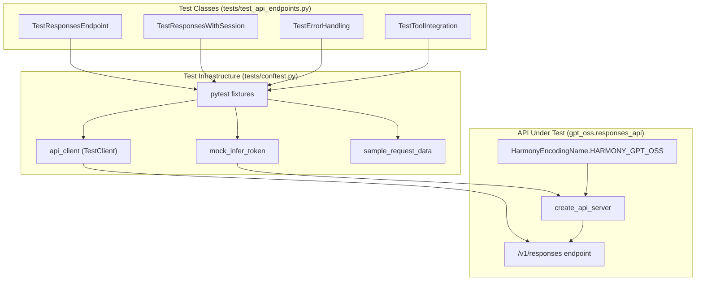
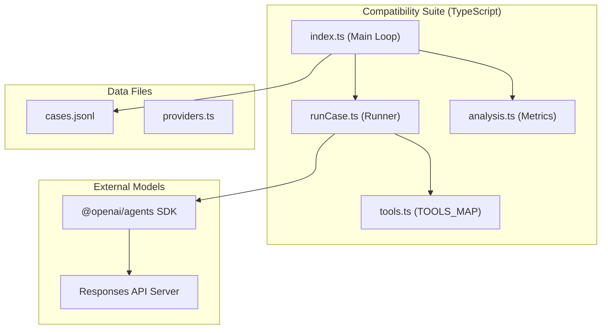

<!-- source: DeepWiki mcp.deepwiki.com · repo openai/gpt-oss · page 8.2 Testing · fetched 2026-10-26 -->

# Testing

Relevant source files

The following files were used as context for generating this wiki page:

- [.github/workflows/CI.yml](.github/workflows/CI.yml)
- [compatibility-test/README.md](compatibility-test/README.md)
- [compatibility-test/analysis.ts](compatibility-test/analysis.ts)
- [compatibility-test/cases.jsonl](compatibility-test/cases.jsonl)
- [compatibility-test/index.ts](compatibility-test/index.ts)
- [compatibility-test/providers.ts](compatibility-test/providers.ts)
- [compatibility-test/runCase.ts](compatibility-test/runCase.ts)
- [compatibility-test/tools.ts](compatibility-test/tools.ts)
- [gpt_oss/metal/test/f32-bf16w-matmul.cc](gpt_oss/metal/test/f32-bf16w-matmul.cc)
- [gpt_oss/metal/test/matmul-kernel-tester.hpp](gpt_oss/metal/test/matmul-kernel-tester.hpp)
- [tests/conftest.py](tests/conftest.py)
- [tests/test_api_endpoints.py](tests/test_api_endpoints.py)

The gpt-oss testing framework validates API endpoints, ensures compatibility across inference backends, and verifies the mathematical correctness of low-level Metal kernels. This includes unit tests for the Responses API server, comprehensive compatibility tests using the Agent SDK, and a C++/GTest suite for GPU acceleration kernels.

For evaluation of model performance on benchmarks, see [Evaluation Framework](#7). For build system testing, see [Build System](#8.1).

## API Endpoint Testing

The primary test suite validates the `/v1/responses` API endpoint using `pytest` and the FastAPI `TestClient`. Tests cover core functionality, error handling, tool integration, and session management.

### Test Structure

The test suite is organized into focused test classes in `tests/test_api_endpoints.py` that validate different aspects of the API:

- `TestResponsesEndpoint`: Basic response creation and configuration [tests/test_api_endpoints.py:10-72]().
- `TestResponsesWithSession`: Session management and conversation continuity [tests/test_api_endpoints.py:75-110]().
- `TestErrorHandling`: Input validation and error responses [tests/test_api_endpoints.py:112-138]().
- `TestToolIntegration`: Tool calling functionality and schema validation [tests/test_api_endpoints.py:140-176]().

Sources: [tests/test_api_endpoints.py:8-176](), [tests/conftest.py:17-118]()

### Core API Validation

The basic endpoint tests validate essential API functionality including response creation, reasoning effort levels, and parameter handling:

| Test Case | Purpose | Key Validation |
|-----------|---------|----------------|
| `test_basic_response_creation` | Standard response generation | Validates `id`, `object` type, and model echo [tests/test_api_endpoints.py:10-16](). |
| `test_response_with_high_reasoning` | High reasoning effort mode | Verifies `reasoning_effort="high"` results in `completed` status [tests/test_api_endpoints.py:18-24](). |
| `test_streaming_response` | Server-Sent Events (SSE) | Iterates lines to verify valid JSON data chunks [tests/test_api_endpoints.py:62-72](). |
| `test_response_with_session_id` | Conversation tracking | Verifies unique response IDs across same session [tests/test_api_endpoints.py:77-93](). |

Sources: [tests/test_api_endpoints.py:10-93]()

## Compatibility Testing

The compatibility test suite in the `compatibility-test/` directory uses TypeScript and the `@openai/agents` SDK to validate API shape and tool calling functionality across different providers.

### Test Execution Flow

The compatibility testing system processes test cases defined in `cases.jsonl` [compatibility-test/cases.jsonl:1-30]() in parallel using the `Listr2` task runner [compatibility-test/index.ts:159-174]().

1.  **Case Loading**: Parses `cases.jsonl` which contains prompts and expected tool arguments [compatibility-test/index.ts:76-82]().
2.  **Provider Configuration**: Uses `providers.ts` to point to local or remote endpoints [compatibility-test/providers.ts:1-15]().
3.  **Runner Execution**: `runCase.ts` uses `OpenAIResponsesModel` or `OpenAIChatCompletionsModel` to execute the agent [compatibility-test/runCase.ts:71-80]().
4.  **Analysis**: `analysis.ts` computes `pass@k` metrics (success in any of $k$ attempts) and `pass^k` (success in all $k$ attempts) [compatibility-test/analysis.ts:58-82]().

Sources: [compatibility-test/index.ts:21-196](), [compatibility-test/runCase.ts:39-141](), [compatibility-test/analysis.ts:1-99]()

## Metal Kernel Unit Tests

For the Apple Silicon backend, gpt-oss includes a C++ unit testing suite using `googletest` (GTest) to verify the accuracy of Metal compute shaders.

### MatMul Kernel Tester

The `MatMulKernelTester` class provides a harness for testing various matrix multiplication kernels (Decode, Prefill, MLP) against reference CPU implementations.

- **Precision Validation**: Uses `IsNearAbsRel` to check absolute and relative tolerances [gpt_oss/metal/test/matmul-kernel-tester.hpp:15-41]().
- **Random Initialization**: Fills input, weight, and bias buffers with random values using GPU fill kernels [gpt_oss/metal/test/matmul-kernel-tester.hpp:126-159]().
- **Kernel Variants**: Tests `DECODE_OPTIMIZED`, `PREFILL_QKV_OPTIMIZED`, `PREFILL_ATTN_OUTPUT_OPTIMIZED`, and `PREFILL_MLP_GATE_OPTIMIZED` [gpt_oss/metal/test/matmul-kernel-tester.hpp:103-108]().

### Example Test Cases

Tests in `gpt_oss/metal/test/f32-bf16w-matmul.cc` validate the `F32_BF16W_MATMUL` kernel across different shapes:

- `single_simdgroup_single_iteration`: Tests a minimal row with 128 columns (32 threads * 4) [gpt_oss/metal/test/f32-bf16w-matmul.cc:13-19]().
- `multiple_threadgroups`: Tests kernel scaling across multiple GPU threadgroups [gpt_oss/metal/test/f32-bf16w-matmul.cc:39-48]().
- `seq_len_1024`: Large scale prefill tests for QKV, Attention Output, and MLP Gate projections [gpt_oss/metal/test/f32-bf16w-matmul.cc:62-87]().

Sources: [gpt_oss/metal/test/matmul-kernel-tester.hpp:46-180](), [gpt_oss/metal/test/f32-bf16w-matmul.cc:1-87]()

## Continuous Integration (CI)

The project uses GitHub Actions to automate building and publishing. The CI workflow (`.github/workflows/CI.yml`) triggers on releases or tags [github/workflows/CI.yml:3-9]().

- **Build Tooling**: Uses `uv` for package management and building [github/workflows/CI.yml:42-50]().
- **Trusted Publishing**: Publishes to PyPI using OIDC exchange [github/workflows/CI.yml:56-61]().

Sources: [.github/workflows/CI.yml:1-61]()

---

