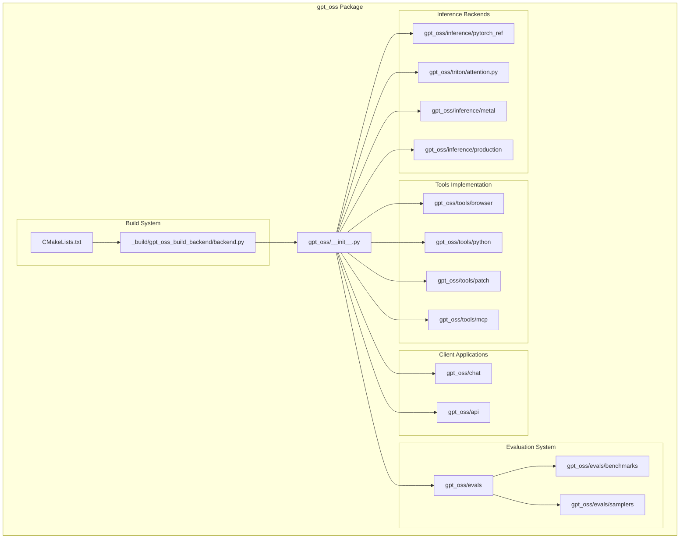
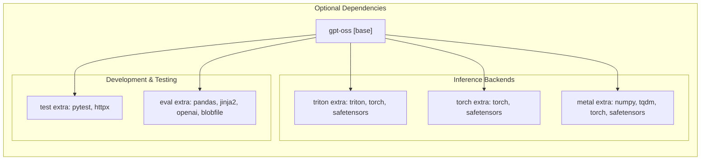
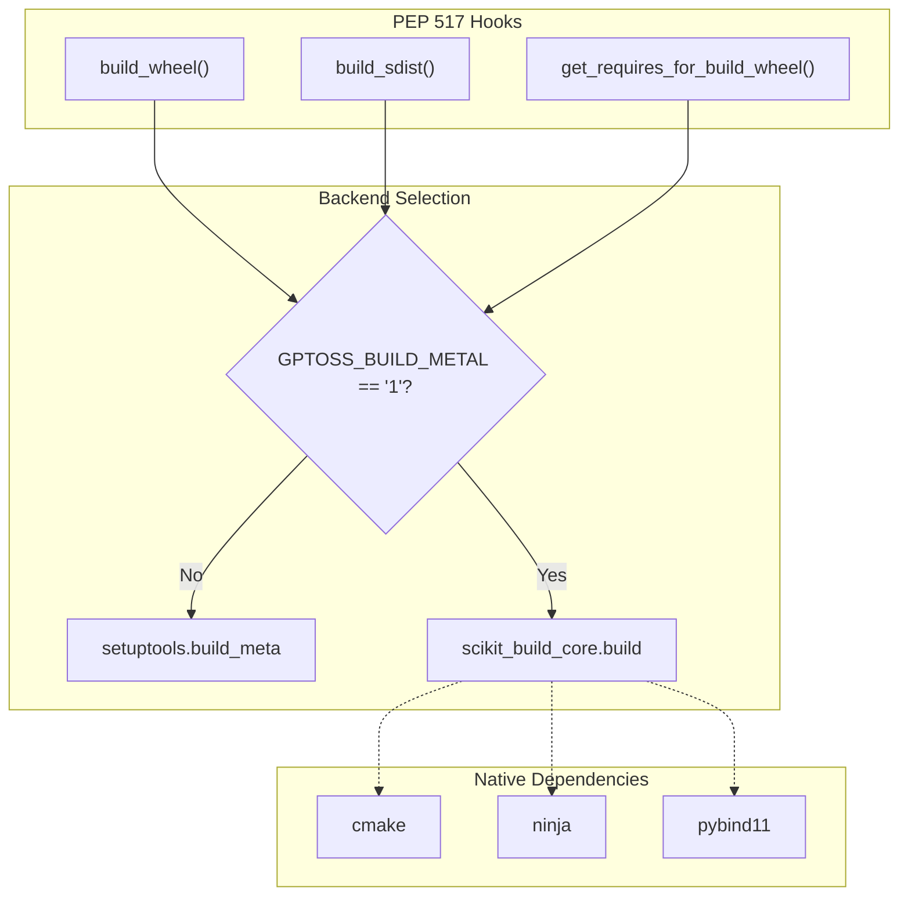
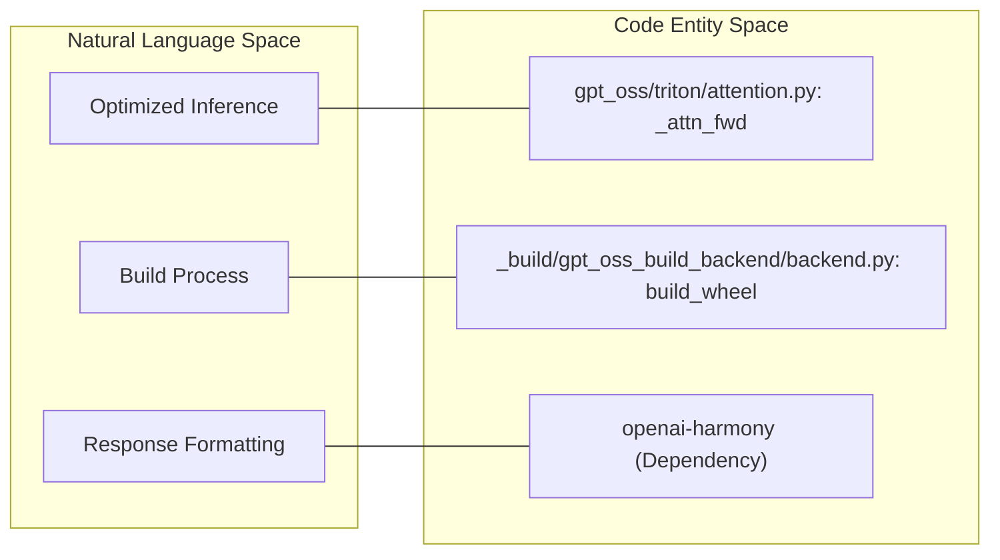

<!-- source: DeepWiki mcp.deepwiki.com · repo openai/gpt-oss · page 8.3 Package Structure · fetched 2026-10-26 -->

# Package Structure

Relevant source files

The following files were used as context for generating this wiki page:

- [MANIFEST.in](MANIFEST.in)
- [_build/gpt_oss_build_backend/__init__.py](_build/gpt_oss_build_backend/__init__.py)
- [_build/gpt_oss_build_backend/backend.py](_build/gpt_oss_build_backend/backend.py)
- [gpt_oss/triton/attention.py](gpt_oss/triton/attention.py)
- [pyproject.toml](pyproject.toml)

This document describes the organization of the gpt-oss codebase, including its module structure, dependency management, and build system architecture. It covers how the various components are packaged and distributed, and how they integrate with external dependencies.

For information about the build process and compilation, see [Build System](#8.1). For testing infrastructure, see [Testing](#8.2).

## Project Organization

The gpt-oss repository follows a structured layout that separates core functionality, inference backends, tools, client applications, and evaluation systems into distinct modules. The package is defined as `gpt-oss` with a versioned release cycle [pyproject.toml:2-24]().

### High-Level Package Layout

**Sources:** [pyproject.toml:37-48](), [gpt_oss/triton/attention.py:1-16](), [_build/gpt_oss_build_backend/backend.py:1-30]()

## Dependency Architecture

The package uses a tiered dependency system with core dependencies required for basic functionality and optional dependency groups for specific hardware or use cases.

### Core Dependencies

The base installation includes essential libraries for model operations, networking, and API functionality [pyproject.toml:5-21]():

| Dependency | Version | Purpose |
|------------|---------|---------|
| `openai-harmony` | Latest | Response format library (see [Harmony Response Format](#5.1)) |
| `tiktoken` | >=0.9.0 | Tokenization for model inputs |
| `aiohttp` | >=3.12.14 | Async HTTP client for API calls |
| `fastapi` | >=0.116.1 | Web API framework for the Responses server |
| `pydantic` | >=2.11.7 | Data validation and serialization |
| `docker` | >=7.1.0 | Container management for the Python execution tool |
| `chz` | >=0.3.0 | Configuration management |
| `jupyter-client` | >=8.6.3 | Support for local Jupyter-based code execution |

**Sources:** [pyproject.toml:5-21]()

### Optional Dependency Groups

To minimize the footprint on different environments, specialized requirements are gated behind optional extras [pyproject.toml:26-31]().

**Sources:** [pyproject.toml:26-31]()

## Build System Architecture

The project uses a custom PEP 517 build backend located in `_build/gpt_oss_build_backend/backend.py` [_build/gpt_oss_build_backend/backend.py:1-12](). This backend supports two distinct modes:

1.  **Default Mode**: Delegates to `setuptools.build_meta` to produce a pure Python wheel for distribution [_build/gpt_oss_build_backend/backend.py:43-46]().
2.  **Metal Mode**: Triggered by the `GPTOSS_BUILD_METAL` environment variable. It delegates to `scikit_build_core` to compile native C++/Metal extensions [_build/gpt_oss_build_backend/backend.py:49-54]().

### Build Backend Logic

**Sources:** [_build/gpt_oss_build_backend/backend.py:39-54](), [_build/gpt_oss_build_backend/backend.py:100-112](), [pyproject.toml:33-36]()

## Module Integration Points

The package structure facilitates loose coupling between components through well-defined interfaces.

### Cross-Module Data Flow

| Component | Code Entity | Interaction Pattern |
|-----------|-------------|---------------------|
| **Triton Attention** | `gpt_oss.triton.attention.attention` | Implements `torch.autograd.Function` for optimized forward passes using Triton kernels [gpt_oss/triton/attention.py:104-162](). |
| **Build Configuration** | `tool.scikit-build` | Directs CMake to the root `CMakeLists.txt` and enables `GPTOSS_BUILD_PYTHON` for native bindings [pyproject.toml:41-47](). |
| **Package Discovery** | `tool.setuptools.packages.find` | Automatically includes the `gpt_oss` namespace and its submodules [pyproject.toml:38-39](). |

### Reference to Natural Language Space

The following diagram maps high-level system concepts to their specific code implementations within the package structure.

**Sources:** [gpt_oss/triton/attention.py:18-101](), [_build/gpt_oss_build_backend/backend.py:59-64](), [pyproject.toml:6]()

This modular structure allows developers to install only the components they need while maintaining compatibility across the entire ecosystem. The use of an in-tree build backend ensures that specialized hardware support (like Apple Metal) can be built locally without cluttering the standard Python distribution [MANIFEST.in:1]().

---

