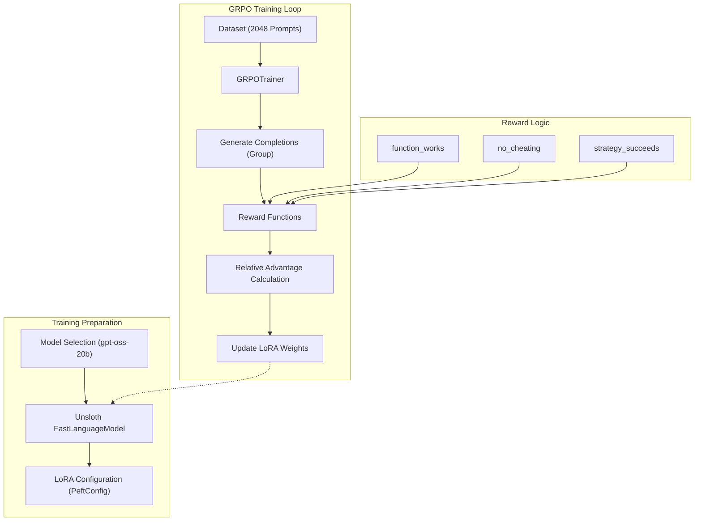
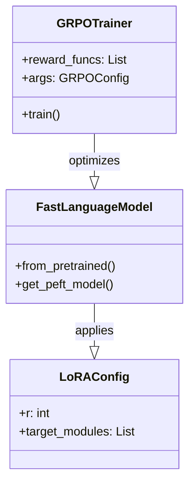

<!-- source: DeepWiki mcp.deepwiki.com · repo openai/gpt-oss · page 8.4 Reinforcement Fine-Tuning · fetched 2026-10-26 -->

# Reinforcement Fine-Tuning

Relevant source files

The following files were used as context for generating this wiki page:

- [awesome-gpt-oss.md](awesome-gpt-oss.md)
- [examples/reinforcement-fine-tuning.ipynb](examples/reinforcement-fine-tuning.ipynb)

This page provides a technical guide for performing Reinforcement Learning (RL) on `gpt-oss` models, specifically utilizing the Group Relative Policy Optimization (GRPO) algorithm. The implementation leverages the Unsloth library for memory-efficient training and the `GRPOTrainer` from Hugging Face's TRL (Transformer Reinforcement Learning) library.

## Overview of the RL Pipeline

The reinforcement fine-tuning pipeline for `gpt-oss` is designed to optimize models for complex, multi-step reasoning tasks or strategic environments. A primary sandbox used for this is the **2048 game**, where the model must output valid moves to reach a specific score [examples/reinforcement-fine-tuning.ipynb:19-25]().

### Core Components
*   **Unsloth**: Provides 4-bit quantization and embedding offloading to enable RL on consumer-grade hardware (e.g., Tesla T4) [examples/reinforcement-fine-tuning.ipynb:34-35]().
*   **GRPO (Group Relative Policy Optimization)**: An RL algorithm that calculates rewards relative to a group of completions, removing the need for a separate critic model and significantly reducing VRAM overhead.
*   **Reward Functions**: Deterministic Python functions that evaluate model outputs based on syntax, logic, and success criteria.

## Implementation Architecture

The following diagram illustrates the flow from the high-level RL objectives to the specific code entities involved in the Unsloth-based fine-tuning process.

### RL Data Flow and Training Loop
"Natural Language Space" meets "Code Entity Space" in the trainer's evaluation loop.

Sources: [examples/reinforcement-fine-tuning.ipynb:21-25](), [examples/reinforcement-fine-tuning.ipynb:34-35]()

## Reward Function Design

Reward functions are the heart of reinforcement fine-tuning. For the 2048 game environment, three specific metrics are used to guide the model's behavior [examples/reinforcement-fine-tuning.ipynb:21-23]():

1.  **`function_works`**: Checks if the model's output follows the required format (e.g., valid JSON or specific tool-call syntax).
2.  **`no_cheating`**: Ensures the model does not attempt to manipulate the game state directly (e.g., manually setting a tile to 2048) but instead uses valid move commands.
3.  **`strategy_succeeds`**: The primary objective reward, granted when the model makes moves that increase the board score or achieve the target tile.

## Hardware Configurations

The fine-tuning process is highly sensitive to available VRAM. The repository provides two primary configuration profiles [examples/reinforcement-fine-tuning.ipynb:61-66]().

| Feature | T4 (16GB VRAM) | H100 (80GB VRAM) |
| :--- | :--- | :--- |
| **Quantization** | `load_in_4bit = True` | `load_in_16bit = True` |
| **Max Seq Length** | 768 | 2048+ |
| **LoRA Rank** | 4 (Low) | 32+ (High) |
| **Embedding** | `offload_embedding = True` | `offload_embedding = False` |
| **Speed** | Moderate | High |

Sources: [examples/reinforcement-fine-tuning.ipynb:61-66]()

## Integration with Unsloth and GRPOTrainer

The fine-tuning script initializes the model using `FastLanguageModel` from Unsloth to apply optimizations like 4-bit quantization, which reduces memory usage by approximately 75% [examples/reinforcement-fine-tuning.ipynb:61-66]().

### Configuration Mapping
The following diagram maps the training parameters to the underlying implementation classes.

Sources: [examples/reinforcement-fine-tuning.ipynb:50-56](), [examples/reinforcement-fine-tuning.ipynb:61-66]()

## 2048 Game Sandbox

The 2048 environment serves as a "RL Sandbox" where the model acts as the agent. The environment is stateless from the model's perspective; the current board state is provided in the prompt, and the model must output a direction (`UP`, `DOWN`, `LEFT`, `RIGHT`).

*   **Prompting**: The board is represented as a text-based grid.
*   **Action Space**: The model outputs tokens corresponding to moves.
*   **State Transition**: The training script handles the game logic, updating the board based on the model's predicted move and feeding the new state back into the next iteration of the sequence [examples/reinforcement-fine-tuning.ipynb:19-23]().

Sources: [examples/reinforcement-fine-tuning.ipynb:19-25](), [awesome-gpt-oss.md:93-95]()

---

