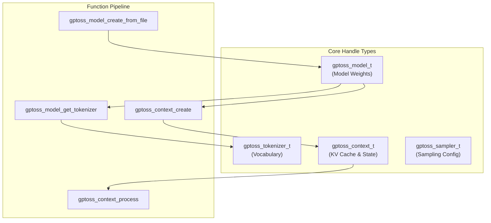
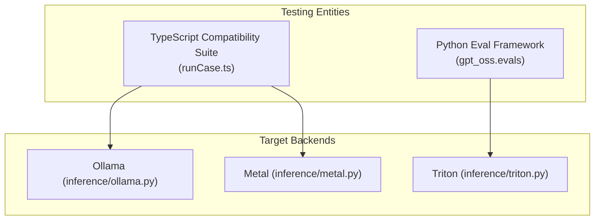

<!-- source: DeepWiki mcp.deepwiki.com · repo openai/gpt-oss · page 9 Reference · fetched 2026-10-26 -->

# Reference

Relevant source files

The following files were used as context for generating this wiki page:

- [LICENSE](LICENSE)
- [USAGE_POLICY](USAGE_POLICY)
- [gpt_oss/metal/include/gpt-oss/functions.h](gpt_oss/metal/include/gpt-oss/functions.h)
- [gpt_oss/metal/python/model.c](gpt_oss/metal/python/model.c)

This page provides technical reference documentation and API specifications for the gpt-oss system. It serves as a high-level entry point for developers needing precise details on the C API, system compatibility, and legal requirements.

## C API Reference

The gpt-oss Metal backend provides a low-level C API for direct model operations, tokenization, and inference on Apple Silicon. This interface is defined in the project's header files and implemented via the Metal C stack.

### API Architecture

The C API is organized around opaque handle types that manage the complete inference pipeline:

### Key Functions
- **Model Management**: `gptoss_model_create_from_file` [gpt_oss/metal/include/gpt-oss/functions.h:22-24]() and `gptoss_model_release` [gpt_oss/metal/include/gpt-oss/functions.h:69-70]().
- **Tokenizer**: `gptoss_tokenizer_decode` [gpt_oss/metal/include/gpt-oss/functions.h:139-143]() and `gptoss_tokenizer_get_special_token_id` [gpt_oss/metal/include/gpt-oss/functions.h:82-85]().
- **Inference**: `gptoss_context_process` [gpt_oss/metal/include/gpt-oss/functions.h:294-295]() and `gptoss_context_sample` [gpt_oss/metal/include/gpt-oss/functions.h:303-307]().

For the complete function list, status codes, and parameter definitions, see the [C API Reference](#9.1).

**Sources**: [gpt_oss/metal/include/gpt-oss/functions.h:1-163](), [gpt_oss/metal/python/model.c:8-21]()

## Compatibility Testing

The system includes a TypeScript-based compatibility suite and Python evaluation framework to ensure consistent behavior across different hardware and software backends.

### Testing Stack

### Components
- **TypeScript Suite**: Validates tool calling and API compliance using `cases.jsonl` and `providers.ts`.
- **Evaluation Framework**: Implements benchmarks like HealthBench and GPQA Diamond to measure model performance.
- **Backend Adapters**: Ensures that diverse backends (e.g., Ollama, Triton) adhere to the same inference interface.

For details on running tests and adding new providers, see [Compatibility Testing](#9.2).

**Sources**: [gpt_oss/responses_api/inference/ollama.py:1-193]()

## License and Usage Policy

The gpt-oss project is governed by a dual-layered legal framework covering the source code and the model weights.

### Apache License 2.0
The codebase is released under the Apache License 2.0. This allows for:
- **Commercial use** and modification.
- **Distribution** of derivative works.
- **Patent grants** from contributors.

### Usage Policy
The use of `gpt-oss-120b` and `gpt-oss-20b` weights requires adherence to the `USAGE_POLICY`, which emphasizes:
- **Legal Compliance**: Users must comply with all applicable laws.
- **Safety**: Responsible deployment of model capabilities.

For the full text of these documents, see [License and Usage Policy](#9.3).

**Sources**: [LICENSE:1-201](), [USAGE_POLICY:1-1]()

---

