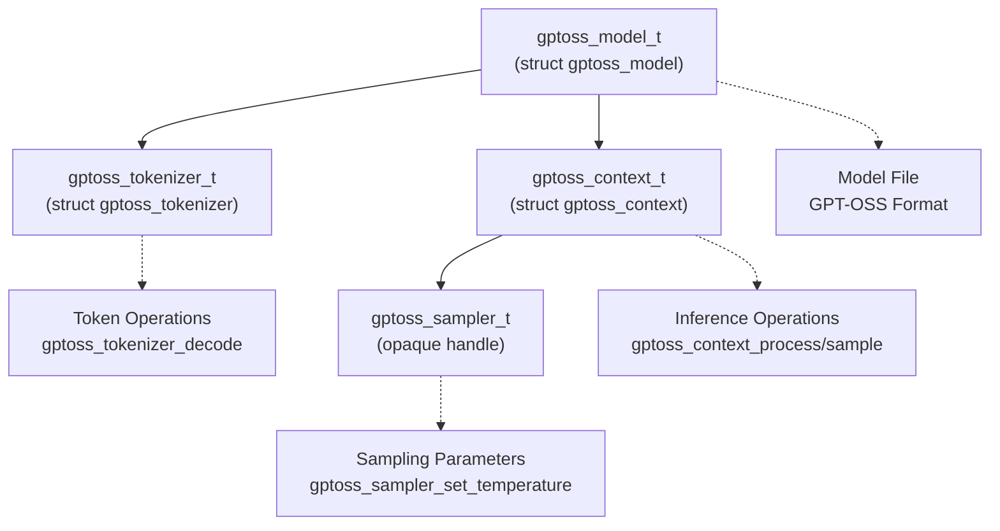
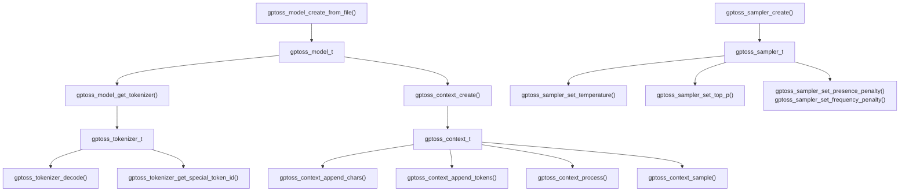
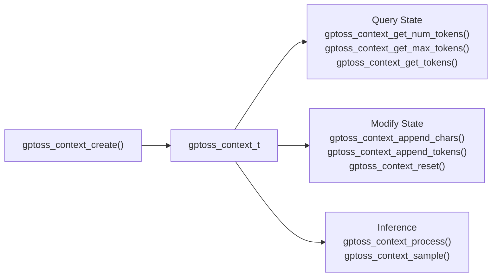
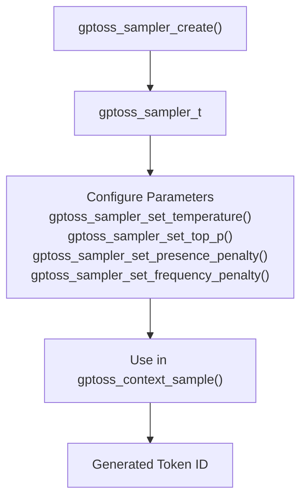
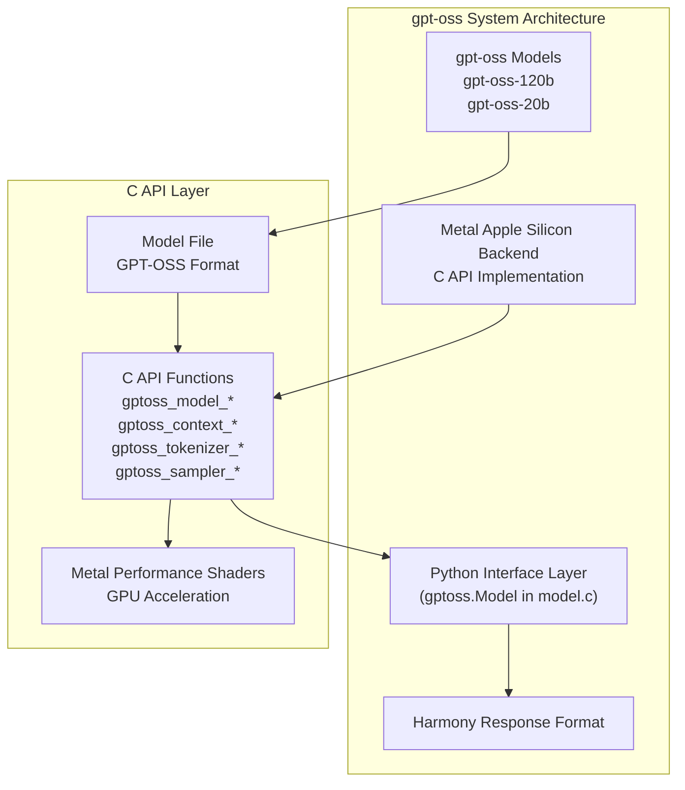

<!-- source: DeepWiki mcp.deepwiki.com · repo openai/gpt-oss · page 9.1 C API Reference · fetched 2026-10-26 -->

# C API Reference

Relevant source files

The following files were used as context for generating this wiki page:

- [gpt_oss/metal/include/gpt-oss/functions.h](gpt_oss/metal/include/gpt-oss/functions.h)
- [gpt_oss/metal/python/model.c](gpt_oss/metal/python/model.c)
- [gpt_oss/metal/source/include/internal/model.h](gpt_oss/metal/source/include/internal/model.h)

This document provides a complete reference for the low-level Metal C API used for model and tokenizer operations in gpt-oss. The C API provides direct access to model inference capabilities optimized for Apple Silicon hardware using Metal Performance Shaders.

For information about production inference backends, see [Production Backends](#4.4). For details about the broader tool ecosystem, see [Tools and Capabilities](#5).

## Overview

The gpt-oss C API provides a low-level interface for running language models on Apple Silicon hardware through Metal. The API is organized around four core object types with reference counting for memory management and comprehensive error handling through status codes.

**Core Object Hierarchy**

**API Function Categories**

| Category | Functions | Purpose |
|----------|-----------|---------|
| Model Management | `gptoss_model_create_from_file`, `gptoss_model_retain`, `gptoss_model_release` | Load and manage model instances |
| Tokenizer Operations | `gptoss_tokenizer_get_special_token_id`, `gptoss_tokenizer_decode` | Token vocabulary access |
| Context Management | `gptoss_context_create`, `gptoss_context_append_chars`, `gptoss_context_process` | Inference state management |
| Sampling Control | `gptoss_sampler_create`, `gptoss_sampler_set_temperature` | Configure generation parameters |

Sources: [gpt_oss/metal/include/gpt-oss/functions.h:1-398](), [gpt_oss/metal/source/include/internal/model.h:13-178]()

## Object Lifecycle and Dependencies

The C API follows a strict object lifecycle with reference counting. Objects must be created, used, and properly released to avoid memory leaks. In the Python bindings, this is managed by the `tp_init` and `tp_dealloc` functions of the respective types [gpt_oss/metal/python/model.c:8-27]().

**Object Creation and Dependency Flow**

**Reference Counting Pattern**

All objects follow the same reference counting pattern, using `atomic_uint_least64_t ref_count` internally [gpt_oss/metal/source/include/internal/model.h:15-37]():
- `*_create` functions return objects with reference count of 1.
- `*_retain` functions increment reference count.
- `*_release` functions decrement reference count and free when it reaches 0.

Sources: [gpt_oss/metal/include/gpt-oss/functions.h:53-71](), [gpt_oss/metal/include/gpt-oss/functions.h:146-163](), [gpt_oss/metal/include/gpt-oss/functions.h:296-313](), [gpt_oss/metal/include/gpt-oss/functions.h:376-393](), [gpt_oss/metal/source/include/internal/model.h:15-139]()

## Model Operations

The `gptoss_model_t` object represents a loaded language model and serves as the root object for all inference operations. Internally, it contains Metal objects like `gptoss_metal_command_queue` and various `gptoss_metal_function` handles for GPU kernels [gpt_oss/metal/source/include/internal/model.h:70-95]().

### Model Creation and Properties

| Function | Purpose | Key Parameters |
|----------|---------|----------------|
| `gptoss_model_create_from_file` | Load model from filesystem | `path`: Model file path `model_out`: Created model instance |
| `gptoss_model_get_tokenizer` | Access model's tokenizer | `model`: Model instance `tokenizer_out`: Tokenizer reference |
| `gptoss_model_get_max_context_length` | Query maximum context size | `model`: Model instance `max_context_length_out`: Maximum tokens |

### Error Handling

All functions return `enum gptoss_status` with these possible values:
- `gptoss_status_success`: Operation completed successfully.
- Error codes for various failure conditions (memory, file access, invalid parameters).

Sources: [gpt_oss/metal/include/gpt-oss/functions.h:14-50](), [gpt_oss/metal/source/include/internal/model.h:32-130]()

## Tokenizer Operations

The `gptoss_tokenizer_t` provides access to the model's vocabulary and token encoding/decoding capabilities. It maps the `tokens_ptr` and `regex_ptr` from the model file into memory [gpt_oss/metal/source/include/internal/model.h:20-25]().

### Vocabulary Access

| Function | Purpose | Returns |
|----------|---------|---------|
| `gptoss_tokenizer_get_num_text_tokens` | Count of text tokens in vocabulary | `num_text_tokens` [gpt_oss/metal/source/include/internal/model.h:26]() |
| `gptoss_tokenizer_get_num_special_tokens` | Count of special tokens | `num_special_tokens` [gpt_oss/metal/source/include/internal/model.h:27]() |
| `gptoss_tokenizer_get_num_tokens` | Total vocabulary size | Total number of tokens |

### Token Operations

| Function | Purpose | Parameters |
|----------|---------|------------|
| `gptoss_tokenizer_get_special_token_id` | Get ID for special tokens | `token_type`: Special token enum `token_id_out`: Resulting token ID |
| `gptoss_tokenizer_decode` | Convert token ID to bytes | `token_id`: Token to decode `token_ptr_out`: Byte representation `token_size_out`: Size in bytes |

Sources: [gpt_oss/metal/include/gpt-oss/functions.h:72-163](), [gpt_oss/metal/source/include/internal/model.h:13-30]()

## Context Management

The `gptoss_context_t` object maintains the inference state including cached tokens and attention state (KV cache). It allocates several `gptoss_metal_buffer` objects for activations such as `residual_activation_buffer`, `qkv_activation_buffer`, and `kvcache_buffer` [gpt_oss/metal/source/include/internal/model.h:158-177]().

### Context Lifecycle

### Context Functions

| Category | Functions | Purpose |
|----------|-----------|---------|
| Creation | `gptoss_context_create` | Create context with specified capacity |
| State Query | `gptoss_context_get_num_tokens`, `gptoss_context_get_max_tokens`, `gptoss_context_get_tokens` | Inspect current context state |
| Content Addition | `gptoss_context_append_chars`, `gptoss_context_append_tokens` | Add text or tokens to context |
| Inference | `gptoss_context_process`, `gptoss_context_sample` | Process context and generate tokens |
| Lifecycle | `gptoss_context_reset`, `gptoss_context_retain`, `gptoss_context_release` | Manage context lifecycle |

Sources: [gpt_oss/metal/include/gpt-oss/functions.h:165-313](), [gpt_oss/metal/source/include/internal/model.h:134-178]()

## Sampling Configuration

The `gptoss_sampler_t` object controls the parameters used for token generation from the model's probability distributions.

### Sampling Parameters

| Parameter | Function | Range | Effect |
|-----------|----------|-------|--------|
| Temperature | `gptoss_sampler_set_temperature` | [0.0, 1.0] | Controls randomness in sampling |
| Top-P | `gptoss_sampler_set_top_p` | (0.0, 1.0] | Nucleus sampling threshold |
| Presence Penalty | `gptoss_sampler_set_presence_penalty` | [-2.0, 2.0] | Reduces repetition of any tokens |
| Frequency Penalty | `gptoss_sampler_set_frequency_penalty` | [-2.0, 2.0] | Reduces repetition based on frequency |

### Typical Sampling Workflow

Sources: [gpt_oss/metal/include/gpt-oss/functions.h:315-393]()

## Integration with gpt-oss System

The C API serves as the foundation for the Metal Apple Silicon backend. It provides the low-level primitives that higher-level Python interfaces build upon, such as the `gptoss.Model` and `gptoss.Tokenizer` types defined in `gpt_oss/metal/python/model.c` [gpt_oss/metal/python/model.c:81-94]().

**System Integration Points**

The C API enables direct model execution on Apple Silicon hardware. The Python bindings initialize the C model using `gptoss_model_create_from_file` during object instantiation [gpt_oss/metal/python/model.c:15]().

Sources: [gpt_oss/metal/include/gpt-oss/functions.h:1-398](), [gpt_oss/metal/python/model.c:8-94]()

---

