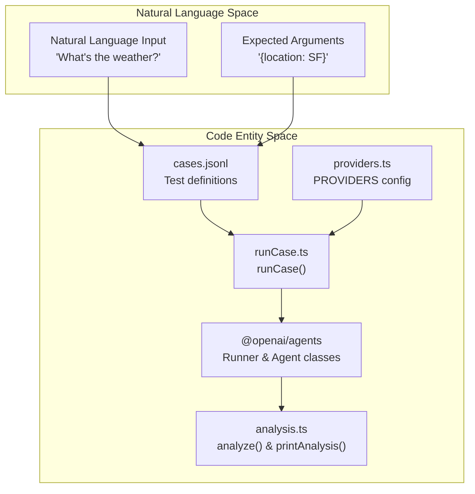
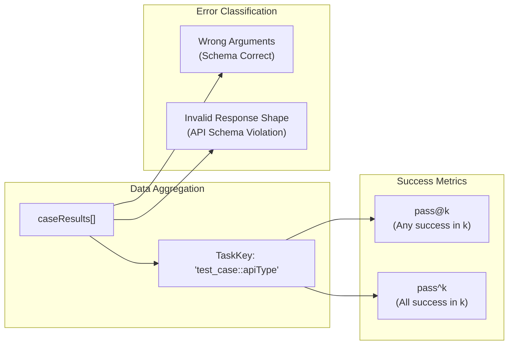

<!-- source: DeepWiki mcp.deepwiki.com · repo openai/gpt-oss · page 9.2 Compatibility Testing · fetched 2026-10-26 -->

# Compatibility Testing

<details>
<summary>Relevant source files</summary>

The following files were used as context for generating this wiki page:

- [compatibility-test/README.md](compatibility-test/README.md)
- [compatibility-test/analysis.ts](compatibility-test/analysis.ts)
- [compatibility-test/cases.jsonl](compatibility-test/cases.jsonl)
- [compatibility-test/index.ts](compatibility-test/index.ts)
- [compatibility-test/providers.ts](compatibility-test/providers.ts)
- [compatibility-test/runCase.ts](compatibility-test/runCase.ts)
- [compatibility-test/tools.ts](compatibility-test/tools.ts)

</details>


This document covers the automated compatibility testing system that validates tool calling functionality and API response formats across different models and backends. The system ensures that models can correctly interpret natural language requests and invoke tools with proper arguments, while maintaining compatibility with both the Responses API and Chat Completions API formats.

For information about the broader evaluation framework, see [Evaluation Framework](#7). For details about the underlying tool implementations being tested, see [Tools and Capabilities](#5).

## Overview

The compatibility testing system validates two critical aspects of model behavior:

1.  **Tool Calling Accuracy**: Whether models can correctly identify which tool to call and provide proper arguments based on natural language input.
2.  **API Format Compliance**: Whether responses conform to expected API schemas for both `/v1/responses` and Chat Completions endpoints.

The system is built using the TypeScript Agents SDK and the OpenAI client to verify the shape of API calls and execution logic [compatibility-test/README.md:1-4]().

## Test Architecture

The following diagram bridges the Natural Language test requirements to the specific TypeScript entities responsible for execution and validation.



Sources: [compatibility-test/runCase.ts:39-47](), [compatibility-test/providers.ts:1-15](), [compatibility-test/analysis.ts:1-8]()

## Provider and Tool Configuration

Testing requires defining a provider in `providers.ts`. This configuration determines the base URL, API key, and which API types (`responses`, `chat`, or both) to validate [compatibility-test/providers.ts:1-15]().

The `tools.ts` file defines the mock tools used during testing. Each tool is wrapped using the `tool()` function from the Agents SDK, which includes the tool's schema and a mock execution function [compatibility-test/tools.ts:3-13]().

### Available Mock Tools
| Tool Name | Purpose | Parameters |
|-----------|---------|------------|
| `get_weather` | Weather lookup | `location` [compatibility-test/tools.ts:18-32]() |
| `get_system_health` | Runtime health check | None [compatibility-test/tools.ts:35-40]() |
| `markdown_to_html` | Format conversion | `markdown` [compatibility-test/tools.ts:43-55]() |
| `detect_language` | ISO code identification | `text` [compatibility-test/tools.ts:58-73]() |
| `generate_chart` | PNG chart creation | `data`, `chart_type`, `title` [compatibility-test/tools.ts:76-112]() |
| `query_database` | SQL analytics lookup | `table`, `columns`, `limit` [compatibility-test/tools.ts:115-150]() |

## Execution Logic

The test runner utilizes `runCase.ts` to execute the following pipeline for every configured `apiType`:

1.  **Initialization**: Creates an `Agent` with the specific tool required by the case and an `OpenAI` client pointing to the provider [compatibility-test/runCase.ts:57-66]().
2.  **Runner Selection**: Instantiates either an `OpenAIResponsesModel` or `OpenAIChatCompletionsModel` based on the configuration [compatibility-test/runCase.ts:71-79]().
3.  **Execution**: Calls `runner.run()`. If `streaming` is enabled, it iterates through the `StreamedRunResult` to collect raw model events [compatibility-test/runCase.ts:84-104]().
4.  **Validation**:
    *   `testToolCall`: Uses `Ajv` to validate that the tool arguments match the tool's JSON schema [compatibility-test/runCase.ts:155-159]().
    *   `testEvents`: Validates the presence of reasoning deltas and specific event types (e.g., `response.reasoning_text.delta`) for streaming responses [compatibility-test/runCase.ts:193-232]().
    *   `testOutputData`: Validates the structural integrity of the final response object [compatibility-test/runCase.ts:109-113]().

Sources: [compatibility-test/runCase.ts:39-141]()

## Result Analysis

The `analysis.ts` module aggregates individual `RunCaseSummary` objects into statistical reports.



### Metrics Definition
*   **pass@k**: The fraction of tasks where at least one of the first `k` attempts succeeded [compatibility-test/analysis.ts:78]().
*   **pass^k**: The fraction of tasks where *all* of the first `k` attempts succeeded [compatibility-test/analysis.ts:79]().
*   **Wrong-input tool calls**: Occurs when the model calls the correct tool with a valid schema, but the specific arguments do not match the `expected_arguments` in `cases.jsonl` [compatibility-test/analysis.ts:39-45]().

Sources: [compatibility-test/analysis.ts:1-99]()

## Usage Guide

### Running Tests
To run the suite, use the `npm start` command with the desired provider and iteration count:

```bash
# Run a single test case to verify connectivity
npm start -- --provider vllm -n 1 -k 1

# Run the full suite with 5 attempts per case for consistency analysis
npm start -- --provider vllm -k 5
```
Sources: [compatibility-test/README.md:12-23]()

### CLI Arguments
| Argument | Short | Default | Description |
|----------|-------|---------|-------------|
| `--cases` | `-c` | `cases.jsonl` | Path to the test cases file [compatibility-test/index.ts:24]() |
| `--provider` | `-p` | `openai` | Provider key from `providers.ts` [compatibility-test/index.ts:25]() |
| `--streaming` | `-s` | `false` | Enable streaming mode [compatibility-test/index.ts:26]() |
| `--tries` | `-k` | `1` | Number of attempts per case [compatibility-test/index.ts:30]() |
| `--n` | `-n` | `all` | Limit the number of cases to run [compatibility-test/index.ts:28]() |

### Output Files
The system generates two files per run:
1.  `rollout_[provider]_[timestamp].jsonl`: Raw logs of every attempt and response [compatibility-test/index.ts:58-59]().
2.  `analysis_[provider]_[timestamp].json`: Calculated metrics including pass@k and error distributions [compatibility-test/index.ts:60-63]().

Sources: [compatibility-test/index.ts:21-63]()

---

