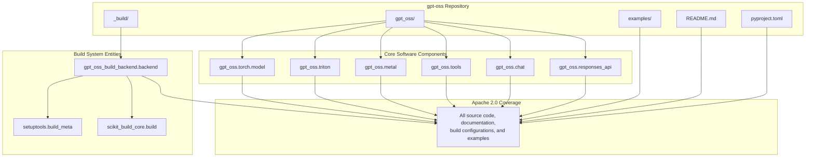
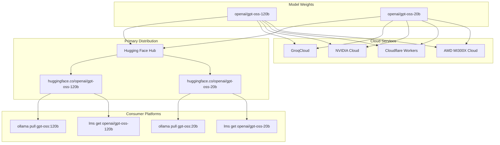
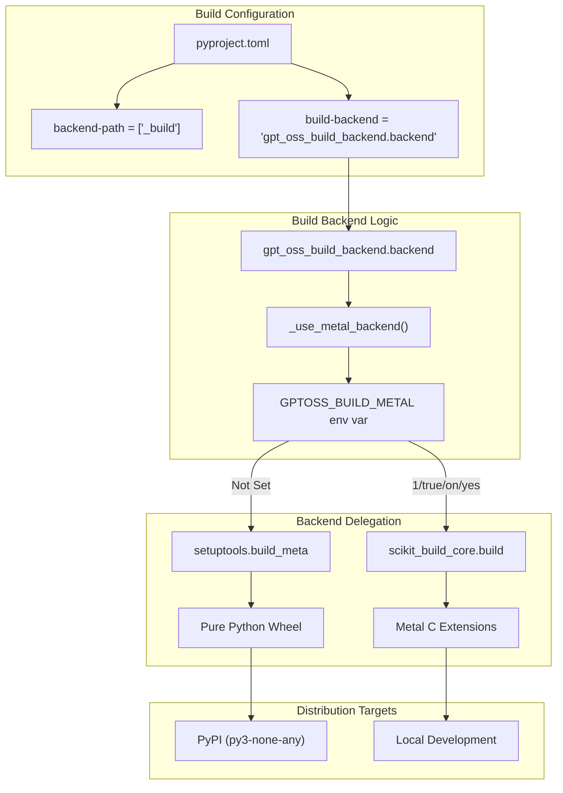

<!-- source: DeepWiki mcp.deepwiki.com · repo openai/gpt-oss · page 9.3 License and Usage Policy · fetched 2026-10-26 -->

# License and Usage Policy

Relevant source files

The following files were used as context for generating this wiki page:

- [LICENSE](LICENSE)
- [USAGE_POLICY](USAGE_POLICY)

This document covers the licensing framework for the gpt-oss repository, including the Apache 2.0 license for all software components and the distribution model for the model weights. It also outlines the usage policies governing the acceptable application of the gpt-oss-120b and gpt-oss-20b models.

## Software License

The gpt-oss codebase is released under the Apache License, Version 2.0, providing broad permissions for commercial and non-commercial use. This is a permissive license that allows users to build freely without copyleft restrictions or patent risk, making it suitable for experimentation, customization, and commercial deployment.

### License Permissions

The Apache 2.0 license grants comprehensive permissions for the software components:

| Permission | Description |
|------------|-------------|
| **Commercial Use** | Use in commercial products and services without restriction |
| **Modification** | Modify source code and create derivative works [LICENSE:41-47]() |
| **Distribution** | Distribute original or modified versions in source or binary form [LICENSE:90-93]() |
| **Private Use** | Use privately without obligation to disclose modifications |
| **Patent Protection** | Contributors provide patent license for their contributions [LICENSE:74-82]() |

### Repository Components Under License

The following diagram maps the repository structure to the code entities covered under the Apache 2.0 license.

#### Repository Structure and Licensed Components

**Sources:** [LICENSE:1-129](), [_build/gpt_oss_build_backend/backend.py:1-30]()

## Usage Policy

By using the OpenAI gpt-oss-120b and gpt-oss-20b models, users agree to comply with all applicable laws and the specific guidelines outlined in the usage policy. The goal is to ensure tools are used safely, responsibly, and democratically [USAGE_POLICY:1-3]().

### Acceptable Use Guidelines

The policy emphasizes maximizing user control while maintaining safety standards. Key pillars include:
- **Legal Compliance**: Mandatory adherence to all applicable laws [USAGE_POLICY:2]().
- **Safety**: Prevention of harmful use cases.
- **Responsibility**: Ethical application of the models in production environments.

**Sources:** [USAGE_POLICY:1-3]()

## Model Weights and Distribution

The gpt-oss model weights are distributed as "open-weight models" and are available through multiple channels for different deployment scenarios.

### Model Variants

Two model variants are available with different resource requirements:

| Model | Parameters | Active Parameters | Target Hardware | Memory Requirement |
|-------|------------|------------------|-----------------|-------------------|
| `gpt-oss-120b` | 117B total | 5.1B active | Single 80GB GPU (H100, MI300X) | Production use cases |
| `gpt-oss-20b` | 21B total | 3.6B active | 16GB memory | Local/specialized use cases |

### Distribution Channels and Integration

The weights are accessible via the Hugging Face Hub and integrated into various local and cloud platforms.

#### Model Distribution Architecture

**Sources:** [USAGE_POLICY:2](), [LICENSE:67-72]()

## Build System and Distribution

The gpt-oss repository uses a custom PEP 517 build backend, defined in `gpt_oss_build_backend.backend`, that supports different build modes depending on the target environment.

### Build Backend Architecture

The build system dynamically selects between `setuptools` and `scikit-build-core` based on the environment configuration.

#### Build System Components

### Build Modes

The build system supports two distinct modes:

| Mode | Environment Variable | Backend | Output | Use Case |
|------|---------------------|---------|--------|----------|
| **Pure Wheel** | `GPTOSS_BUILD_METAL` unset | `setuptools.build_meta` | `py3-none-any` wheel | PyPI distribution |
| **Metal Build** | `GPTOSS_BUILD_METAL=1` | `scikit_build_core.build` | Platform-specific wheel | Local Metal development |

**Sources:** [_build/gpt_oss_build_backend/backend.py:1-30](), [_build/gpt_oss_build_backend/backend.py:103-112]()

## Compliance Requirements

### Legal Obligations

Users of gpt-oss must comply with:
1. **Apache 2.0 License Terms**: Including attribution requirements [LICENSE:95-122]().
2. **Usage Policy**: For model weights and outputs [USAGE_POLICY:1-3]().
3. **Applicable Law**: All relevant local and international regulations.

### Liability and Warranty

The Apache 2.0 license includes important disclaimers:
- **No Warranty**: Software is provided on an "AS IS" BASIS, WITHOUT WARRANTIES OR CONDITIONS OF ANY KIND [LICENSE:143-157]().
- **Limitation of Liability**: Contributors are not liable for any damages arising out of the use or inability to use the Work [LICENSE:159-174]().

**Sources:** [LICENSE:143-174](), [USAGE_POLICY:1-3]()

---

