# Page: Overview

# Overview

<details>
<summary>Relevant source files</summary>

The following files were used as context for generating this wiki page:

- [README.md](README.md)
- [awesome-gpt-oss.md](awesome-gpt-oss.md)
- [examples/reinforcement-fine-tuning.ipynb](examples/reinforcement-fine-tuning.ipynb)

</details>


This document provides a technical overview of the gpt-oss repository, which implements OpenAI's open-weight language models and supporting infrastructure. The repository contains two sparse mixture-of-experts (MoE) models (`gpt-oss-120b` and `gpt-oss-20b`), multiple inference backends, integrated tools, client applications, and evaluation frameworks.

For detailed model specifications, see [Models](#2). For deployment instructions, see [Getting Started](#3). For tool integration details, see [Tools and Capabilities](#5).

## System Architecture

The following diagram maps the high-level system components to their corresponding code entities:

**System Component Map**
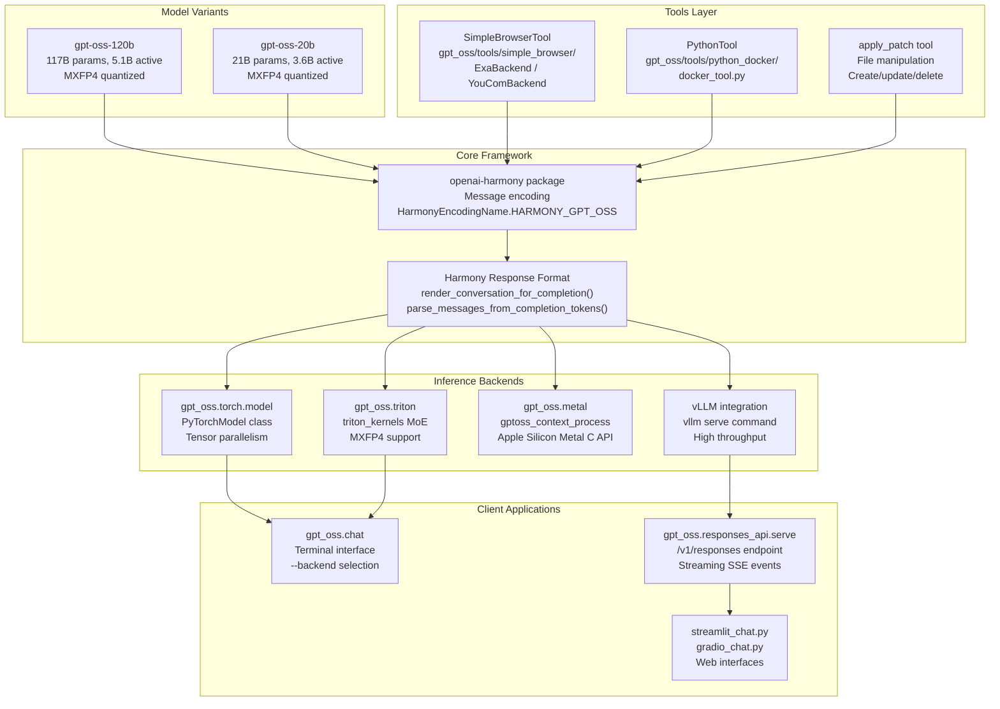

Sources: [README.md:14-46](), [README.md:104-168](), [README.md:300-335](), [awesome-gpt-oss.md:83-86]()

## Core Components

The gpt-oss system consists of several interconnected components that work together to provide a complete language model inference and interaction platform:

| Component | Purpose | Key Code Entities |
|-----------|---------|-------------------|
| **Model Variants** | Two sparse MoE models with different parameter counts | `openai/gpt-oss-120b`, `openai/gpt-oss-20b` |
| **Harmony Framework** | Essential message encoding and tool integration | `openai_harmony`, `load_harmony_encoding` |
| **Inference Backends** | Multiple computational backends for model execution | `gpt_oss.torch`, `gpt_oss.triton`, `gpt_oss.metal` |
| **Tools Ecosystem** | Integrated capabilities for web browsing and code execution | `SimpleBrowserTool`, `PythonTool`, `gpt-oss-mcp-server` |
| **Client Applications** | Various interfaces for model interaction | `gpt_oss.chat`, `api_server.py`, `streamlit_chat.py` |
| **Evaluation System** | Benchmarking and testing framework | `gpt_oss.evals`, `HealthBenchEval`, `GPQAEval` |

Sources: [README.md:16-19](), [README.md:104-118](), [awesome-gpt-oss.md:7-13]()

## Model Variants

The repository provides two model variants optimized for different use cases:

### gpt-oss-120b
- **Parameters**: 117B total, 5.1B active per forward pass [README.md:18-18]()
- **Memory**: Fits on a single 80GB GPU (NVIDIA H100 or AMD MI300X) [README.md:18-18]()
- **Quantization**: MXFP4 quantization of the MoE weights [README.md:45-45]()
- **Use Case**: Production, general purpose, high reasoning use cases [README.md:18-18]()

### gpt-oss-20b  
- **Parameters**: 21B total, 3.6B active per forward pass [README.md:19-19]()
- **Memory**: Runs within 16GB of memory [README.md:45-45]()
- **Quantization**: MXFP4 quantization of the MoE weights [README.md:45-45]()
- **Use Case**: Lower latency, local or specialized use cases [README.md:19-19]()

Both models were trained using the Harmony response format and require it for correct operation [README.md:21-21](). They support configurable reasoning effort (low, medium, high) and provide full access to the chain-of-thought process [README.md:41-42]().

## Deployment Ecosystem

The following diagram illustrates the deployment options and their corresponding code integration points:

**Deployment and Client Flow**
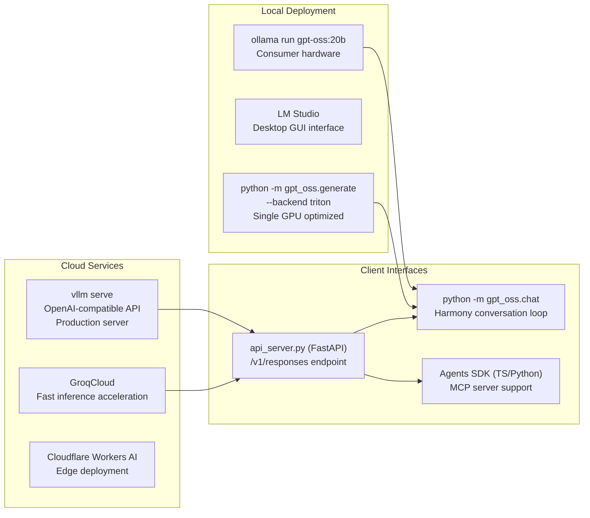

Sources: [README.md:79-92](), [README.md:176-183](), [awesome-gpt-oss.md:17-76]()

## Build System Architecture

The repository uses a custom PEP 517 build backend that supports dynamic selection between standard Python packaging and native Metal compilation for Apple Silicon.

**Build Pipeline**
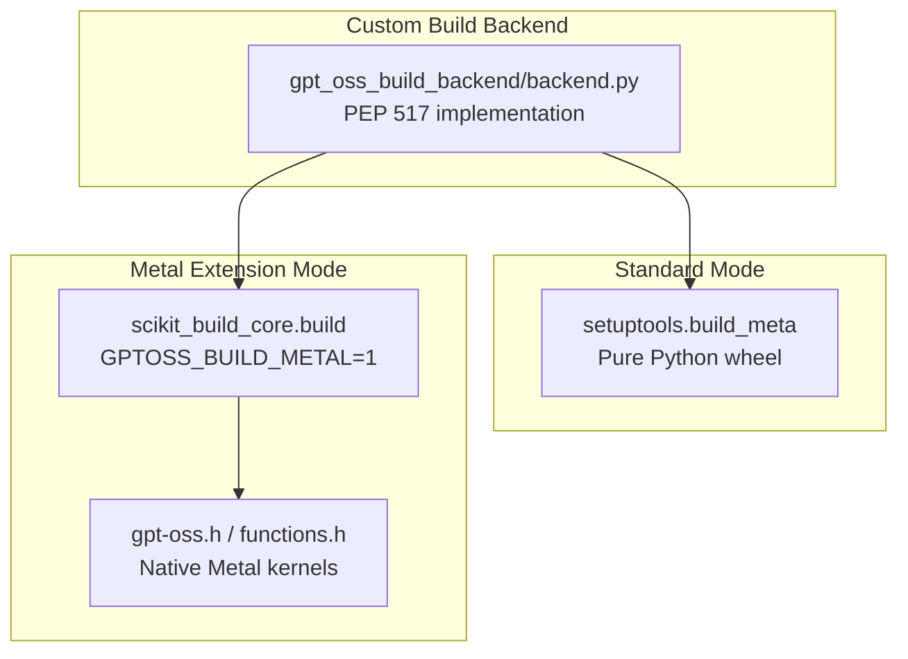

The build system automatically delegates to `scikit-build-core` when building with Metal support, which handles the compilation of `.metallib` files and the C++ Python bindings [README.md:31-31]().

Sources: [README.md:31-31](), [awesome-gpt-oss.md:39-40]()

## Key Technologies

- **MXFP4 Quantization**: Native quantization format for MoE weights, enabling large models to run on significantly reduced hardware footprints (e.g., 120b on a single 80GB GPU) [README.md:45-45]().
- **Harmony Response Format**: A specialized chat format library (`openai-harmony`) required for model operation. It manages `Conversation`, `Message`, and `Role` objects, and handles the rendering of tool descriptions and stop tokens [README.md:104-168]().
- **Sparse MoE Architecture**: Efficient mixture-of-experts design where only a small subset of parameters (5.1B for the 120b model) are active during any single inference step [README.md:18-19]().
- **Multi-Backend Support**: Pluggable inference backends ranging from educational PyTorch implementations to high-performance Triton kernels and native Metal implementations for Apple Silicon [README.md:29-31]().
- **Agentic Capabilities**: Native support for tool calling, including web browsing via `SimpleBrowserTool` and secure code execution via `PythonTool` [README.md:44-44](), [awesome-gpt-oss.md:83-86]().
- **Reinforcement Fine-Tuning**: Support for training models using GRPO (Group Relative Policy Optimization) for strategy-based tasks like the 2048 game [examples/reinforcement-fine-tuning.ipynb:19-35]().

Sources: [README.md:18-46](), [README.md:104-168](), [examples/reinforcement-fine-tuning.ipynb:19-35]()

---

# Page: Models

# Models

<details>
<summary>Relevant source files</summary>

The following files were used as context for generating this wiki page:

- [README.md](README.md)
- [awesome-gpt-oss.md](awesome-gpt-oss.md)
- [examples/reinforcement-fine-tuning.ipynb](examples/reinforcement-fine-tuning.ipynb)

</details>


This section covers the two open-weight language model variants in the `gpt-oss` repository: `gpt-oss-120b` and `gpt-oss-20b`. It details their technical specifications, architectural characteristics, quantization schemes, and deployment considerations. For information about inference backends and runtime implementations, see [Inference Backends](#4). For deployment guides and platform-specific setup, see [Getting Started](#3).

## Model Variants

The gpt-oss repository provides two model variants optimized for different use cases and hardware constraints:

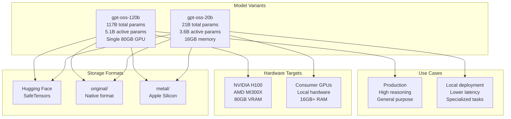

Sources: [README.md:16-19](), [README.md:175-183](), [README.md:246-251]()

## Technical Specifications

| Specification | gpt-oss-120b | gpt-oss-20b |
|---------------|--------------|-------------|
| **Total Parameters** | 117B | 21B |
| **Active Parameters** | 5.1B | 3.6B |
| **Architecture** | Mixture of Experts (MoE) | Mixture of Experts (MoE) |
| **Quantization** | MXFP4 (MoE weights) | MXFP4 (MoE weights) |
| **Base Precision** | BF16 | BF16 |
| **Memory Requirement** | Single 80GB GPU | 16GB |
| **Target Hardware** | H100, MI300X | Consumer GPUs (e.g. T4, RTX) |
| **License** | Apache 2.0 | Apache 2.0 |
| **Response Format** | Harmony (required) | Harmony (required) |

Sources: [README.md:18-19](), [README.md:45](), [README.md:40](), [README.md:21](), [examples/reinforcement-fine-tuning.ipynb:63-65]()

## Architecture and Implementation

The models are implemented across multiple backends with different optimization strategies. The repository provides reference code for PyTorch, Triton, and Metal.

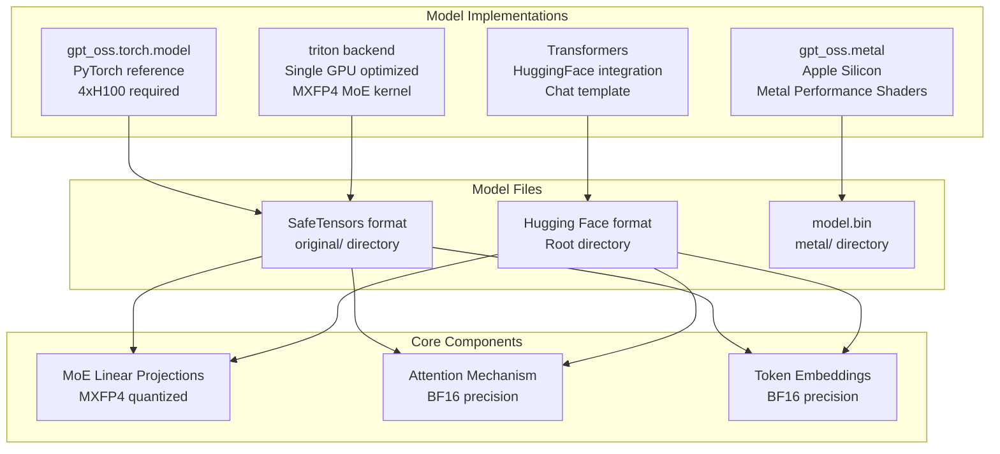

Sources: [README.md:185-187](), [README.md:204](), [README.md:232](), [README.md:51]()

## Quantization Format

The models use MXFP4 quantization specifically for Mixture of Experts (MoE) weights. This allows the 120B model to fit on a single 80GB GPU. Other weights like attention and embeddings remain in higher precision (BF16).

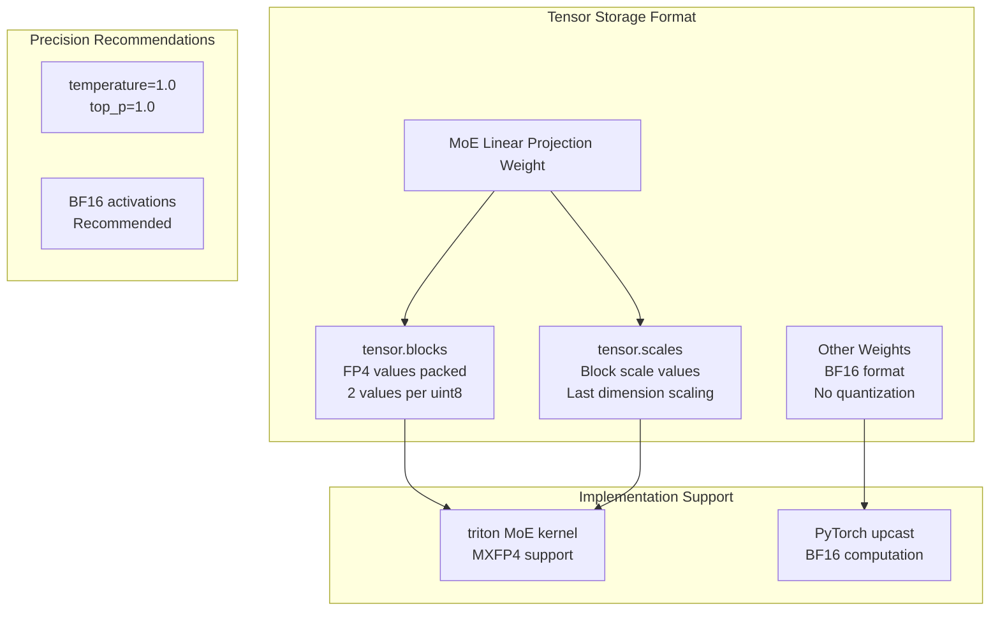

Sources: [README.md:45](), [README.md:485-490](), [README.md:494](), [README.md:204]()

## Model Distribution and Access

The models are available through multiple distribution channels with different format requirements. The "original" format is used for the native PyTorch and Triton backends, while the root directory format is compatible with Hugging Face Transformers and vLLM.

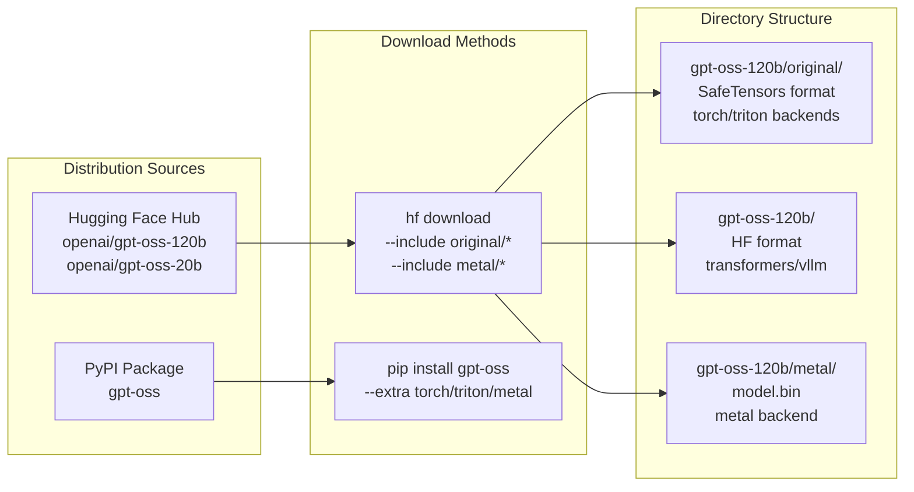

Sources: [README.md:175-183](), [README.md:246-251](), [README.md:155-171]()

## Sampling and Configuration

Both models require specific configuration for optimal performance. They are trained with the [Harmony Response Format](#5.1) and will not function correctly without it.

| Parameter | Recommended Value | Purpose |
|-----------|------------------|---------|
| `temperature` | 1.0 | Sampling randomness |
| `top_p` | 1.0 | Nucleus sampling |
| `reasoning_effort` | low/medium/high | Configurable reasoning depth |
| `max_context` | 8192 (default) | Context window size |
| `precision` | BF16 | Activation precision |

The models support configurable reasoning effort levels, allowing users to trade between response quality and latency.

Sources: [README.md:494](), [README.md:41](), [README.md:21](), [README.md:272-294]()

## Child Pages

- [gpt-oss-120b](#2.1) — Detailed specifications for the 117B parameter MoE model.
- [gpt-oss-20b](#2.2) — Detailed specifications for the 21B parameter model optimized for latency.

---

# Page: gpt-oss-120b

# gpt-oss-120b

<details>
<summary>Relevant source files</summary>

The following files were used as context for generating this wiki page:

- [README.md](README.md)

</details>


This document covers the technical specifications, architecture, and deployment options for the `gpt-oss-120b` model, the larger variant in the gpt-oss series. This page focuses specifically on the 117B parameter model optimized for production use cases.

## Model Specifications

The `gpt-oss-120b` model is designed for production environments requiring high reasoning capabilities while maintaining single-GPU deployment feasibility. It is a Mixture-of-Experts (MoE) model where only a fraction of parameters are active for any given token. [README.md:18-19]()

| Specification | Value |
|---------------|-------|
| Total Parameters | 117B |
| Active Parameters | 5.1B |
| Architecture | Mixture of Experts (MoE) |
| Quantization | MXFP4 for MoE weights |
| Minimum GPU Memory | 80GB (Quantized) |
| Target Hardware | NVIDIA H100, AMD MI300X |
| Precision | BF16 activations |
| License | Apache 2.0 |

Sources: [README.md:18-19](), [README.md:40-46]()

## Architecture and Quantization

### MoE Architecture

The model implements a sparse Mixture of Experts design. Routing decisions activate only 5.1B parameters per token, significantly reducing the FLOPs required for inference compared to a dense 117B model. [README.md:18-19]()

### MXFP4 Quantization Details

The model employs MXFP4 (Microscaling FP4) quantization specifically for the MoE expert weights. This allows the 117B parameter model to fit within 80GB of VRAM. [README.md:45-46]()

The quantization format splits weights into:
- **Blocks**: The actual FP4 values, packed into `uint8` containers.
- **Scales**: Shared exponents/scaling factors used to dequantize blocks during the forward pass.

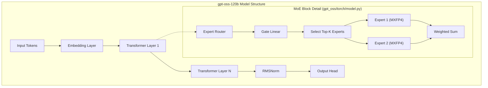

Sources: [README.md:45-46](), [README.md:185-188]()

## Hardware Requirements and Memory Profile

### Memory Optimization

The primary constraint for `gpt-oss-120b` is VRAM. While the total parameter count is high, the MXFP4 quantization reduces the weight footprint to approximately 60GB, leaving room for KV cache and activations on an 80GB card. [README.md:45-46]()

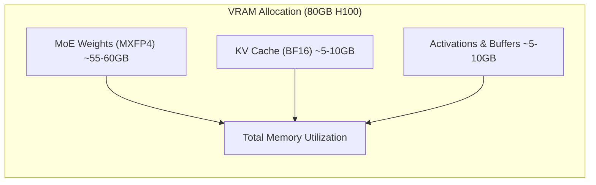

### Tensor Parallelism Requirements

When running the **PyTorch Reference Implementation**, the model requires tensor parallelism because it upcasts weights to BF16 for computation if optimized kernels are not used. This increases the memory requirement to approximately 4x H100 (80GB) or 2x H200 (141GB). [README.md:187-188]()

Sources: [README.md:18-19](), [README.md:187-188]()

## Inference Implementations

### vLLM (Production Recommended)

For production, vLLM is the recommended backend. It supports the model through a specialized fork that handles the architecture and quantization. [README.md:81-92]()

```python
# vLLM Configuration for 120b
llm = LLM(
    model="openai/gpt-oss-120b",
    tensor_parallel_size=1, # Fits on 1x 80GB GPU with quantization
    gpu_memory_utilization=0.95,
    max_model_len=8192
)
```
Sources: [README.md:137-144]()

### Triton Optimized Backend

The Triton backend (`gpt_oss/triton`) is a single-GPU optimized implementation. It uses specialized kernels to perform dequantization and matrix multiplication in a single step, avoiding the memory overhead of upcasting the entire weight matrix. [README.md:204-210]()

Key components include:
- `FlashAttention v2` with learned sinks. [README.md:213-214]()
- `MXFP4 MoE` kernel for efficient expert routing and execution. [README.md:215-216]()
- CUDA graph capture to minimize CPU launch overhead. [README.md:217-218]()

### PyTorch Reference Implementation

Located in `gpt_oss/torch/model.py`, this implementation provides the most readable version of the MoE logic. It uses `torch.distributed` for tensor parallelism across multiple GPUs. [README.md:185-190]()

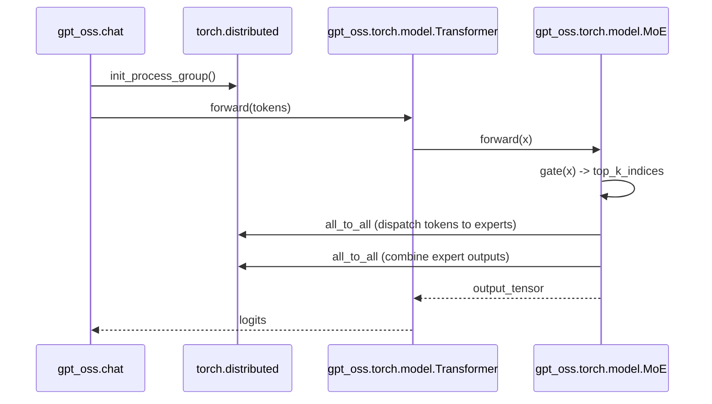

Sources: [README.md:185-200](), [README.md:337-342]()

## Integration with Harmony Format

The `gpt-oss-120b` model **must** be used with the Harmony response format. Failure to use the `openai-harmony` package for rendering prompts and parsing completions will result in degraded performance or nonsensical output. [README.md:21-22]()

The model is trained to recognize specific control tokens and structures defined in `HarmonyEncodingName.HARMONY_GPT_OSS`. [README.md:118-131]()

Sources: [README.md:21-22](), [README.md:104-131]()

---

# Page: gpt-oss-20b

# gpt-oss-20b

<details>
<summary>Relevant source files</summary>

The following files were used as context for generating this wiki page:

- [README.md](README.md)
- [awesome-gpt-oss.md](awesome-gpt-oss.md)
- [examples/reinforcement-fine-tuning.ipynb](examples/reinforcement-fine-tuning.ipynb)

</details>


This document covers the `gpt-oss-20b` model, the smaller variant in the gpt-oss series optimized for lower latency and local deployment scenarios. For information about the larger production model, see [gpt-oss-120b](). For details about inference backends, see [Inference Backends](). For deployment guidance, see [Getting Started]().

## Overview

The `gpt-oss-20b` model is a 21-billion parameter sparse mixture-of-experts (MoE) model with 3.6 billion active parameters [README.md:19](). It is specifically designed for scenarios requiring lower latency inference, local deployment, and specialized use cases where the full computational capacity of the 120B model is not required. It is released under the permissive Apache 2.0 license [README.md:40]().

## Model Specifications

| Specification | Value |
|---------------|-------|
| Total Parameters | 21 billion [README.md:19]() |
| Active Parameters | 3.6 billion [README.md:19]() |
| Memory Requirements | 16GB [README.md:45]() |
| Architecture | Sparse Mixture-of-Experts [README.md:19]() |
| Quantization | MXFP4 for MoE weights [README.md:45]() |
| License | Apache 2.0 [README.md:40]() |
| Required Format | Harmony response format [README.md:21]() |

The model implements the same architectural patterns as `gpt-oss-120b` but with reduced scale to enable deployment on consumer hardware and edge computing environments.

**gpt-oss-20b System Architecture**
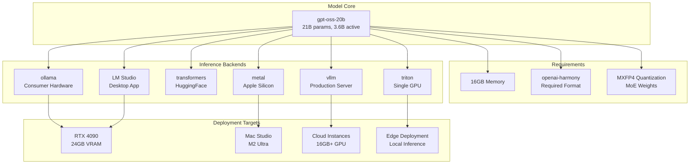
Sources: [README.md:18-19](), [README.md:40-45]()

## Reinforcement Fine-Tuning Support

A key feature of `gpt-oss-20b` is its support for reinforcement learning (RL) fine-tuning on consumer-grade hardware. Using the [Unsloth](https://github.com/unslothai/unsloth) library and the GRPO algorithm, the model can be trained to develop complex strategies in sandboxed environments [examples/reinforcement-fine-tuning.ipynb:23-35]().

### Fine-Tuning Hardware Configurations
The model can be fine-tuned on varying hardware by adjusting quantization and memory offloading:
*   **Tesla T4 (15GB VRAM):** Requires `load_in_4bit = True`, `max_seq_length = 768`, and `offload_embedding = True` [examples/reinforcement-fine-tuning.ipynb:63-66]().
*   **H100/B200 (80GB VRAM):** Can use `load_in_16bit` for faster training and higher accuracy [examples/reinforcement-fine-tuning.ipynb:65]().

**Fine-Tuning Data Flow (RL Sandbox)**
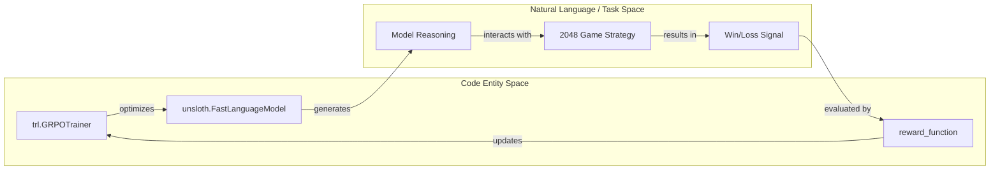
Sources: [examples/reinforcement-fine-tuning.ipynb:23-56](), [examples/reinforcement-fine-tuning.ipynb:62-67]()

## Deployment and Inference

The `gpt-oss-20b` model supports multiple deployment strategies optimized for different hardware configurations.

### Local Deployment Platforms
*   **Ollama:** Recommended for consumer hardware [README.md:176-182]().
*   **LM Studio:** Desktop GUI for model interaction [awesome-gpt-oss.md:23-25]().
*   **Apple Silicon:** Native Metal implementation for Mac hardware [README.md:31]().

### Production and Cloud
*   **vLLM:** Recommended for high-throughput OpenAI-compatible servers [README.md:81-89]().
*   **GroqCloud:** Offers low-latency hosted inference with built-in tool support [awesome-gpt-oss.md:55-61]().
*   **Cloudflare Workers AI:** Serverless deployment option [awesome-gpt-oss.md:66-69]().

**Inference Stack Mapping**
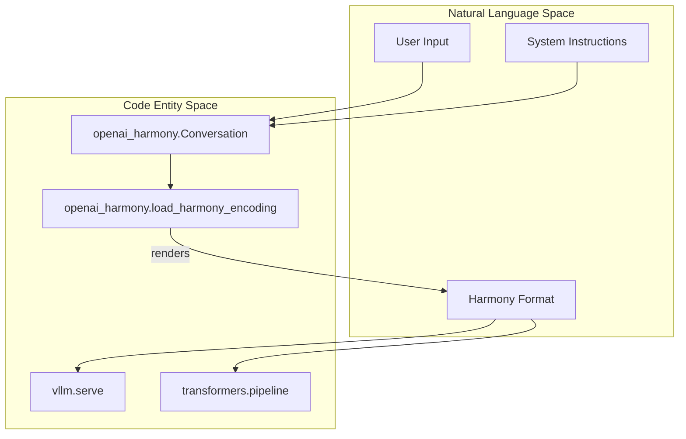
Sources: [README.md:53-75](), [README.md:104-131](), [awesome-gpt-oss.md:17-76]()

## Usage Examples

### vLLM Offline Inference
The following example demonstrates how to use the `openai-harmony` package to render a conversation for `gpt-oss-20b` before passing it to the vLLM engine:

```python
from openai_harmony import load_harmony_encoding, Conversation, Role, HarmonyEncodingName
from vllm import LLM, SamplingParams

# Render the prefill with Harmony
encoding = load_harmony_encoding(HarmonyEncodingName.HARMONY_GPT_OSS)
convo = Conversation.from_messages([...])
prefill_ids = encoding.render_conversation_for_completion(convo, Role.ASSISTANT)

# Initialize vLLM for gpt-oss-20b
llm = LLM(
    model="openai/gpt-oss-20b",
    tensor_parallel_size=1,
    gpu_memory_utilization=0.95
)

outputs = llm.generate(prompt_token_ids=[prefill_ids], sampling_params=SamplingParams(...))
```
Sources: [README.md:118-155]()

### Hardware-Specific Optimization
*   **NVIDIA RTX:** Optimized via TensorRT-LLM [awesome-gpt-oss.md:48-49]().
*   **AMD Ryzen AI:** Support for local execution on NPU/GPU [awesome-gpt-oss.md:33-35]().
*   **Apple Silicon:** Uses `GPTOSS_BUILD_METAL` for native compilation [gpt_oss_build_backend/backend.py]().

Sources: [README.md:143](), [awesome-gpt-oss.md:32-35](), [awesome-gpt-oss.md:48-51]()

---

# Page: Getting Started

# Getting Started

<details>
<summary>Relevant source files</summary>

The following files were used as context for generating this wiki page:

- [MANIFEST.in](MANIFEST.in)
- [README.md](README.md)
- [_build/gpt_oss_build_backend/__init__.py](_build/gpt_oss_build_backend/__init__.py)
- [_build/gpt_oss_build_backend/backend.py](_build/gpt_oss_build_backend/backend.py)
- [gpt_oss/triton/attention.py](gpt_oss/triton/attention.py)
- [pyproject.toml](pyproject.toml)

</details>


This guide provides essential information for quickly deploying and using the gpt-oss models. It covers installation prerequisites, multiple deployment options, and basic usage patterns to get you running with either `gpt-oss-120b` or `gpt-oss-20b` models.

For detailed model specifications, see [Models](#2). For production deployment guidance, see [Local Deployment](#3.1) and [Cloud Deployment](#3.2). For tool integration, see [Tools and Capabilities](#5).

## Prerequisites

### System Requirements

The gpt-oss models have specific system requirements that vary by deployment method:

| Requirement | Details |
|-------------|---------|
| Python | >= 3.12 [pyproject.toml:23]() |
| macOS | Xcode CLI tools (`xcode-select --install`) |
| Linux | CUDA support required for Triton and PyTorch backends |
| Build System | Custom PEP 517 backend in `gpt_oss_build_backend.backend` [pyproject.toml:35]() |

### Hardware Requirements by Model

| Model | Parameters | Active Parameters | Memory Requirements |
|-------|-----------|------------------|-------------------|
| `gpt-oss-120b` | 117B | 5.1B | Single 80GB GPU (H100/MI300X) [README.md:18]() |
| `gpt-oss-20b` | 21B | 3.6B | 16GB memory (MXFP4) [README.md:45]() |

Sources: [README.md:16-19](), [README.md:45]()

### Critical Dependency: Harmony Format

Both models require the `openai-harmony` response format for correct operation. The models will not work correctly without proper harmony formatting.

Sources: [README.md:21](), [pyproject.toml:6]()

## Installation Options

### PyPI Installation

The package supports several optional dependency groups defined in `pyproject.toml` [pyproject.toml:26-31]():

```bash
# Basic tools only (includes fastapi, docker, aiohttp)
pip install gpt-oss

# Include PyTorch reference implementation
pip install gpt-oss[torch]

# Include Triton optimized implementation  
pip install gpt-oss[triton]

# Include Apple Silicon Metal implementation
GPTOSS_BUILD_METAL=1 pip install gpt-oss[metal]
```

Sources: [pyproject.toml:5-21](), [pyproject.toml:26-31](), [_build/gpt_oss_build_backend/backend.py:9-12]()

### Local Development Installation

For development or building the native Metal extension, use the `GPTOSS_BUILD_METAL` environment variable to trigger the `scikit-build-core` delegation in the build backend [_build/gpt_oss_build_backend/backend.py:49-54]():

```bash
git clone https://github.com/openai/gpt-oss.git
cd gpt-oss
GPTOSS_BUILD_METAL=1 pip install -e ".[metal]"
```

Sources: [_build/gpt_oss_build_backend/backend.py:39-41](), [pyproject.toml:41-47]()

## Quick Start Options

### Installation and Deployment Flow

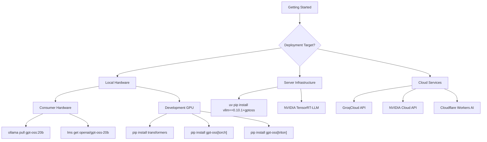

Sources: [README.md:47-127]()

### Model Download

Download model weights from Hugging Face:

```bash
# For most deployment methods (Transformers, vLLM, Ollama, LM Studio)
hf download openai/gpt-oss-120b --local-dir gpt-oss-120b/
hf download openai/gpt-oss-20b --local-dir gpt-oss-20b/

# For reference implementations (PyTorch, Triton)  
hf download openai/gpt-oss-120b --include "original/*" --local-dir gpt-oss-120b/
hf download openai/gpt-oss-20b --include "original/*" --local-dir gpt-oss-20b/
```

Sources: [README.md:9-10](), [README.md:175-183]()

## Quick Start Examples

### Transformers (Recommended for Development)

```python
from transformers import pipeline
import torch

model_id = "openai/gpt-oss-120b"

pipe = pipeline(
    "text-generation",
    model=model_id,
    torch_dtype="auto",
    device_map="auto",
)

messages = [
    {"role": "user", "content": "Explain quantum mechanics clearly and concisely."},
]

outputs = pipe(messages, max_new_tokens=256)
print(outputs[0]["generated_text"][-1])
```

Sources: [README.md:53-75]()

### vLLM (Recommended for Production)

vLLM provides an OpenAI-compatible web server. Note the use of `openai-harmony` for manual rendering when not using the high-level server [README.md:117-131]().

```bash
# Install vLLM with gpt-oss support
uv pip install --pre vllm==0.10.1+gptoss \
    --extra-index-url https://wheels.vllm.ai/gpt-oss/ \
    --extra-index-url https://download.pytorch.org/whl/nightly/cu128 \
    --index-strategy unsafe-best-match

# Start OpenAI-compatible server
vllm serve openai/gpt-oss-20b
```

Sources: [README.md:81-90]()

## Backend Architecture and Code Mapping

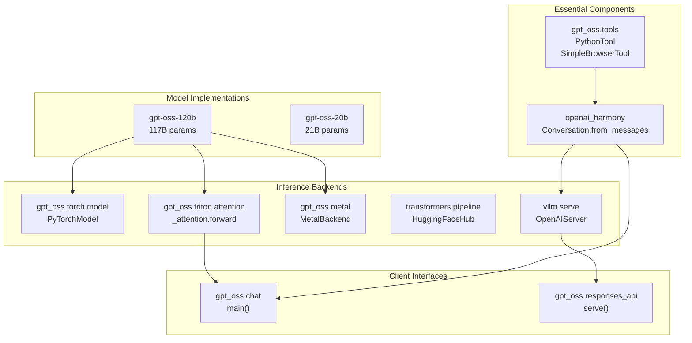

Sources: [gpt_oss/triton/attention.py:104-106](), [README.md:120-131](), [pyproject.toml:10-12]()

## Terminal Chat Quick Test

Use the built-in terminal chat client to verify your installation:

```bash
# Basic chat with Triton backend
python -m gpt_oss.chat gpt-oss-20b/original/

# Chat with tools enabled (requires docker and aiohttp)
python -m gpt_oss.chat gpt-oss-20b/original/ --python --browser
```

### Chat Client Options

| Option | Purpose |
|--------|---------|
| `--reasoning-effort` | Reasoning depth (low/medium/high) |
| `--backend` | Inference backend (triton/torch/vllm) |
| `--python` | Enable `PythonTool` execution [pyproject.toml:10]() |
| `--browser` | Enable `SimpleBrowserTool` [pyproject.toml:12]() |

Sources: [README.md:272-295](), [pyproject.toml:5-21]()

## Next Steps

### For Local Deployment
- Detailed hardware setup for consumer GPUs and Apple Silicon.
- For details, see [Local Deployment](#3.1).

### For Cloud Deployment
- Integration with GroqCloud, NVIDIA Cloud, and Cloudflare.
- For details, see [Cloud Deployment](#3.2).

---

# Page: Local Deployment

# Local Deployment

<details>
<summary>Relevant source files</summary>

The following files were used as context for generating this wiki page:

- [README.md](README.md)
- [awesome-gpt-oss.md](awesome-gpt-oss.md)
- [examples/reinforcement-fine-tuning.ipynb](examples/reinforcement-fine-tuning.ipynb)
- [gpt_oss/metal/scripts/create-local-model.py](gpt_oss/metal/scripts/create-local-model.py)

</details>


This page covers setting up and running gpt-oss models on local hardware, including consumer devices, development environments, and local production deployments. For cloud-based deployment options, see [Cloud Deployment](3.2). For details about specific inference backends, see [Inference Backends](4).

## Overview

The gpt-oss models support multiple local deployment options, ranging from simple consumer-friendly applications to optimized development environments. The choice depends on your hardware, use case, and technical requirements.

**Local Deployment Architecture**

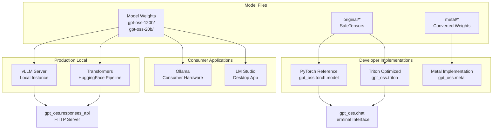

Sources: [README.md:100-127](), [README.md:185-258]()

## Consumer Hardware Solutions

### Ollama

Ollama provides the simplest path to running gpt-oss models on consumer hardware with automatic optimization for available resources.

**Installation and Usage:**

```bash
# Install Ollama first from ollama.com/download
ollama pull gpt-oss:20b
ollama run gpt-oss:20b

ollama pull gpt-oss:120b  
ollama run gpt-oss:120b
```

The Ollama integration handles model downloading, quantization, and memory management automatically. It supports both model variants with appropriate resource allocation.

**Integration with gpt-oss Tools:**

The responses API server can use Ollama as a backend:

```bash
python -m gpt_oss.responses_api.serve --inference-backend ollama
```

Sources: [README.md:176-183](), [awesome-gpt-oss.md:19-22]()

### LM Studio

LM Studio provides a desktop application interface for local model deployment with graphical model management.

**Model Download:**

```bash
lms get openai/gpt-oss-20b
lms get openai/gpt-oss-120b
```

LM Studio automatically handles model conversion and provides a chat interface. It can also serve as an OpenAI-compatible API endpoint for integration with other applications.

Sources: [awesome-gpt-oss.md:23-26]()

## Developer Reference Implementations

### PyTorch Reference Implementation

The PyTorch implementation provides an educational reference showing the exact model architecture.

**System Requirements:**
- 4× H100 GPUs or 2× H200 GPUs for gpt-oss-120b
- CUDA-compatible system
- Python 3.12

**Installation:**

```bash
pip install -e ".[torch]"
```

**Model Download and Setup:**

```bash
hf download openai/gpt-oss-120b --include "original/*" --local-dir gpt-oss-120b/
hf download openai/gpt-oss-20b --include "original/*" --local-dir gpt-oss-20b/
```

**Usage:**

```bash
torchrun --nproc-per-node=4 -m gpt_oss.generate gpt-oss-120b/original/
```

The implementation uses tensor parallelism for MoE layers and upcasts all weights to BF16 for computation.

Sources: [README.md:185-200](), [README.md:29]()

### Triton Optimized Implementation

The Triton backend provides single-GPU optimization for gpt-oss-120b using optimized kernels and memory management.

**Installation:**

```bash
# Install Triton from source
git clone https://github.com/triton-lang/triton
cd triton/
pip install -r python/requirements.txt
pip install -e . --verbose --no-build-isolation
pip install -e python/triton_kernels

# Install gpt-oss triton implementation
pip install -e ".[triton]"
```

**Usage:**

```bash
export PYTORCH_CUDA_ALLOC_CONF=expandable_segments:True
python -m gpt_oss.generate --backend triton gpt-oss-120b/original/
```

The expandable allocator prevents OOM errors during weight loading. The implementation uses MXFP4-optimized MoE kernels and attention optimizations.

Sources: [README.md:202-228](), [README.md:30]()

### Metal Implementation (Apple Silicon)

The Metal implementation enables local deployment on Apple Silicon hardware using Metal Performance Shaders.

**Build Configuration:**

The Metal backend requires compilation during installation:

```bash
GPTOSS_BUILD_METAL=1 pip install -e ".[metal]"
```

**Model Conversion:**

Weight conversion is handled by `create-local-model.py`, which transforms Hugging Face checkpoints into the proprietary `.bin` format required by the Metal C++ runtime. This script handles the conversion of `tiktoken` vocabularies and `safetensors` weights.

```bash
# Convert SafeTensors to Metal format
python gpt_oss/metal/scripts/create-local-model.py -s <model_dir> -d <output_file>
```

**Conversion Data Flow**

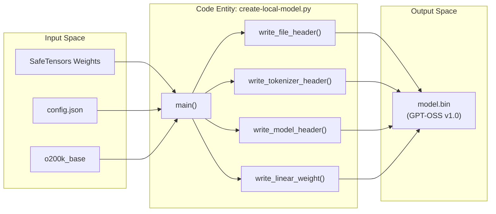

Sources: [gpt_oss/metal/scripts/create-local-model.py:17-50](), [gpt_oss/metal/scripts/create-local-model.py:83-132](), [README.md:230-257]()

## Production-Ready Local Solutions

### Transformers Integration

Hugging Face Transformers provides production-ready local inference with automatic harmony format handling.

**Installation:**

```bash
pip install transformers torch
```

**Usage:**

```python
from transformers import pipeline
import torch

model_id = "openai/gpt-oss-120b"

pipe = pipeline(
    "text-generation",
    model=model_id,
    torch_dtype="auto", 
    device_map="auto",
)

messages = [
    {"role": "user", "content": "Explain quantum mechanics clearly and concisely."},
]

outputs = pipe(messages, max_new_tokens=256)
print(outputs[0]["generated_text"][-1])
```

The pipeline automatically applies the harmony response format when using the chat template.

Sources: [README.md:49-77]()

### vLLM Local Server

vLLM provides high-throughput local inference with OpenAI-compatible API endpoints.

**Installation:**

```bash
uv pip install --pre vllm==0.10.1+gptoss \
    --extra-index-url https://wheels.vllm.ai/gpt-oss/ \
    --extra-index-url https://download.pytorch.org/whl/nightly/cu128 \
    --index-strategy unsafe-best-match
```

**Server Startup:**

```bash
vllm serve openai/gpt-oss-20b
```

This creates an OpenAI-compatible server that automatically downloads and serves the model with optimized batching and memory management.

Sources: [README.md:79-92]()

## System Requirements and Hardware Considerations

### Memory Requirements

| Model | Configuration | Memory Requirement | Hardware Examples |
|-------|--------------|-------------------|-------------------|
| gpt-oss-20b | Standard | 16GB | RTX 4090, RTX A6000 |
| gpt-oss-120b | MXFP4 Quantized | 80GB | H100, MI300X |
| gpt-oss-120b | PyTorch Reference | 320GB+ | 4× H100, 2× H200 |

### MXFP4 Quantization

The models use native MXFP4 quantization for MoE weights to fit large parameter counts into limited VRAM.
- `gpt-oss-120b`: 117B parameters (5.1B active) optimized for 80GB GPUs.
- `gpt-oss-20b`: 21B parameters (3.6B active) optimized for 16GB GPUs.

All evaluations and reference implementations assume MXFP4 quantization for the MoE layers.

Sources: [README.md:18-19](), [README.md:45](), [examples/reinforcement-fine-tuning.ipynb:65]()

## Terminal Chat Integration

The terminal chat client provides a unified interface across all local backends with tool integration.

**Inference Request Flow**

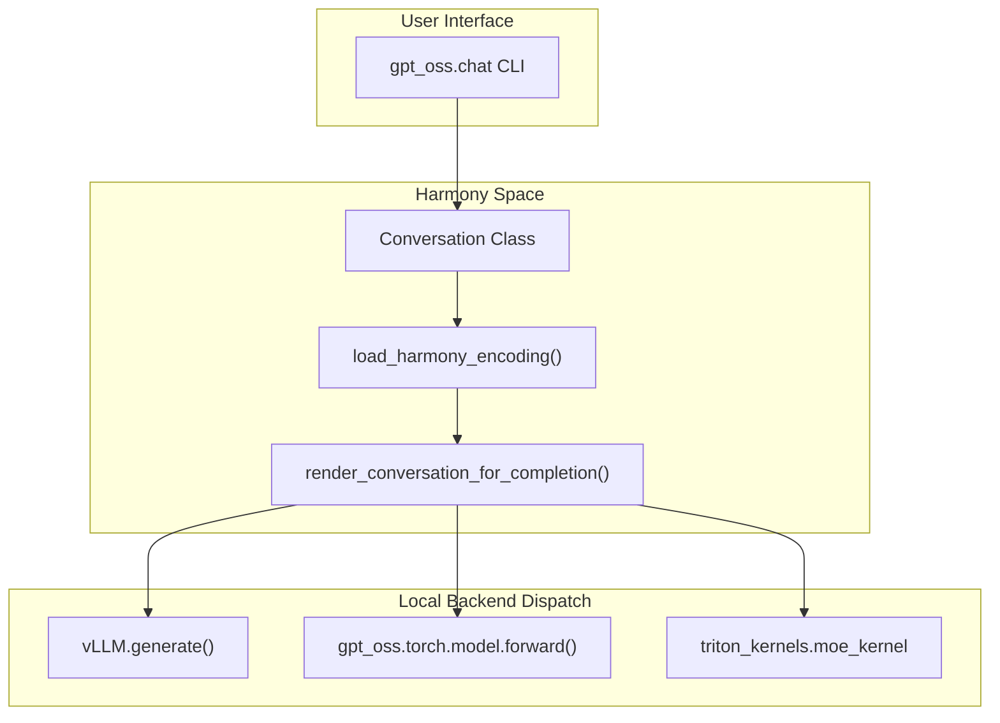

**Usage Examples:**

```bash
# Triton backend with browser tool
python -m gpt_oss.chat --backend triton -b gpt-oss-120b/original/

# PyTorch backend with Python tool
python -m gpt_oss.chat --backend torch -p gpt-oss-20b/original/
```

Sources: [README.md:94-168](), [README.md:267-299]()

---

# Page: Cloud Deployment

# Cloud Deployment

<details>
<summary>Relevant source files</summary>

The following files were used as context for generating this wiki page:

- [README.md](README.md)
- [awesome-gpt-oss.md](awesome-gpt-oss.md)
- [examples/reinforcement-fine-tuning.ipynb](examples/reinforcement-fine-tuning.ipynb)

</details>


This page covers deploying and accessing gpt-oss models through cloud service providers that offer hosted inference endpoints. For local deployment options, see [Local Deployment](#3.1). For production server deployment on your own infrastructure, see [Production Backends](#4.4).

Cloud deployment provides immediate access to gpt-oss models without requiring local hardware setup or model downloads. These services handle model hosting, scaling, and optimization, offering API-based access to both `gpt-oss-120b` and `gpt-oss-20b` models.

## Cloud Provider Overview

Multiple cloud providers offer hosted gpt-oss model inference with different performance characteristics, pricing models, and additional features:

### Cloud Service Architecture

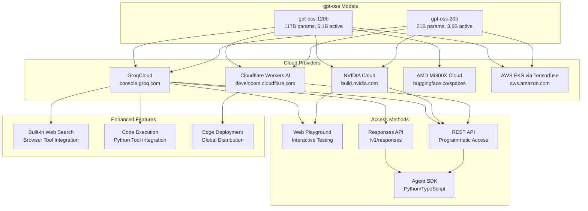

Sources: [awesome-gpt-oss.md:53-74](), [README.md:18-19]()

## GroqCloud

GroqCloud provides the most comprehensive gpt-oss integration with built-in tool support and Responses API compatibility.

### Available Models and Features

| Model | Playground Link | Features |
|-------|----------------|----------|
| gpt-oss-120b | `console.groq.com/playground?model=openai/gpt-oss-120b` | Full tool integration |
| gpt-oss-20b | `console.groq.com/playground?model=openai/gpt-oss-20b` | Fast inference |

### Tool Integration

GroqCloud offers native integration with gpt-oss reference tools:

- **Web Search**: Built-in browser tool functionality for web browsing and search.
- **Code Execution**: Python execution environment for code analysis and generation.
- **Responses API**: Full compatibility with the `/v1/responses` endpoint specification.

### API Integration

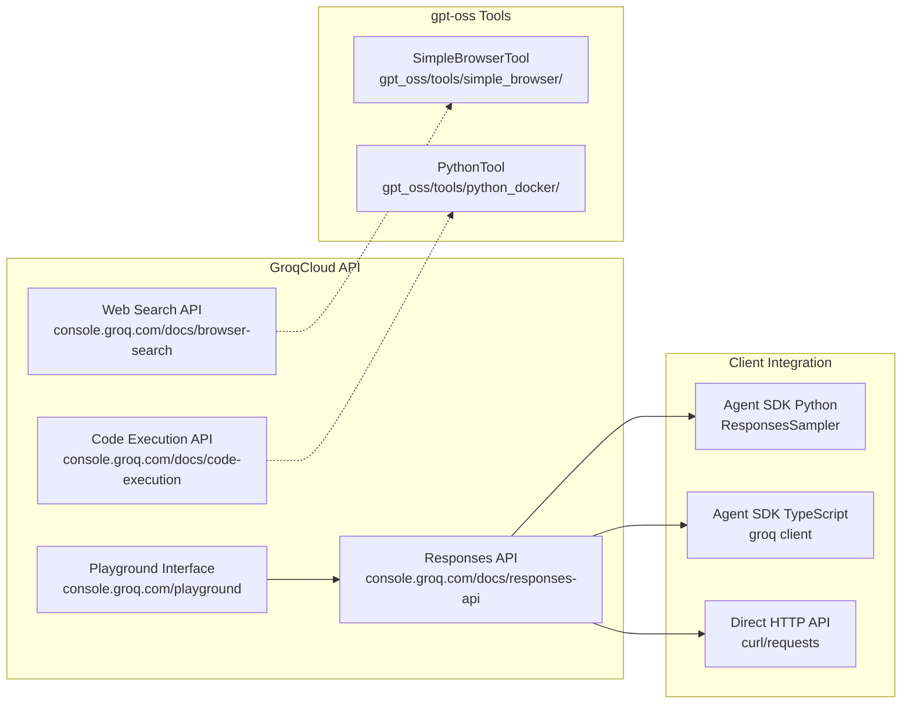

Sources: [awesome-gpt-oss.md:55-61](), [awesome-gpt-oss.md:84-85]()

## NVIDIA Cloud

NVIDIA provides gpt-oss models optimized for high-throughput inference on GB200 NVL72 architecture.

### Platform Access

- **gpt-oss-120b**: Available at `build.nvidia.com/openai/gpt-oss-120b` [awesome-gpt-oss.md:65]()
- **gpt-oss-20b**: Available at `build.nvidia.com/openai/gpt-oss-20b` [awesome-gpt-oss.md:65]()
- **Performance**: Up to 1.5M tokens per second inference capability on NVIDIA GB200 NVL72 [awesome-gpt-oss.md:64]().

### Architecture Optimization

NVIDIA Cloud leverages TensorRT-LLM optimizations and GB200 NVL72 hardware for maximum throughput. This makes it suitable for high-volume production workloads requiring consistent low latency.

Sources: [awesome-gpt-oss.md:62-65]()

## Cloudflare Workers AI

Cloudflare Workers AI offers edge-deployed gpt-oss models for globally distributed inference.

### Edge Deployment Model

```mermaid
graph TB
    subgraph "Cloudflare Edge Network"
        EdgeNode1["Edge Location 1<br/>gpt-oss models"]
        EdgeNode2["Edge Location 2<br/>gpt-oss models"]
        EdgeNode3["Edge Location N<br/>gpt-oss models"]
    end
    
    subgraph "Model Variants"
        CF120B["gpt-oss-120b<br/>developers.cloudflare.com/workers-ai/models/gpt-oss-120b"]
        CF20B["gpt-oss-20b<br/>developers.cloudflare.com/workers-ai/models/gpt-oss-20b"]
    end
    
    subgraph "Client Access"
        WorkersAPI["Workers AI API"]
        GlobalRequests["Global User Requests"]
    end
    
    CF120B --> EdgeNode1
    CF120B --> EdgeNode2
    CF120B --> EdgeNode3
    
    CF20B --> EdgeNode1
    CF20B --> EdgeNode2
    CF20B --> EdgeNode3
    
    GlobalRequests --> WorkersAPI
    WorkersAPI --> EdgeNode1
    WorkersAPI --> EdgeNode2
    WorkersAPI --> EdgeNode3
```

### Benefits

- **Low Latency**: Requests routed to nearest edge location.
- **Global Scale**: Distributed inference without regional limitations.
- **Workers Integration**: Seamless integration with Cloudflare Workers platform.

Sources: [awesome-gpt-oss.md:66-69]()

## Additional Cloud Providers

### AWS (Amazon Web Services)
Deploy gpt-oss for both 20b and 120b models on AWS EKS using Tensorfuse [awesome-gpt-oss.md:73]().

### AMD MI300X Cloud
AMD provides gpt-oss-120B access through specialized MI300X hardware via Hugging Face Spaces integration [awesome-gpt-oss.md:71]().

### Google Colab
For experimentation, `gpt-oss-20b` can be run on Google Colab using Unsloth's 4-bit quantization (MXFP4) [awesome-gpt-oss.md:76]().

## Cloud Provider Selection

### Performance Characteristics

| Provider | Throughput | Latency | Global Distribution | Tool Support |
|----------|------------|---------|-------------------|--------------|
| GroqCloud | High | Low | Regional | Full (Web + Code) |
| NVIDIA | Very High (1.5M TPS) | Very Low | Regional | Standard API |
| Cloudflare | Medium | Very Low | Global Edge | Standard API |
| AMD MI300X | Medium | Low | Regional | Web Interface |

### Integration Considerations

**For Responses API compatibility**: GroqCloud provides the most complete integration with native support for the `/v1/responses` endpoint and built-in tool execution [awesome-gpt-oss.md:59-61]().

**For maximum throughput**: NVIDIA Cloud with GB200 NVL72 architecture offers the highest performance for production workloads [awesome-gpt-oss.md:64]().

**For global deployment**: Cloudflare Workers AI provides the lowest latency worldwide through edge distribution [awesome-gpt-oss.md:67]().

**For AMD hardware optimization**: AMD MI300X Cloud offers specialized acceleration for AMD-based infrastructures [awesome-gpt-oss.md:71]().

Sources: [awesome-gpt-oss.md:53-77]()

---

# Page: Inference Backends

# Inference Backends

<details>
<summary>Relevant source files</summary>

The following files were used as context for generating this wiki page:

- [README.md](README.md)
- [_build/gpt_oss_build_backend/backend.py](_build/gpt_oss_build_backend/backend.py)
- [gpt_oss/generate.py](gpt_oss/generate.py)
- [gpt_oss/triton/attention.py](gpt_oss/triton/attention.py)
- [pyproject.toml](pyproject.toml)

</details>


This document provides an overview of the different computational backends available for running gpt-oss models. It covers the architecture, trade-offs, and selection criteria for each backend type. For detailed implementation specifics, see [PyTorch Reference Implementation](#4.1), [Triton Optimized Backend](#4.2), [Metal Apple Silicon Backend](#4.3), and [Production Backends](#4.4).

## Backend Architecture Overview

The gpt-oss inference system supports multiple backends through a unified interface pattern. Each backend implements a `TokenGenerator` class that provides consistent text generation capabilities while optimizing for different hardware configurations and use cases [gpt_oss/generate.py:11-27]().

**Backend Architecture**
```mermaid
graph TB
    subgraph "Frontend_Interface"
        [gpt_oss.generate]
        [gpt_oss.chat]
        [api_server.py]
    end
    
    subgraph "Backend_Selection"
        BackendRouter["match args.backend"]
    end
    
    subgraph "Reference_Implementations"
        TorchBackend["TorchGenerator<br/>gpt_oss.torch.model"]
        TritonBackend["TritonGenerator<br/>gpt_oss.triton.model"]  
        MetalBackend["MetalGenerator<br/>gpt_oss.metal"]
    end
    
    subgraph "Production_Backends"
        VLLMBackend["VLLMGenerator<br/>gpt_oss.vllm.token_generator"]
        TransformersBackend["Transformers Pipeline"]
        OllamaBackend["Ollama streaming bridge"]
    end
    
    subgraph "Model_Weights"
        OriginalWeights["SafeTensors<br/>original/"]
        MetalWeights["Binary<br/>model.bin"]
        HFWeights["HuggingFace<br/>Converted"]
    end
    
    [gpt_oss.generate] --> BackendRouter
    [gpt_oss.chat] --> BackendRouter  
    [api_server.py] --> BackendRouter
    
    BackendRouter --> TorchBackend
    BackendRouter --> TritonBackend
    BackendRouter --> MetalBackend
    BackendRouter --> VLLMBackend
    
    TorchBackend --> OriginalWeights
    TritonBackend --> OriginalWeights
    MetalBackend --> MetalWeights
    VLLMBackend --> HFWeights
    TransformersBackend --> HFWeights
    OllamaBackend --> HFWeights
```

Sources: [gpt_oss/generate.py:11-27](), [README.md:47-127](), [pyproject.toml:26-31]()

## Backend Categories

### Reference Implementations

The reference implementations serve educational and development purposes, providing transparent access to model internals with varying levels of optimization [README.md:170-174]().

| Backend | Purpose | Hardware Requirements | Optimization Level |
|---------|---------|----------------------|-------------------|
| `torch` | Educational reference | 4× H100 (120b model) | Minimal (Reference) |
| `triton` | Optimized reference | 1× H100 80GB | High (Custom Kernels) |
| `metal` | Apple Silicon demo | Apple M-series | Moderate (MPS) |

### Production Backends

Production backends prioritize performance, scalability, and deployment flexibility over code transparency [README.md:79-92]().

| Backend | Use Case | Integration | Deployment |
|---------|----------|------------|------------|
| `vllm` | High-throughput serving | Native integration | Server/Cloud |
| `transformers` | Development/Research | HuggingFace ecosystem | Local/Cloud |
| `ollama` | Consumer hardware | API integration | Local |

Sources: [README.md:49-182](), [pyproject.toml:5-21]()

## Backend Selection Logic

The backend selection mechanism in the codebase follows a consistent pattern across different entry points, specifically utilizing the `match` statement in the CLI to instantiate the appropriate generator [gpt_oss/generate.py:12-27]().

**Backend Selection Flow**
```mermaid
graph TD
    UserInput["argparse: --backend"]
    
    BackendMatcher["match args.backend"]
    
    TorchInit["'torch':<br/>init_distributed()<br/>TorchGenerator()"]
    TritonInit["'triton':<br/>init_distributed()<br/>TritonGenerator()"]
    VLLMInit["'vllm':<br/>VLLMGenerator()"]
    
    TorchModel["gpt_oss.torch.model.TokenGenerator"]
    TritonModel["gpt_oss.triton.model.TokenGenerator"]
    VLLMModel["gpt_oss.vllm.token_generator.TokenGenerator"]
    
    UserInput --> BackendMatcher
    BackendMatcher --> TorchInit
    BackendMatcher --> TritonInit
    BackendMatcher --> VLLMInit
    
    TorchInit --> TorchModel
    TritonInit --> TritonModel
    VLLMInit --> VLLMModel
```

Sources: [gpt_oss/generate.py:12-27](), [gpt_oss/generate.py:73-80]()

## Performance and Resource Characteristics

### Memory Requirements

Different backends have varying memory footprint characteristics based on their optimization strategies:

- **torch**: Loads all weights to BF16; requires tensor parallelism across multiple GPUs for the 120b model [README.md:18-19]().
- **triton**: Supports native MXFP4 quantization, allowing `gpt-oss-120b` to fit on a single 80GB GPU [README.md:45]().
- **metal**: Uses a custom binary format for weights and targets Apple Silicon unified memory [README.md:31]().
- **vllm**: Implements advanced memory optimization, recommending `gpu_memory_utilization` around 0.95 [README.md:137-144]().

### Computational Optimization

The Triton backend specifically includes advanced features like FlashAttention v2 with learned sinks and banded attention [gpt_oss/triton/attention.py:1-7]().

| Optimization | torch | triton | metal | vllm |
|-------------|-------|--------|-------|------|
| Custom kernels | ❌ | ✅ `_attn_fwd` | ✅ Metal | ✅ CUDA |
| MXFP4 support | ❌ | ✅ Native | ❌ | ✅ |
| Banded Attention | ❌ | ✅ | ❌ | ❌ |
| KV caching | Basic | ✅ | ✅ | ✅ PagedAttention |

Sources: [gpt_oss/triton/attention.py:18-36](), [README.md:45-46](), [README.md:101-101]()

## Weight Format Requirements

Each backend expects model weights in specific formats, reflecting their optimization strategies and target hardware.

**Weight Format Mapping**
```mermaid
graph LR
    subgraph "Source_Formats"
        HFOriginal["SafeTensors<br/>(Original Weights)"]
        MetalBinary["Binary<br/>(model.bin)"]
    end
    
    subgraph "Backend_Requirements"
        TorchBackend["torch backend"]
        TritonBackend["triton backend"]
        MetalBackend["metal backend"]
        VLLMBackend["vllm backend"]
    end
    
    HFOriginal --> TorchBackend
    HFOriginal --> TritonBackend
    HFOriginal --> VLLMBackend
    MetalBinary --> MetalBackend
```

Sources: [gpt_oss/generate.py:42-47](), [pyproject.toml:27-29]()

## Integration Points

### CLI Applications

The main entry points for inference backends are:

- `gpt_oss.generate` - Basic text generation with backend selection [gpt_oss/generate.py:11-38]().
- `gpt_oss.chat` - Interactive chat with tool integration.
- `gpt_oss.responses_api.serve` - HTTP API server with multiple backend support.

### Programmatic Access

Each backend exposes a consistent `TokenGenerator` interface for programmatic usage:

```python
# Backend instantiation patterns from generate.py
generator = TorchGenerator(args.checkpoint, device=device) # [gpt_oss/generate.py:17]
generator = TritonGenerator(args.checkpoint, context=args.context_length, device=device) # [gpt_oss/generate.py:22]
generator = VLLMGenerator(args.checkpoint, tensor_parallel_size=args.tensor_parallel_size) # [gpt_oss/generate.py:25]
```

### Build System Integration

The build system supports conditional compilation of backend extensions through environment variables, particularly for the Metal backend [pyproject.toml:33-35]().

- `GPTOSS_BUILD_METAL=1` - Enables Metal backend compilation via `scikit-build-core` [_build/gpt_oss_build_backend/backend.py:39-40]().
- Default build - Pure Python wheel without native extensions [_build/gpt_oss_build_backend/backend.py:4-6]().

Sources: [gpt_oss/generate.py:11-27](), [_build/gpt_oss_build_backend/backend.py:31-55](), [pyproject.toml:41-47]()

---

# Page: PyTorch Reference Implementation

# PyTorch Reference Implementation

<details>
<summary>Relevant source files</summary>

The following files were used as context for generating this wiki page:

- [README.md](README.md)
- [gpt_oss/generate.py](gpt_oss/generate.py)

</details>


This document covers the PyTorch reference implementation of the gpt-oss models, which provides an educational, non-optimized implementation showing the exact model architecture using basic PyTorch operators. This implementation serves as a learning resource and reference for understanding the model's internal structure, specifically how the Mixture-of-Experts (MoE) layers and tensor parallelism are organized.

For production inference, see **4.4 Production Backends**. For single-GPU optimized inference, see **4.2 Triton Optimized Backend**.

## Purpose and Scope

The PyTorch reference implementation is designed primarily for educational purposes to demonstrate the exact model architecture using standard PyTorch operations. It includes tensor parallelism support for MoE (Mixture of Experts) layers, enabling the larger model to run across multiple GPUs. This implementation prioritizes clarity and correctness over performance optimization.

**Architecture Integration**

```mermaid
graph TD
    "gpt_oss.generate"["gpt_oss.generate:main()"] --> BackendSwitch{"Backend Selection"}
    BackendSwitch -->|"torch"| TorchInit["gpt_oss.torch.utils:init_distributed()"]
    BackendSwitch -->|"triton"| TritonInit["Triton Backend"]
    BackendSwitch -->|"vllm"| VLLMInit["vLLM Backend"]
    
    TorchInit --> TorchGen["gpt_oss.torch.model:TokenGenerator"]
    TorchGen --> ModelLoad["Checkpoint Loading"]
    TorchGen --> Generation["Token Generation Loop"]
    
    Generation --> Tokenizer["gpt_oss.tokenizer:get_tokenizer()"]
    Generation --> StopTokens["Stop Token Handling"]
    Generation --> LogProbs["Return Logprobs"]
    
    subgraph "gpt_oss.torch"
        ModelLoad --> Weights["BF16 Weight Upcasting"]
        ModelLoad --> MoE["MoE Tensor Parallelism"]
        ModelLoad --> Distributed["Multi-GPU Distribution"]
    end
```

Sources: [gpt_oss/generate.py:11-17](), [README.md:170-174]()

## Implementation Details

The `torch` backend implements a basic but complete version of the gpt-oss architecture using standard PyTorch operations. Key technical characteristics include:

### Weight Handling and Precision
While the models are distributed in **MXFP4** (Microscaling Formats) for production use to fit `gpt-oss-120b` on a single 80GB GPU, the reference PyTorch implementation focuses on the architectural logic. It typically handles weights in high precision (BF16) for simplicity during educational walkthroughs.

### Tensor Parallelism for MoE
The most significant architectural feature is tensor parallelism support for Mixture of Experts layers. This allows the larger `gpt-oss-120b` model to be distributed across multiple GPUs. The `TokenGenerator` in the torch backend manages the distribution of these experts across the available devices initialized by the distributed process group.

### Distributed Setup
The implementation requires distributed initialization through the `init_distributed()` utility function, which configures the multi-GPU environment for tensor parallel execution. This is typically invoked via `torchrun`.

**Token Generation Flow**

```mermaid
graph LR
    TokenizerEncode["tokenizer.encode(prompt)"] --> TokenGen["gpt_oss.torch.model:TokenGenerator.generate()"]
    TokenGen --> DistModel["Distributed Model Forward"]
    DistModel --> MoEParallel["MoE Tensor Parallel"]
    MoEParallel --> BF16Compute["BF16 Computation"]
    BF16Compute --> TokenOutput["Token + LogProb"]
    TokenOutput --> TokenizerDecode["tokenizer.decode([token])"]
    TokenizerDecode --> Display["Print Token Output"]
```

Sources: [gpt_oss/generate.py:29-37](), [README.md:18-19](), [README.md:45-45]()

## Usage and Requirements

### Hardware Requirements
The PyTorch reference implementation requires substantial GPU memory because it does not utilize the specialized MXFP4 kernels found in the Triton or Metal backends.

| Model | Minimum Hardware | Recommended Setup |
|-------|------------------|-------------------|
| `gpt-oss-120b` | 4× H100 (80GB each) | 8× H100 |
| `gpt-oss-20b` | 1× H100 (80GB) | 2× A100 |

### Installation and Setup
Install the torch backend dependencies using the optional extra:

```bash
pip install -e ".[torch]"
```

### Command Line Usage
Execute the reference implementation using `torchrun` to manage the distributed processes:

```bash
# Multi-GPU execution for gpt-oss-120b using 4 GPUs
torchrun --nproc-per-node=4 -m gpt_oss.generate \
    --backend torch \
    --prompt "Explain quantum mechanics" \
    --temperature 0.7 \
    path/to/checkpoint/
```

Sources: [gpt_oss/generate.py:4-4](), [gpt_oss/generate.py:72-80]()

## Code Structure

The PyTorch implementation follows a clear modular structure centered around the `TokenGenerator` class and distributed utilities.

### Key Components

| Component | Location | Purpose |
|-----------|----------|---------|
| `TokenGenerator` | `gpt_oss.torch.model` | Main model inference class encapsulating the PyTorch model and sampling logic. |
| `init_distributed` | `gpt_oss.torch.utils` | Initializes `torch.distributed` and sets the local device. |
| `main` | `gpt_oss.generate` | Orchestrates tokenizer setup and the generation loop. |

### TokenGenerator Interface
The `TokenGenerator` class provides a `generate` method that yields tokens and their associated log probabilities.

```python
# gpt_oss/generate.py snippet
generator = TorchGenerator(args.checkpoint, device=device)

for token, logprob in generator.generate(
    tokens, 
    stop_tokens=[tokenizer.eot_token], 
    temperature=args.temperature, 
    max_tokens=max_tokens, 
    return_logprobs=True
):
    # Process token...
```

**Class Structure**

```mermaid
graph TD
    "gpt_oss.generate:main()" --> "gpt_oss.torch.utils:init_distributed()"
    "gpt_oss.torch.utils:init_distributed()" --> "gpt_oss.torch.model:TokenGenerator"
    
    "gpt_oss.torch.model:TokenGenerator" --> LoadCheckpoint["Checkpoint Loading"]
    "gpt_oss.torch.model:TokenGenerator" --> SetupMoE["Setup MoE Parallelism"]
    "gpt_oss.torch.model:TokenGenerator" --> GenerateMethod["generate() method"]
    
    GenerateMethod --> ForwardPass["Model Forward Pass"]
    ForwardPass --> Sampling["Temperature Sampling"]
    Sampling --> LogProbCalc["Log Probability Calculation"]
    LogProbCalc --> StopCheck["Stop Token Check"]
    
    subgraph "Architecture Components"
        ForwardPass --> RMSNorm["RMSNorm"]
        ForwardPass --> Rotary["RotaryEmbedding (RoPE)"]
        ForwardPass --> MoELayers["MoE (Mixture of Experts)"]
    end
```

Sources: [gpt_oss/generate.py:14-17](), [gpt_oss/generate.py:32-37]()

## Limitations

The PyTorch reference implementation has several important limitations that make it unsuitable for production use:

1.  **Memory Inefficiency**: Lacks the memory-efficient MXFP4 kernels used in the Triton backend, requiring much higher VRAM.
2.  **No CUDA Graphs**: Does not implement CUDA graph capture, leading to higher CPU overhead per token.
3.  **Basic Attention**: Uses standard PyTorch attention mechanisms rather than the optimized FlashAttention v2 kernels with learned sinks found in `gpt_oss.triton`.
4.  **No Prefix Caching**: Unlike the vLLM backend, this reference does not support advanced KV cache management like prefix caching.

For performance-critical tasks, users should utilize the **vLLM** backend or the **Triton** kernels.

Sources: [README.md:170-174](), [gpt_oss/generate.py:2-3]()

---

# Page: Triton Optimized Backend

# Triton Optimized Backend

<details>
<summary>Relevant source files</summary>

The following files were used as context for generating this wiki page:

- [README.md](README.md)
- [_build/gpt_oss_build_backend/backend.py](_build/gpt_oss_build_backend/backend.py)
- [gpt_oss/triton/attention.py](gpt_oss/triton/attention.py)
- [pyproject.toml](pyproject.toml)

</details>


The Triton optimized backend provides a single-GPU inference implementation for gpt-oss models using PyTorch and optimized Triton kernels. This backend is designed to run `gpt-oss-120b` efficiently on a single 80GB GPU through memory optimizations, MXFP4 quantization support, and specialized kernels for attention and Mixture-of-Experts (MoE).

## Architecture Overview

The Triton backend serves as an optimized single-GPU inference solution that bridges the gap between the educational PyTorch reference implementation and production-ready backends like vLLM. It leverages custom Triton kernels to achieve high performance while maintaining the flexibility of a Python-based stack.

### Backend Integration

```mermaid
graph TB
    subgraph "Inference Pipeline"
        Generate["gpt_oss.generate<br/>main()"]
        Chat["gpt_oss.chat<br/>Terminal Interface"]
        ResponsesAPI["gpt_oss.responses_api<br/>HTTP Server"]
    end
    
    subgraph "Triton Backend"
        TritonGen["TritonGenerator<br/>gpt_oss.triton.model"]
        FlashAttn["FlashAttention v2<br/>gpt_oss.triton.attention"]
        TritonKernels["Optimized Triton<br/>MoE Kernels"]
        MXFP4["MXFP4<br/>Quantization"]
    end
    
    subgraph "PyTorch Infrastructure" 
        CUDAAlloc["PyTorch CUDA<br/>Expandable Allocator"]
        CUDAGraphs["CUDA Graph<br/>Capture"]
    end
    
    subgraph "Model Storage"
        SafeTensors["SafeTensors<br/>Checkpoint"]
        Tokenizer["gpt_oss.tokenizer<br/>get_tokenizer()"]
    end
    
    Generate --> TritonGen
    Chat --> TritonGen  
    ResponsesAPI --> TritonGen
    
    TritonGen --> FlashAttn
    TritonGen --> TritonKernels
    TritonGen --> MXFP4
    TritonGen --> CUDAGraphs
    
    TritonKernels --> CUDAAlloc
    MXFP4 --> CUDAAlloc
    
    TritonGen --> SafeTensors
    TritonGen --> Tokenizer
```

Sources: [README.md:134-136](), [README.md:202-228](), [gpt_oss/triton/attention.py:1-7]()

## Core Components

### FlashAttention v2 with Learned Sinks

The Triton backend implements an expanded version of FlashAttention v2. This implementation includes support for **learned attention sinks** and **banded (sliding window) attention**, which are critical for maintaining long-context performance in the gpt-oss architecture.

The core kernel `_attn_fwd` manages the following:
*   **Learned Sinks**: Loads attention sinks per head to stabilize attention scores [gpt_oss/triton/attention.py:45-48]().
*   **Banded Attention**: Implements a sliding window mechanism via the `BANDWIDTH` parameter to limit the attention scope [gpt_oss/triton/attention.py:35-36](), [gpt_oss/triton/attention.py:61-64]().
*   **Softmax Normalization**: Uses a modified softmax that accounts for the learned sinks [gpt_oss/triton/attention.py:94-97]().

### MXFP4 MoE Kernels

Mixture-of-Experts (MoE) layers are accelerated using specialized Triton kernels that handle MXFP4 quantized weights. This allows the 117B parameter model to fit within the memory constraints of a single 80GB GPU.

| Component | Role | Source |
|-----------|------|--------|
| `triton_kernels` | External dependency providing the core MXFP4 MoE implementation. | [README.md:213-214]() |
| `MXFP4 Quantization` | Post-training quantization format used for MoE weights. | [README.md:45]() |
| `MoE Routing` | Logic for dispatching tokens to active experts (5.1B active parameters). | [README.md:18-19]() |

Sources: [README.md:45](), [README.md:213-214]()

## Memory and Performance Optimization

### Cache and KV Management

The Triton backend utilizes a sophisticated Cache/KV management system to minimize recomputation and memory fragmentation.

```mermaid
graph LR
    subgraph "KV Cache Management"
        CacheSystem["Cache/KV System"]
        BandedAttn["Banded Attention<br/>Sliding Window"]
        Sinks["Learned Sinks"]
    end
    
    subgraph "Implementation Entities"
        AttnKernel["_attn_fwd"]
        AttnClass["_attention.forward"]
        TensorDesc["TensorDescriptor"]
    end
    
    CacheSystem --> AttnClass
    BandedAttn --> AttnKernel
    Sinks --> AttnKernel
    AttnClass --> TensorDesc
```

The `_attention` class handles tensor padding to align with Triton block sizes (`BLOCK_M`, `BLOCK_N`) and uses `TensorDescriptor` for efficient memory layout management [gpt_oss/triton/attention.py:121-151]().

### CUDA Graph Capture

To reduce CPU overhead and kernel launch latency during auto-regressive decoding, the Triton backend employs CUDA Graph capture. This freezes the execution sequence for a fixed context length, allowing the GPU to replay the entire inference step with a single launch.

### CUDA Allocator Configuration

Efficient memory utilization requires the PyTorch CUDA expandable allocator. This prevents fragmentation when handling the large MoE weight matrices and KV caches.
*   **Setting**: `PYTORCH_CUDA_ALLOC_CONF="expandable_segments:True"` [README.md:224-228]().

## Installation and Setup

### Dependencies

The Triton backend is an optional dependency group in the `gpt-oss` package.

```toml
[project.optional-dependencies]
triton = ["triton>=3.4", "safetensors>=0.5.3", "torch>=2.7.0"]
```
Sources: [pyproject.toml:27-27]()

### Build Process

Building the Triton backend requires specific nightly versions of both PyTorch and Triton to support the latest kernel features:

1.  **Triton Source**: Clone and install `triton-lang/triton` from source [README.md:206-212]().
2.  **MoE Kernels**: Install the `triton_kernels` package from the Triton repository [README.md:213-214]().
3.  **GPT-OSS**: Install with the triton extra: `pip install -e ".[triton]"` [README.md:215-218]().

## Performance Characteristics

| Metric | gpt-oss-120b (Triton) | gpt-oss-20b (Triton) |
|--------|-----------------------|----------------------|
| **GPU Requirement** | 1x 80GB (H100/MI300X) | 1x 16GB (Consumer) |
| **Quantization** | MXFP4 (MoE Weights) | MXFP4 (MoE Weights) |
| **Attention** | FlashAttention v2 + Sinks | FlashAttention v2 + Sinks |
| **Throughput** | Optimized for single-GPU | Low-latency local use |

Sources: [README.md:18-19](), [README.md:45](), [gpt_oss/triton/attention.py:1-7]()

---

# Page: Metal Apple Silicon Backend

# Metal Apple Silicon Backend

<details>
<summary>Relevant source files</summary>

The following files were used as context for generating this wiki page:

- [gpt_oss/metal/CMakeLists.txt](gpt_oss/metal/CMakeLists.txt)
- [gpt_oss/metal/benchmark/end-to-end-threadgroup.cc](gpt_oss/metal/benchmark/end-to-end-threadgroup.cc)
- [gpt_oss/metal/benchmark/end-to-end.cc](gpt_oss/metal/benchmark/end-to-end.cc)
- [gpt_oss/metal/examples/generate.py](gpt_oss/metal/examples/generate.py)
- [gpt_oss/metal/include/gpt-oss/functions.h](gpt_oss/metal/include/gpt-oss/functions.h)
- [gpt_oss/metal/python/context.c](gpt_oss/metal/python/context.c)
- [gpt_oss/metal/python/model.c](gpt_oss/metal/python/model.c)
- [gpt_oss/metal/scripts/create-local-model.py](gpt_oss/metal/scripts/create-local-model.py)
- [gpt_oss/metal/source/context.c](gpt_oss/metal/source/context.c)
- [gpt_oss/metal/source/expert_routing_metadata.metal](gpt_oss/metal/source/expert_routing_metadata.metal)
- [gpt_oss/metal/source/gather_and_accumulate.metal](gpt_oss/metal/source/gather_and_accumulate.metal)
- [gpt_oss/metal/source/generate.c](gpt_oss/metal/source/generate.c)
- [gpt_oss/metal/source/include/internal/kernel-args.h](gpt_oss/metal/source/include/internal/kernel-args.h)
- [gpt_oss/metal/source/include/internal/math.h](gpt_oss/metal/source/include/internal/math.h)
- [gpt_oss/metal/source/include/internal/metal-kernels.h](gpt_oss/metal/source/include/internal/metal-kernels.h)
- [gpt_oss/metal/source/include/internal/metal.h](gpt_oss/metal/source/include/internal/metal.h)
- [gpt_oss/metal/source/include/internal/metal.hpp](gpt_oss/metal/source/include/internal/metal.hpp)
- [gpt_oss/metal/source/include/internal/model.h](gpt_oss/metal/source/include/internal/model.h)
- [gpt_oss/metal/source/matmul.metal](gpt_oss/metal/source/matmul.metal)
- [gpt_oss/metal/source/metal-kernels.c](gpt_oss/metal/source/metal-kernels.c)
- [gpt_oss/metal/source/metal.m](gpt_oss/metal/source/metal.m)
- [gpt_oss/metal/source/model.c](gpt_oss/metal/source/model.c)
- [gpt_oss/metal/source/moematmul.metal](gpt_oss/metal/source/moematmul.metal)
- [gpt_oss/metal/source/rope.metal](gpt_oss/metal/source/rope.metal)
- [gpt_oss/metal/source/sample.metal](gpt_oss/metal/source/sample.metal)
- [gpt_oss/metal/source/scatter.metal](gpt_oss/metal/source/scatter.metal)
- [gpt_oss/metal/source/sdpa.metal](gpt_oss/metal/source/sdpa.metal)
- [gpt_oss/metal/test/rope-kernel-tester.hpp](gpt_oss/metal/test/rope-kernel-tester.hpp)

</details>


This document covers the Metal backend implementation for running gpt-oss models on Apple Silicon hardware. This is a high-performance C/Metal implementation that provides native inference capabilities by leveraging Metal Performance Shaders and custom compute kernels.

## Purpose and Scope

The Metal Apple Silicon Backend provides a complete stack for running gpt-oss models natively on macOS. It includes a low-level C API, custom Metal compute kernels for transformer operations (including Mixture of Experts), a binary model format, and Python bindings for easy integration.

## Architecture Overview

The backend is structured into three primary layers: the Python interface, the C/C++ core logic (Model and Context management), and the Metal Compute layer where GPU kernels are dispatched.

### System Architecture and Code Entities

```mermaid
graph TD
    subgraph "Python Interface [gpt_oss/metal/python/]"
        PY_MOD["module.c"]
        PY_MODEL["PyGPTOSSModel"]
        PY_CTX["PyGPTOSSContext"]
    end
    
    subgraph "C Core [gpt_oss/metal/source/]"
        C_MODEL["struct gptoss_model"]
        C_CTX["struct gptoss_context"]
        C_API["gpt-oss.h"]
        LOADER["model.c: gptoss_model_create_from_file"]
    end
    
    subgraph "Metal Dispatch [gpt_oss/metal/source/]"
        KERN_WRAP["metal-kernels.c"]
        MTL_OBJ["metal.m: gptoss_metal_device"]
        MTL_CMD["metal-kernels.c: gptoss_metal_command_buffer_encode_launch_*"]
    end
    
    subgraph "GPU Kernels [gpt_oss/metal/source/*.metal]"
        SH_MATMUL["matmul.metal: gptoss_f32_bf16w_matmul"]
        SH_MOE["moematmul.metal: gptoss_f32_mf4w_moe_matmul"]
        SH_SDPA["sdpa.metal: gptoss_f32_sdpa_q8_d64"]
    end

    PY_MOD --> C_API
    PY_MODEL --> C_MODEL
    PY_CTX --> C_CTX
    C_API --> C_MODEL
    C_API --> C_CTX
    C_MODEL --> MTL_OBJ
    C_CTX --> KERN_WRAP
    KERN_WRAP --> SH_MATMUL
    KERN_WRAP --> SH_MOE
    KERN_WRAP --> SH_SDPA
    LOADER --> C_MODEL
```
Sources: [gpt_oss/metal/source/include/internal/model.h:32-178](), [gpt_oss/metal/source/context.c:19-157](), [gpt_oss/metal/python/context.c:8-175](), [gpt_oss/metal/source/metal-kernels.c:13-181]()

## Model and Context Lifecycle

The backend distinguishes between the `gptoss_model`, which holds static weights and GPU pipeline states, and the `gptoss_context`, which manages the KV cache and activation buffers for a specific inference session.

### Model Loading
Models are loaded from a custom binary format via `gptoss_model_create_from_file` [gpt_oss/metal/source/model.c:80-203](). The loader:
1. Validates the `GPT-OSS v1.0` magic header [gpt_oss/metal/source/model.c:115-132]().
2. Verifies UUIDs for the model type and Apple GPU layout [gpt_oss/metal/source/model.c:141-165]().
3. Initializes the Metal device, command queue, and compiles/loads the `default.metallib` [gpt_oss/metal/source/include/internal/model.h:70-73]().
4. Maps weights into `gptoss_metal_buffer` objects, separating shared weights (embeddings, gates) from per-block MoE weights [gpt_oss/metal/source/include/internal/model.h:126-130]().

### Context Management
A context is created using `gptoss_context_create` [gpt_oss/metal/source/context.c:19-23](). It allocates several GPU buffers for activations:
- **Residual stream**: `residual_activation_buffer` [gpt_oss/metal/source/context.c:68-71]().
- **MoE Routing**: `gate_activation_buffer` and `token_to_expert_routing_buffer` [gpt_oss/metal/source/context.c:84-100]().
- **KV Cache**: `kvcache_buffer` sized for the full context length [gpt_oss/metal/source/context.c:139-142]().

## Kernel Dispatch Pipeline

The backend uses a structured dispatch system defined in `metal-kernels.c`. Each high-level operation (e.g., RMSNorm, MatMul) has a corresponding C function that prepares `kernel-args.h` structures and encodes the Metal command.

### Key Dispatch Functions
| Function | Shader Kernel | Purpose |
|----------|---------------|---------|
| `gptoss_metal_command_buffer_encode_launch_f32_bf16w_matmul` | `gptoss_f32_bf16w_matmul` | Standard BFloat16 weight matrix multiplication [gpt_oss/metal/source/metal-kernels.c:97-113]() |
| `gptoss_metal_command_buffer_encode_launch_f32_bf16w_matmul_qkv` | `gptoss_f32_bf16w_matmul_qkv` | QKV projection with integrated RoPE [gpt_oss/metal/source/metal-kernels.c:115-142]() |
| `gptoss_metal_command_buffer_encode_launch_mf4_f32_convert` | `gptoss_mf4_f32_convert` | Dequantizes MXFP4 weights to FP32 [gpt_oss/metal/source/metal-kernels.c:149-158]() |

### Data Flow: Token to Logits

```mermaid
sequenceDiagram
    participant CPU as C API (context.c)
    participant CMD as Command Buffer
    participant GPU as Metal GPU
    
    CPU->>CMD: Encode Embeddings (bf16_f32_embeddings_fn)
    CPU->>CMD: Encode RMSNorm (f32_bf16w_rmsnorm_fn)
    CPU->>CMD: Encode QKV + RoPE (f32_bf16w_matmul_qkv_fn)
    CPU->>CMD: Encode SDPA (f32_sdpa_q8_d64_fn)
    CPU->>CMD: Encode MoE Gate (f32_bf16w_matmul_fn)
    CPU->>CMD: Encode MoE Experts (f32_mf4w_moe_matmul_fn)
    CPU->>CMD: Encode Unembedding (f32_bf16w_unembedding_fn)
    CMD->>GPU: Commit & Synchronize
    GPU-->>CPU: Logits/Sampled Token
```
Sources: [gpt_oss/metal/source/context.c:49-157](), [gpt_oss/metal/source/include/internal/model.h:74-95](), [gpt_oss/metal/source/matmul.metal:70-156]()

## Mixture of Experts (MoE) Implementation

The Metal backend implements efficient MoE routing and execution:
1. **Routing**: The `gate_activation_buffer` stores the expert scores. `gptoss_expert_routing_metadata_fn` calculates the necessary offsets for expert dispatch [gpt_oss/metal/source/include/internal/model.h:90]().
2. **Execution**: The `f32_mf4w_moe_matmul_swiglu_fn` kernel handles the expert MLP computation. It uses MXFP4 (Microscaling) quantization to reduce memory bandwidth requirements [gpt_oss/metal/source/include/internal/model.h:83-84]().
3. **Aggregation**: Experts are gathered and accumulated back into the residual stream using `f32_gather_and_accumulate_e4_fn` [gpt_oss/metal/source/include/internal/model.h:89]().

## Python Bindings

The Python interface [gpt_oss/metal/python/module.c]() wraps the C structures into Python objects:
- `PyGPTOSSModel`: Wraps `gptoss_model_t` [gpt_oss/metal/python/model.c]().
- `PyGPTOSSContext`: Wraps `gptoss_context_t` and provides methods like `append()`, `process()`, and `sample()` [gpt_oss/metal/python/context.c:187-194]().

### Example Usage (Python)
```python
import _metal
model = _metal.Model("model.bin")
ctx = model.Context(context_length=2048)
ctx.append("Hello, world!")
ctx.process()
tokens = ctx.sample(max_output_tokens=50, temperature=0.7)
```
Sources: [gpt_oss/metal/python/context.c:64-114](), [gpt_oss/metal/python/context.c:126-175]()

## Build System

The backend uses a custom build process defined in `CMakeLists.txt` [gpt_oss/metal/CMakeLists.txt:1-56]():
1. **Shader Compilation**: Uses `xcrun metal` to compile `.metal` files into `.air` intermediate files [gpt_oss/metal/CMakeLists.txt:39-52]().
2. **Library Creation**: Links `.air` files into a single `default.metallib` using `xcrun metallib` [gpt_oss/metal/CMakeLists.txt:53]().
3. **C Library**: Compiles `model.c`, `tokenizer.c`, and `context.c` into the `gptoss` static library [gpt_oss/metal/CMakeLists.txt:74-75]().
4. **Python Extension**: The `_metal` module is created by linking the C core and the Metal kernel wrappers [gpt_oss/metal/CMakeLists.txt:63-72]().

Sources: [gpt_oss/metal/CMakeLists.txt:1-114]()

---

# Page: Production Backends

# Production Backends

<details>
<summary>Relevant source files</summary>

The following files were used as context for generating this wiki page:

- [README.md](README.md)
- [awesome-gpt-oss.md](awesome-gpt-oss.md)
- [examples/reinforcement-fine-tuning.ipynb](examples/reinforcement-fine-tuning.ipynb)
- [gpt_oss/evals/healthbench_eval.py](gpt_oss/evals/healthbench_eval.py)
- [gpt_oss/responses_api/inference/metal.py](gpt_oss/responses_api/inference/metal.py)
- [gpt_oss/responses_api/inference/ollama.py](gpt_oss/responses_api/inference/ollama.py)
- [gpt_oss/responses_api/inference/transformers.py](gpt_oss/responses_api/inference/transformers.py)
- [gpt_oss/responses_api/serve.py](gpt_oss/responses_api/serve.py)

</details>


This page covers production-ready inference solutions for running gpt-oss models in real-world deployment scenarios. Unlike the reference implementations covered in the Triton or Metal backends, these solutions are designed for high-throughput, scalable, and reliable production use cases.

## Overview

Production backends provide optimized inference engines with features like continuous batching, prefix caching, quantization support, and standardized API compatibility. They are designed to handle multiple concurrent requests efficiently and integrate with existing deployment infrastructure via the `Responses API` server [gpt_oss/responses_api/serve.py:11-13]().

## Production Backend Architecture

```mermaid
graph TB
    subgraph "Model_Storage"
        HF["Hugging Face Hub<br/>openai/gpt-oss-120b<br/>openai/gpt-oss-20b"]
        Local["Local Checkpoints<br/>SafeTensors / GGUF"]
    end
    
    subgraph "Production_Inference_Engines"
        vLLM["vLLM Server<br/>vllm.LLM<br/>PagedAttention"]
        Transformers["Transformers<br/>AutoModelForCausalLM<br/>torch.bfloat16"]
        TRTLLM["TensorRT-LLM<br/>NVIDIA optimized<br/>MXFP4 support"]
        Ollama["Ollama<br/>ollama.py bridge<br/>Streaming HTTP"]
    end
    
    subgraph "API_Interfaces"
        ResponsesAPI["Responses API Server<br/>gpt_oss.responses_api.serve"]
        OpenAIAPI["OpenAI Compatible<br/>/v1/chat/completions"]
    end
    
    HF --> vLLM
    HF --> Transformers
    HF --> TRTLLM
    Local --> Ollama
    
    vLLM --> OpenAIAPI
    Transformers --> ResponsesAPI
    TRTLLM --> OpenAIAPI
    Ollama --> ResponsesAPI
    
    ResponsesAPI --> OpenAIAPI
```

Sources: [README.md:79-127](), [awesome-gpt-oss.md:14-65](), [gpt_oss/responses_api/serve.py:40-53]()

## vLLM High-Throughput Server

vLLM is the recommended engine for high-concurrency production environments. It supports `gpt-oss` models through specialized wheels and features `PagedAttention` for efficient KV cache management [README.md:84-87]().

### Configuration and Deployment
The `vLLM` implementation for `gpt-oss` supports tensor parallelism and specific memory optimizations for the 120B model [README.md:137-144]().

```python
# Configuration example for gpt-oss-20b
llm = LLM(
    model="openai/gpt-oss-20b",
    trust_remote_code=True,
    gpu_memory_utilization=0.95,
    max_num_batched_tokens=4096,
    max_model_len=5000,
    tensor_parallel_size=1
)
```
Sources: [README.md:137-144]()

### Harmony Integration
To ensure correct model behavior, vLLM outputs must be parsed through the `openai-harmony` package to handle the structured response format [README.md:162-167]().

Sources: [README.md:118-135](), [README.md:162-167]()

## Transformers Backend

The Hugging Face Transformers library provides a straightforward production deployment option using the `AutoModelForCausalLM` API.

### Implementation Details
The `gpt_oss.responses_api.inference.transformers` module implements a wrapper around `AutoModelForCausalLM` to match the internal `infer_next_token` interface [gpt_oss/responses_api/inference/transformers.py:31-50]().

```python
def load_model(checkpoint: str):
    model = AutoModelForCausalLM.from_pretrained(
        checkpoint,
        torch_dtype=torch.bfloat16,
        device_map="auto",
    )
    return model
```
Sources: [gpt_oss/responses_api/inference/transformers.py:17-28]()

### Inference Flow
The backend issues single-token generation calls via `model.generate` to mimic the behavior of optimized streaming backends while maintaining compatibility with the standard `Responses API` [gpt_oss/responses_api/inference/transformers.py:41-50]().

Sources: [gpt_oss/responses_api/inference/transformers.py:1-4](), [gpt_oss/responses_api/inference/transformers.py:41-50]()

## Ollama Streaming Bridge

For consumer-grade hardware and local production use, `gpt-oss` integrates with Ollama via a threaded streaming bridge [gpt_oss/responses_api/inference/ollama.py:1-5]().

### Threaded Token Buffering
Because Ollama operates as an external service, the `ollama.py` backend manages a `_token_buffer` and a background `_stream_thread` to provide tokens to the `Responses API` server without blocking the main event loop [gpt_oss/responses_api/inference/ollama.py:24-28]().

```mermaid
graph LR
    subgraph "Ollama_Inference_Logic"
        Start["_start_stream()"]
        Thread["Thread: ollama-stream"]
        Req["requests.post<br/>/api/generate"]
        Buffer["_token_buffer<br/>(list[int])"]
    end
    
    subgraph "API_Server_Loop"
        Infer["infer_next_token()"]
        Wait["Wait for Token<br/>POLL_INTERVAL_S"]
    end
    
    Start --> Thread
    Thread --> Req
    Req --> Buffer
    Infer --> Wait
    Wait -- "pop(0)" --> Buffer
```

### Timeouts and Error Handling
The bridge implements specific timeouts to handle the latency of local inference:
* `FIRST_BYTE_TIMEOUT_S`: 30.0s for the initial token [gpt_oss/responses_api/inference/ollama.py:21]().
* `NO_TOKEN_TIMEOUT_S`: 15.0s for inactivity during streaming [gpt_oss/responses_api/inference/ollama.py:20]().

Sources: [gpt_oss/responses_api/inference/ollama.py:17-21](), [gpt_oss/responses_api/inference/ollama.py:64-117](), [gpt_oss/responses_api/inference/ollama.py:129-145]()

## Cloud Backends

Production deployments of `gpt-oss` are supported on several high-performance cloud platforms, leveraging specialized hardware like LPUs and H100s [awesome-gpt-oss.md:55-71]().

| Provider | Optimization | Model Support |
| :--- | :--- | :--- |
| **Groq** | LPU Inference (High Speed) | 120b, 20b [awesome-gpt-oss.md:55-58]() |
| **NVIDIA** | GB200 NVL72 (1.5M TPS) | 120b, 20b [awesome-gpt-oss.md:62-65]() |
| **Cloudflare** | Workers AI (Edge) | 120b, 20b [awesome-gpt-oss.md:66-69]() |
| **AMD** | MI300X | 120b [awesome-gpt-oss.md:70-71]() |

Sources: [awesome-gpt-oss.md:55-71]()

## Responses API Server Integration

The `serve.py` entry point acts as the production gateway, dispatching to the appropriate backend based on the `--inference-backend` flag [gpt_oss/responses_api/serve.py:31-37]().

### Shared Interface
All production backends must implement the `setup_model` function, which returns a callable `infer_next_token` with the following signature [gpt_oss/responses_api/serve.py:57-58]():

`infer_next_token(tokens: list[int], temperature: float, new_request: bool) -> int`

```mermaid
graph TD
    subgraph "Entry_Point"
        Main["gpt_oss.responses_api.serve"]
        Parser["argparse.ArgumentParser"]
    end
    
    subgraph "Backend_Dispatch"
        TR["transformers.py"]
        VL["vllm.py"]
        OL["ollama.py"]
        MT["metal.py"]
    end
    
    Main --> Parser
    Parser -- "--inference-backend" --> Backend_Dispatch
    Backend_Dispatch -- "setup_model()" --> Infer["infer_next_token()"]
    Infer --> Server["uvicorn.run(api_server)"]
```

Sources: [gpt_oss/responses_api/serve.py:14-38](), [gpt_oss/responses_api/serve.py:40-53](), [gpt_oss/responses_api/serve.py:57-58]()

---

# Page: Tools and Capabilities

# Tools and Capabilities

<details>
<summary>Relevant source files</summary>

The following files were used as context for generating this wiki page:

- [README.md](README.md)
- [gpt_oss/chat.py](gpt_oss/chat.py)

</details>


This page covers the integrated tool ecosystem and response formats that enable gpt-oss models' capabilities. The models were specifically trained to work with the Harmony response format and include native support for web browsing, Python code execution, and file manipulation tools. This document explains the technical architecture of these systems and their integration.

For information about specific client applications that utilize these tools, see [Client Applications](#6). For details about the evaluation of tool performance, see [Evaluation Framework](#7).

## Architecture Overview

The tools and capabilities system consists of several key components that work together to provide external functionality to the gpt-oss models. The following diagram bridges the natural language space to the code entities that implement these capabilities.

**System to Code Entity Mapping**
```mermaid
graph TB
    subgraph "Response Format Layer [openai-harmony]"
        HarmonyEncoding["HarmonyEncodingName.HARMONY_GPT_OSS"]
        SystemContent["openai_harmony.SystemContent"]
        MessageParsing["encoding.parse_messages_from_completion_tokens"]
    end
    
    subgraph "Tool Implementations [gpt_oss.tools]"
        SimpleBrowserTool["gpt_oss.tools.simple_browser.SimpleBrowserTool"]
        PythonTool["gpt_oss.tools.python_docker.docker_tool.PythonTool"] 
        ApplyPatchTool["gpt_oss.tools.apply_patch"]
    end
    
    subgraph "Backend Services"
        ExaBackend["gpt_oss.tools.simple_browser.backend.ExaBackend"]
        YouComBackend["gpt_oss.tools.simple_browser.backend.YouComBackend"]
        DockerContainer["PYTHON_EXECUTION_BACKEND (docker)"]
    end
    
    subgraph "MCP Integration [gpt-oss-mcp-server]"
        BrowserServer["browser_server.py"]
        PythonServer["python_server.py"]
        BuildSystemPrompt["build-system-prompt.py"]
    end
    
    subgraph "Integration Points"
        ChatApplication["gpt_oss.chat.main"]
        ResponsesAPI["gpt_oss.responses_api.api_server"]
    end
    
    HarmonyEncoding --> SystemContent
    SystemContent --> MessageParsing
    
    SimpleBrowserTool --> ExaBackend
    SimpleBrowserTool --> YouComBackend
    PythonTool --> DockerContainer
    
    SimpleBrowserTool --> BrowserServer
    PythonTool --> PythonServer
    BrowserServer --> BuildSystemPrompt
    PythonServer --> BuildSystemPrompt
    
    BuildSystemPrompt --> SystemContent
    MessageParsing --> SimpleBrowserTool
    MessageParsing --> PythonTool
    
    SystemContent --> ChatApplication
    SystemContent --> ResponsesAPI
    
    style HarmonyEncoding stroke-dasharray: 5 5
    style SystemContent stroke-dasharray: 5 5
```

Sources: [gpt_oss/chat.py:20-39](), [README.md:21-21](), [README.md:348-481]()

## Harmony Response Format

The `openai-harmony` library is the foundation for all model interactions. Both `gpt-oss-120b` and `gpt-oss-20b` require this format to function correctly. It handles the structured rendering of system instructions, tool definitions, and the parsing of model-generated tool calls.

Key entities include:
- `Conversation`: Manages the list of `Message` objects.
- `SystemContent`: Configures model identity, reasoning effort, and tool schemas.
- `StreamableParser`: Handles real-time parsing of streaming model tokens into structured actions.

For details, see [Harmony Response Format](#5.1).

Sources: [gpt_oss/chat.py:25-39](), [README.md:104-112]()

## Tool Discovery and System Prompt Integration

The system uses Model Context Protocol (MCP) servers to dynamically discover available tools and integrate them into system prompts. This allows the model to understand what tools are available and how to call them via the `SystemContent.with_tools()` method.

**MCP Tool Discovery Flow**
```mermaid
graph LR
    subgraph "MCP Servers [gpt-oss-mcp-server]"
        BrowserMCP["browser_server.py"]
        PythonMCP["python_server.py"] 
    end
    
    subgraph "Discovery Process"
        BuildScript["build-system-prompt.py"]
        ToolSchemaCollection["Tool Schema JSON"]
    end
    
    subgraph "System Prompt Generation"
        SystemContentWithTools["SystemContent.with_tools()"]
    end
    
    subgraph "Model Integration"
        SystemMessage["Message.from_role_and_content(Role.SYSTEM)"]
        TokenRendering["encoding.render_conversation_for_completion()"]
    end
    
    BrowserMCP --> BuildScript
    PythonMCP --> BuildScript
    BuildScript --> ToolSchemaCollection
    
    ToolSchemaCollection --> SystemContentWithTools
    SystemContentWithTools --> SystemMessage
    SystemMessage --> TokenRendering
```

Sources: [gpt_oss/chat.py:81-102](), [README.md:363-413](), [README.md:430-475]()

## Integrated Tools

### Browser Tool
The `SimpleBrowserTool` provides web search and navigation. It supports multiple backends like `ExaBackend` and `YouComBackend`. It handles HTML-to-text extraction and manages a scrollable window to stay within the model's context window limits.

For details, see [Browser Tool](#5.2).

Sources: [gpt_oss/chat.py:21-22](), [gpt_oss/chat.py:87-96]()

### Python Execution Tool
The `PythonTool` enables secure code execution. It primarily uses a Docker-based backend for isolation, though it supports local execution for development. It captures `stdout` and `stderr` and returns them to the model as tool response messages.

For details, see [Python Execution Tool](#5.3).

Sources: [gpt_oss/chat.py:23](), [gpt_oss/chat.py:98-100]()

### File Patching Tool
The `apply_patch` tool is integrated into the chat interface to allow the model to create, update, or delete files on the local system. It uses a specific markdown-based patch format defined in `apply_patch.md`.

For details, see [File Patching Tool](#5.4).

Sources: [gpt_oss/chat.py:20](), [gpt_oss/chat.py:105-126]()

## Tool Execution Flow

The following sequence illustrates how a model's intent is translated into a tool action within the `gpt_oss.chat` implementation.

```mermaid
sequenceDiagram
    participant Model as "gpt-oss Model"
    participant Harmony as "Harmony Encoding"
    participant Chat as "gpt_oss.chat.main"
    participant Tool as "Tool Implementation"
    
    Model->>Harmony: Generate completion tokens
    Harmony->>Chat: parse_messages_from_completion_tokens()
    Chat->>Chat: Identify last_message.recipient
    
    alt recipient == "browser.search"
        Chat->>Tool: browser_tool.process(last_message)
    else recipient == "python"
        Chat->>Tool: python_tool.process(last_message)
    end
    
    Tool-->>Chat: Return tool output messages
    Chat->>Model: Continue inference with results
```

Sources: [gpt_oss/chat.py:157-185](), [README.md:162-167]()

## MCP Integration

The `gpt-oss-mcp-server` directory contains servers that implement the Model Context Protocol. These servers facilitate tool discovery and provide a standardized way to generate system prompts that include tool definitions compatible with the Harmony format.

For details, see [MCP Integration](#5.5).

Sources: [README.md:363-413]()

---

# Page: Harmony Response Format

# Harmony Response Format

<details>
<summary>Relevant source files</summary>

The following files were used as context for generating this wiki page:

- [README.md](README.md)
- [gpt_oss/chat.py](gpt_oss/chat.py)
- [gpt_oss/responses_api/api_server.py](gpt_oss/responses_api/api_server.py)

</details>


## Purpose and Scope

The Harmony Response Format is an essential chat format library that `gpt-oss` models require for correct operation. It provides the structured communication protocol used during both training and inference. This document covers the implementation details of the `openai-harmony` library, message encoding/decoding processes, tool integration mechanisms, and the streaming architecture used by the Responses API server.

## Overview

Both `gpt-oss-120b` and `gpt-oss-20b` models were trained exclusively with the Harmony response format [README.md:21-22](). The format is not merely a wrapper but a structural requirement; without it, the models will fail to generate coherent or tool-compatible outputs. 

The core implementation resides in the `openai-harmony` package, which defines the primitive entities (`Message`, `Role`, `Conversation`) and the encoding logic (`HarmonyEncoding`) required to bridge natural language prompts and the model's token space.

**Harmony Architecture: Natural Language to Code Entity Space**

```mermaid
graph TD
    subgraph "Natural Language Space"
        UserPrompt["User Prompt Text"]
        SystemInstr["System Instructions"]
    end

    subgraph "Code Entity Space (openai-harmony)"
        direction TB
        RoleEnum["Role (Enum)<br/>SYSTEM, USER, ASSISTANT, DEVELOPER"]
        AuthorClass["Author (Class)<br/>name, role"]
        ContentClasses["Content Types<br/>SystemContent, DeveloperContent, TextContent"]
        MessageClass["Message (Class)<br/>from_role_and_content()"]
        ConvoClass["Conversation (Class)<br/>from_messages()"]
    end

    subgraph "Token Space"
        Encoding["HarmonyEncoding<br/>HARMONY_GPT_OSS"]
        TokenIDs["List[int]<br/>Prefill/Completion Tokens"]
    end

    UserPrompt --> MessageClass
    SystemInstr --> ContentClasses
    RoleEnum --> MessageClass
    AuthorClass --> MessageClass
    ContentClasses --> MessageClass
    MessageClass --> ConvoClass
    ConvoClass --> Encoding
    Encoding --> TokenIDs
```

Sources: [README.md:104-112](), [gpt_oss/chat.py:25-39](), [gpt_oss/responses_api/api_server.py:10-22]()

## Core Components

### Conversation and Message Structure
The system models a chat as a `Conversation` object, which is a sequence of `Message` objects [gpt_oss/chat.py:134-135](). Each message is attributed to a `Role` and contains specific content types:

*   **Role**: Defines the origin of the message (e.g., `Role.SYSTEM`, `Role.USER`, `Role.ASSISTANT`, `Role.DEVELOPER`) [gpt_oss/chat.py:32]().
*   **SystemContent**: Used for high-level configuration, including `reasoning_effort`, `conversation_start_date`, and tool definitions via `with_tools()` [gpt_oss/chat.py:81-85]().
*   **DeveloperContent**: Used for providing specific instructions to the model and defining function tools [gpt_oss/chat.py:112-126]().

### Harmony Encoding
The `HarmonyEncoding` class handles the conversion between these high-level objects and the integer token IDs required by the model's embedding layer.

*   **Loading**: The specific encoding for these models is loaded using `load_harmony_encoding(HarmonyEncodingName.HARMONY_GPT_OSS)` [README.md:118]().
*   **Rendering (Prefill)**: `render_conversation_for_completion` generates the token sequence for the prompt, ending with the header for the target role (usually `Role.ASSISTANT`) [README.md:131]().
*   **Parsing (Completion)**: `parse_messages_from_completion_tokens` converts the model's raw output tokens back into structured `Message` objects, identifying tool calls and text responses [README.md:163]().

### Stop Tokens
Harmony defines specific "stop tokens" that signify the end of a model's turn or an action. These are retrieved via `encoding.stop_tokens_for_assistant_actions()` and passed to the inference sampler to prevent the model from "hallucinating" further turns [README.md:134-150]().

## Tool Integration and Descriptions

Tools are integrated into the Harmony format by defining them in the `SystemContent` or `DeveloperContent`.

*   **ToolDescription**: A class used to define the schema for tools, including name, description, and parameters [gpt_oss/chat.py:115-123]().
*   **Recipient Routing**: When a model decides to use a tool, it generates a message with a specific `recipient` (e.g., `browser.search`, `python`, or `functions.apply_patch`) [gpt_oss/chat.py:171-190]().
*   **Built-in vs. Custom**: The `api_server.py` distinguishes between built-in recipients (like `assistant` or `browser`) and external function calls [gpt_oss/responses_api/api_server.py:88-97]().

**Tool Call Execution Flow**

```mermaid
graph TB
    subgraph "Harmony Parser"
        OutputTokens["Model Output Tokens"]
        Parser["StreamableParser / parse_messages()"]
        ParsedMsg["Message Object<br/>recipient: 'python'"]
    end

    subgraph "Tool Dispatch (chat.py / api_server.py)"
        RecipientMatch{"Check Recipient"}
        PythonTool["PythonTool.process()"]
        BrowserTool["SimpleBrowserTool.process()"]
        FunctionCall["External Function Execution"]
    end

    subgraph "Response Integration"
        ToolResult["Tool Result Message"]
        ConvoUpdate["Conversation.append(ToolResult)"]
    end

    OutputTokens --> Parser
    Parser --> ParsedMsg
    ParsedMsg --> RecipientMatch
    RecipientMatch -- "python" --> PythonTool
    RecipientMatch -- "browser.*" --> BrowserTool
    RecipientMatch -- "functions.*" --> FunctionCall
    PythonTool --> ToolResult
    BrowserTool --> ToolResult
    FunctionCall --> ToolResult
    ToolResult --> ConvoUpdate
```

Sources: [gpt_oss/chat.py:171-205](), [gpt_oss/responses_api/api_server.py:163-205]()

## Streaming and the StreamableParser

For production environments, Harmony supports streaming responses via the `StreamableParser`. This allows the UI to display reasoning or text deltas as they are generated, rather than waiting for the full completion.

### StreamState and Events
The `StreamableParser` maintains a `StreamState` to track the model's progress through various content parts (reasoning, text, tool calls) [gpt_oss/responses_api/api_server.py:18-19](). As tokens arrive, the parser emits events that the `api_server.py` translates into Response API events:

1.  **Reasoning**: `ResponseReasoningTextDelta` [gpt_oss/responses_api/api_server.py:45]().
2.  **Text**: `ResponseOutputTextDelta` [gpt_oss/responses_api/api_server.py:43]().
3.  **Tool Calls**: `ResponseCodeInterpreterCallCodeDelta` or `ResponseWebSearchCallSearching` [gpt_oss/responses_api/api_server.py:29, 49]().

### Implementation in API Server
The `api_server.py` utilizes the `encoding` and `StreamableParser` within its `generate_response` and streaming loops to ensure that the HTTP SSE (Server-Sent Events) stream remains synchronized with the Harmony protocol state [gpt_oss/responses_api/api_server.py:101-136]().

Sources: [gpt_oss/responses_api/api_server.py:28-69](), [gpt_oss/chat.py:33-34]()

---

# Page: Browser Tool

# Browser Tool

<details>
<summary>Relevant source files</summary>

The following files were used as context for generating this wiki page:

- [gpt_oss/tools/simple_browser/__init__.py](gpt_oss/tools/simple_browser/__init__.py)
- [gpt_oss/tools/simple_browser/backend.py](gpt_oss/tools/simple_browser/backend.py)
- [gpt_oss/tools/simple_browser/page_contents.py](gpt_oss/tools/simple_browser/page_contents.py)
- [gpt_oss/tools/simple_browser/simple_browser_tool.py](gpt_oss/tools/simple_browser/simple_browser_tool.py)
- [tests/gpt_oss/tools/simple_browser/test_backend.py](tests/gpt_oss/tools/simple_browser/test_backend.py)

</details>


The Browser Tool provides web browsing and search capabilities for gpt-oss models, enabling them to search the internet, open web pages, and find specific content within pages. This tool implements the browser functionality that the models were trained to use, supporting citation-formatted responses and context-aware content display through a scrollable window management system.

## Architecture Overview

The Browser Tool implements a stateful browsing session with caching, citation support, and token-aware content management. It abstracts different search engines and content extraction logic behind a unified interface.

```mermaid
graph TB
    subgraph "Tool Interface"
        SimpleBrowserTool["SimpleBrowserTool<br/>gpt_oss/tools/simple_browser/simple_browser_tool.py"]
        ToolConfig["ToolNamespaceConfig<br/>browser() config"]
    end
    
    subgraph "Core Methods"
        SearchMethod["search()<br/>@function_the_model_can_call"]
        OpenMethod["open()<br/>@function_the_model_can_call"] 
        FindMethod["find()<br/>@function_the_model_can_call"]
    end
    
    subgraph "State Management"
        SimpleBrowserState["SimpleBrowserState<br/>page_stack, pages cache"]
        PageContents["PageContents<br/>processed page data"]
    end
    
    subgraph "Backend Implementations"
        Backend["Backend Interface<br/>gpt_oss/tools/simple_browser/backend.py"]
        ExaBackend["ExaBackend<br/>(Exa Search API)"]
        YouComBackend["YouComBackend<br/>(You.com API)"]
    end
    
    subgraph "Content Processing"
        ProcessHTML["process_html()<br/>HTML to text conversion"]
        ExtractClass["Extract<br/>search result snippets"]
        HTMLToText["html_to_text()<br/>markdown-like conversion"]
    end
    
    SimpleBrowserTool --> SearchMethod
    SimpleBrowserTool --> OpenMethod
    SimpleBrowserTool --> FindMethod
    
    SimpleBrowserTool --> SimpleBrowserState
    SimpleBrowserTool --> Backend
    
    SearchMethod --> Backend
    OpenMethod --> SimpleBrowserState
    FindMethod --> PageContents
    
    SimpleBrowserState --> PageContents
    Backend --> ExaBackend
    Backend --> YouComBackend
    
    ProcessHTML --> PageContents
    ProcessHTML --> ExtractClass
    ProcessHTML --> HTMLToText
    
    PageContents --> SimpleBrowserState
```

**Sources:** [gpt_oss/tools/simple_browser/simple_browser_tool.py:319-362](), [gpt_oss/tools/simple_browser/backend.py:81-121](), [gpt_oss/tools/simple_browser/page_contents.py:51-58]()

## Core Components

The Browser Tool consists of several key classes that handle different aspects of web browsing functionality:

| Component | Purpose | Key Methods/Properties |
|-----------|---------|----------------------|
| `SimpleBrowserTool` | Main tool implementation | `search()`, `open()`, `find()`, `tool_config` | [gpt_oss/tools/simple_browser/simple_browser_tool.py:319-320]() |
| `SimpleBrowserState` | Session state management | `add_page()`, `get_page()`, `page_stack`, `pages` | [gpt_oss/tools/simple_browser/simple_browser_tool.py:277-317]() |
| `PageContents` | Processed web page data | `url`, `text`, `title`, `urls`, `snippets` | [gpt_oss/tools/simple_browser/page_contents.py:51-58]() |
| `Backend` | Search/fetch abstraction | `search()`, `fetch()` | [gpt_oss/tools/simple_browser/backend.py:81-95]() |
| `ExaBackend` | Search via Exa API | `BASE_URL = "https://api.exa.ai"` | [gpt_oss/tools/simple_browser/backend.py:123-132]() |
| `YouComBackend` | Search via You.com | `BASE_URL = "https://api.ydc-index.io"` | [gpt_oss/tools/simple_browser/backend.py:192-198]() |

## Tool Methods and Data Flow

The `SimpleBrowserTool` exposes three methods that models invoke via the Harmony format. These methods use a retry logic wrapper `with_retries` for resilience against network flakes [gpt_oss/tools/simple_browser/backend.py:52-71]().

```mermaid
graph TD
    subgraph "Model Interaction Space"
        ModelCall["Model Tool Call<br/>(browser.search, browser.open)"]
        HarmonyMsg["Harmony Message<br/>openai_harmony.Message"]
    end
    
    subgraph "Code Entity Space"
        SBT["SimpleBrowserTool"]
        Search["search()<br/>L454"]
        Open["open()<br/>L491"]
        Find["find()<br/>L553"]
        Retry["with_retries()<br/>backend.py:52"]
    end
    
    subgraph "Backend Services"
        Exa["ExaBackend"]
        YouCom["YouComBackend"]
        Aiohttp["aiohttp.ClientSession"]
    end
    
    ModelCall --> HarmonyMsg
    HarmonyMsg --> SBT
    SBT --> Search
    SBT --> Open
    SBT --> Find
    
    Search --> Retry
    Open --> Retry
    Retry --> Exa
    Retry --> YouCom
    Exa --> Aiohttp
    YouCom --> Aiohttp
```

### Search Method
The `search()` method performs web searches using the configured backend [gpt_oss/tools/simple_browser/simple_browser_tool.py:454-489](). It returns a list of results formatted as a simple HTML page which is then processed into a `PageContents` object [gpt_oss/tools/simple_browser/backend.py:154-169]().

### Open Method
The `open()` method handles navigation [gpt_oss/tools/simple_browser/simple_browser_tool.py:491-551]():
- **URL Navigation**: Opens a direct URL string.
- **Link Navigation**: Uses an integer `id` to follow a link from the current page's `urls` mapping.
- **Context Management**: Supports `loc` (line number) and `view_source` prefixing [gpt_oss/tools/simple_browser/backend.py:36]().
- **Scrollable Window**: Manages context windowing via `view_tokens` to avoid overloading the model context [gpt_oss/tools/simple_browser/simple_browser_tool.py:528-540]().

### Find Method
The `find()` method searches for a `pattern` within the current page text [gpt_oss/tools/simple_browser/simple_browser_tool.py:553-579](). It uses `run_find_in_page()` to extract matching snippets and their associated line numbers [gpt_oss/tools/simple_browser/simple_browser_tool.py:208-241]().

**Sources:** [gpt_oss/tools/simple_browser/simple_browser_tool.py:454-579](), [gpt_oss/tools/simple_browser/backend.py:141-169]()

## Content Extraction and Citation Format

The tool converts complex HTML into a simplified text format suitable for LLMs while preserving the ability to cite sources accurately.

### HTML to Text Transformation
Content extraction is handled by `process_html()` [gpt_oss/tools/simple_browser/page_contents.py:253-304]().
1. **Link Cleaning**: `_clean_links()` replaces anchor tags with a custom format: `【link_id†text†domain】` [gpt_oss/tools/simple_browser/page_contents.py:130-164]().
2. **Structural Conversion**: `html_to_text()` uses `html2text` with custom overrides to ignore images and tables while preserving the body width [gpt_oss/tools/simple_browser/page_contents.py:185-206]().
3. **Line Numbering**: `mark_lines()` prepends `L{idx}:` to every line for precise referencing [gpt_oss/tools/simple_browser/page_contents.py:81-89]().

### Citation Normalization
The model outputs citations in the format `【cursor†content】` [gpt_oss/tools/simple_browser/simple_browser_tool.py:47](). The `normalize_citations()` function post-processes these into standard markdown links using the `page_stack` to resolve the `cursor` index to a real URL [gpt_oss/tools/simple_browser/simple_browser_tool.py:620-695]().

```mermaid
graph LR
    subgraph "Raw Extraction"
        HTML["Raw HTML"]
        CleanLinks["_clean_links()"]
        H2T["html_to_text()"]
    end
    
    subgraph "Context Display"
        MarkLines["mark_lines()"]
        ScrollWindow["get_end_loc()"]
    end
    
    subgraph "Citation Logic"
        ModelOut["【cursor†L10-L12】"]
        Normalize["normalize_citations()"]
        FinalMD["[domain](url)"]
    end
    
    HTML --> CleanLinks
    CleanLinks --> H2T
    H2T --> MarkLines
    MarkLines --> ScrollWindow
    ScrollWindow --> ModelOut
    ModelOut --> Normalize
    Normalize --> FinalMD
```

**Sources:** [gpt_oss/tools/simple_browser/page_contents.py:130-206](), [gpt_oss/tools/simple_browser/simple_browser_tool.py:620-695]()

## Backend Implementations

Backends inherit from the `Backend` base class and implement `search` and `fetch` methods.

### ExaBackend
- **Mechanism**: Uses the Exa Search API (`/search` and `/contents` endpoints) [gpt_oss/tools/simple_browser/backend.py:141-189]().
- **Authentication**: Requires `EXA_API_KEY` [gpt_oss/tools/simple_browser/backend.py:134-138]().
- **Features**: Requests `text` with `includeHtmlTags: True` to allow the tool's own extraction logic to run [gpt_oss/tools/simple_browser/backend.py:178]().

### YouComBackend
- **Mechanism**: Uses the You.com Search API (`/v1/search` endpoint) [gpt_oss/tools/simple_browser/backend.py:209-213]().
- **Authentication**: Requires `YDC_API_KEY` [gpt_oss/tools/simple_browser/backend.py:199-203]().
- **Aggregation**: Combines both `web` and `news` results into a unified search page [gpt_oss/tools/simple_browser/backend.py:216-226]().

**Sources:** [gpt_oss/tools/simple_browser/backend.py:123-242]()

---

# Page: Python Execution Tool

# Python Execution Tool

<details>
<summary>Relevant source files</summary>

The following files were used as context for generating this wiki page:

- [gpt_oss/tools/python_docker/docker_tool.py](gpt_oss/tools/python_docker/docker_tool.py)

</details>


The Python Execution Tool provides secure code execution capabilities for gpt-oss models through isolated environments. This tool enables models to perform calculations, data processing, and other computational tasks as part of their reasoning process. While primarily utilizing Docker for isolation, the tool supports multiple execution backends via environment configuration.

## Architecture Overview

The Python tool integrates into the gpt-oss ecosystem through multiple layers, from the core Harmony message format up to client applications and MCP servers. It supports a stateless execution model where, by default, each request starts in a fresh environment.

### System Integration and Backend Selection

```mermaid
graph TD
    subgraph "Configuration"
        ENV["PYTHON_EXECUTION_BACKEND ENV"]
    end

    subgraph "Execution Backends"
        Docker["'docker' (Default)"]
        UV["'dangerously_use_uv'"]
        Jupyter["'dangerously_use_local_jupyter'"]
    end

    subgraph "Core Implementation"
        PythonTool["class PythonTool"]
        CallDocker["call_python_script()"]
        CallUV["call_python_script_with_uv()"]
        JupyterSess["class LocalJupyterSession"]
    end

    subgraph "Infrastructure"
        DClient["docker.from_env()"]
        UVCli["uv run CLI"]
        JKernel["jupyter_client"]
    end

    ENV -->|Selects| PythonTool
    PythonTool -->|Uses| CallDocker
    PythonTool -->|Uses| CallUV
    PythonTool -->|Uses| JupyterSess

    CallDocker --> DClient
    CallUV --> UVCli
    JupyterSess --> JKernel
```

Sources: [gpt_oss/tools/python_docker/docker_tool.py:28-38](), [gpt_oss/tools/python_docker/docker_tool.py:211-236]()

## Execution Backends

The system supports three distinct backends, controlled by the `PYTHON_EXECUTION_BACKEND` environment variable [gpt_oss/tools/python_docker/docker_tool.py:34-38]().

### 1. Docker Backend (`docker`)
The default and most secure backend. It uses the `docker` Python library to manage the lifecycle of a `python:3.11` container for every execution [gpt_oss/tools/python_docker/docker_tool.py:41-79]().

- **Isolation**: High. Each script runs in a new container.
- **Mechanism**: The script is bundled into a `tar` archive and injected into the container using `put_archive` [gpt_oss/tools/python_docker/docker_tool.py:54-71]().
- **Cleanup**: Containers are forcibly removed after execution [gpt_oss/tools/python_docker/docker_tool.py:78]().

### 2. UV Backend (`dangerously_use_uv`)
A faster, local execution backend that uses the `uv` package manager [gpt_oss/tools/python_docker/docker_tool.py:82-98]().

- **Isolation**: Low. Runs on the host system.
- **Mechanism**: Uses `subprocess.run` to call `uv run --no-project python script.py` [gpt_oss/tools/python_docker/docker_tool.py:91-93]().

### 3. Jupyter Backend (`dangerously_use_local_jupyter`)
A stateful backend that allows the model to maintain variables and state across multiple tool calls [gpt_oss/tools/python_docker/docker_tool.py:101-209]().

- **Mechanism**: Manages a `BlockingKernelClient` and `KernelManager` from `jupyter_client` [gpt_oss/tools/python_docker/docker_tool.py:111-142]().
- **State**: Unlike other backends, this can persist a session if the `PythonTool` instance is held [gpt_oss/tools/python_docker/docker_tool.py:215-217]().

Sources: [gpt_oss/tools/python_docker/docker_tool.py:28-32](), [gpt_oss/tools/python_docker/docker_tool.py:41-79](), [gpt_oss/tools/python_docker/docker_tool.py:82-98](), [gpt_oss/tools/python_docker/docker_tool.py:101-209]()

## Implementation Detail: Docker Lifecycle

The `call_python_script` function manages the interaction with the Docker daemon.

```mermaid
sequenceDiagram
    participant PT as "PythonTool"
    participant CPS as "call_python_script()"
    participant DC as "Docker Client"
    participant C as "Container (python:3.11)"

    PT->>CPS: script: str
    CPS->>DC: images.get("python:3.11")
    Note over CPS: Create TarStream with script.py
    CPS->>DC: containers.create(command="sleep infinity")
    DC->>C: Start
    CPS->>C: put_archive(path="/tmp", data=TarStream)
    CPS->>C: exec_run("python /tmp/script.py")
    C-->>CPS: stdout/stderr
    CPS->>C: remove(force=True)
    CPS-->>PT: output: str
```

Sources: [gpt_oss/tools/python_docker/docker_tool.py:41-79]()

## The PythonTool Class

The `PythonTool` class implements the `Tool` interface and acts as the bridge between Harmony messages and the execution backends.

### Key Methods

| Method | Role |
| :--- | :--- |
| `tool_config` | Returns `ToolNamespaceConfig` with name `"python"` and internal tool settings [gpt_oss/tools/python_docker/docker_tool.py:220-226](). |
| `instruction` | Provides the system prompt snippet explaining the tool's stateless nature [gpt_oss/tools/python_docker/docker_tool.py:228-236](). |
| `_process(message)` | Extracts the script from `TextContent`, routes it to the correct backend, and returns a `Message` with `Role.TOOL` [gpt_oss/tools/python_docker/docker_tool.py:238-261](). |

### Stateless vs. Stateful Execution
By default, the `PythonTool` initializes a new execution environment for every call in its `_process` method unless the `dangerously_use_local_jupyter` backend is configured, in which case it attempts to maintain a `LocalJupyterSession` [gpt_oss/tools/python_docker/docker_tool.py:215-217]().

Sources: [gpt_oss/tools/python_docker/docker_tool.py:211-268]()

## Data Flow: Natural Language to Code Execution

This diagram bridges the gap between the model's intent (Natural Language Space) and the actual code entities that perform the work.

```mermaid
graph LR
    subgraph "Natural Language Space"
        Intent["'Calculate the Fibonacci sequence...'"]
        ToolCall["recipient='python'"]
    end

    subgraph "Code Entity Space"
        direction TB
        H_Msg["openai_harmony.Message"]
        PT_Class["gpt_oss.tools.PythonTool"]
        Exec_Logic["call_python_script()"]
        Result["Role.TOOL Message"]
    end

    Intent -->|Model Generation| ToolCall
    ToolCall -->|Parsed into| H_Msg
    H_Msg -->|Passed to| PT_Class
    PT_Class -->|Invokes| Exec_Logic
    Exec_Logic -->|Wraps output| Result
```

Sources: [gpt_oss/tools/python_docker/docker_tool.py:238-261](), [gpt_oss/tools/python_docker/docker_tool.py:15-22]()

## Security and Warnings

The Python Execution Tool includes specific warnings regarding its use in production environments:

1.  **Permissive Environment**: The default Docker backend runs in a permissive container. Users are advised to implement additional resource constraints (CPU/Memory limits) and network restrictions for production use [gpt_oss/tools/python_docker/docker_tool.py:46-79]().
2.  **Local Execution**: The `uv` and `jupyter` backends are prefixed with `dangerously_use_` because they execute code directly on the host system with the model's permissions [gpt_oss/tools/python_docker/docker_tool.py:28-32]().
3.  **Statelessness**: Models are instructed that the environment is stateless, meaning they should include all necessary imports and data definitions in every code block [gpt_oss/tools/python_docker/docker_tool.py:231-234]().

Sources: [gpt_oss/tools/python_docker/docker_tool.py:28-32](), [gpt_oss/tools/python_docker/docker_tool.py:228-236]()

---

# Page: File Patching Tool

# File Patching Tool

<details>
<summary>Relevant source files</summary>

The following files were used as context for generating this wiki page:

- [README.md](README.md)
- [gpt_oss/chat.py](gpt_oss/chat.py)

</details>


The File Patching Tool provides file manipulation capabilities for the gpt-oss models, allowing them to create, update, and delete files during their reasoning process. This tool enables the models to perform file operations as part of their agentic capabilities, particularly useful for tasks involving code generation, file editing, and content management.

For information about web browsing capabilities, see [Browser Tool](#5.2). For Python code execution, see [Python Execution Tool](#5.3). For the underlying response format system, see [Harmony Response Format](#5.1).

## Purpose and Integration

The `apply_patch` tool is integrated into the chat interface to allow models to modify the local environment. It operates by interpreting specific patch instructions and executing them against the file system.

```mermaid
graph TD
    subgraph "File Operations"
        CreateOp["create<br/>Create new files"]
        UpdateOp["update<br/>Modify existing files"]
        DeleteOp["delete<br/>Remove files"]
    end
    
    subgraph "Tool Integration"
        ApplyPatch["gpt_oss.tools.apply_patch"]
        HarmonyFormat["openai_harmony.ToolDescription"]
        ChatCLI["gpt_oss.chat.main"]
    end
    
    subgraph "Model Interface"
        GPTModel["gpt-oss models"]
        SystemPrompt["DeveloperContent.with_instructions"]
        ToolCalls["Tool Calls"]
    end
    
    CreateOp --> ApplyPatch
    UpdateOp --> ApplyPatch
    DeleteOp --> ApplyPatch
    
    ApplyPatch --> ChatCLI
    ChatCLI --> SystemPrompt
    SystemPrompt --> GPTModel
    GPTModel --> ToolCalls
    ToolCalls --> HarmonyFormat
```

Sources: [gpt_oss/chat.py:20-20](), [gpt_oss/chat.py:105-126]()

## System Architecture

The File Patching Tool is implemented as a function tool that the model can invoke via the Harmony response format. Unlike the Python execution tool which uses Docker, the `apply_patch` tool acts directly on the file system relative to the execution path.

```mermaid
graph TB
    subgraph "User Interfaces"
        TerminalChat["gpt_oss.chat"]
        ResponsesAPI["gpt_oss.api_server"]
    end
    
    subgraph "Tool Activation"
        ApplyPatchFlag["--apply-patch / args.apply_patch"]
        DevContent["DeveloperContent.with_function_tools"]
        ToolDesc["ToolDescription.new('apply_patch')"]
    end
    
    subgraph "Execution Flow"
        ModelOutput["Model Tool Call"]
        ApplyPatchFunc["gpt_oss.tools.apply_patch"]
        FileSystem["Local File System"]
    end
    
    TerminalChat --> ApplyPatchFlag
    ApplyPatchFlag --> DevContent
    DevContent --> ToolDesc
    
    ModelOutput --> ApplyPatchFunc
    ApplyPatchFunc --> FileSystem
```

Sources: [gpt_oss/chat.py:105-126](), [gpt_oss/chat.py:150-150]()

## Usage Patterns

### Terminal Chat Interface

The `apply_patch` tool is enabled in the terminal chat interface using the `--apply-patch` flag. When this flag is active, the chat application injects specific instructions and a tool definition into the conversation's `DeveloperContent`.

```bash
python -m gpt_oss.chat --apply-patch --checkpoint /path/to/model
```

Sources: [gpt_oss/chat.py:105-126](), [gpt_oss/chat.py:150-150]()

### Implementation Details

In `gpt_oss/chat.py`, the tool is configured by reading an external documentation file `apply_patch.md` and appending it to the developer instructions. This ensures the model understands the specific syntax required for patching.

```python
if args.apply_patch:
    apply_patch_instructions = Path(apply_patch.__file__).parent / "apply_patch.md"
    developer_message += apply_patch_instructions.read_text()
    developer_message_content = (
        DeveloperContent.new()
        .with_instructions(developer_message)
        .with_function_tools([
            ToolDescription.new(
                "apply_patch",
                "Patch a file",
                parameters={
                    "type": "string",
                    "description": "Formatted patch code",
                    "default": "*** Begin Patch\n*** End Patch\n",
                }
            ),
        ])
    )
```

Sources: [gpt_oss/chat.py:105-126]()

## Tool Invocation and Schema

The model invokes the tool using the following schema defined in the `ToolDescription`:

| Property | Value | Description |
|-----------|---------|-------------|
| **Name** | `apply_patch` | The identifier used by the model to call the function. |
| **Description** | "Patch a file" | Instruction to the model on when to use this tool. |
| **Parameters** | `string` | A formatted patch string containing instructions for file changes. |
| **Default** | `*** Begin Patch\n*** End Patch\n` | The expected wrapper for the patch content. |

Sources: [gpt_oss/chat.py:115-124]()

## Security and Safety Considerations

The `apply_patch` tool operates with direct file system access, which requires careful consideration of security implications:

### File System Permissions
The tool operates with the permissions of the process running the `gpt_oss.chat` application [gpt_oss/chat.py:105-126](). This means it can modify any file the user has write access to in the current environment.

### Integration with Reasoning
Because the tool is provided via `DeveloperContent`, it is treated as a high-priority instruction. The model uses its reasoning capabilities to determine the exact diff or file content required before calling the `apply_patch` function [gpt_oss/chat.py:111-126]().

## Integration with Other Tools

The `apply_patch` tool is often used in conjunction with the `PythonTool` and `SimpleBrowserTool`. For instance, a model might search for a library's documentation using the browser, test a code snippet in the Python sandbox, and finally use `apply_patch` to save the working code to a local file.

```mermaid
graph TB
    subgraph "Tool Ecosystem"
        SimpleBrowserTool["gpt_oss.tools.simple_browser.SimpleBrowserTool"]
        PythonTool["gpt_oss.tools.python_docker.docker_tool.PythonTool"]
        ApplyPatch["gpt_oss.tools.apply_patch"]
    end
    
    subgraph "Chat Loop"
        StreamableParser["openai_harmony.StreamableParser"]
        ToolDispatch["gpt_oss.chat.main (loop)"]
    end
    
    SimpleBrowserTool --> ToolDispatch
    PythonTool --> ToolDispatch
    ApplyPatch --> ToolDispatch
    ToolDispatch --> StreamableParser
```

Sources: [gpt_oss/chat.py:20-23](), [gpt_oss/chat.py:87-103](), [gpt_oss/chat.py:171-180]()

---

# Page: MCP Integration

# MCP Integration

<details>
<summary>Relevant source files</summary>

The following files were used as context for generating this wiki page:

- [gpt-oss-mcp-server/README.md](gpt-oss-mcp-server/README.md)
- [gpt-oss-mcp-server/browser_server.py](gpt-oss-mcp-server/browser_server.py)
- [gpt-oss-mcp-server/build-system-prompt.py](gpt-oss-mcp-server/build-system-prompt.py)
- [gpt-oss-mcp-server/pyproject.toml](gpt-oss-mcp-server/pyproject.toml)
- [gpt-oss-mcp-server/python_server.py](gpt-oss-mcp-server/python_server.py)
- [gpt-oss-mcp-server/reference-system-prompt.py](gpt-oss-mcp-server/reference-system-prompt.py)

</details>


The MCP Integration system provides Model Context Protocol (MCP) servers that enable dynamic tool discovery and automated system prompt generation for gpt-oss models. This system bridges individual tools with the Harmony response format, allowing for automatic discovery of available tools and their schemas to construct appropriate system prompts.

For information about the underlying tools that MCP servers expose, see [Browser Tool](#5.2), [Python Execution Tool](#5.3), and [File Patching Tool](#5.4). For details about the response format system that MCP integration feeds into, see [Harmony Response Format](#5.1).

## Architecture Overview

The MCP integration consists of three main components: MCP servers that expose tool capabilities, a service discovery mechanism that automatically detects available tools, and a system prompt builder that constructs Harmony-compatible system messages.

### Natural Language to Code Entity Mapping: Discovery Flow
The following diagram maps the high-level discovery process to specific code entities within the `gpt-oss-mcp-server` directory.

```mermaid
graph TB
    subgraph "Natural Language Space"
        Discovery["Tool Discovery"]
        Adaptation["Schema Adaptation"]
        Prompting["System Prompt Generation"]
    end

    subgraph "Code Entity Space"
        BuildScript["build-system-prompt.py"]
        ListFunc["list_server_and_tools()"]
        TrimFunc["trim_schema()"]
        HarmonyEnc["HarmonyEncodingName.HARMONY_GPT_OSS"]
        SystemMsg["SystemContent.with_tools()"]
    end

    Discovery -.-> BuildScript
    BuildScript --> ListFunc
    Adaptation -.-> TrimFunc
    Prompting -.-> HarmonyEnc
    ListFunc --> TrimFunc
    TrimFunc --> SystemMsg
    SystemMsg --> HarmonyEnc
```

Sources: [gpt-oss-mcp-server/README.md:1-30](), [gpt-oss-mcp-server/build-system-prompt.py:1-117]()

## MCP Server Implementation

MCP servers wrap the individual tool implementations and expose them through the Model Context Protocol using Server-Sent Events (SSE). Each server provides both tool execution capabilities and schema information for automatic discovery.

### Python Execution Server
The `python_server.py` creates a `FastMCP` server [gpt-oss-mcp-server/python_server.py:6-12]() that wraps the `PythonTool` [gpt-oss-mcp-server/python_server.py:27-33](). It uses specific annotations to control schema inclusion in system prompts; the `include_in_prompt: False` annotation [gpt-oss-mcp-server/python_server.py:24]() prevents simple text-in-text-out tools from cluttering the system prompt with redundant schema definitions.

### Browser Server
The `browser_server.py` implements a more complex server with session management via `AppContext` [gpt-oss-mcp-server/browser_server.py:12-29](). It dynamically instantiates `SimpleBrowserTool` using either `ExaBackend` or `YouComBackend` based on the `BROWSER_BACKEND` environment variable [gpt-oss-mcp-server/browser_server.py:17-24]().

```mermaid
graph LR
    subgraph "FastMCP Server Configuration"
        ServerConfig["FastMCP<br/>name='python'<br/>instructions=..."]
        ToolDecorator["@mcp.tool<br/>name='python'<br/>annotations"]
    end
    
    subgraph "Tool Integration"
        PythonFunction["async def python(code: str)"]
        DockerTool["PythonTool()<br/>(docker_tool.py)"]
        MessageFormat["Harmony Message<br/>Author, TextContent"]
    end
    
    ServerConfig --> ToolDecorator
    ToolDecorator --> PythonFunction
    PythonFunction --> DockerTool
    DockerTool --> MessageFormat
```

Sources: [gpt-oss-mcp-server/python_server.py:1-34](), [gpt-oss-mcp-server/browser_server.py:12-49]()

## Service Discovery Mechanism

The MCP integration uses an asynchronous service discovery process to automatically detect available MCP servers and collect their tool schemas. This process connects to multiple MCP servers simultaneously and aggregates their capabilities.

The `list_server_and_tools` function [gpt-oss-mcp-server/build-system-prompt.py:24-29]() establishes SSE connections using `sse_client` and retrieves both initialization information and tool schemas via `ClientSession.list_tools()`.

```mermaid
graph TD
    subgraph "Discovery Process"
        URLs["tools_urls<br/>localhost:8001/sse<br/>localhost:8000/sse"]
        SSEClient["sse_client(url)<br/>Connection Streams"]
        ClientSession["MCP ClientSession<br/>Initialize & List Tools"]
    end
    
    subgraph "Response Processing"
        InitResponse["initialize_response<br/>serverInfo.name<br/>instructions"]
        ToolsResponse["list_tools_response<br/>tools[].name<br/>tools[].inputSchema"]
        SchemaTransform["trim_schema()<br/>JSON Schema to Harmony"]
    end
    
    URLs --> SSEClient
    SSEClient --> ClientSession
    ClientSession --> InitResponse
    ClientSession --> ToolsResponse
    ToolsResponse --> SchemaTransform
    InitResponse --> ToolNamespace
    SchemaTransform --> ToolDescription
    ToolDescription --> ToolNamespace
```

Sources: [gpt-oss-mcp-server/build-system-prompt.py:24-30](), [gpt-oss-mcp-server/build-system-prompt.py:71-92]()

## Schema Transformation

MCP tool schemas must be transformed to be compatible with Harmony's format requirements. The `trim_schema` function [gpt-oss-mcp-server/build-system-prompt.py:32-52]() performs this transformation by removing unnecessary fields and converting MCP JSON Schema conventions to Harmony's expected format.

| MCP Schema Element | Harmony Transformation | Code Reference |
|-------------------|----------------------|----------------|
| `"title"` field | Removed completely | [gpt-oss-mcp-server/build-system-prompt.py:34-35]() |
| `"default": null` | Removed if null | [gpt-oss-mcp-server/build-system-prompt.py:36-37]() |
| `"anyOf"` union | Converted to `"type": [list]` | [gpt-oss-mcp-server/build-system-prompt.py:38-46]() |
| `"null"` type | Filtered out from unions | [gpt-oss-mcp-server/build-system-prompt.py:43]() |
| Nested `"properties"` | Recursively transformed | [gpt-oss-mcp-server/build-system-prompt.py:47-51]() |

Sources: [gpt-oss-mcp-server/build-system-prompt.py:32-53]()

## System Prompt Generation

The system prompt generation process combines the discovered MCP tools with Harmony's system content structure to create properly formatted system messages.

### Natural Language to Code Entity Mapping: Prompt Building
This diagram shows how the system prompt is assembled from discrete code objects into the final string.

```mermaid
graph LR
    subgraph "Natural Language Concepts"
        Instruction["System Instructions"]
        ToolDef["Tool Definitions"]
        Context["Conversation Context"]
    end

    subgraph "Code Entities"
        SysContent["SystemContent.new()"]
        ToolDesc["ToolDescription.new()"]
        HarmonyMsg["Message.from_role_and_content()"]
        Conv["Conversation.from_messages()"]
        Render["encoding.render_conversation()"]
    end

    Instruction --> SysContent
    ToolDef --> ToolDesc
    ToolDesc --> SysContent
    SysContent --> HarmonyMsg
    Context --> Conv
    HarmonyMsg --> Conv
    Conv --> Render
```

The `build-system-prompt.py` script [gpt-oss-mcp-server/build-system-prompt.py:94-116]() demonstrates the complete process. It loads the `HARMONY_GPT_OSS` encoding [gpt-oss-mcp-server/build-system-prompt.py:94](), adds tools to `SystemContent` [gpt-oss-mcp-server/build-system-prompt.py:100-102](), and renders the final string using the tokenizer [gpt-oss-mcp-server/build-system-prompt.py:115]().

Sources: [gpt-oss-mcp-server/build-system-prompt.py:94-116](), [gpt-oss-mcp-server/reference-system-prompt.py:19-46]()

## Integration with Harmony

The MCP integration connects with Harmony's tool system through the `ToolNamespaceConfig` and `ToolDescription` classes. Each MCP server becomes a tool namespace:
- MCP server `serverInfo.name` becomes the `ToolNamespaceConfig.name` [gpt-oss-mcp-server/build-system-prompt.py:84]().
- MCP server `instructions` becomes the namespace description [gpt-oss-mcp-server/build-system-prompt.py:85]().
- Individual MCP tools are mapped to `ToolDescription` objects [gpt-oss-mcp-server/build-system-prompt.py:87-90]().

This design allows the system to automatically adapt to new MCP servers without requiring changes to the core Harmony integration logic.

Sources: [gpt-oss-mcp-server/build-system-prompt.py:83-92](), [gpt-oss-mcp-server/build-system-prompt.py:100-102]()

## Usage and Deployment

MCP servers are deployed as standalone SSE-enabled services. The typical deployment involves starting the servers via the `mcp` CLI and using `build-system-prompt.py` for integration.

**Starting MCP servers:**
```bash
# Start browser server on port 8001
mcp run -t sse browser_server.py:mcp

# Start python server on port 8000
mcp run -t sse python_server.py:mcp
```

The servers are configured to listen on specific ports (e.g., `port=8001` for the browser server [gpt-oss-mcp-server/browser_server.py:48]()). Once running, the `build-system-prompt.py` script connects to these local endpoints [gpt-oss-mcp-server/build-system-prompt.py:71-74]() to generate the system prompt.

Sources: [gpt-oss-mcp-server/README.md:12-29](), [gpt-oss-mcp-server/browser_server.py:48](), [gpt-oss-mcp-server/build-system-prompt.py:71-74]()

---

# Page: Client Applications

# Client Applications

<details>
<summary>Relevant source files</summary>

The following files were used as context for generating this wiki page:

- [gpt_oss/chat.py](gpt_oss/chat.py)
- [gpt_oss/responses_api/api_server.py](gpt_oss/responses_api/api_server.py)

</details>


This document covers the client applications and interfaces provided for interacting with gpt-oss models. These applications demonstrate different interaction patterns and serve as reference implementations for building custom interfaces. For information about the underlying inference backends, see [Inference Backends](#4). For details about the tools and capabilities exposed through these clients, see [Tools and Capabilities](#5).

## Client Architecture Overview

The gpt-oss ecosystem provides multiple client applications that interface with different inference backends through standardized protocols. The primary communication formats are the `openai-harmony` encoding for direct model interaction and the `Responses API` for programmatic and web access.

**Client Applications Architecture**

```mermaid
graph TB
    subgraph "Client_Applications"
        ["gpt_oss.chat"]
        ["streamlit_chat.py"]
        ["gradio_chat.py"]
        ["gpt_oss.responses_api.serve"]
        ["Agent_SDK_Examples"]
    end
    
    subgraph "Protocol_Layer"
        ["HarmonyEncoding"]
        ["Responses_API_SSE"]
    end
    
    subgraph "Inference_Backends"
        ["Triton_Generator"]
        ["Torch_Generator"] 
        ["VLLM_Generator"]
        ["Metal_Backend"]
        ["Ollama_Backend"]
    end
    
    subgraph "Tool_Integration"
        ["SimpleBrowserTool"]
        ["PythonTool"]
        ["apply_patch"]
    end
    
    ["gpt_oss.chat"] --> ["HarmonyEncoding"]
    ["gpt_oss.chat"] --> ["Triton_Generator"]
    ["gpt_oss.chat"] --> ["Torch_Generator"]
    ["gpt_oss.chat"] --> ["VLLM_Generator"]
    
    ["streamlit_chat.py"] --> ["Responses_API_SSE"]
    ["gradio_chat.py"] --> ["Responses_API_SSE"]
    ["gpt_oss.responses_api.serve"] --> ["Responses_API_SSE"]
    ["Responses_API_SSE"] --> ["Metal_Backend"]
    ["Responses_API_SSE"] --> ["Ollama_Backend"]
    
    ["Agent_SDK_Examples"] --> ["Responses_API_SSE"]
    
    ["gpt_oss.chat"] --> ["SimpleBrowserTool"]
    ["gpt_oss.chat"] --> ["PythonTool"]
    ["gpt_oss.chat"] --> ["apply_patch"]
    ["gpt_oss.responses_api.serve"] --> ["SimpleBrowserTool"]
    ["gpt_oss.responses_api.serve"] --> ["PythonTool"]
```

Sources: [gpt_oss/chat.py:62-79](), [gpt_oss/responses_api/api_server.py:100-102](), [gpt_oss/chat.py:87-102]()

## Terminal Chat Interface

The terminal chat interface provides a command-line application for interactive conversations with gpt-oss models. The implementation is located in `gpt_oss.chat` and supports multiple inference backends with optional tool integration. For details, see [Terminal Chat Interface](#6.1).

### Core Implementation

The main chat loop implemented in the `gpt_oss.chat` module provides:

1.  **Backend Selection**: Dynamically imports and initializes `TokenGenerator` variants based on the `--backend` argument [gpt_oss/chat.py:62-77]().
2.  **System Message Construction**: Builds `SystemContent` with `ReasoningEffort` and tool configurations [gpt_oss/chat.py:81-102]().
3.  **Interactive Loop**: Processes user input via `input()` and broadcasts it across distributed nodes if necessary [gpt_oss/chat.py:49-58]().
4.  **Stream Parsing**: Uses `StreamableParser` from `openai-harmony` to handle real-time token generation and tool dispatch [gpt_oss/chat.py:221-230]().

**Terminal Chat Implementation Flow**

```mermaid
graph TD
    ["main()"] --> ["Backend_Selection"]
    ["Backend_Selection"] --> ["TritonGenerator"]
    ["Backend_Selection"] --> ["TorchGenerator"] 
    ["Backend_Selection"] --> ["VLLMGenerator"]
    
    ["main()"] --> ["SystemContent"]
    ["SystemContent"] --> ["with_reasoning_effort()"]
    ["SystemContent"] --> ["with_tools()"]
    
    ["main()"] --> ["Interactive_Loop"]
    ["Interactive_Loop"] --> ["get_user_input()"]
    ["Interactive_Loop"] --> ["generator.generate()"]
    ["Interactive_Loop"] --> ["StreamableParser"]
    
    ["StreamableParser"] --> ["Tool_Dispatch"]
    ["Tool_Dispatch"] --> ["SimpleBrowserTool"]
    ["Tool_Dispatch"] --> ["PythonTool"]
    ["Tool_Dispatch"] --> ["apply_patch"]
```

Sources: [gpt_oss/chat.py:49-102](), [gpt_oss/chat.py:171-200]()

## Web Interfaces

The gpt-oss repository includes web-based chat interfaces that provide rich UI controls for configuring model behavior and tools. These interfaces communicate with gpt-oss models through the Responses API protocol. For details, see [Web Interfaces](#6.2).

### Common Features

Web interfaces typically provide:

| Feature | Description | Implementation |
| :--- | :--- | :--- |
| **Model Configuration** | Backend and parameter selection | `ResponsesRequest` fields |
| **Tool Integration** | Enable/disable browser and python tools | `SimpleBrowserTool` / `PythonTool` |
| **Streaming Responses** | Real-time message display | `StreamingResponse` (SSE) |
| **Reasoning Effort** | Control model depth | `get_reasoning_effort` |

Sources: [gpt_oss/responses_api/api_server.py:9-25](), [gpt_oss/responses_api/api_server.py:74-85]()

## Responses API Server

The Responses API server provides an HTTP/SSE interface compatible with the Responses API specification. This server implementation demonstrates how to expose gpt-oss models through standardized web APIs. For details, see [Responses API Server](#6.3).

### Server Architecture

The server, created via `create_api_server`, supports multiple inference backends and implements core Responses API endpoints using FastAPI [gpt_oss/responses_api/api_server.py:100-103]().

**Responses API Server Architecture**

```mermaid
graph TD
    ["serve.py"] --> ["create_api_server()"]
    ["create_api_server()"] --> ["FastAPI_App"]
    
    ["FastAPI_App"] --> ["POST_/v1/responses"]
    ["FastAPI_App"] --> ["generate_response()"]
    
    ["generate_response()"] --> ["encoding.parse_messages_from_completion_tokens()"]
    ["generate_response()"] --> ["Tool_Execution_Logic"]
    
    ["Tool_Execution_Logic"] --> ["SimpleBrowserTool"]
    ["Tool_Execution_Logic"] --> ["PythonTool"]
    
    ["generate_response()"] --> ["ResponseObject"]
```

Sources: [gpt_oss/responses_api/api_server.py:100-136](), [gpt_oss/responses_api/api_server.py:153-196]()

## Agent SDK Examples

The gpt-oss project provides examples for integrating with modern Agent SDKs in both Python and TypeScript. These examples demonstrate how to build agentic applications using the Model Context Protocol (MCP) and standard AI SDKs. For details, see [Agent SDK Examples](#6.4).

### Integration Patterns

- **Python SDK**: Uses `AsyncOpenAI` client pointing to the Responses API server, combined with `MCPServerStdio` for tool discovery.
- **TypeScript SDK**: Implements compatibility tests and agentic loops using the Responses API schema.

Sources: [gpt_oss/responses_api/types.py:60-61](), [gpt_oss/responses_api/api_server.py:10-22]()

---

# Page: Terminal Chat Interface

# Terminal Chat Interface

<details>
<summary>Relevant source files</summary>

The following files were used as context for generating this wiki page:

- [README.md](README.md)
- [gpt_oss/chat.py](gpt_oss/chat.py)

</details>


The Terminal Chat Interface is a command-line chat application that provides interactive access to gpt-oss models with full tool integration and multiple backend support. This interface serves as the primary reference implementation for building conversational applications using the harmony response format and demonstrates integration patterns for tools, backends, and user interaction.

For web-based interfaces, see [Web Interfaces](#6.2). For programmatic API access, see [Responses API Server](#6.3).

## Purpose and Architecture

The terminal chat interface acts as an integration layer between inference backends, tool implementations, and user interaction, providing a complete conversational experience in a command-line environment.

```mermaid
graph TB
    subgraph "User Interface Layer"
        CLI["gpt_oss.chat main()"]
        ReadlineInput["readline input handling"]
        TerminalOutput["termcolor output formatting"]
        RawMode["raw mode output"]
    end

    subgraph "Backend Selection"
        BackendRouter["Backend Selection Logic"]
        TritonGen["TritonGenerator"]
        TorchGen["TorchGenerator"]
        VLLMGen["VLLMGenerator"]
    end

    subgraph "Tool Integration"
        BrowserTool["SimpleBrowserTool"]
        PythonTool["PythonTool"]
        ApplyPatch["apply_patch function"]
    end

    subgraph "Message Processing"
        HarmonyEncoding["HarmonyEncoding"]
        StreamableParser["StreamableParser"]
        SystemContent["SystemContent"]
        ConversationBuilder["Conversation.from_messages()"]
    end

    CLI --> ReadlineInput
    CLI --> BackendRouter
    CLI --> BrowserTool
    CLI --> PythonTool
    CLI --> ApplyPatch

    BackendRouter --> TritonGen
    BackendRouter --> TorchGen
    BackendRouter --> VLLMGen

    CLI --> HarmonyEncoding
    HarmonyEncoding --> StreamableParser
    HarmonyEncoding --> SystemContent
    HarmonyEncoding --> ConversationBuilder

    StreamableParser --> TerminalOutput
    StreamableParser --> RawMode
```

**Sources**: [gpt_oss/chat.py:1-370](), [README.md:267-299]()

## Backend Integration

The chat interface supports multiple inference backends through a unified `TokenGenerator` interface, selected at runtime based on the `--backend` argument.

| Backend | Generator Class | Requirements | Use Case |
|---------|----------------|--------------|----------|
| `triton` | `TritonGenerator` | Single GPU, optimized kernels | Default, production-ready |
| `torch` | `TorchGenerator` | Multi-GPU, reference implementation | Educational, debugging |
| `vllm` | `VLLMGenerator` | vLLM server integration | High-throughput deployment |

```mermaid
graph LR
    subgraph "Backend Selection Process"
        Args["args.backend"] --> Match["Backend Match Logic"]
        Match -->|"triton"| TritonInit["TritonGenerator(checkpoint, context, device)"]
        Match -->|"torch"| TorchInit["TorchGenerator(checkpoint, device)"]
        Match -->|"vllm"| VLLMInit["VLLMGenerator(checkpoint, tensor_parallel_size)"]
    end

    subgraph "Common Interface"
        TritonInit --> GenerateMethod["generator.generate(tokens, stop_tokens)"]
        TorchInit --> GenerateMethod
        VLLMInit --> GenerateMethod
    end

    GenerateMethod --> StreamParser["StreamableParser.process(token)"]
```

**Sources**: [gpt_oss/chat.py:62-77]()

## Tool Integration

The interface integrates with the MCP-compatible tool ecosystem, enabling browser search, Python execution, and file manipulation capabilities.

### Tool Configuration

```mermaid
graph TB
    subgraph "Tool Enablement"
        BrowserFlag["--browser flag"] --> BrowserSetup["ExaBackend + SimpleBrowserTool"]
        PythonFlag["--python flag"] --> PythonSetup["PythonTool()"]
        ApplyPatchFlag["--apply-patch flag"] --> ApplyPatchSetup["apply_patch function"]
    end

    subgraph "System Message Construction"
        SystemContent["SystemContent.new()"] --> WithTools["with_tools(tool.tool_config)"]
        BrowserSetup --> WithTools
        PythonSetup --> WithTools
        ApplyPatchSetup --> FunctionTools["with_function_tools([ToolDescription])"]
    end

    subgraph "Runtime Execution"
        MessageRecipient["message.recipient"] --> ToolRouter["Tool Routing Logic"]
        ToolRouter -->|"browser.*"| BrowserProcess["browser_tool.process()"]
        ToolRouter -->|"python"| PythonProcess["python_tool.process()"]
        ToolRouter -->|"functions.apply_patch"| ApplyPatchCall["apply_patch.apply_patch()"]
    end
```

### Tool Execution Flow

The chat loop detects tool calls based on message recipients and routes them to appropriate tool implementations:

- **Browser Tool**: Recipients starting with `browser.` (search, open, find operations) [gpt_oss/chat.py:171-180]()
- **Python Tool**: Recipients matching `python` (code execution) [gpt_oss/chat.py:182-193]()
- **Apply Patch**: Recipients matching `functions.apply_patch` (file operations) [gpt_oss/chat.py:195-208]()

**Sources**: [gpt_oss/chat.py:87-96](), [gpt_oss/chat.py:167-223]()

## User Interface Features

### Interactive Components

The interface provides rich terminal interaction through several key components:

```mermaid
graph LR
    subgraph "Input Handling"
        Readline["gnureadline/readline"] --> History["History Management"]
        History --> UserPrompt["User Input Prompt"]
        UserPrompt --> DistributedSync["Distributed Synchronization"]
    end

    subgraph "Output Formatting"
        StreamParser["StreamableParser"] --> OutputMode{"Raw Mode?"}
        OutputMode -->|"Yes"| RawOutput["Direct token decode"]
        OutputMode -->|"No"| FormattedOutput["Colored terminal output"]
        FormattedOutput --> ColoredRoles["User/Assistant/Tool colors"]
    end

    subgraph "Tool Output Handling"
        ToolResult["Tool execution result"] --> ShowResults{"show-browser-results?"}
        ShowResults -->|"Yes"| FullOutput["Full tool output"]
        ShowResults -->|"No"| SummaryOutput["[Search results fed to model]"]
    end
```

### Display Modes

**Raw Mode** (`--raw`): Displays the exact harmony-encoded conversation tokens, useful for debugging and understanding the underlying format. [gpt_oss/chat.py:133-141]()

**Formatted Mode** (default): Provides a user-friendly interface with:
- Color-coded message roles (User: red, Assistant: green, CoT: yellow, Tools: cyan/magenta) [gpt_oss/chat.py:240-281]()
- System information display (model identity, reasoning effort, enabled tools) [gpt_oss/chat.py:143-154]()
- Citation normalization for browser tool results [gpt_oss/chat.py:270-281]()

**Sources**: [gpt_oss/chat.py:129-150](), [gpt_oss/chat.py:225-234](), [gpt_oss/chat.py:240-281]()

## Configuration Options

The interface supports extensive configuration through command-line arguments:

| Argument | Type | Default | Purpose |
|----------|------|---------|---------|
| `checkpoint` | str | required | Path to model checkpoint |
| `--reasoning-effort` | choice | "low" | Model reasoning intensity (low/medium/high) |
| `--backend` | choice | "triton" | Inference backend (triton/torch/vllm) |
| `--browser` | flag | False | Enable browser tool |
| `--python` | flag | False | Enable Python execution |
| `--apply-patch` | flag | False | Enable file patching |
| `--context` | int | 8192 | Maximum context length |
| `--raw` | flag | False | Raw token output mode |
| `--developer-message` | str | "" | Custom developer instructions |

**Sources**: [gpt_oss/chat.py:286-357]()

## Message Processing Pipeline

The core conversation loop implements a sophisticated message processing pipeline that handles streaming token generation, tool execution, and response parsing.

```mermaid
graph TB
    subgraph "Message Construction"
        UserInput["User Input"] --> UserMessage["Message.from_role_and_content(USER)"]
        SystemSetup["System/Developer Messages"] --> MessageList["messages list"]
        UserMessage --> MessageList
    end

    subgraph "Token Generation"
        MessageList --> Conversation["Conversation.from_messages()"]
        Conversation --> RenderTokens["encoding.render_conversation_for_completion()"]
        RenderTokens --> GeneratorCall["generator.generate(tokens, stop_tokens)"]
    end

    subgraph "Streaming Processing"
        GeneratorCall --> StreamLoop["Token-by-token processing"]
        StreamLoop --> ParserProcess["parser.process(token)"]
        ParserProcess --> StateCheck{"parser.state == EXPECT_START?"}
        StateCheck --> ContentDelta["parser.last_content_delta"]
        ContentDelta --> OutputBuffer["Output formatting & buffering"]
    end

    subgraph "Tool Execution"
        ParserComplete["Parser messages complete"] --> RecipientCheck{"message.recipient?"}
        RecipientCheck -->|"browser.*"| AsyncBrowser["asyncio.run(browser_tool.process())"]
        RecipientCheck -->|"python"| AsyncPython["asyncio.run(python_tool.process())"]
        RecipientCheck -->|"functions.apply_patch"| SyncApplyPatch["apply_patch.apply_patch()"]
    end

    OutputBuffer --> MessageList
    AsyncBrowser --> MessageList
    AsyncPython --> MessageList
    SyncApplyPatch --> MessageList
```

**Sources**: [gpt_oss/chat.py:235-283](), [gpt_oss/chat.py:153-234]()

## Implementation Details

### Distributed Computing Support

The interface supports distributed inference through PyTorch's distributed computing framework:

- **Rank-based Input**: Only rank 0 reads user input, broadcasts to other ranks [gpt_oss/chat.py:49-58]()
- **Synchronized Generation**: All ranks participate in token generation
- **History Management**: Only rank 0 maintains readline history [gpt_oss/chat.py:360-365]()

### Citation Processing

When browser tools are enabled, the interface performs real-time citation normalization:

- **Buffer Management**: Accumulates partial tokens to avoid breaking citations mid-stream [gpt_oss/chat.py:270-272]()
- **Citation Detection**: Uses `browser_tool.normalize_citations()` to identify and format citations [gpt_oss/chat.py:273-274]()
- **Partial Citation Handling**: Delays output when citations are incomplete [gpt_oss/chat.py:275-281]()

### Error Handling

The interface implements robust error handling for:
- **Tool Execution Errors**: Captured and displayed as tool output [gpt_oss/chat.py:195-208]()
- **JSON Parsing**: For apply_patch tool argument processing [gpt_oss/chat.py:200-201]()
- **Token Generation**: Graceful handling of generation stopping conditions

**Sources**: [gpt_oss/chat.py:49-58](), [gpt_oss/chat.py:270-281](), [gpt_oss/chat.py:195-208]()

---

# Page: Web Interfaces

# Web Interfaces

<details>
<summary>Relevant source files</summary>

The following files were used as context for generating this wiki page:

- [examples/gradio/gradio_chat.py](examples/gradio/gradio_chat.py)
- [examples/streamlit/streamlit_chat.py](examples/streamlit/streamlit_chat.py)
- [gpt_oss/responses_api/events.py](gpt_oss/responses_api/events.py)

</details>


This document covers the web-based chat interfaces for interacting with gpt-oss models. These interfaces provide browser-accessible alternatives to the terminal chat application while supporting similar functionality including tool integration, streaming responses, reasoning display, and built-in tool toggles.

For terminal-based interaction, see [Terminal Chat Interface](#6.1). For programmatic API access, see [Responses API Server](#6.3).

## Overview

The gpt-oss repository includes two main web interface implementations:

- **Gradio Interface**: Implements a modern web UI with an interactive chat experience, layout managed by `gradio_chat.py`.
- **Streamlit Interface**: Provides a dashboard-style interface with sidebar controls and message display managed by `streamlit_chat.py`.

Both interfaces connect to the Responses API server, which serves as a backend for inference and tool integration, and allow configuration of the model, reasoning effort level, temperature, and toggles for built-in tools like browser search and code interpreter.

```mermaid
graph TB
    subgraph "Web Interfaces"
        GradioUI["gradio_chat.py"]
        StreamlitUI["streamlit_chat.py"]
    end
    
    subgraph "User Configuration"
        ModelSelect["Model Selection<br/>(large or small)"]
        Instructions["System Instructions"]
        Tools["Function & Built-in Tool Toggles"]
        Params["Temperature, Reasoning Effort"]
    end
    
    subgraph "API Backends"
        LargeAPI["Responses API: localhost:8000/v1/responses<br/>Large Model"]
        SmallAPI["Responses API: localhost:8081/v1/responses<br/>Small Model"]
    end
    
    subgraph "Response Processing"
        Streaming["Streaming SSE Events from API"]
        ReasoningDisplay["Reasoning Text Display"]
        FuncCallDisplay["Function Call Display"]
        WebSearchDisplay["Web Search & Code Interpreter Displays"]
    end
    
    GradioUI --> ModelSelect
    StreamlitUI --> ModelSelect
    ModelSelect --> LargeAPI
    ModelSelect --> SmallAPI
    
    GradioUI --> Instructions
    StreamlitUI --> Instructions
    GradioUI --> Tools
    StreamlitUI --> Tools
    GradioUI --> Params
    StreamlitUI --> Params
    
    LargeAPI --> Streaming
    SmallAPI --> Streaming
    Streaming --> ReasoningDisplay
    Streaming --> FuncCallDisplay
    Streaming --> WebSearchDisplay
```

Sources: [examples/gradio/gradio_chat.py:1-247](), [examples/streamlit/streamlit_chat.py:1-253]()

---

## Gradio Interface

The Gradio interface (`gradio_chat.py`) presents a clean, responsive chat window alongside a sidebar for detailed configuration options.

### Core Components

- `chat_with_model`: The main function responsible for processing the user input, preparing the chat history in the Harmony format, configuring tools, sending requests to the Responses API server, and streaming the response events back to the UI.
- Gradio UI elements include:
  - `gr.Chatbot` for displaying the conversation history.
  - `gr.Textbox` for user text input.
  - Sidebar controls for:
    - Model choice (large or small)
    - System instructions
    - Reasoning effort selection
    - Toggle for functions and browser search
    - Temperature and max output token sliders
    - Debug mode toggle

Event handlers trigger the chat function on either submitting the textbox or clicking the send button.

```mermaid
graph TD
    subgraph "Gradio UI Components"
        Chatbot["gr.Chatbot(height=500)"]
        TextInput["gr.Textbox for user input"]
        SendButton["gr.Button \"Send\""]
        ClearButton["gr.Button \"Clear Chat\""]
    end
    
    subgraph "Sidebar Configuration"
        ModelRadio["gr.Radio large/small"]
        InstructionsBox["gr.Textbox system instructions"]
        EffortRadio["gr.Radio low/medium/high reasoning effort"]
        FunctionsToggle["gr.Checkbox use_functions"]
        BrowserToggle["gr.Checkbox use_browser_search"]
        TemperatureSlider["gr.Slider temperature"]
        MaxTokenSlider["gr.Slider max_output_tokens"]
        DebugToggle["gr.Checkbox debug_mode"]
    end
    
    TextInput -->|submit| ChatFunction["chat_with_model()"]
    SendButton -->|click| ChatFunction
    ClearButton -->|click| ClearChatFunction
    
    ModelRadio --> ChatFunction
    InstructionsBox --> ChatFunction
    EffortRadio --> ChatFunction
    FunctionsToggle --> ChatFunction
    BrowserToggle --> ChatFunction
    TemperatureSlider --> ChatFunction
    MaxTokenSlider --> ChatFunction
    DebugToggle --> ChatFunction
```

Sources: [examples/gradio/gradio_chat.py:179-243]()

### Message Processing Workflow

- The chat history is maintained as a list of tuples `(user_message, assistant_message)`.
- Each turn is converted into a Harmony message format with `"type": "message"`, `"role"` set to `"user"` or `"assistant"`, and `"content"` containing the textual payload.
- The tools array is constructed conditionally based on the toggles for functions and browser search.
- Requests to the Responses API server are streamed line-by-line, parsing event JSON payloads.
- Streaming events such as output text deltas and reasoning text deltas are appended to the assistant's last message, updating the UI incrementally.
- Function call and web search call completions are displayed with appropriate annotations.
- Debug metadata, if enabled, is appended at the response completion.

The code employs idiomatic Gradio patterns for streaming updates by `yield`ing the updated history and empty input textbox at each data delta.

Sources: [examples/gradio/gradio_chat.py:18-177]()

### API Endpoint Routing

The model selection controls which Responses API server endpoint the Gradio client posts requests to:

```python
URL = ("http://localhost:8081/v1/responses" if model_choice == "small" else "http://localhost:8000/v1/responses")
```

This distinguishes between the small and large model inference servers.

Sources: [examples/gradio/gradio_chat.py:69-72]()

---

## Streamlit Interface

The Streamlit interface (`streamlit_chat.py`) uses a sidebar panel for options while rendering messages in the main window with rich avatars and structural display.

### Session State Management

- Uses `st.session_state` to persist conversation history (`messages`) and user-selected model.
- Reads initial model selection from URL parameters if provided.
- Sidebar UI controls provide:
  - Segmented control for model selection.
  - Text area for system instructions.
  - Radio buttons for reasoning effort.
  - Toggles for enabling functions, browser search, and code interpreter tools.
  - Sliders for temperature and maximum output tokens.
  - Debug mode toggle.

```mermaid
graph TB
    subgraph "Streamlit Session State"
        Messages["st.session_state.messages"]
        Model["st.session_state.model"]
        FunctionOutput["st.session_state.function_output"]
    end
    
    subgraph "URL Parameters"
        ModelParam["st.query_params.model"]
        ShowBrowser["st.query_params.show_browser"]
    end
    
    subgraph "Sidebar Configuration"
        ModelControl["st.sidebar.segmented_control"]
        InstructionsArea["st.sidebar.text_area"]
        EffortRadio["st.sidebar.radio"]
        FuncToggle["st.sidebar.toggle use_functions"]
        BrowserToggle["st.sidebar.toggle use_browser_search"]
        CodeInterpToggle["st.sidebar.toggle use_code_interpreter"]
        TemperatureSlider["st.sidebar.slider temperature"]
        MaxTokenSlider["st.sidebar.slider max_output_tokens"]
        DebugToggle["st.sidebar.toggle debug_mode"]
    end
    
    ModelParam --> Model
    ShowBrowser --> BrowserToggle
    
    ModelControl --> Model
    Messages --> ChatDisplay["Main chat message display"]
    FunctionOutput --> FunctionForm["Function output inputs"]
```

Sources: [examples/streamlit/streamlit_chat.py:19-82]()

### Response Streaming and Display

The core function `run(container)` orchestrates the request to the Responses API server and processes streaming events:

- Builds the `tools` array based on toggles and includes function tool specification with name, description, and JSON schema parameters.
- Posts a streaming request with fields for input messages, instructions, reasoning effort, tools, temperature, and max output tokens.
- Iterates over the streaming response lines decoding each event JSON.
- Handles different event types:
  - `response.output_item.added` starts rendering a new message or reasoning segment.
  - `response.reasoning_text.delta` appends partial reasoning text with 🤔 avatar.
  - `response.output_text.delta` appends assistant message text.
  - `response.output_item.done` displays function calls and tool actions with appropriate icons.
- Also maintains session state updates with partial text increments and rendering for special items like code interpreter calls.

Historical messages are re-rendered each interaction using role-based layout with built-in avatars and rich text and code block support.

Sources: [examples/streamlit/streamlit_chat.py:105-201](), [examples/streamlit/streamlit_chat.py:203-236]()

### URL Routing Logic

Model selection determines the Responses API endpoint:

```python
URL = (
    "http://localhost:8081/v1/responses" if st.session_state.model == "small" else "http://localhost:8000/v1/responses"
)
```

Sources: [examples/streamlit/streamlit_chat.py:84-88]()

---

## Shared API Integration Details

Both interfaces share a consistent approach to interacting with the Responses API server.

### Request Payload Structure

Requests to `/v1/responses` include:

- `input`: Array of Harmony messages representing full conversation history.
- `stream`: Boolean enabled for streaming responses.
- `instructions`: System-level instructions string.
- `reasoning`: Object with `effort` level (`low`, `medium`, `high`).
- `tools`: Array specifying enabled tools, optionally including:
  - Function definitions (name, description, parameters schema).
  - Built-in tools like `"browser_search"` or `"code_interpreter"`.
- `temperature`: Sampling temperature float.
- `max_output_tokens`: Maximum response tokens.
- `metadata`: Includes debug flag.

```mermaid
graph TD
    Request["Request JSON"]
    InputArray["input: messages[]"]
    StreamFlag["stream: true"]
    Instructions["instructions: string"]
    ReasoningEffort["reasoning: { effort }"]
    ToolsArray["tools: []"]
    TempVal["temperature: float"]
    MaxTokens["max_output_tokens: int"]
    Metadata["metadata: {__debug: bool}"]
    
    Request --> InputArray
    Request --> StreamFlag
    Request --> Instructions
    Request --> ReasoningEffort
    Request --> ToolsArray
    Request --> TempVal
    Request --> MaxTokens
    Request --> Metadata
    
    subgraph Tools Details
        FuncTool["Function Tool: {type: 'function', name, description, parameters}"]
        BrowserTool["Browser Search Tool: {type: 'browser_search'}"]
        CodeInterpTool["Code Interpreter Tool: {type: 'code_interpreter'}"]
    end
    
    ToolsArray --> FuncTool
    ToolsArray --> BrowserTool
    ToolsArray --> CodeInterpTool
```

Sources: [examples/gradio/gradio_chat.py:74-88](), [examples/streamlit/streamlit_chat.py:120-133]()

### Streaming Response Event Handling

Both clients process identical streaming event types emitted by the Responses API server's SSE stream. Important events include:

| Event Type                     | Description                               | UI Effect                      |
|-------------------------------|-------------------------------------------|-------------------------------|
| `response.output_item.added`   | Starts a new output item (message/reasoning/tool call) | Creates a new chat message block |
| `response.reasoning_text.delta`| Partial reasoning text chunk              | Append to reasoning text area (🤔 avatar) |
| `response.output_text.delta`   | Partial assistant output text              | Append to bot's message       |
| `response.output_item.done`    | Completion of a function call or tool action | Renders call details, arguments |
| `response.completed`           | Response fully completed                   | Finalizes message, optionally shows debug info |

This event-driven streaming mechanism enables rich interactive experiences with real-time incremental updates.

Sources: [examples/gradio/gradio_chat.py:107-168](), [examples/streamlit/streamlit_chat.py:149-200]()

---

## Configuration Options

### Model Selection

- `large`: Uses the large model server endpoint at `localhost:8000/v1/responses`.
- `small`: Uses the small model server endpoint at `localhost:8081/v1/responses`.

### Tools and Features

- **Function Tool:** A custom function can be defined with:
  - `function_name`: Identifier string.
  - `function_description`: Description of purpose.
  - `function_parameters`: JSON schema for parameters.
- **Browser Search:** Toggle to enable web search tool calls.
- **Code Interpreter:** (Streamlit only) Toggle to enable code execution tool.

### Generation Parameters

- **Temperature:** Float from 0.0 to 1.0 controlling randomness.
- **Max Output Tokens:** Integer setting the maximum tokens in the response.
- **Reasoning Effort:** Discrete choice from `low`, `medium`, `high` to control depth of reasoning.

Sources: [examples/gradio/gradio_chat.py:194-228](), [examples/streamlit/streamlit_chat.py:32-78]()

---

## Launch and Deployment

### Gradio Interface

Run:

```python
if __name__ == "__main__":
    demo.launch()
```

This will start the Gradio server, exposing the chat UI at `http://localhost:7860` with default options including live reload.

### Streamlit Interface

Run:

```bash
streamlit run examples/streamlit/streamlit_chat.py
```

Optional URL parameters:

- `?model=large` or `?model=small` to pre-select the model.
- `?show_browser=1` to enable display of browser tool toggles.

Sources: [examples/gradio/gradio_chat.py:246-247](), [examples/streamlit/streamlit_chat.py:25-56]()

---

# Appendix: Entity Mapping Diagram

This diagram bridges the natural language concepts with specific code entities relevant to the web interfaces.

```mermaid
graph TD
    NaturalLang["Natural Language Space"]
    CodeSpace["Code Entity Space"]
    
    NaturalLang -->|uses| WebInterfaces["Web Interfaces"]
    WebInterfaces --> StreamlitIntf["Streamlit Interface"]
    WebInterfaces --> GradioIntf["Gradio Interface"]
    
    StreamlitIntf --> "streamlit_chat.py[1-253]"
    GradioIntf --> "gradio_chat.py[1-247]"
    
    StreamlitIntf --> "Responses API Server"
    GradioIntf --> "Responses API Server"
    
    "Responses API Server" --> "api_server.py"
    "Responses API Server" --> "serve.py"
    
    StreamlitIntf --> SessionState["Streamlit st.session_state"]
    GradioIntf --> ChatHistory["Gradio history list"]
    
    ToolsToggle["Tools Toggle UI"] --> StreamlitIntf
    ToolsToggle --> GradioIntf
    
    StreamingEvents["Streaming Event Handling"] --> StreamlitIntf
    StreamingEvents --> GradioIntf
    
    StreamlitIntf -.-> ReasoningEffortUI["Sidebar control: reasoning effort"]
    GradioIntf -.-> ReasoningEffortUI
    
    StreamlitIntf -.-> ModelSelectionUI["Sidebar control: model large/small"]
    GradioIntf -.-> ModelSelectionUI
    
    ModelSelectionUI --> APIEndpointRouting["URL routing to API endpoints"]
    APIEndpointRouting --> "localhost:8000/v1/responses"
    APIEndpointRouting --> "localhost:8081/v1/responses"
```

Sources: [examples/gradio/gradio_chat.py:1-247](), [examples/streamlit/streamlit_chat.py:1-253]()

---

# Summary

The gpt-oss web interfaces provide flexible, user-friendly browser-based access to the underlying model inference systems for both large and small models. They implement rich configuration options for reasoning depth, temperature, tools, and system instructions. The integration with the Responses API server ensures modularity and streaming support for an interactive chat experience.

The Streamlit interface caters to users comfortable with sidebar controls and rich message rendering, including special handling for reasoning and code interpretation outputs. The Gradio interface offers a more streamlined and classic chat window with incremental streaming updates tailored to the Gradio component model.

Both interfaces are designed to be easy to launch, deploy, and extend, enabling developers and users to interact with the gpt-oss models via web browsers efficiently and with enhanced capabilities.

---

Sources:  
- [examples/gradio/gradio_chat.py:1-247]()  
- [examples/streamlit/streamlit_chat.py:1-253]()

---

# Page: Responses API Server

# 6.3 Responses API Server

<details>
<summary>Relevant source files</summary>

The following files were used as context for generating this wiki page:

- [examples/streamlit/streamlit_chat.py](examples/streamlit/streamlit_chat.py)
- [gpt_oss/responses_api/api_server.py](gpt_oss/responses_api/api_server.py)
- [gpt_oss/responses_api/events.py](gpt_oss/responses_api/events.py)
- [gpt_oss/responses_api/types.py](gpt_oss/responses_api/types.py)

</details>


The Responses API Server provides an HTTP endpoint implementing the `/v1/responses` API for programmatic access to gpt-oss models. The server enables streaming responses with tool integration and supports multiple inference backends for flexible deployment scenarios.

For information about other client applications, see [Terminal Chat Interface](#6.1) and [Web Interfaces](#6.2). For details about the underlying tools integrated with this server, see [Browser Tool](#5.2) and [Python Execution Tool](#5.3).

## Purpose and Architecture

The server implements a reference version of the Responses API specification, providing streaming HTTP access to gpt-oss models while maintaining compatibility with the models' native [Harmony Response Format](#5.1). The implementation focuses on core functionality rather than comprehensive production features.

### FastAPI Server Architecture

```mermaid
graph TB
    subgraph "FastAPI Application"
        A["create_api_server()"]
        B["app = FastAPI()"]
        C["@app.post('/v1/responses')"]
    end
    
    subgraph "Request Processing"
        D["ResponsesRequest"]
        E["generate_response()"]
        F["StreamResponsesEvents"]
    end
    
    subgraph "Inference Integration" 
        G["infer_next_token: Callable"]
        H["encoding: HarmonyEncoding"]
        I["StreamableParser"]
    end
    
    subgraph "Tool Integration"
        J["SimpleBrowserTool"]
        K["PythonTool"] 
        L["browser_tool.process()"]
    end
    
    A --> B
    B --> C
    C --> D
    D --> E
    D --> F
    
    E --> G
    E --> H
    F --> I
    
    F --> J
    F --> K
    J --> L
```

**Sources:** [gpt_oss/responses_api/api_server.py:100-103](), [gpt_oss/responses_api/api_server.py:118-136](), [gpt_oss/responses_api/api_server.py:339-354]()

### Core Components and Classes

The server uses Pydantic models to define the type system for the Responses API, ensuring strict validation of incoming requests and structured outgoing events.

```mermaid
graph LR
    subgraph "API Server Module [api_server.py]"
        A["create_api_server"]
        B["StreamResponsesEvents"]
        C["generate_response"]
    end
    
    subgraph "Event Types [events.py]"
        D["ResponseCreatedEvent"]
        E["ResponseInProgressEvent"] 
        F["ResponseCompletedEvent"]
        G["ResponseOutputItemAdded"]
    end
    
    subgraph "Request/Response Types [types.py]"
        H["ResponsesRequest"]
        I["ResponseObject"]
        J["WebSearchCallItem"]
        K["FunctionCallItem"]
        L["CodeInterpreterCallItem"]
    end
    
    A --> B
    B --> D
    B --> E 
    B --> F
    B --> G
    
    C --> H
    C --> I
    I --> J
    I --> K
    I --> L
```

**Sources:** [gpt_oss/responses_api/api_server.py:28-69](), [gpt_oss/responses_api/types.py:154-216](), [gpt_oss/responses_api/events.py:21-205]()

### Server Entry Point and CLI Interface

The `serve.py` module acts as the entry point, handling model loading and backend selection before starting the FastAPI server via Uvicorn.

```mermaid
graph TB
    subgraph "Command Line Interface [serve.py]"
        A["python -m gpt_oss.responses_api.serve"]
        B["--checkpoint FILE"] 
        C["--port PORT"]
        D["--inference-backend BACKEND"]
    end
    
    subgraph "Backend Selection Logic [serve.py]"
        E["args.inference_backend"]
        F["'triton' -> inference.triton.setup_model"] 
        G["'transformers' -> inference.transformers.setup_model"]
        H["'vllm' -> inference.vllm.setup_model"]
        I["'ollama' -> inference.ollama.setup_model"]
        J["'metal' -> inference.metal.setup_model"]
    end
    
    subgraph "Server Initialization"
        K["load_harmony_encoding()"]
        L["setup_model(checkpoint)"]
        M["create_api_server(infer_next_token, encoding)"] 
        N["uvicorn.run(app, port=args.port)"]
    end
    
    A --> B
    A --> C 
    A --> D
    D --> E
    E --> F
    E --> G
    E --> H
    E --> I
    E --> J
    
    F --> L
    G --> L
    H --> L
    I --> L
    J --> L
    
    K --> M
    L --> M
    M --> N
```

**Sources:** [gpt_oss/responses_api/serve.py:13-58]()

## Supported Inference Backends

The server supports multiple inference backends through a unified `infer_next_token` interface, allowing flexible deployment based on hardware.

| Backend | Description | Implementation File |
|---------|------------|----------------------|
| `triton` | Triton-optimized implementation | `gpt_oss/responses_api/inference/triton.py` |
| `metal` | Apple Silicon Metal backend | `gpt_oss/responses_api/inference/metal.py` |
| `ollama` | Ollama API bridge | `gpt_oss/responses_api/inference/ollama.py` |
| `vllm` | vLLM production backend | `gpt_oss/responses_api/inference/vllm.py` |
| `transformers` | HF Transformers integration | `gpt_oss/responses_api/inference/transformers.py` |

**Sources:** [gpt_oss/responses_api/serve.py:40-53]()

## Request Processing and Streaming

The server implements the `/v1/responses` endpoint with Server-Sent Events (SSE) for real-time streaming.

### Request Processing Pipeline

```mermaid
sequenceDiagram
    participant Client
    participant Server as "api_server.py"
    participant Stream as "StreamResponsesEvents"
    participant Parser as "StreamableParser"
    participant Backend as "infer_next_token"
    participant Tools as "SimpleBrowserTool / PythonTool"
    
    Client->>Server: POST /v1/responses (ResponsesRequest)
    Server->>Stream: Instantiate with request params
    Stream->>Client: data: {"type": "response.created", ...}
    
    loop Token Generation
        Stream->>Backend: infer_next_token(tokens, temp)
        Backend->>Stream: next_token
        Stream->>Parser: parser.process(next_token)
        
        alt Tool Call Detected
            Parser->>Stream: tool recipient found
            Stream->>Tools: tool.process(call_args)
            Tools->>Stream: tool_output
            Stream->>Client: data: {"type": "response.output_item.done", ...}
        end
        
        Stream->>Client: data: {"type": "response.output_text.delta", ...}
    end
    
    Stream->>Client: data: {"type": "response.completed", ...}
```

**Sources:** [gpt_oss/responses_api/api_server.py:742-743](), [gpt_oss/responses_api/api_server.py:339-741](), [gpt_oss/responses_api/api_server.py:438-518]()

### Streaming Events Architecture

Events are serialized using Pydantic and sent as SSE chunks. Key events include:

- `response.created`: Initial response object [gpt_oss/responses_api/events.py:25-28]()
- `response.output_item.added`: New item (message, reasoning, tool call) [gpt_oss/responses_api/events.py:70-79]()
- `response.output_text.delta`: Incremental text tokens [gpt_oss/responses_api/events.py:35-42]()
- `response.code_interpreter_call_code.delta`: Incremental Python code [gpt_oss/responses_api/events.py:175-185]()
- `response.completed`: Final response state [gpt_oss/responses_api/events.py:30-32]()

## Tool Integration

The server provides built-in support for `SimpleBrowserTool` and `PythonTool` (Code Interpreter).

### Browser Tool Flow
When the model outputs a `browser.` recipient, the server:
1. Detects the tool call via `StreamableParser` [gpt_oss/responses_api/api_server.py:616-620]().
2. Emits a `response.web_search_call.searching` event [gpt_oss/responses_api/api_server.py:686-689]().
3. Calls `browser_tool.process()` [gpt_oss/responses_api/api_server.py:692]().
4. Handles citation normalization and emits `response.output_text.annotation.added` events [gpt_oss/responses_api/api_server.py:532-553]().

### Code Interpreter Flow
When the model outputs a `python` recipient:
1. The server tracks code generation in `python_delta_buffer` [gpt_oss/responses_api/api_server.py:566-568]().
2. On completion, it executes the code using `python_tool.run()` [gpt_oss/responses_api/api_server.py:603]().
3. Execution logs and images are returned in a `CodeInterpreterCallItem` [gpt_oss/responses_api/types.py:101-116]().

## Configuration and Usage

### Command Line Interface
The server is started using the `gpt_oss.responses_api.serve` module:

```bash
# Start with default settings
python -m gpt_oss.responses_api.serve --checkpoint /path/to/model --port 8000

# Start with a specific backend
python -m gpt_oss.responses_api.serve --inference-backend vllm --port 8001
```

**Sources:** [gpt_oss/responses_api/serve.py:13-38]()

### Streamlit Integration Example
The server is designed to work with clients like the Streamlit chat interface, which consumes the SSE stream to render messages, reasoning, and tool outputs.

```python
# From examples/streamlit/streamlit_chat.py
response = requests.post(
    URL,
    json={
        "input": st.session_state.messages,
        "stream": True,
        "tools": tools,
        "reasoning": {"effort": effort},
    },
    stream=True,
)
```

**Sources:** [examples/streamlit/streamlit_chat.py:121-134]()

---

# Page: Agent SDK Examples

# Agent SDK Examples

<details>
<summary>Relevant source files</summary>

The following files were used as context for generating this wiki page:

- [README.md](README.md)
- [examples/agents-sdk-python/example.py](examples/agents-sdk-python/example.py)
- [examples/agents-sdk-python/pyproject.toml](examples/agents-sdk-python/pyproject.toml)

</details>


This document covers example implementations using the Agent SDK for programmatic interaction with gpt-oss models. The Agent SDK provides Python and TypeScript libraries for building applications that leverage model capabilities with integrated tool support and MCP server connectivity. For information about the underlying Responses API that powers these SDKs, see [Responses API Server](#6.3). For details about MCP integration and tool discovery, see [MCP Integration](#5.5).

## Overview

The Agent SDK enables developers to programmatically create conversational agents with tool capabilities. The SDK handles model interaction, streaming responses, tool execution, and MCP server integration. It provides a high-level abstraction over the underlying Responses API while maintaining access to advanced features like custom tools and external service integration.

### Agent SDK Architecture

```mermaid
graph TB
    subgraph "Agent SDK Layer"
        AgentClass["Agent"]
        RunnerClass["Runner"]
        FunctionTool["@function_tool"]
        ItemHelpers["ItemHelpers"]
    end
    
    subgraph "MCP Integration"
        MCPServerStdio["MCPServerStdio"]
        FilesystemMCP["@modelcontextprotocol/server-filesystem"]
    end
    
    subgraph "Configuration"
        SetDefaultClient["set_default_openai_client()"]
        SetDefaultAPI["set_default_openai_api()"]
        SetTracing["set_tracing_disabled()"]
    end
    
    subgraph "OpenAI Client"
        AsyncOpenAI["AsyncOpenAI"]
        LocalEndpoint["http://localhost:11434/v1"]
    end
    
    subgraph "Streaming Events"
        RawResponse["raw_response_event"]
        AgentUpdated["agent_updated_stream_event"]
        RunItem["run_item_stream_event"]
        ToolCall["tool_call_item"]
        ToolOutput["tool_call_output_item"]
        MessageOutput["message_output_item"]
    end
    
    AgentClass --> RunnerClass
    FunctionTool --> AgentClass
    MCPServerStdio --> AgentClass
    FilesystemMCP --> MCPServerStdio
    
    SetDefaultClient --> AsyncOpenAI
    AsyncOpenAI --> LocalEndpoint
    SetDefaultAPI --> AgentClass
    SetTracing --> AgentClass
    
    RunnerClass --> RawResponse
    RunnerClass --> AgentUpdated
    RunnerClass --> RunItem
    RunItem --> ToolCall
    RunItem --> ToolOutput
    RunItem --> MessageOutput
    
    ItemHelpers --> MessageOutput
```

**Sources:** [examples/agents-sdk-python/example.py:1-102]()

## Python SDK Example Implementation

The Python Agent SDK example demonstrates integration with local model servers, MCP filesystem tools, and custom function tools. The implementation uses `asyncio` for asynchronous operations and provides streaming response handling.

### Client Configuration

The example configures an `AsyncOpenAI` client to connect to a local model server, typically Ollama running on port 11434:

| Configuration | Value | Purpose |
|---------------|--------|---------|
| `api_key` | `"local"` | Placeholder for local server |
| `base_url` | `"http://localhost:11434/v1"` | Local Ollama endpoint |
| `model` | `"gpt-oss:20b-test"` | Model identifier |

The SDK configuration functions set global defaults for the agents framework:

- `set_default_openai_client(openai_client)` - Configures the OpenAI client instance [examples/agents-sdk-python/example.py:52]()
- `set_default_openai_api("chat_completions")` - Sets API type [examples/agents-sdk-python/example.py:53]()
- `set_tracing_disabled(True)` - Disables debug tracing [examples/agents-sdk-python/example.py:51]()

**Sources:** [examples/agents-sdk-python/example.py:25-53]()

### MCP Server Integration

The example creates an `MCPServerStdio` instance that connects to the ModelContextProtocol filesystem server via `npx`:

```mermaid
graph LR
    PythonAgent["Agent"] --> MCPServerStdio["MCPServerStdio"]
    MCPServerStdio --> NPX["npx"]
    NPX --> FilesystemServer["@modelcontextprotocol/server-filesystem"]
    FilesystemServer --> WorkingDir["samples_dir"]
    
    MCPServerStdio -.-> Connect["await mcp_server.connect()"]
    AgentClass["Agent"] --> MCPServers["mcp_servers=[mcp_server]"]
```

The MCP server provides filesystem capabilities to the agent, allowing it to read, write, and manipulate files in the specified directory. The server is configured with command-line parameters and connected asynchronously before agent creation using `await mcp_server.connect()` [examples/agents-sdk-python/example.py:48]().

**Sources:** [examples/agents-sdk-python/example.py:34-48]()

### Custom Function Tools

The example demonstrates custom tool creation using the `@function_tool` decorator:

```python
@function_tool
async def get_weather(location: str) -> str:
    return f"The weather in {location} is sunny."
```

This decorator converts regular Python functions into tools that the agent can call during conversations. The function signature and docstring are automatically parsed to generate tool schemas for the model.

**Sources:** [examples/agents-sdk-python/example.py:55-58]()

### Agent Creation and Execution

The `Agent` class combines model configuration, instructions, tools, and MCP servers:

| Parameter | Value | Purpose |
|-----------|--------|---------|
| `name` | `"My Agent"` | Agent identifier |
| `instructions` | `"You are a helpful assistant."` | System prompt |
| `tools` | `[get_weather]` | Custom function tools |
| `model` | `"gpt-oss:20b-test"` | Model specification |
| `mcp_servers` | `[mcp_server]` | Connected MCP servers |

The `Runner.run_streamed(agent, user_input)` method executes the agent with streaming response processing [examples/agents-sdk-python/example.py:73]().

**Sources:** [examples/agents-sdk-python/example.py:60-73]()

## Streaming Event Processing

The SDK provides detailed streaming events for real-time response handling via `result.stream_events()` [examples/agents-sdk-python/example.py:76]():

```mermaid
graph TD
    StreamResult["Runner.run_streamed().stream_events()"] --> EventType{"event.type"}
    
    EventType -->|"raw_response_event"| RawResponse["Continue (filtered)"]
    EventType -->|"agent_updated_stream_event"| AgentUpdated["Print event.new_agent.name"]
    EventType -->|"run_item_stream_event"| ItemType{"event.item.type"}
    
    ItemType -->|"tool_call_item"| ToolCall["Print 'Tool was called'"]
    ItemType -->|"tool_call_output_item"| ToolOutput["Print event.item.output"]
    ItemType -->|"message_output_item"| MessageOutput["Extract text content"]
    
    MessageOutput --> ItemHelpersText["ItemHelpers.text_message_output(event.item)"]
```

### Event Types and Processing

| Event Type | Processing | Output |
|------------|------------|--------|
| `raw_response_event` | Filtered out | None |
| `agent_updated_stream_event` | Agent metadata | `"Agent updated: {name}"` |
| `tool_call_item` | Tool execution start | `"-- Tool was called"` |
| `tool_call_output_item` | Tool results | `"-- Tool output: {output}"` |
| `message_output_item` | Model response | Extracted text via `ItemHelpers` |

The `ItemHelpers.text_message_output()` utility extracts readable text content from message items, handling the internal message structure [examples/agents-sdk-python/example.py:88]().

**Sources:** [examples/agents-sdk-python/example.py:75-92]()

## Dependencies and Requirements

The Python SDK example requires specific dependencies and runtime prerequisites:

### Package Dependencies

The project uses `openai-agents>=0.2.4` as the primary dependency [examples/agents-sdk-python/pyproject.toml:8](), which provides the Agent SDK functionality. This includes the core classes like `Agent`, `Runner`, `MCPServerStdio`, and decorators like `@function_tool`.

### Runtime Requirements

The example requires Node.js and `npx` for MCP server execution. It uses `shutil.which("npx")` to verify installation [examples/agents-sdk-python/example.py:98]():

```python
if not shutil.which("npx"):
    raise RuntimeError(
        "npx is not installed. Please install it with `npm install -g npx`."
    )
```

This check ensures the ModelContextProtocol filesystem server can be launched via `npx` before attempting to connect.

**Sources:** [examples/agents-sdk-python/pyproject.toml:1-10](), [examples/agents-sdk-python/example.py:98-101]()

## Usage Patterns

The Agent SDK example demonstrates several key usage patterns for building programmatic agents:

1. **Async/Await Architecture** - All operations use `asyncio` for non-blocking execution [examples/agents-sdk-python/example.py:102]().
2. **Local Model Integration** - Connects to local inference servers like Ollama via `AsyncOpenAI` [examples/agents-sdk-python/example.py:26-29]().
3. **MCP Tool Discovery** - Leverages external MCP servers for extended capabilities [examples/agents-sdk-python/example.py:35-45]().
4. **Custom Tool Definition** - Creates application-specific tools with simple `@function_tool` decorators [examples/agents-sdk-python/example.py:56-58]().
5. **Streaming Response Handling** - Processes real-time events for responsive UIs [examples/agents-sdk-python/example.py:76-91]().
6. **Error-Safe Configuration** - Validates runtime requirements like `npx` before execution [examples/agents-sdk-python/example.py:98-101]().

This pattern enables developers to build sophisticated agent applications that combine local model inference with external tool capabilities while maintaining full control over the execution environment.

**Sources:** [examples/agents-sdk-python/example.py:1-102]()

---

# Page: Evaluation Framework

# Evaluation Framework

<details>
<summary>Relevant source files</summary>

The following files were used as context for generating this wiki page:

- [gpt_oss/evals/__main__.py](gpt_oss/evals/__main__.py)
- [gpt_oss/evals/basic_eval.py](gpt_oss/evals/basic_eval.py)
- [gpt_oss/evals/chat_completions_sampler.py](gpt_oss/evals/chat_completions_sampler.py)
- [gpt_oss/evals/healthbench_eval.py](gpt_oss/evals/healthbench_eval.py)
- [gpt_oss/evals/responses_sampler.py](gpt_oss/evals/responses_sampler.py)
- [gpt_oss/responses_api/inference/ollama.py](gpt_oss/responses_api/inference/ollama.py)

</details>


The evaluation framework provides a comprehensive system for benchmarking gpt-oss model performance across multiple domains including graduate-level science (GPQA), medical reasoning (HealthBench), and mathematics (AIME25). The framework is adapted from OpenAI's simple-evals and integrates with both local model instances via the Responses API and external services via OpenAI-compatible APIs.

For information about running specific evaluations, see [Running Evaluations](#7.1). For details on individual benchmark implementations, see [Benchmark Implementations](#7.2).

## Architecture Overview

The evaluation framework follows a modular architecture with clear separation between evaluation orchestration, benchmark implementations, sampling interfaces, and result processing.

### Evaluation Framework Architecture

```mermaid
graph TD
    subgraph "CLI Interface"
        MainModule["gpt_oss.evals.__main__:main()"]
    end
    
    subgraph "Evaluation Orchestration"
        GetEvals["get_evals()<br/>Factory Function"]
        ModelConfig["models dict<br/>ResponsesSampler configs"]
        GradingSampler["grading_sampler<br/>ChatCompletionSampler"]
    end
    
    subgraph "Benchmark Implementations"
        GPQAEval["GPQAEval<br/>Graduate Q&A"]
        HealthBenchEval["HealthBenchEval<br/>Medical Reasoning"]
        AIME25Eval["AIME25Eval<br/>Mathematics"]
        BasicEval["BasicEval<br/>Smoke Test"]
    end
    
    subgraph "Sampler Infrastructure"
        ResponsesSampler["ResponsesSampler<br/>gpt-oss models"]
        ChatCompletionSampler["ChatCompletionSampler<br/>OpenAI API"]
        SamplerBase["SamplerBase<br/>Abstract Interface"]
    end
    
    subgraph "Type System"
        EvalResult["EvalResult<br/>Aggregated Results"]
        SingleEvalResult["SingleEvalResult<br/>Individual Samples"]
        SamplerResponse["SamplerResponse<br/>Model Output"]
    end
    
    subgraph "Output Generation"
        ReportModule["report.make_report()<br/>HTML Generation"]
        JSONOutput["JSON Metrics<br/>File Output"]
    end
    
    MainModule --> GetEvals
    MainModule --> ModelConfig
    MainModule --> GradingSampler
    
    GetEvals --> GPQAEval
    GetEvals --> HealthBenchEval
    GetEvals --> AIME25Eval
    GetEvals --> BasicEval
    
    ModelConfig --> ResponsesSampler
    GradingSampler --> ChatCompletionSampler
    
    ResponsesSampler --> SamplerBase
    ChatCompletionSampler --> SamplerBase
    
    GPQAEval --> EvalResult
    HealthBenchEval --> EvalResult
    AIME25Eval --> EvalResult
    BasicEval --> EvalResult
    
    EvalResult --> SingleEvalResult
    SamplerBase --> SamplerResponse
    
    EvalResult --> ReportModule
    EvalResult --> JSONOutput
```

Sources: [gpt_oss/evals/__main__.py:1-148](), [gpt_oss/evals/basic_eval.py:8-15](), [gpt_oss/evals/types.py:7-33]()

## Evaluation Orchestration

The evaluation system is orchestrated through a command-line interface that manages model configurations, benchmark selection, and result generation.

### CLI Interface and Model Configuration

The main entry point provides a comprehensive CLI for configuring and running evaluations:

| Parameter | Default | Purpose |
|-----------|---------|---------|
| `--model` | `gpt-oss-120b,gpt-oss-20b` | Comma-separated list of model variants |
| `--base-url` | `http://localhost:8000/v1` | API endpoint for model service |
| `--eval` | `gpqa,healthbench...` | Comma-separated list of evaluations |
| `--temperature` | 1.0 | Sampling temperature |
| `--n-threads` | 1584 | Concurrent evaluation threads |
| `--debug` | False | Run with reduced sample size |
| `--examples` | None | Override default sample count |

The system defines model configurations combining the base models with reasoning effort levels (`low`, `medium`, `high`) using the `ResponsesSampler` [gpt_oss/evals/__main__.py:76-86]().

```mermaid
graph TD
    subgraph "Model Configuration Mapping"
        SamplerCls["sampler_cls<br/>ResponsesSampler or ChatCompletionsSampler"]
        ModelLoop["for model_name in args.model.split(',')"]
        EffortLoop["for reasoning_effort in args.reasoning_effort.split(',')"]
    end
    
    subgraph "Sampler Initialization"
        NewSampler["Sampler Instance<br/>model=model_name<br/>reasoning_effort=reasoning_effort<br/>temperature=args.temperature"]
    end
    
    SamplerCls --> ModelLoop
    ModelLoop --> EffortLoop
    EffortLoop --> NewSampler
```

Sources: [gpt_oss/evals/__main__.py:22-86](), [gpt_oss/evals/__main__.py:17-71]()

## Benchmark System

The evaluation framework implements primary benchmarks targeting different domains of model capability.

### Benchmark Factory and Configuration

The `get_evals()` function serves as a factory for benchmark instantiation [gpt_oss/evals/__main__.py:97-143](). It handles configuration based on debug mode and example count overrides:

| Benchmark | Domain | Default Repeats | Debug Examples | Threading |
|-----------|---------|-----------------|----------------|-----------|
| `gpqa` | Graduate Science Q&A | 8 | 5 | Configurable |
| `healthbench` | Medical Reasoning | 1 | 10 | Configurable |
| `healthbench_hard` | Medical (Hard Subset) | 1 | 10 | Configurable |
| `healthbench_consensus` | Medical (Consensus) | 1 | 10 | Configurable |
| `aime25` | Mathematics | 8 | 5 | Configurable |
| `basic` | Smoke Test | 1 | N/A | 1 |

The grading system for complex benchmarks like `HealthBench` uses an external `grader_model` (typically GPT-4) initialized via `ChatCompletionsSampler` [gpt_oss/evals/__main__.py:90-95]().

Sources: [gpt_oss/evals/__main__.py:97-143](), [gpt_oss/evals/healthbench_eval.py:112-135](), [gpt_oss/evals/basic_eval.py:1-39]()

## Sampling Infrastructure

The evaluation framework defines a clean abstraction layer for model interaction through the sampler system.

### Sampler Interface and Implementation

The `SamplerBase` abstract class defines the core interface for model interaction, with concrete implementations for different API types [gpt_oss/evals/types.py:33-33]():

*   **`ResponsesSampler`**: Specifically designed for the `gpt-oss` Responses API, supporting reasoning effort parameters and streaming-compatible token usage tracking [gpt_oss/evals/responses_sampler.py:10-33]().
*   **`ChatCompletionsSampler`**: Provides compatibility with standard OpenAI-style chat completion endpoints, used primarily for the LLM-as-judge grading tasks [gpt_oss/evals/chat_completions_sampler.py:17-37]().

Both samplers implement a `__call__` method that accepts a `MessageList` and returns a `SamplerResponse` containing the text and usage metadata [gpt_oss/evals/responses_sampler.py:37-69](), [gpt_oss/evals/chat_completions_sampler.py:42-77]().

Sources: [gpt_oss/evals/responses_sampler.py:10-86](), [gpt_oss/evals/chat_completions_sampler.py:17-94]()

## Results and Reporting

The evaluation framework provides comprehensive result aggregation and reporting capabilities.

### Result Processing Pipeline

The execution loop in `main()` iterates through models and evaluations, generating reports for each combination [gpt_oss/evals/__main__.py:157-160]().

1.  **Execution**: `result = eval_obj(sampler)` invokes the benchmark.
2.  **HTML Generation**: `report.make_report(result)` creates a human-readable visualization [gpt_oss/evals/__main__.py:168]().
3.  **Metrics Export**: Aggregated scores and metadata are saved to JSON files [gpt_oss/evals/__main__.py:174-180]().

The result system generates three types of output files:

| File Type | Content | Purpose |
|-----------|---------|---------|
| HTML Report | Formatted results via Jinja2 templates | Human review and analysis |
| JSON Metrics | Aggregated scores and `metrics` dictionary | Automated processing |
| Full Results | Complete `EvalResult` dict including `convos` and `htmls` | Detailed analysis and debugging |

Sources: [gpt_oss/evals/__main__.py:155-191](), [gpt_oss/evals/types.py:44-56](), [gpt_oss/evals/basic_eval.py:36-37]()

---

# Page: Running Evaluations

# Running Evaluations

<details>
<summary>Relevant source files</summary>

The following files were used as context for generating this wiki page:

- [gpt_oss/evals/__main__.py](gpt_oss/evals/__main__.py)
- [gpt_oss/evals/basic_eval.py](gpt_oss/evals/basic_eval.py)
- [gpt_oss/evals/chat_completions_sampler.py](gpt_oss/evals/chat_completions_sampler.py)
- [gpt_oss/evals/responses_sampler.py](gpt_oss/evals/responses_sampler.py)

</details>


This document covers how to execute evaluations using the `gpt-oss` evaluation framework. It provides a practical guide for running benchmarks against `gpt-oss` models through the command-line interface and understanding the evaluation workflow.

## Overview

The evaluation framework provides a command-line interface for running standardized benchmarks against `gpt-oss` models. The system is built around the concept of samplers that interface with running model instances and evaluators that execute specific benchmark tests.

## Evaluation Framework Architecture

The framework is orchestrated by `gpt_oss.evals.__main__.py`, which coordinates between samplers (the interface to the model) and evaluators (the benchmark logic).

### Data Flow and Entity Mapping

```mermaid
graph TD
    subgraph "CLI Entry Point"
        CLI["gpt_oss.evals.__main__.py"]
    end

    subgraph "Sampler Space (Natural Language Interface)"
        RS["ResponsesSampler"]
        CCS["ChatCompletionsSampler"]
    end

    subgraph "Eval Space (Code Logic)"
        GE["GPQAEval"]
        HE["HealthBenchEval"] 
        AE["AIME25Eval"]
        BE["BasicEval"]
    end
    
    subgraph "Output Space"
        REP["report.make_report()"]
        HTML["HTML Reports (/tmp/*.html)"]
        JSON["Metrics JSON (/tmp/*.json)"]
    end

    CLI -->|"instantiates"| RS
    CLI -->|"instantiates"| CCS
    CLI -->|"selects"| GE
    CLI -->|"selects"| HE
    CLI -->|"selects"| AE
    CLI -->|"selects"| BE
    
    GE -->|"calls sampler(messages)"| RS
    HE -->|"calls sampler(messages)"| RS
    HE -->|"calls grading_sampler"| CCS
    
    RS -->|"HTTP POST /responses"| API["Responses API Server"]
    
    CLI -->|"calls"| REP
    REP --> HTML
    CLI --> JSON
```

Sources: [gpt_oss/evals/__main__.py:1-15](), [gpt_oss/evals/responses_sampler.py:10-13](), [gpt_oss/evals/chat_completions_sampler.py:17-18](), [gpt_oss/evals/basic_eval.py:8-15]()

## Command-Line Interface

The evaluation system is accessed through Python's module execution:

```bash
python -m gpt_oss.evals [options]
```

### Core Arguments

| Argument | Default | Description |
|----------|---------|-------------|
| `--model` | `gpt-oss-120b,gpt-oss-20b` | Comma-separated list of model names. |
| `--reasoning-effort` | `low,medium,high` | Reasoning effort levels to test for each model. |
| `--sampler` | `responses` | Sampler backend: `responses` or `chat_completions`. |
| `--eval` | `gpqa,healthbench,...` | Comma-separated list of evaluation names. |
| `--base-url` | `http://localhost:8000/v1` | Base URL for the API server. |
| `--temperature` | `1.0` | Sampling temperature for the model. |
| `--n-threads` | `1584` | Number of threads for parallel execution. |
| `--examples` | `None` | Override the number of examples to run. |
| `--debug` | `False` | Run with minimal examples and repeats. |

Sources: [gpt_oss/evals/__main__.py:22-70]()

## Sampler Implementation details

The framework uses two primary sampler classes defined in the `gpt_oss.evals` package to communicate with model backends.

### ResponsesSampler
This sampler is designed to point at a local Responses API server. It uses the `OpenAI` client but calls the non-standard `responses.create` endpoint.

*   **Implementation**: It packs messages into a list and handles the `reasoning` parameter if `reasoning_model` is set to `True`.
*   **Retry Logic**: Implements exponential backoff for general exceptions [gpt_oss/evals/responses_sampler.py:78-84]().

### ChatCompletionsSampler
This sampler uses the standard OpenAI Chat Completions API. It is used both for testing models that support the standard API and for the "LLM-as-a-judge" grading mechanism.

*   **Grading**: By default, a `ChatCompletionsSampler` pointing to `gpt-4.1-2025-04-14` is instantiated to grade HealthBench results [gpt_oss/evals/__main__.py:90-95]().

Sources: [gpt_oss/evals/responses_sampler.py:10-86](), [gpt_oss/evals/chat_completions_sampler.py:17-94]()

## Model and Eval Resolution

The framework dynamically builds a matrix of models and evaluations based on CLI input.

### Model Matrix Generation
The CLI iterates through the cross-product of `--model` and `--reasoning-effort`.

```mermaid
graph LR
    A["--model 'm1,m2'"] --> C["m1-low"]
    A --> D["m1-medium"]
    A --> E["m1-high"]
    B["--reasoning-effort 'low,medium,high'"] --> C
    B --> D
    B --> E
    C --> F["Sampler(model='m1', reasoning_effort='low')"]
```

Sources: [gpt_oss/evals/__main__.py:76-86]()

### Available Evaluations

The `get_evals` function in `__main__.py` maps string names to `Eval` class instances:

| Name | Class | Configuration |
|------|-------|---------------|
| `basic` | `BasicEval` | Simple "hi" test case. |
| `gpqa` | `GPQAEval` | Graduate-level Q&A; 8 repeats by default. |
| `healthbench` | `HealthBenchEval` | Medical eval; uses `grading_sampler`. |
| `healthbench_hard` | `HealthBenchEval` | Uses `subset_name="hard"`. |
| `healthbench_consensus` | `HealthBenchEval` | Uses `subset_name="consensus"`. |
| `aime25` | `AIME25Eval` | Mathematics competition; 8 repeats by default. |

Sources: [gpt_oss/evals/__main__.py:102-143]()

## Execution Workflow

The evaluation process follows this sequence:

1.  **Initialization**: Parse arguments and instantiate the requested `Sampler` (either `ResponsesSampler` or `ChatCompletionsSampler`) [gpt_oss/evals/__main__.py:72-86]().
2.  **Grading Setup**: Initialize a `ChatCompletionsSampler` for automated grading [gpt_oss/evals/__main__.py:90-95]().
3.  **Execution Loop**:
    *   Iterate through each model configuration.
    *   Iterate through each requested evaluation.
    *   Call the evaluation object: `result = eval_obj(sampler)` [gpt_oss/evals/__main__.py:160]().
4.  **Reporting**:
    *   Generate an HTML report using `report.make_report(result)` [gpt_oss/evals/__main__.py:168]().
    *   Save metrics and full conversation logs to `/tmp/` in JSON format [gpt_oss/evals/__main__.py:174-189]().

Sources: [gpt_oss/evals/__main__.py:155-192]()

## Example Usage

### Running a Local Evaluation
To evaluate a locally running `gpt-oss-120b` model via the Responses API:

```bash
python -m gpt_oss.evals \
  --model gpt-oss-120b \
  --reasoning-effort medium \
  --eval gpqa \
  --base-url http://localhost:8000/v1
```

### Debugging
To run a quick check with only 5 examples and no repeats:

```bash
python -m gpt_oss.evals --debug --examples 5 --eval healthbench
```

Sources: [gpt_oss/evals/__main__.py:17-70](), [gpt_oss/evals/responses_sampler.py:23-25]()

---

# Page: Benchmark Implementations

# Benchmark Implementations

<details>
<summary>Relevant source files</summary>

The following files were used as context for generating this wiki page:

- [gpt_oss/evals/__main__.py](gpt_oss/evals/__main__.py)
- [gpt_oss/evals/basic_eval.py](gpt_oss/evals/basic_eval.py)
- [gpt_oss/evals/chat_completions_sampler.py](gpt_oss/evals/chat_completions_sampler.py)
- [gpt_oss/evals/healthbench_eval.py](gpt_oss/evals/healthbench_eval.py)
- [gpt_oss/evals/responses_sampler.py](gpt_oss/evals/responses_sampler.py)
- [gpt_oss/responses_api/inference/ollama.py](gpt_oss/responses_api/inference/ollama.py)

</details>


This page provides a technical deep dive into the benchmark implementations within the `gpt-oss` evaluation framework. It covers the core `BasicEval` base class, specialized science and math benchmarks (GPQA, AIME25), and the comprehensive medical reasoning suite (HealthBench).

## Overview

The evaluation system is built around the `Eval` interface defined in `gpt_oss/evals/types.py`. Benchmarks are implemented as classes that, when called, orchestrate data loading, model sampling via a `SamplerBase`, and automated grading.

```mermaid
graph TD
    subgraph "CLI Entrypoint"
        Main["gpt_oss.evals.__main__:main()"]
    end

    subgraph "Benchmark Implementations"
        HB["HealthBenchEval"]
        GPQA["GPQAEval"]
        AIME["AIME25Eval"]
        Basic["BasicEval"]
    end

    subgraph "Base Infrastructure"
        Sampler["SamplerBase (Interface)"]
        Report["report.py (Aggregation)"]
        Types["types.py (Data Models)"]
    end

    Main --> HB
    Main --> GPQA
    Main --> AIME
    Main --> Basic

    HB & GPQA & AIME & Basic -- "implements" --> Types
    HB & GPQA & AIME & Basic -- "uses" --> Sampler
    HB & GPQA & AIME & Basic -- "uses" --> Report
```

Sources: [gpt_oss/evals/__main__.py:6-14](), [gpt_oss/evals/basic_eval.py:8-13](), [gpt_oss/evals/healthbench_eval.py:110-133]()

## Base Classes and Interfaces

### BasicEval
The `BasicEval` class serves as a minimal implementation for testing the evaluation pipeline. It uses a hardcoded example and simple length-based scoring.

*   **Data Flow**: It packs a question into a `MessageList`, calls the sampler, and renders the result using the `report.HTML_JINJA` template.
*   **Scoring**: Returns a score of `1.0` if the response length is greater than zero, otherwise `0.0`.

Sources: [gpt_oss/evals/basic_eval.py:8-37]()

### Sampler Integration
Benchmarks interact with models through `SamplerBase` implementations. The framework primarily uses:
*   `ResponsesSampler`: Connects to the `gpt-oss` Responses API server [gpt_oss/evals/responses_sampler.py:10-33]().
*   `ChatCompletionsSampler`: Used for standard OpenAI-compatible APIs and for the LLM-as-judge grader (typically `gpt-4.1-2025-04-14`) [gpt_oss/evals/chat_completions_sampler.py:17-37]().

## HealthBench Implementation

`HealthBenchEval` is a complex medical reasoning benchmark that uses physician-validated rubrics and an LLM-as-judge for grading.

### Dataset Variants and Loading
HealthBench supports three subsets, loaded from Azure blob storage via `blobfile`:

| Subset Name | Constant | Source File |
| :--- | :--- | :--- |
| `None` (Standard) | `INPUT_PATH` | [gpt_oss/evals/healthbench_eval.py:35]() |
| `hard` | `INPUT_PATH_HARD` | [gpt_oss/evals/healthbench_eval.py:36]() |
| `consensus` | `INPUT_PATH_CONSENSUS` | [gpt_oss/evals/healthbench_eval.py:37]() |

### Grading Rubrics
The `RubricItem` class encapsulates the evaluation criteria. Grading is performed by an external model using the `GRADER_TEMPLATE`, which instructs the judge to return a JSON object containing an `explanation` and a `criteria_met` boolean.

```mermaid
graph TB
    subgraph "HealthBench Grading Logic"
        Judge["Grader Model (GPT-4)"]
        Template["GRADER_TEMPLATE"]
        Parser["parse_json_to_dict"]
        Calc["calculate_score()"]
    end

    subgraph "Rubric Data"
        RI["RubricItem"]
        Crit["criterion: str"]
        Pts["points: float"]
    end

    RI --> Crit & Pts
    Template -- "wraps" --> Crit
    Judge -- "uses" --> Template
    Judge -- "returns" --> RawJSON["Raw JSON String"]
    RawJSON --> Parser
    Parser -- "extracts" --> CM["criteria_met: bool"]
    CM & Pts --> Calc
    Calc -- "outputs" --> FinalScore["overall_score"]
```

Sources: [gpt_oss/evals/healthbench_eval.py:39-88](), [gpt_oss/evals/healthbench_eval.py:110-133](), [gpt_oss/evals/healthbench_eval.py:135-153]()

### Physician Evaluation Modes
Beyond model evaluation, `healthbench_eval.py` supports modes to evaluate human physician performance:
*   `physician_completions`: Evaluates "ideal" physician answers against the rubrics [gpt_oss/evals/healthbench_eval.py:10]().
*   `physician_completion_references`: Evaluates the reference model completions that physicians were shown during the validation process [gpt_oss/evals/healthbench_eval.py:11]().

## Specialized Benchmarks

### GPQA Diamond
The `GPQAEval` implementation handles the "Diamond" subset of the Graduate-Level Google-Proof Q&A benchmark.
*   **Implementation**: Configurable via `n_repeats` and `num_examples` [gpt_oss/evals/__main__.py:106-111]().
*   **Grading**: Typically uses the `ABCD` multiple-choice grader logic found in the wider framework.

### AIME25
`AIME25Eval` evaluates mathematical reasoning using the American Invitational Mathematics Examination 2025 problems.
*   **Execution**: It supports high-concurrency evaluation with `n_threads` (defaulting to 1584 for large-scale runs) [gpt_oss/evals/__main__.py:62-141]().

## Statistical Aggregation

Results from all benchmarks are processed through `report.aggregate_results`. For HealthBench, specific statistical methods are used:

*   **`calculate_score`**: Computes a weighted average where only positive point rubrics contribute to the denominator [gpt_oss/evals/healthbench_eval.py:138-153]().
*   **`_compute_clipped_stats`**: Computes the mean and bootstrap standard deviation (1000 resamples) for metrics, ensuring they are clipped to the `[0, 1]` range [gpt_oss/evals/healthbench_eval.py:194-210]().

### Reporting Data Flow
```mermaid
graph LR
    subgraph "Raw Output"
        Resp["SamplerResponse"]
        Meta["Usage Metadata"]
    end

    subgraph "Processing"
        SER["SingleEvalResult"]
        Agg["report.aggregate_results"]
    end

    subgraph "Artifacts"
        HTML["Report (.html)"]
        JSON["Metrics (.json)"]
    end

    Resp --> SER
    Meta --> SER
    SER -- "mapped over examples" --> Agg
    Agg --> HTML
    Agg --> JSON
```

Sources: [gpt_oss/evals/healthbench_eval.py:440-497](), [gpt_oss/evals/__main__.py:157-191]()

---

# Page: Samplers and Grading

# Samplers and Grading

<details>
<summary>Relevant source files</summary>

The following files were used as context for generating this wiki page:

- [gpt_oss/evals/__main__.py](gpt_oss/evals/__main__.py)
- [gpt_oss/evals/basic_eval.py](gpt_oss/evals/basic_eval.py)
- [gpt_oss/evals/chat_completions_sampler.py](gpt_oss/evals/chat_completions_sampler.py)
- [gpt_oss/evals/healthbench_eval.py](gpt_oss/evals/healthbench_eval.py)
- [gpt_oss/evals/responses_sampler.py](gpt_oss/evals/responses_sampler.py)
- [gpt_oss/responses_api/inference/ollama.py](gpt_oss/responses_api/inference/ollama.py)

</details>


This document describes the sampler implementations used by the evaluation framework to interface with different API endpoints and the automated grading systems that assess model responses. Samplers provide a unified interface for generating model responses across different API formats, while grading systems automatically score those responses against benchmark expectations.

For information about running evaluations and benchmark implementations, see [Running Evaluations](#7.1) and [Benchmark Implementations](#7.2). For evaluation reports and metrics, see [Report Generation](#7.4).

## Sampler Architecture

The evaluation framework uses a common sampler interface to abstract different API endpoints and model types. This allows benchmarks to be run against any compatible API without modification.

### Sampler Class Hierarchy

```mermaid
classDiagram
    class SamplerBase {
        <<interface>>
        +__call__(message_list: MessageList) SamplerResponse
    }
    
    class ChatCompletionsSampler {
        +client: OpenAI
        +model: str
        +system_message: str
        +temperature: float
        +max_tokens: int
        +reasoning_model: bool
        +reasoning_effort: str
        +__init__(model, system_message, temperature, max_tokens, reasoning_model, reasoning_effort, base_url)
        +_pack_message(role, content) dict
        +__call__(message_list) SamplerResponse
    }
    
    class ResponsesSampler {
        +client: OpenAI
        +model: str
        +developer_message: str
        +temperature: float
        +max_tokens: int
        +reasoning_model: bool
        +reasoning_effort: str
        +__init__(model, developer_message, temperature, max_tokens, reasoning_model, reasoning_effort, base_url)
        +_pack_message(role, content) dict
        +__call__(message_list) SamplerResponse
    }
    
    class SamplerResponse {
        +response_text: str
        +response_metadata: dict
        +actual_queried_message_list: MessageList
    }
    
    SamplerBase <|-- ChatCompletionsSampler
    SamplerBase <|-- ResponsesSampler
    ChatCompletionsSampler --> SamplerResponse
    ResponsesSampler --> SamplerResponse
```

Sources: [gpt_oss/evals/chat_completions_sampler.py:17-29](), [gpt_oss/evals/responses_sampler.py:10-32](), [gpt_oss/evals/types.py:33-33]()

### Data Flow Through Samplers

```mermaid
flowchart TD
    Eval["Evaluation Benchmark"] --> MessageList["MessageList input"]
    MessageList --> SamplerChoice{"Sampler Type"}
    
    SamplerChoice -->|"Chat Completions API"| ChatSampler["ChatCompletionsSampler"]
    SamplerChoice -->|"Responses API"| ResponsesSampler["ResponsesSampler"]
    
    ChatSampler --> ChatAPI["client.chat.completions.create()"]
    ResponsesSampler --> ResponsesAPI["client.responses.create()"]
    
    ChatAPI --> RetryLogic["Exponential backoff retry"]
    ResponsesAPI --> RetryLogic
    
    RetryLogic --> SamplerResponse["SamplerResponse object"]
    SamplerResponse --> Grading["Automated grading"]
    
    Grading --> Results["Evaluation results"]
```

Sources: [gpt_oss/evals/chat_completions_sampler.py:42-94](), [gpt_oss/evals/responses_sampler.py:37-92]()

## ChatCompletionsSampler

The `ChatCompletionsSampler` class provides compatibility with OpenAI's Chat Completions API format. It handles both standard and reasoning models with configurable parameters.

### Key Features

| Feature | Implementation | Configuration |
|---------|---------------|---------------|
| **API Endpoint** | `client.chat.completions.create()` | `base_url` parameter [gpt_oss/evals/chat_completions_sampler.py:30-30]() |
| **Retry Logic** | Exponential backoff | `2 ** trial` seconds [gpt_oss/evals/chat_completions_sampler.py:86-86]() |
| **System Messages** | Configurable system prompt | `system_message` parameter [gpt_oss/evals/chat_completions_sampler.py:43-46]() |
| **Reasoning Models** | Support for reasoning effort | `reasoning_model`, `reasoning_effort` [gpt_oss/evals/chat_completions_sampler.py:50-57]() |
| **Error Handling** | BadRequestError, rate limits | Returns fallback response [gpt_oss/evals/chat_completions_sampler.py:78-84]() |

### Configuration Parameters

The sampler accepts several configuration options through its constructor:

```python
# Default configuration from chat_completions_sampler.py:20-29
ChatCompletionsSampler(
    model="gpt-3.5-turbo",           # Model identifier
    system_message=None,             # Optional system prompt
    temperature=0.5,                 # Sampling temperature
    max_tokens=1024,                 # Maximum response length
    reasoning_model=False,           # Enable reasoning model features
    reasoning_effort=None,           # Reasoning effort level
    base_url="http://localhost:8000/v1"  # API endpoint
)
```

### System Message Handling

The sampler provides predefined system messages for different use cases:

- `OPENAI_SYSTEM_MESSAGE_API`: Standard helpful assistant message [gpt_oss/evals/chat_completions_sampler.py:10-10]()
- `OPENAI_SYSTEM_MESSAGE_CHATGPT`: ChatGPT-style system message with knowledge cutoff [gpt_oss/evals/chat_completions_sampler.py:11-14]()

Sources: [gpt_oss/evals/chat_completions_sampler.py:10-37]()

## ResponsesSampler

The `ResponsesSampler` class interfaces with OpenAI's Responses API, which provides enhanced response handling and developer message support.

### Key Differences from Chat Completions

| Aspect | ChatCompletionsSampler | ResponsesSampler |
|--------|----------------------|------------------|
| **API Method** | `chat.completions.create()` | `responses.create()` [gpt_oss/evals/responses_sampler.py:55-55]() |
| **Input Parameter** | `messages` | `input` [gpt_oss/evals/responses_sampler.py:47-47]() |
| **System Role** | `system` | `developer` [gpt_oss/evals/responses_sampler.py:40-40]() |
| **Output Handling** | `response.choices[0].message.content` | `response.output_text` [gpt_oss/evals/responses_sampler.py:66-66]() |
| **Default Max Tokens** | 1024 | 131,072 [gpt_oss/evals/responses_sampler.py:20-20]() |

### Reasoning Model Support

Both samplers support reasoning models but with different parameter structures:

```python
# ChatCompletionsSampler reasoning parameters
response = self.client.chat.completions.create(
    model=self.model,
    messages=message_list,
    reasoning_effort=self.reasoning_effort,  # Direct parameter
    temperature=self.temperature,
    max_tokens=self.max_tokens,
)

# ResponsesSampler reasoning parameters  
reasoning = (
    {"effort": self.reasoning_effort}
    if self.reasoning_effort
    else None
)
response = self.client.responses.create(
    model=self.model,
    input=message_list,
    reasoning=reasoning,  # Nested object
)
```

Sources: [gpt_oss/evals/responses_sampler.py:45-62](), [gpt_oss/evals/chat_completions_sampler.py:50-64]()

## Automated Grading and LLM-as-Judge

Automated grading is critical for benchmarks like HealthBench where correctness isn't just a simple string match.

### LLM-as-Judge Pattern (HealthBench)

HealthBench uses a high-capability model (e.g., `gpt-4.1`) as a grader to evaluate response turns against specific rubric items.

```mermaid
flowchart TD
    Input["Assistant Response"] --> Rubric["Rubric Item (Criterion + Points)"]
    Rubric --> GraderTemplate["GRADER_TEMPLATE"]
    GraderTemplate --> LLMJudge["Grader Model (ChatCompletionsSampler)"]
    LLMJudge --> JSONOutput["JSON: explanation + criteria_met"]
    JSONOutput --> Calc["calculate_score()"]
    Calc --> FinalScore["Final HealthBench Score"]
```

- **Grader Template**: Defines instructions for the judge, including handling "such as" clauses and negative point criteria [gpt_oss/evals/healthbench_eval.py:39-88]().
- **Rubric Item**: A structured object containing a criterion string, point value, and tags [gpt_oss/evals/healthbench_eval.py:110-132]().
- **Score Calculation**: Sums achieved points divided by total possible points based on boolean `criteria_met` flags returned by the judge [gpt_oss/evals/healthbench_eval.py:135-153]().

### Multiple Choice Grading (ABCD Grader)

Benchmarks like GPQA use a simpler pattern where the model is prompted to provide an answer in a specific format (e.g., "Answer: (A)"), and the evaluator extracts the choice to compare against the ground truth.

Sources: [gpt_oss/evals/healthbench_eval.py:39-153](), [gpt_oss/evals/__main__.py:90-95]()

## Error Handling and Retry Logic

Both samplers implement robust error handling with exponential backoff for reliable evaluation runs.

### Retry Mechanism

```mermaid
flowchart TD
    Start["API Call"] --> Success{"Successful Response?"}
    Success -->|"Yes"| Return["Return SamplerResponse"]
    Success -->|"No"| ErrorType{"Error Type"}
    
    ErrorType -->|"BadRequestError"| BadRequest["Return fallback response"]
    ErrorType -->|"Other Exception"| Backoff["Calculate backoff: 2^trial seconds"]
    
    Backoff --> Wait["Sleep for backoff period"]
    Wait --> Increment["Increment trial counter"]
    Increment --> Start
    
    BadRequest --> End["End evaluation"]
    Return --> End
```

### Error Response Handling

When errors occur, samplers return structured fallback responses:

```python
# BadRequestError handling - returns empty/fallback response
return SamplerResponse(
    response_text="No response (bad request).",  # ChatCompletions
    # or response_text=""                        # Responses
    response_metadata={"usage": None},
    actual_queried_message_list=message_list,
)
```

Sources: [gpt_oss/evals/chat_completions_sampler.py:78-84](), [gpt_oss/evals/responses_sampler.py:70-76](), [gpt_oss/evals/chat_completions_sampler.py:85-93](), [gpt_oss/evals/responses_sampler.py:77-85]()

## Integration with Evaluation Framework

Samplers integrate with the broader evaluation system to enable automated testing across multiple benchmarks and models.

### Sampler Selection in Evaluations

```mermaid
graph LR
    MainEval["evals/__main__.py"] --> SamplerFactory["Sampler Selection Logic"]
    
    SamplerFactory --> ChatSampler["ChatCompletionsSampler"]
    SamplerFactory --> ResponsesSampler["ResponsesSampler"]
    
    ChatSampler --> HealthBench["HealthBenchEval"]
    ChatSampler --> GPQA["GPQAEval"] 
    ChatSampler --> AIME25["AIME25Eval"]
    ChatSampler --> BasicEval["BasicEval"]
    
    ResponsesSampler --> HealthBench
    ResponsesSampler --> GPQA
    ResponsesSampler --> AIME25
    ResponsesSampler --> BasicEval
```

### Response Processing Pipeline

The evaluation framework processes sampler responses through automated grading systems that compare generated responses against expected answers or use LLM-based judging for more complex evaluations.

Each benchmark implements its own grading logic that takes the `SamplerResponse.response_text` and evaluates it according to benchmark-specific criteria, producing numerical scores and detailed feedback for evaluation reports.

Sources: [gpt_oss/evals/__main__.py:74-86](), [gpt_oss/evals/basic_eval.py:15-37]()

---

# Page: Report Generation

# Report Generation

<details>
<summary>Relevant source files</summary>

The following files were used as context for generating this wiki page:

- [gpt_oss/evals/__main__.py](gpt_oss/evals/__main__.py)
- [gpt_oss/evals/basic_eval.py](gpt_oss/evals/basic_eval.py)
- [gpt_oss/evals/chat_completions_sampler.py](gpt_oss/evals/chat_completions_sampler.py)
- [gpt_oss/evals/healthbench_eval.py](gpt_oss/evals/healthbench_eval.py)
- [gpt_oss/evals/responses_sampler.py](gpt_oss/evals/responses_sampler.py)
- [gpt_oss/responses_api/inference/ollama.py](gpt_oss/responses_api/inference/ollama.py)

</details>


This section covers the evaluation report generation system in gpt-oss, including the implementation of result aggregation, metric computation (such as bootstrap standard deviation), and HTML report generation using Jinja2 templates.

## Overview of Report Types

The evaluation system generates three distinct types of reports for each evaluation run, each serving different purposes for analysis and review.

Title: Report Generation Data Flow
```mermaid
graph TD
    subgraph "Code Entity Space"
        EvalObj["BasicEval / HealthBenchEval"]
        ReportMod["gpt_oss.evals.report"]
        EvalResult["EvalResult (Type)"]
        SingleEval["SingleEvalResult (Type)"]
    end

    EvalObj -- "calls report.map_with_progress" --> SingleEval
    SingleEval -- "aggregated by report.aggregate_results" --> EvalResult
    
    EvalResult --> HTMLReport["HTML Report"]
    EvalResult --> MetricsJSON["Metrics JSON"]
    EvalResult --> FullResultJSON["Full Results JSON"]
    
    HTMLReport -- "report.make_report()" --> HTMLFile["/tmp/{file_stem}.html"]
    MetricsJSON -- "score + metrics dict" --> MetricsFile["/tmp/{file_stem}.json"]
    FullResultJSON -- "result_dict" --> FullFile["/tmp/{file_stem}_allresults.json"]
```

Sources: [gpt_oss/evals/__main__.py:164-189](), [gpt_oss/evals/report.py:100-115](), [gpt_oss/evals/types.py:30-45]()

## Core Data Structures

The reporting system relies on standardized types defined in `gpt_oss.evals.types` to ensure consistency across different benchmark implementations.

### SingleEvalResult
Represents the result of a single example within an evaluation.
- `html`: A rendered HTML string for the specific example [gpt_oss/evals/types.py:31]().
- `score`: The numerical score for this example [gpt_oss/evals/types.py:32]().
- `convo`: The list of messages (`MessageList`) representing the full interaction [gpt_oss/evals/types.py:33]().
- `metrics`: A dictionary of secondary metrics (e.g., character count, token usage) [gpt_oss/evals/types.py:34]().

### EvalResult
The aggregated output of an entire evaluation suite.
- `score`: The mean score across all examples [gpt_oss/evals/types.py:39]().
- `metrics`: Aggregated metrics, including `bootstrap_std` [gpt_oss/evals/types.py:40]().
- `htmls`: A list of all individual HTML strings [gpt_oss/evals/types.py:41]().
- `convos`: A list of all conversation logs [gpt_oss/evals/types.py:42]().
- `metadata`: A dictionary containing execution context like model names and timestamps [gpt_oss/evals/types.py:43]().

Sources: [gpt_oss/evals/types.py:30-45]()

## Result Aggregation and Metrics

The `aggregate_results` function in `report.py` is responsible for transforming a list of `SingleEvalResult` objects into a final `EvalResult`.

### Bootstrap Standard Deviation
To provide statistical confidence in evaluation scores, the system computes a bootstrap standard deviation. This is implemented by resampling the scores with replacement 1000 times and calculating the standard deviation of the resulting means [gpt_oss/evals/report.py:110-114]().

### Metric Aggregation Logic
1. **Score Calculation**: Computes the mean of all `SingleEvalResult.score` values [gpt_oss/evals/report.py:104]().
2. **Metric Merging**: Aggregates secondary metrics by averaging numerical values found in the `metrics` dictionaries of individual results [gpt_oss/evals/report.py:105-108]().
3. **HTML/Convo Collection**: Flattens individual example data into lists for the final report [gpt_oss/evals/report.py:116-118]().

Sources: [gpt_oss/evals/report.py:100-123]()

## HTML Report Generation

Reports are rendered using **Jinja2** templates. The system uses a base template (`HTML_JINJA`) that is sometimes extended by specific evaluations (e.g., `HealthBenchEval`).

### Template Structure
The standard template includes:
- **Prompt Messages**: Visualizes the conversation history [gpt_oss/evals/report.py:20]().
- **Assistant Response**: Displays the model's output [gpt_oss/evals/report.py:23]().
- **Grading Info**: Shows the score, correct answer, and extracted answer [gpt_oss/evals/report.py:25-29]().

### Specialized Templates
Benchmarks like HealthBench customize the report format. For instance, `HealthBenchEval` removes the "Correct Answer" field and adds a specific "Rubrics with grades" section to display complex multi-criteria grading [gpt_oss/evals/healthbench_eval.py:90-96]().

Title: Natural Language to Code Entity Mapping (Reporting)
```mermaid
graph LR
    subgraph "Natural Language Concepts"
        Agg["Aggregation Logic"]
        Stats["Statistical Confidence"]
        UI["Visual Report"]
    end

    subgraph "Code Entity Space"
        FuncAgg["report.aggregate_results"]
        FuncBoot["report.bootstrap_std"]
        Jinja["report.HTML_JINJA"]
        MakeRep["report.make_report"]
    end

    Agg --> FuncAgg
    Stats --> FuncBoot
    UI --> Jinja
    UI --> MakeRep
```

Sources: [gpt_oss/evals/report.py:13-35](), [gpt_oss/evals/healthbench_eval.py:90-96]()

## File Naming and Storage

Reports are written to `/tmp/` using a structured naming convention to prevent collisions and aid organization.

### Naming Structure
```
{eval_name}_{model_name}_temp{temperature}_{timestamp}{debug_suffix}
```

| Component | Description | Source |
|-----------|-------------|--------|
| `eval_name` | Benchmark identifier (e.g., `gpqa`) | [gpt_oss/evals/__main__.py:162]() |
| `model_name` | Model name + reasoning effort | [gpt_oss/evals/__main__.py:157-158]() |
| `timestamp` | `YYYYMMDD_HHMMSS` format | [gpt_oss/evals/__main__.py:156]() |
| `debug_suffix` | `_DEBUG` if `--debug` is used | [gpt_oss/evals/__main__.py:149]() |

### Output Files
- **HTML**: Human-readable report containing all rendered example HTMLs joined together [gpt_oss/evals/__main__.py:168]().
- **Metrics JSON**: A compact JSON containing the final score and metrics dictionary [gpt_oss/evals/__main__.py:175-176]().
- **Full Results JSON**: A complete dump of the `EvalResult` object, including all conversation logs [gpt_oss/evals/__main__.py:181-188]().

Sources: [gpt_oss/evals/__main__.py:149-189]()

## Multi-Model Result Aggregation

The evaluation framework supports comparing multiple models by merging their results. This is handled at the end of the `main()` execution loop.

1. **Merge Key**: A dictionary `mergekey2resultpath` maps the file stem to the resulting JSON path [gpt_oss/evals/__main__.py:151]().
2. **Metric Selection**: The merger prefers `f1_score` if available, falling back to the standard `score` [gpt_oss/evals/__main__.py:202]().
3. **Consolidated Output**: Prints a summary of all evaluations run during the session, facilitating quick comparison across reasoning efforts or model variants [gpt_oss/evals/__main__.py:193-206]().

Sources: [gpt_oss/evals/__main__.py:151-206]()

---

# Page: Development

# Development

<details>
<summary>Relevant source files</summary>

The following files were used as context for generating this wiki page:

- [.github/workflows/CI.yml](.github/workflows/CI.yml)
- [MANIFEST.in](MANIFEST.in)
- [_build/gpt_oss_build_backend/__init__.py](_build/gpt_oss_build_backend/__init__.py)
- [_build/gpt_oss_build_backend/backend.py](_build/gpt_oss_build_backend/backend.py)
- [gpt_oss/triton/attention.py](gpt_oss/triton/attention.py)
- [pyproject.toml](pyproject.toml)

</details>


This page provides developer resources for building, testing, and contributing to the gpt-oss codebase. It covers the build system, dependency management, testing infrastructure, package organization, and reinforcement fine-tuning. For specific details about the build backend implementation, see [Build System](#8.1). For testing procedures and API compatibility validation, see [Testing](#8.2). For understanding the project's modular structure, see [Package Structure](#8.3). For information on model training and RL, see [Reinforcement Fine-Tuning](#8.4).

## Development Environment Setup

The gpt-oss project requires Python 3.12 and uses a custom PEP 517 build backend for compilation. The project supports multiple optional dependency groups for different inference backends and development workflows.

### Core Dependencies

The base installation requires several essential packages for API handling, Docker integration, and structured logging:

| Category | Dependencies |
|----------|-------------|
| Core Framework | `openai-harmony`, `tiktoken>=0.9.0` |
| HTTP/API | `aiohttp>=3.12.14`, `fastapi>=0.116.1`, `uvicorn>=0.35.0` |
| Tools Integration | `docker>=7.1.0`, `requests>=2.31.0`, `jupyter-client>=8.6.3` |
| Data Processing | `pydantic>=2.11.7`, `lxml>=4.9.4`, `html2text>=2025.4.15` |
| Infrastructure | `structlog>=25.4.0`, `tenacity>=9.1.2`, `chz>=0.3.0` |

Sources: [pyproject.toml:5-21]()

### Optional Backend Dependencies

Different inference backends and development tasks require specific dependency groups:

```mermaid
graph TB
    subgraph "Core Installation"
        Core["gpt-oss[base]"]
    end
    
    subgraph "Inference Backends"
        TritonDeps["gpt-oss[triton]<br/>triton, safetensors, torch"]
        TorchDeps["gpt-oss[torch]<br/>safetensors, torch"]
        MetalDeps["gpt-oss[metal]<br/>numpy, tqdm, safetensors, torch"]
    end
    
    subgraph "Development & Training"
        TestDeps["gpt-oss[test]<br/>pytest, httpx"]
        EvalDeps["gpt-oss[eval]<br/>pandas, numpy, openai, jinja2"]
    end
    
    Core --> TritonDeps
    Core --> TorchDeps
    Core --> MetalDeps
    Core --> TestDeps
    Core --> EvalDeps
```

Sources: [pyproject.toml:26-31]()

## Build System Architecture

The project uses a custom PEP 517 build backend defined in `_build/gpt_oss_build_backend/backend.py` [pyproject.toml:35-36](). This backend supports two modes: a pure Python wheel for standard distribution and an optional Metal/C extension build for local development [gpt_oss_build_backend/backend.py:1-30]().

### Build Backend Logic

The backend dynamically selects between `setuptools` and `scikit-build-core` based on the environment:

```mermaid
graph TD
    subgraph "Build Trigger"
        Start["pip install / python -m build"]
    end

    subgraph "Logic: gpt_oss_build_backend.backend"
        CheckEnv{"GPTOSS_BUILD_METAL set?"}
        Setuptools["setuptools.build_meta"]
        Scikit["scikit_build_core.build"]
    end

    subgraph "Artifacts"
        PureWheel["Pure Python Wheel<br/>(py3-none-any)"]
        NativeWheel["Native Extension Wheel<br/>(with Metal/C++ binary)"]
    end

    Start --> CheckEnv
    CheckEnv -- "No" --> Setuptools
    CheckEnv -- "Yes" --> Scikit
    Setuptools --> PureWheel
    Scikit --> NativeWheel
```

When `GPTOSS_BUILD_METAL` is enabled, the backend injects dynamic build requirements including `scikit-build-core`, `pybind11`, `cmake`, and `ninja` [gpt_oss_build_backend/backend.py:100-110]().

Sources: [_build/gpt_oss_build_backend/backend.py:39-54](), [pyproject.toml:33-47]()

## Continuous Integration and Publishing

The project uses GitHub Actions for automated building and publishing to PyPI. The CI workflow utilizes "Trusted Publishing" via OIDC to handle PyPI authentication without manual tokens [.github/workflows/CI.yml:56-61]().

### CI Pipeline

| Step | Action | Command/Detail |
|------|--------|----------------|
| **Setup** | Python 3.12 | `actions/setup-python@v4` |
| **Tools** | Install Build Tools | `pip install setuptools wheel build uv` |
| **Build** | Package Creation | `uv build` |
| **Publish** | PyPI Release | `pypa/gh-action-pypi-publish` |

Sources: [.github/workflows/CI.yml:33-61]()

## Performance Optimization (Triton)

For developers working on GPU performance, the project includes specialized Triton kernels. A key component is the `FlashAttention` implementation which supports learned sinks and banded attention [gpt_oss/triton/attention.py:1-7]().

### Triton Attention Kernel (`_attn_fwd`)

The kernel manages high-performance attention computation with the following features:
- **Learned Sinks**: Loads attention sinks into the softmax calculation [gpt_oss/triton/attention.py:45-48]().
- **Banded Attention**: Implements sliding window constraints using `BANDWIDTH` [gpt_oss/triton/attention.py:61-64]().
- **Tiling**: Uses `BLOCK_M` and `BLOCK_N` (default 64) for efficient memory access [gpt_oss/triton/attention.py:121-122]().

Sources: [gpt_oss/triton/attention.py:18-102]()

## Version and Discovery Configuration

The project maintains specific metadata for discovery and compatibility:

| Component | Specification |
|-----------|--------------|
| **Version** | `0.0.9` [pyproject.toml:24]() |
| **Python** | `>=3.12` [pyproject.toml:23]() |
| **Package Discovery** | `gpt_oss*` pattern [pyproject.toml:39]() |
| **CMake Source** | Root directory `.` [pyproject.toml:42]() |

The build system ensures all sub-packages under the `gpt_oss` namespace are included in the final wheel [pyproject.toml:49]().

Sources: [pyproject.toml:22-50]()

---

# Page: Build System

# Build System

<details>
<summary>Relevant source files</summary>

The following files were used as context for generating this wiki page:

- [MANIFEST.in](MANIFEST.in)
- [_build/gpt_oss_build_backend/__init__.py](_build/gpt_oss_build_backend/__init__.py)
- [_build/gpt_oss_build_backend/backend.py](_build/gpt_oss_build_backend/backend.py)
- [gpt_oss/metal/CMakeLists.txt](gpt_oss/metal/CMakeLists.txt)
- [gpt_oss/metal/source/expert_routing_metadata.metal](gpt_oss/metal/source/expert_routing_metadata.metal)
- [gpt_oss/metal/source/moematmul.metal](gpt_oss/metal/source/moematmul.metal)
- [gpt_oss/triton/attention.py](gpt_oss/triton/attention.py)
- [pyproject.toml](pyproject.toml)

</details>


This document covers the custom build system used by gpt-oss, including the PEP 517 backend implementation, the Metal shader compilation pipeline, and the environment-driven delegation between build engines.

## Overview

The gpt-oss project uses a custom PEP 517 build backend to manage the complexity of shipping a pure-Python package by default while supporting high-performance native extensions for Apple Silicon (Metal). The system dynamically switches between `setuptools` and `scikit-build-core` based on environment variables.

## Build System Architecture

The build system is designed to produce two types of artifacts:
1.  **Pure Wheels**: Default distribution for PyPI compatibility.
2.  **Native Wheels**: Platform-specific wheels containing compiled Metal kernels and C extensions.

```mermaid
graph TD
    subgraph "Build Orchestration"
        Entry["pyproject.toml"]
        CustomBackend["gpt_oss_build_backend.backend"]
        EnvVar["GPTOSS_BUILD_METAL"]
    end
    
    subgraph "Pure Python Mode"
        Setuptools["setuptools.build_meta"]
        PureWheel["py3-none-any.whl"]
    end
    
    subgraph "Native Metal Mode"
        SBC["scikit-build-core"]
        CMake["CMakeLists.txt"]
        XCRUN["xcrun (Metal Compiler)"]
        NativeWheel["platform-specific.whl"]
    end
    
    Entry -->|build-backend| CustomBackend
    CustomBackend -->|Check| EnvVar
    EnvVar -->|Unset/False| Setuptools
    EnvVar -->|True| SBC
    
    Setuptools --> PureWheel
    SBC --> CMake
    CMake --> XCRUN
    XCRUN --> NativeWheel
```

**Sources:** [pyproject.toml:33-36](), [_build/gpt_oss_build_backend/backend.py:1-30]()

## Custom PEP 517 Backend

The project implements a custom backend in `_build/gpt_oss_build_backend/backend.py`. This script acts as a proxy, delegating hooks to either `setuptools` or `scikit-build-core`.

### Delegation Logic
The function `_use_metal_backend()` checks the `GPTOSS_BUILD_METAL` environment variable against a set of truthy values (`1`, `true`, `on`, `yes`). 

- If **True**: The backend imports `scikit_build_core.build` and injects dynamic requirements like `cmake`, `ninja`, and `pybind11` via `get_requires_for_build_wheel`.
- If **False**: It defaults to `setuptools.build_meta`.

| Function | File Reference | Logic |
| :--- | :--- | :--- |
| `_use_metal_backend` | [_build/gpt_oss_build_backend/backend.py:39-40]() | Parses `GPTOSS_BUILD_METAL` |
| `get_requires_for_build_wheel` | [_build/gpt_oss_build_backend/backend.py:100-112]() | Injects `scikit-build-core`, `pybind11`, `cmake`, `ninja` |
| `build_wheel` | [_build/gpt_oss_build_backend/backend.py:59-64]() | Proxies to selected backend |

**Sources:** [_build/gpt_oss_build_backend/backend.py:31-54](), [pyproject.toml:33-36]()

## Metal Shader Compilation Pipeline

When building the Metal backend, the system uses a multi-stage compilation process to transform `.metal` source files into a single `default.metallib` binary.

### Compilation Steps
1.  **Source to AIR**: Individual `.metal` files are compiled into Apple Intermediate Representation (`.air`) using `xcrun -sdk macosx metal`.
2.  **AIR to Metallib**: All `.air` files are linked into a single library using `xcrun -sdk macosx metallib`.
3.  **Deployment**: The resulting `default.metallib` is copied into the target build directory for the `metal-kernels` library.

```mermaid
graph LR
    subgraph "Metal Source Space"
        M1["matmul.metal"]
        M2["moematmul.metal"]
        M3["rmsnorm.metal"]
    end

    subgraph "Intermediate (AIR)"
        A1["matmul.air"]
        A2["moematmul.air"]
        A3["rmsnorm.air"]
    end

    subgraph "Binary Output"
        MLIB["default.metallib"]
    end

    M1 -->|xcrun metal| A1
    M2 -->|xcrun metal| A2
    M3 -->|xcrun metal| A3
    
    A1 -->|xcrun metallib| MLIB
    A2 -->|xcrun metallib| MLIB
    A3 -->|xcrun metallib| MLIB
```

**Sources:** [gpt_oss/metal/CMakeLists.txt:36-56](), [gpt_oss/metal/source/moematmul.metal:19-33]()

### CMake Configuration for Metal
The `gpt_oss/metal/CMakeLists.txt` defines the following key targets:
- **`build_metallib`**: A custom target that manages the `xcrun` pipeline for all 14+ shader files.
- **`metal-kernels`**: A static library (`STATIC`) containing the Objective-C and C host code (`metal.m`, `metal-kernels.c`) that interacts with the Metal GPU device.
- **`gptoss`**: The main library that links `metal-kernels` and implements model/tokenizer logic.

**Sources:** [gpt_oss/metal/CMakeLists.txt:58-75]()

## Dependency Management

The project uses `pyproject.toml` to define core and optional dependencies.

### Core Dependencies
Essential for the Harmony response format and basic API functionality.
- `openai-harmony`: Conversation and message formatting.
- `tiktoken`: Tokenization.
- `fastapi` & `uvicorn`: API serving.

**Sources:** [pyproject.toml:5-21]()

### Optional Extras
| Extra | Dependencies | Use Case |
| :--- | :--- | :--- |
| `triton` | `triton`, `safetensors`, `torch` | GPU-optimized kernels (CUDA) |
| `metal` | `numpy`, `tqdm`, `safetensors`, `torch` | Apple Silicon inference |
| `eval` | `pandas`, `jinja2`, `blobfile` | Running model benchmarks |

**Sources:** [pyproject.toml:26-31]()

## Build Process Flow

```mermaid
sequenceDiagram
    participant Dev as Developer
    participant PE as PEP 517 (pip/build)
    participant BE as gpt_oss_build_backend
    participant CM as CMake / xcrun
    
    Dev->>PE: GPTOSS_BUILD_METAL=1 pip install .
    PE->>BE: get_requires_for_build_wheel()
    BE-->>PE: [scikit-build-core, cmake, ninja, ...]
    PE->>BE: build_wheel()
    BE->>CM: Invoke scikit-build-core
    CM->>CM: Compile .metal -> .air -> .metallib
    CM->>CM: Compile C/Obj-C Extensions
    CM-->>BE: .so / .dylib + default.metallib
    BE-->>PE: Final Wheel
    PE->>Dev: Installation Complete
```

**Sources:** [_build/gpt_oss_build_backend/backend.py:100-112](), [gpt_oss/metal/CMakeLists.txt:36-72]()

---

# Page: Testing

# Testing

<details>
<summary>Relevant source files</summary>

The following files were used as context for generating this wiki page:

- [.github/workflows/CI.yml](.github/workflows/CI.yml)
- [compatibility-test/README.md](compatibility-test/README.md)
- [compatibility-test/analysis.ts](compatibility-test/analysis.ts)
- [compatibility-test/cases.jsonl](compatibility-test/cases.jsonl)
- [compatibility-test/index.ts](compatibility-test/index.ts)
- [compatibility-test/providers.ts](compatibility-test/providers.ts)
- [compatibility-test/runCase.ts](compatibility-test/runCase.ts)
- [compatibility-test/tools.ts](compatibility-test/tools.ts)
- [gpt_oss/metal/test/f32-bf16w-matmul.cc](gpt_oss/metal/test/f32-bf16w-matmul.cc)
- [gpt_oss/metal/test/matmul-kernel-tester.hpp](gpt_oss/metal/test/matmul-kernel-tester.hpp)
- [tests/conftest.py](tests/conftest.py)
- [tests/test_api_endpoints.py](tests/test_api_endpoints.py)

</details>


The gpt-oss testing framework validates API endpoints, ensures compatibility across inference backends, and verifies the mathematical correctness of low-level Metal kernels. This includes unit tests for the Responses API server, comprehensive compatibility tests using the Agent SDK, and a C++/GTest suite for GPU acceleration kernels.

For evaluation of model performance on benchmarks, see [Evaluation Framework](#7). For build system testing, see [Build System](#8.1).

## API Endpoint Testing

The primary test suite validates the `/v1/responses` API endpoint using `pytest` and the FastAPI `TestClient`. Tests cover core functionality, error handling, tool integration, and session management.

### Test Structure

The test suite is organized into focused test classes in `tests/test_api_endpoints.py` that validate different aspects of the API:

- `TestResponsesEndpoint`: Basic response creation and configuration [tests/test_api_endpoints.py:10-72]().
- `TestResponsesWithSession`: Session management and conversation continuity [tests/test_api_endpoints.py:75-110]().
- `TestErrorHandling`: Input validation and error responses [tests/test_api_endpoints.py:112-138]().
- `TestToolIntegration`: Tool calling functionality and schema validation [tests/test_api_endpoints.py:140-176]().

```mermaid
graph TB
    subgraph "Test Classes (tests/test_api_endpoints.py)"
        BasicTests["TestResponsesEndpoint"]
        SessionTests["TestResponsesWithSession"]
        ErrorTests["TestErrorHandling"]
        ToolTests["TestToolIntegration"] 
    end
    
    subgraph "Test Infrastructure (tests/conftest.py)"
        Fixtures["pytest fixtures"]
        MockInfer["mock_infer_token"]
        APIClient["api_client (TestClient)"]
        SampleData["sample_request_data"]
    end
    
    subgraph "API Under Test (gpt_oss.responses_api)"
        ResponsesAPI["/v1/responses endpoint"]
        APIServer["create_api_server"]
        HarmonyEncoding["HarmonyEncodingName.HARMONY_GPT_OSS"]
    end
    
    BasicTests --> Fixtures
    SessionTests --> Fixtures
    ErrorTests --> Fixtures
    ToolTests --> Fixtures
    
    Fixtures --> MockInfer
    Fixtures --> APIClient
    Fixtures --> SampleData
    
    APIClient --> ResponsesAPI
    MockInfer --> APIServer
    HarmonyEncoding --> APIServer
    APIServer --> ResponsesAPI
```
Sources: [tests/test_api_endpoints.py:8-176](), [tests/conftest.py:17-118]()

### Core API Validation

The basic endpoint tests validate essential API functionality including response creation, reasoning effort levels, and parameter handling:

| Test Case | Purpose | Key Validation |
|-----------|---------|----------------|
| `test_basic_response_creation` | Standard response generation | Validates `id`, `object` type, and model echo [tests/test_api_endpoints.py:10-16](). |
| `test_response_with_high_reasoning` | High reasoning effort mode | Verifies `reasoning_effort="high"` results in `completed` status [tests/test_api_endpoints.py:18-24](). |
| `test_streaming_response` | Server-Sent Events (SSE) | Iterates lines to verify valid JSON data chunks [tests/test_api_endpoints.py:62-72](). |
| `test_response_with_session_id` | Conversation tracking | Verifies unique response IDs across same session [tests/test_api_endpoints.py:77-93](). |

Sources: [tests/test_api_endpoints.py:10-93]()

## Compatibility Testing

The compatibility test suite in the `compatibility-test/` directory uses TypeScript and the `@openai/agents` SDK to validate API shape and tool calling functionality across different providers.

### Test Execution Flow

The compatibility testing system processes test cases defined in `cases.jsonl` [compatibility-test/cases.jsonl:1-30]() in parallel using the `Listr2` task runner [compatibility-test/index.ts:159-174]().

1.  **Case Loading**: Parses `cases.jsonl` which contains prompts and expected tool arguments [compatibility-test/index.ts:76-82]().
2.  **Provider Configuration**: Uses `providers.ts` to point to local or remote endpoints [compatibility-test/providers.ts:1-15]().
3.  **Runner Execution**: `runCase.ts` uses `OpenAIResponsesModel` or `OpenAIChatCompletionsModel` to execute the agent [compatibility-test/runCase.ts:71-80]().
4.  **Analysis**: `analysis.ts` computes `pass@k` metrics (success in any of $k$ attempts) and `pass^k` (success in all $k$ attempts) [compatibility-test/analysis.ts:58-82]().

```mermaid
graph TB
    subgraph "Compatibility Suite (TypeScript)"
        Main["index.ts (Main Loop)"]
        Runner["runCase.ts (Runner)"]
        Tools["tools.ts (TOOLS_MAP)"]
        Analysis["analysis.ts (Metrics)"]
    end
    
    subgraph "Data Files"
        Cases["cases.jsonl"]
        Prov["providers.ts"]
    end
    
    subgraph "External Models"
        AgentSDK["@openai/agents SDK"]
        LocalAPI["Responses API Server"]
    end
    
    Main --> Cases
    Main --> Runner
    Runner --> Tools
    Runner --> AgentSDK
    AgentSDK --> LocalAPI
    Main --> Analysis
```
Sources: [compatibility-test/index.ts:21-196](), [compatibility-test/runCase.ts:39-141](), [compatibility-test/analysis.ts:1-99]()

## Metal Kernel Unit Tests

For the Apple Silicon backend, gpt-oss includes a C++ unit testing suite using `googletest` (GTest) to verify the accuracy of Metal compute shaders.

### MatMul Kernel Tester

The `MatMulKernelTester` class provides a harness for testing various matrix multiplication kernels (Decode, Prefill, MLP) against reference CPU implementations.

- **Precision Validation**: Uses `IsNearAbsRel` to check absolute and relative tolerances [gpt_oss/metal/test/matmul-kernel-tester.hpp:15-41]().
- **Random Initialization**: Fills input, weight, and bias buffers with random values using GPU fill kernels [gpt_oss/metal/test/matmul-kernel-tester.hpp:126-159]().
- **Kernel Variants**: Tests `DECODE_OPTIMIZED`, `PREFILL_QKV_OPTIMIZED`, `PREFILL_ATTN_OUTPUT_OPTIMIZED`, and `PREFILL_MLP_GATE_OPTIMIZED` [gpt_oss/metal/test/matmul-kernel-tester.hpp:103-108]().

### Example Test Cases

Tests in `gpt_oss/metal/test/f32-bf16w-matmul.cc` validate the `F32_BF16W_MATMUL` kernel across different shapes:

- `single_simdgroup_single_iteration`: Tests a minimal row with 128 columns (32 threads * 4) [gpt_oss/metal/test/f32-bf16w-matmul.cc:13-19]().
- `multiple_threadgroups`: Tests kernel scaling across multiple GPU threadgroups [gpt_oss/metal/test/f32-bf16w-matmul.cc:39-48]().
- `seq_len_1024`: Large scale prefill tests for QKV, Attention Output, and MLP Gate projections [gpt_oss/metal/test/f32-bf16w-matmul.cc:62-87]().

Sources: [gpt_oss/metal/test/matmul-kernel-tester.hpp:46-180](), [gpt_oss/metal/test/f32-bf16w-matmul.cc:1-87]()

## Continuous Integration (CI)

The project uses GitHub Actions to automate building and publishing. The CI workflow (`.github/workflows/CI.yml`) triggers on releases or tags [github/workflows/CI.yml:3-9]().

- **Build Tooling**: Uses `uv` for package management and building [github/workflows/CI.yml:42-50]().
- **Trusted Publishing**: Publishes to PyPI using OIDC exchange [github/workflows/CI.yml:56-61]().

Sources: [.github/workflows/CI.yml:1-61]()

---

# Page: Package Structure

# Package Structure

<details>
<summary>Relevant source files</summary>

The following files were used as context for generating this wiki page:

- [MANIFEST.in](MANIFEST.in)
- [_build/gpt_oss_build_backend/__init__.py](_build/gpt_oss_build_backend/__init__.py)
- [_build/gpt_oss_build_backend/backend.py](_build/gpt_oss_build_backend/backend.py)
- [gpt_oss/triton/attention.py](gpt_oss/triton/attention.py)
- [pyproject.toml](pyproject.toml)

</details>


This document describes the organization of the gpt-oss codebase, including its module structure, dependency management, and build system architecture. It covers how the various components are packaged and distributed, and how they integrate with external dependencies.

For information about the build process and compilation, see [Build System](#8.1). For testing infrastructure, see [Testing](#8.2).

## Project Organization

The gpt-oss repository follows a structured layout that separates core functionality, inference backends, tools, client applications, and evaluation systems into distinct modules. The package is defined as `gpt-oss` with a versioned release cycle [pyproject.toml:2-24]().

### High-Level Package Layout

```mermaid
graph TD
    subgraph "gpt_oss Package"
        Core["gpt_oss/__init__.py"]
        
        subgraph "Inference Backends"
            PyTorchRef["gpt_oss/inference/pytorch_ref"]
            Triton["gpt_oss/triton/attention.py"]
            Metal["gpt_oss/inference/metal"]
            Production["gpt_oss/inference/production"]
        end
        
        subgraph "Tools Implementation"
            BrowserTool["gpt_oss/tools/browser"]
            PythonTool["gpt_oss/tools/python"]
            PatchTool["gpt_oss/tools/patch"]
            MCPServers["gpt_oss/tools/mcp"]
        end
        
        subgraph "Client Applications"
            ChatClients["gpt_oss/chat"]
            APIServer["gpt_oss/api"]
        end
        
        subgraph "Evaluation System"
            EvalsCore["gpt_oss/evals"]
            Benchmarks["gpt_oss/evals/benchmarks"]
            Samplers["gpt_oss/evals/samplers"]
        end
        
        subgraph "Build System"
            BuildBackend["_build/gpt_oss_build_backend/backend.py"]
            CMakeFiles["CMakeLists.txt"]
        end
    end
    
    Core --> PyTorchRef
    Core --> Triton
    Core --> Metal
    Core --> Production
    
    Core --> BrowserTool
    Core --> PythonTool
    Core --> PatchTool
    Core --> MCPServers
    
    Core --> ChatClients
    Core --> APIServer
    
    Core --> EvalsCore
    EvalsCore --> Benchmarks
    EvalsCore --> Samplers
    
    BuildBackend --> Core
    CMakeFiles --> BuildBackend
```

**Sources:** [pyproject.toml:37-48](), [gpt_oss/triton/attention.py:1-16](), [_build/gpt_oss_build_backend/backend.py:1-30]()

## Dependency Architecture

The package uses a tiered dependency system with core dependencies required for basic functionality and optional dependency groups for specific hardware or use cases.

### Core Dependencies

The base installation includes essential libraries for model operations, networking, and API functionality [pyproject.toml:5-21]():

| Dependency | Version | Purpose |
|------------|---------|---------|
| `openai-harmony` | Latest | Response format library (see [Harmony Response Format](#5.1)) |
| `tiktoken` | >=0.9.0 | Tokenization for model inputs |
| `aiohttp` | >=3.12.14 | Async HTTP client for API calls |
| `fastapi` | >=0.116.1 | Web API framework for the Responses server |
| `pydantic` | >=2.11.7 | Data validation and serialization |
| `docker` | >=7.1.0 | Container management for the Python execution tool |
| `chz` | >=0.3.0 | Configuration management |
| `jupyter-client` | >=8.6.3 | Support for local Jupyter-based code execution |

**Sources:** [pyproject.toml:5-21]()

### Optional Dependency Groups

To minimize the footprint on different environments, specialized requirements are gated behind optional extras [pyproject.toml:26-31]().

```mermaid
graph LR
    subgraph "Optional Dependencies"
        Base["gpt-oss [base]"]
        
        subgraph "Inference Backends"
            TritonDeps["triton extra: triton, torch, safetensors"]
            TorchDeps["torch extra: torch, safetensors"]
            MetalDeps["metal extra: numpy, tqdm, torch, safetensors"]
        end
        
        subgraph "Development & Testing"
            TestDeps["test extra: pytest, httpx"]
            EvalDeps["eval extra: pandas, jinja2, openai, blobfile"]
        end
        
        Base --> TritonDeps
        Base --> TorchDeps
        Base --> MetalDeps
        Base --> TestDeps
        Base --> EvalDeps
    end
```

**Sources:** [pyproject.toml:26-31]()

## Build System Architecture

The project uses a custom PEP 517 build backend located in `_build/gpt_oss_build_backend/backend.py` [_build/gpt_oss_build_backend/backend.py:1-12](). This backend supports two distinct modes:

1.  **Default Mode**: Delegates to `setuptools.build_meta` to produce a pure Python wheel for distribution [_build/gpt_oss_build_backend/backend.py:43-46]().
2.  **Metal Mode**: Triggered by the `GPTOSS_BUILD_METAL` environment variable. It delegates to `scikit_build_core` to compile native C++/Metal extensions [_build/gpt_oss_build_backend/backend.py:49-54]().

### Build Backend Logic

```mermaid
graph TD
    subgraph "PEP 517 Hooks"
        BW["build_wheel()"]
        BS["build_sdist()"]
        GR["get_requires_for_build_wheel()"]
    end

    subgraph "Backend Selection"
        CheckEnv{"GPTOSS_BUILD_METAL == '1'?"}
        ST["setuptools.build_meta"]
        SB["scikit_build_core.build"]
    end

    subgraph "Native Dependencies"
        C["cmake"]
        N["ninja"]
        PB["pybind11"]
    end

    BW --> CheckEnv
    BS --> CheckEnv
    GR --> CheckEnv

    CheckEnv -- "No" --> ST
    CheckEnv -- "Yes" --> SB
    SB -.-> C
    SB -.-> N
    SB -.-> PB
```

**Sources:** [_build/gpt_oss_build_backend/backend.py:39-54](), [_build/gpt_oss_build_backend/backend.py:100-112](), [pyproject.toml:33-36]()

## Module Integration Points

The package structure facilitates loose coupling between components through well-defined interfaces.

### Cross-Module Data Flow

| Component | Code Entity | Interaction Pattern |
|-----------|-------------|---------------------|
| **Triton Attention** | `gpt_oss.triton.attention.attention` | Implements `torch.autograd.Function` for optimized forward passes using Triton kernels [gpt_oss/triton/attention.py:104-162](). |
| **Build Configuration** | `tool.scikit-build` | Directs CMake to the root `CMakeLists.txt` and enables `GPTOSS_BUILD_PYTHON` for native bindings [pyproject.toml:41-47](). |
| **Package Discovery** | `tool.setuptools.packages.find` | Automatically includes the `gpt_oss` namespace and its submodules [pyproject.toml:38-39](). |

### Reference to Natural Language Space

The following diagram maps high-level system concepts to their specific code implementations within the package structure.

```mermaid
graph LR
    subgraph "Natural Language Space"
        Inference["Optimized Inference"]
        Build["Build Process"]
        Formatting["Response Formatting"]
    end

    subgraph "Code Entity Space"
        TritonKernels["gpt_oss/triton/attention.py: _attn_fwd"]
        CustomBackend["_build/gpt_oss_build_backend/backend.py: build_wheel"]
        Harmony["openai-harmony (Dependency)"]
    end

    Inference --- TritonKernels
    Build --- CustomBackend
    Formatting --- Harmony
```

**Sources:** [gpt_oss/triton/attention.py:18-101](), [_build/gpt_oss_build_backend/backend.py:59-64](), [pyproject.toml:6]()

This modular structure allows developers to install only the components they need while maintaining compatibility across the entire ecosystem. The use of an in-tree build backend ensures that specialized hardware support (like Apple Metal) can be built locally without cluttering the standard Python distribution [MANIFEST.in:1]().

---

# Page: Reinforcement Fine-Tuning

# Reinforcement Fine-Tuning

<details>
<summary>Relevant source files</summary>

The following files were used as context for generating this wiki page:

- [awesome-gpt-oss.md](awesome-gpt-oss.md)
- [examples/reinforcement-fine-tuning.ipynb](examples/reinforcement-fine-tuning.ipynb)

</details>


This page provides a technical guide for performing Reinforcement Learning (RL) on `gpt-oss` models, specifically utilizing the Group Relative Policy Optimization (GRPO) algorithm. The implementation leverages the Unsloth library for memory-efficient training and the `GRPOTrainer` from Hugging Face's TRL (Transformer Reinforcement Learning) library.

## Overview of the RL Pipeline

The reinforcement fine-tuning pipeline for `gpt-oss` is designed to optimize models for complex, multi-step reasoning tasks or strategic environments. A primary sandbox used for this is the **2048 game**, where the model must output valid moves to reach a specific score [examples/reinforcement-fine-tuning.ipynb:19-25]().

### Core Components
*   **Unsloth**: Provides 4-bit quantization and embedding offloading to enable RL on consumer-grade hardware (e.g., Tesla T4) [examples/reinforcement-fine-tuning.ipynb:34-35]().
*   **GRPO (Group Relative Policy Optimization)**: An RL algorithm that calculates rewards relative to a group of completions, removing the need for a separate critic model and significantly reducing VRAM overhead.
*   **Reward Functions**: Deterministic Python functions that evaluate model outputs based on syntax, logic, and success criteria.

## Implementation Architecture

The following diagram illustrates the flow from the high-level RL objectives to the specific code entities involved in the Unsloth-based fine-tuning process.

### RL Data Flow and Training Loop
"Natural Language Space" meets "Code Entity Space" in the trainer's evaluation loop.

```mermaid
graph TD
    subgraph "Training Preparation"
        A["Model Selection (gpt-oss-20b)"] --> B["Unsloth FastLanguageModel"]
        B --> C["LoRA Configuration (PeftConfig)"]
    end

    subgraph "GRPO Training Loop"
        D["Dataset (2048 Prompts)"] --> E["GRPOTrainer"]
        E --> F["Generate Completions (Group)"]
        F --> G["Reward Functions"]
        G --> H["Relative Advantage Calculation"]
        H --> I["Update LoRA Weights"]
    end

    subgraph "Reward Logic"
        G1["function_works"]
        G2["no_cheating"]
        G3["strategy_succeeds"]
        G1 & G2 & G3 --> G
    end

    I -.-> B
```
Sources: [examples/reinforcement-fine-tuning.ipynb:21-25](), [examples/reinforcement-fine-tuning.ipynb:34-35]()

## Reward Function Design

Reward functions are the heart of reinforcement fine-tuning. For the 2048 game environment, three specific metrics are used to guide the model's behavior [examples/reinforcement-fine-tuning.ipynb:21-23]():

1.  **`function_works`**: Checks if the model's output follows the required format (e.g., valid JSON or specific tool-call syntax).
2.  **`no_cheating`**: Ensures the model does not attempt to manipulate the game state directly (e.g., manually setting a tile to 2048) but instead uses valid move commands.
3.  **`strategy_succeeds`**: The primary objective reward, granted when the model makes moves that increase the board score or achieve the target tile.

## Hardware Configurations

The fine-tuning process is highly sensitive to available VRAM. The repository provides two primary configuration profiles [examples/reinforcement-fine-tuning.ipynb:61-66]().

| Feature | T4 (16GB VRAM) | H100 (80GB VRAM) |
| :--- | :--- | :--- |
| **Quantization** | `load_in_4bit = True` | `load_in_16bit = True` |
| **Max Seq Length** | 768 | 2048+ |
| **LoRA Rank** | 4 (Low) | 32+ (High) |
| **Embedding** | `offload_embedding = True` | `offload_embedding = False` |
| **Speed** | Moderate | High |

Sources: [examples/reinforcement-fine-tuning.ipynb:61-66]()

## Integration with Unsloth and GRPOTrainer

The fine-tuning script initializes the model using `FastLanguageModel` from Unsloth to apply optimizations like 4-bit quantization, which reduces memory usage by approximately 75% [examples/reinforcement-fine-tuning.ipynb:61-66]().

### Configuration Mapping
The following diagram maps the training parameters to the underlying implementation classes.

```mermaid
classDiagram
    class FastLanguageModel {
        +from_pretrained()
        +get_peft_model()
    }
    class GRPOTrainer {
        +train()
        +reward_funcs: List
        +args: GRPOConfig
    }
    class LoRAConfig {
        +r: int
        +target_modules: List
    }

    FastLanguageModel --|> LoRAConfig : applies
    GRPOTrainer --|> FastLanguageModel : optimizes
```
Sources: [examples/reinforcement-fine-tuning.ipynb:50-56](), [examples/reinforcement-fine-tuning.ipynb:61-66]()

## 2048 Game Sandbox

The 2048 environment serves as a "RL Sandbox" where the model acts as the agent. The environment is stateless from the model's perspective; the current board state is provided in the prompt, and the model must output a direction (`UP`, `DOWN`, `LEFT`, `RIGHT`).

*   **Prompting**: The board is represented as a text-based grid.
*   **Action Space**: The model outputs tokens corresponding to moves.
*   **State Transition**: The training script handles the game logic, updating the board based on the model's predicted move and feeding the new state back into the next iteration of the sequence [examples/reinforcement-fine-tuning.ipynb:19-23]().

Sources: [examples/reinforcement-fine-tuning.ipynb:19-25](), [awesome-gpt-oss.md:93-95]()

---

# Page: Reference

# Reference

<details>
<summary>Relevant source files</summary>

The following files were used as context for generating this wiki page:

- [LICENSE](LICENSE)
- [USAGE_POLICY](USAGE_POLICY)
- [gpt_oss/metal/include/gpt-oss/functions.h](gpt_oss/metal/include/gpt-oss/functions.h)
- [gpt_oss/metal/python/model.c](gpt_oss/metal/python/model.c)

</details>


This page provides technical reference documentation and API specifications for the gpt-oss system. It serves as a high-level entry point for developers needing precise details on the C API, system compatibility, and legal requirements.

## C API Reference

The gpt-oss Metal backend provides a low-level C API for direct model operations, tokenization, and inference on Apple Silicon. This interface is defined in the project's header files and implemented via the Metal C stack.

### API Architecture

The C API is organized around opaque handle types that manage the complete inference pipeline:

```mermaid
graph TB
    subgraph "Core Handle Types"
        Model["gptoss_model_t<br/>(Model Weights)"]
        Tokenizer["gptoss_tokenizer_t<br/>(Vocabulary)"]
        Context["gptoss_context_t<br/>(KV Cache & State)"]
        Sampler["gptoss_sampler_t<br/>(Sampling Config)"]
    end
    
    subgraph "Function Pipeline"
        Create["gptoss_model_create_from_file"]
        GetTok["gptoss_model_get_tokenizer"]
        CreateCtx["gptoss_context_create"]
        Process["gptoss_context_process"]
    end
    
    Create --> Model
    Model --> GetTok
    GetTok --> Tokenizer
    Model --> CreateCtx
    CreateCtx --> Context
    Context --> Process
```

### Key Functions
- **Model Management**: `gptoss_model_create_from_file` [gpt_oss/metal/include/gpt-oss/functions.h:22-24]() and `gptoss_model_release` [gpt_oss/metal/include/gpt-oss/functions.h:69-70]().
- **Tokenizer**: `gptoss_tokenizer_decode` [gpt_oss/metal/include/gpt-oss/functions.h:139-143]() and `gptoss_tokenizer_get_special_token_id` [gpt_oss/metal/include/gpt-oss/functions.h:82-85]().
- **Inference**: `gptoss_context_process` [gpt_oss/metal/include/gpt-oss/functions.h:294-295]() and `gptoss_context_sample` [gpt_oss/metal/include/gpt-oss/functions.h:303-307]().

For the complete function list, status codes, and parameter definitions, see the [C API Reference](#9.1).

**Sources**: [gpt_oss/metal/include/gpt-oss/functions.h:1-163](), [gpt_oss/metal/python/model.c:8-21]()

## Compatibility Testing

The system includes a TypeScript-based compatibility suite and Python evaluation framework to ensure consistent behavior across different hardware and software backends.

### Testing Stack

```mermaid
graph TD
    subgraph "Testing Entities"
        TS_Suite["TypeScript Compatibility Suite<br/>(runCase.ts)"]
        PY_Eval["Python Eval Framework<br/>(gpt_oss.evals)"]
    end

    subgraph "Target Backends"
        Ollama["Ollama (inference/ollama.py)"]
        Metal["Metal (inference/metal.py)"]
        Triton["Triton (inference/triton.py)"]
    end

    TS_Suite --> Ollama
    TS_Suite --> Metal
    PY_Eval --> Triton
```

### Components
- **TypeScript Suite**: Validates tool calling and API compliance using `cases.jsonl` and `providers.ts`.
- **Evaluation Framework**: Implements benchmarks like HealthBench and GPQA Diamond to measure model performance.
- **Backend Adapters**: Ensures that diverse backends (e.g., Ollama, Triton) adhere to the same inference interface.

For details on running tests and adding new providers, see [Compatibility Testing](#9.2).

**Sources**: [gpt_oss/responses_api/inference/ollama.py:1-193]()

## License and Usage Policy

The gpt-oss project is governed by a dual-layered legal framework covering the source code and the model weights.

### Apache License 2.0
The codebase is released under the Apache License 2.0. This allows for:
- **Commercial use** and modification.
- **Distribution** of derivative works.
- **Patent grants** from contributors.

### Usage Policy
The use of `gpt-oss-120b` and `gpt-oss-20b` weights requires adherence to the `USAGE_POLICY`, which emphasizes:
- **Legal Compliance**: Users must comply with all applicable laws.
- **Safety**: Responsible deployment of model capabilities.

For the full text of these documents, see [License and Usage Policy](#9.3).

**Sources**: [LICENSE:1-201](), [USAGE_POLICY:1-1]()

---

# Page: C API Reference

# C API Reference

<details>
<summary>Relevant source files</summary>

The following files were used as context for generating this wiki page:

- [gpt_oss/metal/include/gpt-oss/functions.h](gpt_oss/metal/include/gpt-oss/functions.h)
- [gpt_oss/metal/python/model.c](gpt_oss/metal/python/model.c)
- [gpt_oss/metal/source/include/internal/model.h](gpt_oss/metal/source/include/internal/model.h)

</details>


This document provides a complete reference for the low-level Metal C API used for model and tokenizer operations in gpt-oss. The C API provides direct access to model inference capabilities optimized for Apple Silicon hardware using Metal Performance Shaders.

For information about production inference backends, see [Production Backends](#4.4). For details about the broader tool ecosystem, see [Tools and Capabilities](#5).

## Overview

The gpt-oss C API provides a low-level interface for running language models on Apple Silicon hardware through Metal. The API is organized around four core object types with reference counting for memory management and comprehensive error handling through status codes.

**Core Object Hierarchy**

```mermaid
graph TD
    Model["gptoss_model_t<br/>(struct gptoss_model)"]
    Tokenizer["gptoss_tokenizer_t<br/>(struct gptoss_tokenizer)"]
    Context["gptoss_context_t<br/>(struct gptoss_context)"]
    Sampler["gptoss_sampler_t<br/>(opaque handle)"]
    
    Model --> Tokenizer
    Model --> Context
    Context --> Sampler
    
    Model -.-> ModelFile["Model File<br/>GPT-OSS Format"]
    Tokenizer -.-> TokenOps["Token Operations<br/>gptoss_tokenizer_decode"]
    Context -.-> InferOps["Inference Operations<br/>gptoss_context_process/sample"]
    Sampler -.-> SampleParams["Sampling Parameters<br/>gptoss_sampler_set_temperature"]
```

**API Function Categories**

| Category | Functions | Purpose |
|----------|-----------|---------|
| Model Management | `gptoss_model_create_from_file`, `gptoss_model_retain`, `gptoss_model_release` | Load and manage model instances |
| Tokenizer Operations | `gptoss_tokenizer_get_special_token_id`, `gptoss_tokenizer_decode` | Token vocabulary access |
| Context Management | `gptoss_context_create`, `gptoss_context_append_chars`, `gptoss_context_process` | Inference state management |
| Sampling Control | `gptoss_sampler_create`, `gptoss_sampler_set_temperature` | Configure generation parameters |

Sources: [gpt_oss/metal/include/gpt-oss/functions.h:1-398](), [gpt_oss/metal/source/include/internal/model.h:13-178]()

## Object Lifecycle and Dependencies

The C API follows a strict object lifecycle with reference counting. Objects must be created, used, and properly released to avoid memory leaks. In the Python bindings, this is managed by the `tp_init` and `tp_dealloc` functions of the respective types [gpt_oss/metal/python/model.c:8-27]().

**Object Creation and Dependency Flow**

```mermaid
graph TD
    FileLoad["gptoss_model_create_from_file()"] --> Model["gptoss_model_t"]
    Model --> GetTok["gptoss_model_get_tokenizer()"]
    GetTok --> Tokenizer["gptoss_tokenizer_t"]
    Model --> CreateCtx["gptoss_context_create()"]
    CreateCtx --> Context["gptoss_context_t"]
    CreateSampler["gptoss_sampler_create()"] --> Sampler["gptoss_sampler_t"]
    
    Context --> AppendChars["gptoss_context_append_chars()"]
    Context --> AppendTokens["gptoss_context_append_tokens()"]
    Context --> Process["gptoss_context_process()"]
    Context --> Sample["gptoss_context_sample()"]
    
    Tokenizer --> Decode["gptoss_tokenizer_decode()"]
    Tokenizer --> GetSpecial["gptoss_tokenizer_get_special_token_id()"]
    
    Sampler --> SetTemp["gptoss_sampler_set_temperature()"]
    Sampler --> SetTopP["gptoss_sampler_set_top_p()"]
    Sampler --> SetPenalties["gptoss_sampler_set_presence_penalty()<br/>gptoss_sampler_set_frequency_penalty()"]
```

**Reference Counting Pattern**

All objects follow the same reference counting pattern, using `atomic_uint_least64_t ref_count` internally [gpt_oss/metal/source/include/internal/model.h:15-37]():
- `*_create` functions return objects with reference count of 1.
- `*_retain` functions increment reference count.
- `*_release` functions decrement reference count and free when it reaches 0.

Sources: [gpt_oss/metal/include/gpt-oss/functions.h:53-71](), [gpt_oss/metal/include/gpt-oss/functions.h:146-163](), [gpt_oss/metal/include/gpt-oss/functions.h:296-313](), [gpt_oss/metal/include/gpt-oss/functions.h:376-393](), [gpt_oss/metal/source/include/internal/model.h:15-139]()

## Model Operations

The `gptoss_model_t` object represents a loaded language model and serves as the root object for all inference operations. Internally, it contains Metal objects like `gptoss_metal_command_queue` and various `gptoss_metal_function` handles for GPU kernels [gpt_oss/metal/source/include/internal/model.h:70-95]().

### Model Creation and Properties

| Function | Purpose | Key Parameters |
|----------|---------|----------------|
| `gptoss_model_create_from_file` | Load model from filesystem | `path`: Model file path<br/>`model_out`: Created model instance |
| `gptoss_model_get_tokenizer` | Access model's tokenizer | `model`: Model instance<br/>`tokenizer_out`: Tokenizer reference |
| `gptoss_model_get_max_context_length` | Query maximum context size | `model`: Model instance<br/>`max_context_length_out`: Maximum tokens |

### Error Handling

All functions return `enum gptoss_status` with these possible values:
- `gptoss_status_success`: Operation completed successfully.
- Error codes for various failure conditions (memory, file access, invalid parameters).

Sources: [gpt_oss/metal/include/gpt-oss/functions.h:14-50](), [gpt_oss/metal/source/include/internal/model.h:32-130]()

## Tokenizer Operations

The `gptoss_tokenizer_t` provides access to the model's vocabulary and token encoding/decoding capabilities. It maps the `tokens_ptr` and `regex_ptr` from the model file into memory [gpt_oss/metal/source/include/internal/model.h:20-25]().

### Vocabulary Access

| Function | Purpose | Returns |
|----------|---------|---------|
| `gptoss_tokenizer_get_num_text_tokens` | Count of text tokens in vocabulary | `num_text_tokens` [gpt_oss/metal/source/include/internal/model.h:26]() |
| `gptoss_tokenizer_get_num_special_tokens` | Count of special tokens | `num_special_tokens` [gpt_oss/metal/source/include/internal/model.h:27]() |
| `gptoss_tokenizer_get_num_tokens` | Total vocabulary size | Total number of tokens |

### Token Operations

| Function | Purpose | Parameters |
|----------|---------|------------|
| `gptoss_tokenizer_get_special_token_id` | Get ID for special tokens | `token_type`: Special token enum<br/>`token_id_out`: Resulting token ID |
| `gptoss_tokenizer_decode` | Convert token ID to bytes | `token_id`: Token to decode<br/>`token_ptr_out`: Byte representation<br/>`token_size_out`: Size in bytes |

Sources: [gpt_oss/metal/include/gpt-oss/functions.h:72-163](), [gpt_oss/metal/source/include/internal/model.h:13-30]()

## Context Management

The `gptoss_context_t` object maintains the inference state including cached tokens and attention state (KV cache). It allocates several `gptoss_metal_buffer` objects for activations such as `residual_activation_buffer`, `qkv_activation_buffer`, and `kvcache_buffer` [gpt_oss/metal/source/include/internal/model.h:158-177]().

### Context Lifecycle

```mermaid
graph LR
    Create["gptoss_context_create()"] --> Context["gptoss_context_t"]
    Context --> Query["Query State<br/>gptoss_context_get_num_tokens()<br/>gptoss_context_get_max_tokens()<br/>gptoss_context_get_tokens()"]
    Context --> Modify["Modify State<br/>gptoss_context_append_chars()<br/>gptoss_context_append_tokens()<br/>gptoss_context_reset()"]
    Context --> Inference["Inference<br/>gptoss_context_process()<br/>gptoss_context_sample()"]
```

### Context Functions

| Category | Functions | Purpose |
|----------|-----------|---------|
| Creation | `gptoss_context_create` | Create context with specified capacity |
| State Query | `gptoss_context_get_num_tokens`, `gptoss_context_get_max_tokens`, `gptoss_context_get_tokens` | Inspect current context state |
| Content Addition | `gptoss_context_append_chars`, `gptoss_context_append_tokens` | Add text or tokens to context |
| Inference | `gptoss_context_process`, `gptoss_context_sample` | Process context and generate tokens |
| Lifecycle | `gptoss_context_reset`, `gptoss_context_retain`, `gptoss_context_release` | Manage context lifecycle |

Sources: [gpt_oss/metal/include/gpt-oss/functions.h:165-313](), [gpt_oss/metal/source/include/internal/model.h:134-178]()

## Sampling Configuration

The `gptoss_sampler_t` object controls the parameters used for token generation from the model's probability distributions.

### Sampling Parameters

| Parameter | Function | Range | Effect |
|-----------|----------|-------|--------|
| Temperature | `gptoss_sampler_set_temperature` | [0.0, 1.0] | Controls randomness in sampling |
| Top-P | `gptoss_sampler_set_top_p` | (0.0, 1.0] | Nucleus sampling threshold |
| Presence Penalty | `gptoss_sampler_set_presence_penalty` | [-2.0, 2.0] | Reduces repetition of any tokens |
| Frequency Penalty | `gptoss_sampler_set_frequency_penalty` | [-2.0, 2.0] | Reduces repetition based on frequency |

### Typical Sampling Workflow

```mermaid
graph TD
    CreateSampler["gptoss_sampler_create()"] --> Sampler["gptoss_sampler_t"]
    Sampler --> SetParams["Configure Parameters<br/>gptoss_sampler_set_temperature()<br/>gptoss_sampler_set_top_p()<br/>gptoss_sampler_set_presence_penalty()<br/>gptoss_sampler_set_frequency_penalty()"]
    SetParams --> UseInSample["Use in gptoss_context_sample()"]
    UseInSample --> GenerateToken["Generated Token ID"]
```

Sources: [gpt_oss/metal/include/gpt-oss/functions.h:315-393]()

## Integration with gpt-oss System

The C API serves as the foundation for the Metal Apple Silicon backend. It provides the low-level primitives that higher-level Python interfaces build upon, such as the `gptoss.Model` and `gptoss.Tokenizer` types defined in `gpt_oss/metal/python/model.c` [gpt_oss/metal/python/model.c:81-94]().

**System Integration Points**

```mermaid
graph TD
    subgraph "gpt-oss System Architecture"
        Models["gpt-oss Models<br/>gpt-oss-120b<br/>gpt-oss-20b"]
        MetalBackend["Metal Apple Silicon Backend<br/>C API Implementation"]
        PythonInterface["Python Interface Layer<br/>(gptoss.Model in model.c)"]
        HarmonyFormat["Harmony Response Format"]
    end
    
    subgraph "C API Layer"
        CAPI["C API Functions<br/>gptoss_model_*<br/>gptoss_context_*<br/>gptoss_tokenizer_*<br/>gptoss_sampler_*"]
        ModelFile["Model File<br/>GPT-OSS Format"]
        MetalMPS["Metal Performance Shaders<br/>GPU Acceleration"]
    end
    
    Models --> ModelFile
    ModelFile --> CAPI
    CAPI --> MetalMPS
    CAPI --> PythonInterface
    PythonInterface --> HarmonyFormat
    MetalBackend --> CAPI
```

The C API enables direct model execution on Apple Silicon hardware. The Python bindings initialize the C model using `gptoss_model_create_from_file` during object instantiation [gpt_oss/metal/python/model.c:15]().

Sources: [gpt_oss/metal/include/gpt-oss/functions.h:1-398](), [gpt_oss/metal/python/model.c:8-94]()

---

# Page: Compatibility Testing

# Compatibility Testing

<details>
<summary>Relevant source files</summary>

The following files were used as context for generating this wiki page:

- [compatibility-test/README.md](compatibility-test/README.md)
- [compatibility-test/analysis.ts](compatibility-test/analysis.ts)
- [compatibility-test/cases.jsonl](compatibility-test/cases.jsonl)
- [compatibility-test/index.ts](compatibility-test/index.ts)
- [compatibility-test/providers.ts](compatibility-test/providers.ts)
- [compatibility-test/runCase.ts](compatibility-test/runCase.ts)
- [compatibility-test/tools.ts](compatibility-test/tools.ts)

</details>


This document covers the automated compatibility testing system that validates tool calling functionality and API response formats across different models and backends. The system ensures that models can correctly interpret natural language requests and invoke tools with proper arguments, while maintaining compatibility with both the Responses API and Chat Completions API formats.

For information about the broader evaluation framework, see [Evaluation Framework](#7). For details about the underlying tool implementations being tested, see [Tools and Capabilities](#5).

## Overview

The compatibility testing system validates two critical aspects of model behavior:

1.  **Tool Calling Accuracy**: Whether models can correctly identify which tool to call and provide proper arguments based on natural language input.
2.  **API Format Compliance**: Whether responses conform to expected API schemas for both `/v1/responses` and Chat Completions endpoints.

The system is built using the TypeScript Agents SDK and the OpenAI client to verify the shape of API calls and execution logic [compatibility-test/README.md:1-4]().

## Test Architecture

The following diagram bridges the Natural Language test requirements to the specific TypeScript entities responsible for execution and validation.

```mermaid
flowchart TD
    subgraph "Natural Language Space"
        Input["Natural Language Input<br/>'What's the weather?'"]
        Expect["Expected Arguments<br/>'{location: SF}'"]
    end
    
    subgraph "Code Entity Space"
        Cases["cases.jsonl<br/>Test definitions"]
        RunCase["runCase.ts<br/>runCase()"]
        AgentsSDK["@openai/agents<br/>Runner & Agent classes"]
        Providers["providers.ts<br/>PROVIDERS config"]
        Analysis["analysis.ts<br/>analyze() & printAnalysis()"]
    end
    
    Input --> Cases
    Expect --> Cases
    Cases --> RunCase
    Providers --> RunCase
    RunCase --> AgentsSDK
    AgentsSDK --> Analysis
```

Sources: [compatibility-test/runCase.ts:39-47](), [compatibility-test/providers.ts:1-15](), [compatibility-test/analysis.ts:1-8]()

## Provider and Tool Configuration

Testing requires defining a provider in `providers.ts`. This configuration determines the base URL, API key, and which API types (`responses`, `chat`, or both) to validate [compatibility-test/providers.ts:1-15]().

The `tools.ts` file defines the mock tools used during testing. Each tool is wrapped using the `tool()` function from the Agents SDK, which includes the tool's schema and a mock execution function [compatibility-test/tools.ts:3-13]().

### Available Mock Tools
| Tool Name | Purpose | Parameters |
|-----------|---------|------------|
| `get_weather` | Weather lookup | `location` [compatibility-test/tools.ts:18-32]() |
| `get_system_health` | Runtime health check | None [compatibility-test/tools.ts:35-40]() |
| `markdown_to_html` | Format conversion | `markdown` [compatibility-test/tools.ts:43-55]() |
| `detect_language` | ISO code identification | `text` [compatibility-test/tools.ts:58-73]() |
| `generate_chart` | PNG chart creation | `data`, `chart_type`, `title` [compatibility-test/tools.ts:76-112]() |
| `query_database` | SQL analytics lookup | `table`, `columns`, `limit` [compatibility-test/tools.ts:115-150]() |

## Execution Logic

The test runner utilizes `runCase.ts` to execute the following pipeline for every configured `apiType`:

1.  **Initialization**: Creates an `Agent` with the specific tool required by the case and an `OpenAI` client pointing to the provider [compatibility-test/runCase.ts:57-66]().
2.  **Runner Selection**: Instantiates either an `OpenAIResponsesModel` or `OpenAIChatCompletionsModel` based on the configuration [compatibility-test/runCase.ts:71-79]().
3.  **Execution**: Calls `runner.run()`. If `streaming` is enabled, it iterates through the `StreamedRunResult` to collect raw model events [compatibility-test/runCase.ts:84-104]().
4.  **Validation**:
    *   `testToolCall`: Uses `Ajv` to validate that the tool arguments match the tool's JSON schema [compatibility-test/runCase.ts:155-159]().
    *   `testEvents`: Validates the presence of reasoning deltas and specific event types (e.g., `response.reasoning_text.delta`) for streaming responses [compatibility-test/runCase.ts:193-232]().
    *   `testOutputData`: Validates the structural integrity of the final response object [compatibility-test/runCase.ts:109-113]().

Sources: [compatibility-test/runCase.ts:39-141]()

## Result Analysis

The `analysis.ts` module aggregates individual `RunCaseSummary` objects into statistical reports.

```mermaid
flowchart LR
    subgraph "Data Aggregation"
        Raw["caseResults[]"]
        TaskKey["TaskKey: 'test_case::apiType'"]
    end
    
    subgraph "Success Metrics"
        PassAtK["pass@k<br/>(Any success in k)"]
        PassHatK["pass^k<br/>(All success in k)"]
    end
    
    subgraph "Error Classification"
        WrongInput["Wrong Arguments<br/>(Schema Correct)"]
        InvalidShape["Invalid Response Shape<br/>(API Schema Violation)"]
    end
    
    Raw --> TaskKey
    TaskKey --> PassAtK
    TaskKey --> PassHatK
    Raw --> WrongInput
    Raw --> InvalidShape
```

### Metrics Definition
*   **pass@k**: The fraction of tasks where at least one of the first `k` attempts succeeded [compatibility-test/analysis.ts:78]().
*   **pass^k**: The fraction of tasks where *all* of the first `k` attempts succeeded [compatibility-test/analysis.ts:79]().
*   **Wrong-input tool calls**: Occurs when the model calls the correct tool with a valid schema, but the specific arguments do not match the `expected_arguments` in `cases.jsonl` [compatibility-test/analysis.ts:39-45]().

Sources: [compatibility-test/analysis.ts:1-99]()

## Usage Guide

### Running Tests
To run the suite, use the `npm start` command with the desired provider and iteration count:

```bash
# Run a single test case to verify connectivity
npm start -- --provider vllm -n 1 -k 1

# Run the full suite with 5 attempts per case for consistency analysis
npm start -- --provider vllm -k 5
```
Sources: [compatibility-test/README.md:12-23]()

### CLI Arguments
| Argument | Short | Default | Description |
|----------|-------|---------|-------------|
| `--cases` | `-c` | `cases.jsonl` | Path to the test cases file [compatibility-test/index.ts:24]() |
| `--provider` | `-p` | `openai` | Provider key from `providers.ts` [compatibility-test/index.ts:25]() |
| `--streaming` | `-s` | `false` | Enable streaming mode [compatibility-test/index.ts:26]() |
| `--tries` | `-k` | `1` | Number of attempts per case [compatibility-test/index.ts:30]() |
| `--n` | `-n` | `all` | Limit the number of cases to run [compatibility-test/index.ts:28]() |

### Output Files
The system generates two files per run:
1.  `rollout_[provider]_[timestamp].jsonl`: Raw logs of every attempt and response [compatibility-test/index.ts:58-59]().
2.  `analysis_[provider]_[timestamp].json`: Calculated metrics including pass@k and error distributions [compatibility-test/index.ts:60-63]().

Sources: [compatibility-test/index.ts:21-63]()

---

# Page: License and Usage Policy

# License and Usage Policy

<details>
<summary>Relevant source files</summary>

The following files were used as context for generating this wiki page:

- [LICENSE](LICENSE)
- [USAGE_POLICY](USAGE_POLICY)

</details>


This document covers the licensing framework for the gpt-oss repository, including the Apache 2.0 license for all software components and the distribution model for the model weights. It also outlines the usage policies governing the acceptable application of the gpt-oss-120b and gpt-oss-20b models.

## Software License

The gpt-oss codebase is released under the Apache License, Version 2.0, providing broad permissions for commercial and non-commercial use. This is a permissive license that allows users to build freely without copyleft restrictions or patent risk, making it suitable for experimentation, customization, and commercial deployment.

### License Permissions

The Apache 2.0 license grants comprehensive permissions for the software components:

| Permission | Description |
|------------|-------------|
| **Commercial Use** | Use in commercial products and services without restriction |
| **Modification** | Modify source code and create derivative works [LICENSE:41-47]() |
| **Distribution** | Distribute original or modified versions in source or binary form [LICENSE:90-93]() |
| **Private Use** | Use privately without obligation to disclose modifications |
| **Patent Protection** | Contributors provide patent license for their contributions [LICENSE:74-82]() |

### Repository Components Under License

The following diagram maps the repository structure to the code entities covered under the Apache 2.0 license.

#### Repository Structure and Licensed Components
```mermaid
graph TD
    subgraph "gpt-oss Repository"
        A["gpt_oss/"]
        B["_build/"]
        C["examples/"]
        D["README.md"]
        E["pyproject.toml"]
    end
    
    subgraph "Core Software Components"
        F["gpt_oss.torch.model"]
        G["gpt_oss.triton"]
        H["gpt_oss.metal"]
        I["gpt_oss.tools"]
        J["gpt_oss.chat"]
        K["gpt_oss.responses_api"]
    end
    
    subgraph "Build System Entities"
        L["gpt_oss_build_backend.backend"]
        M["setuptools.build_meta"]
        N["scikit_build_core.build"]
    end
    
    subgraph "Apache 2.0 Coverage"
        O["All source code, documentation,<br/>build configurations, and examples"]
    end
    
    A --> F
    A --> G  
    A --> H
    A --> I
    A --> J
    A --> K
    B --> L
    L --> M
    L --> N
    
    F --> O
    G --> O
    H --> O
    I --> O
    J --> O
    K --> O
    L --> O
    C --> O
    D --> O
    E --> O
```

**Sources:** [LICENSE:1-129](), [_build/gpt_oss_build_backend/backend.py:1-30]()

## Usage Policy

By using the OpenAI gpt-oss-120b and gpt-oss-20b models, users agree to comply with all applicable laws and the specific guidelines outlined in the usage policy. The goal is to ensure tools are used safely, responsibly, and democratically [USAGE_POLICY:1-3]().

### Acceptable Use Guidelines

The policy emphasizes maximizing user control while maintaining safety standards. Key pillars include:
- **Legal Compliance**: Mandatory adherence to all applicable laws [USAGE_POLICY:2]().
- **Safety**: Prevention of harmful use cases.
- **Responsibility**: Ethical application of the models in production environments.

**Sources:** [USAGE_POLICY:1-3]()

## Model Weights and Distribution

The gpt-oss model weights are distributed as "open-weight models" and are available through multiple channels for different deployment scenarios.

### Model Variants

Two model variants are available with different resource requirements:

| Model | Parameters | Active Parameters | Target Hardware | Memory Requirement |
|-------|------------|------------------|-----------------|-------------------|
| `gpt-oss-120b` | 117B total | 5.1B active | Single 80GB GPU (H100, MI300X) | Production use cases |
| `gpt-oss-20b` | 21B total | 3.6B active | 16GB memory | Local/specialized use cases |

### Distribution Channels and Integration

The weights are accessible via the Hugging Face Hub and integrated into various local and cloud platforms.

#### Model Distribution Architecture
```mermaid
graph TD
    subgraph "Model Weights"
        A["openai/gpt-oss-120b"]
        B["openai/gpt-oss-20b"]
    end
    
    subgraph "Primary Distribution"
        C["Hugging Face Hub"]
        D["huggingface.co/openai/gpt-oss-120b"]
        E["huggingface.co/openai/gpt-oss-20b"]
    end
    
    subgraph "Consumer Platforms"
        F["ollama pull gpt-oss:120b"]
        G["ollama pull gpt-oss:20b"]
        H["lms get openai/gpt-oss-120b"]
        I["lms get openai/gpt-oss-20b"]
    end
    
    subgraph "Cloud Services"
        J["GroqCloud"]
        K["NVIDIA Cloud"]
        L["Cloudflare Workers"]
        M["AMD MI300X Cloud"]
    end
    
    A --> C
    B --> C
    C --> D
    C --> E
    
    D --> F
    E --> G
    D --> H
    E --> I
    
    A --> J
    A --> K
    A --> L
    A --> M
    B --> J
    B --> K
    B --> L
    B --> M
```

**Sources:** [USAGE_POLICY:2](), [LICENSE:67-72]()

## Build System and Distribution

The gpt-oss repository uses a custom PEP 517 build backend, defined in `gpt_oss_build_backend.backend`, that supports different build modes depending on the target environment.

### Build Backend Architecture

The build system dynamically selects between `setuptools` and `scikit-build-core` based on the environment configuration.

#### Build System Components
```mermaid
graph TD
    subgraph "Build Configuration"
        A["pyproject.toml"]
        B["backend-path = ['_build']"]
        C["build-backend = 'gpt_oss_build_backend.backend'"]
    end
    
    subgraph "Build Backend Logic"
        D["gpt_oss_build_backend.backend"]
        E["_use_metal_backend()"]
        F["GPTOSS_BUILD_METAL env var"]
    end
    
    subgraph "Backend Delegation"
        G["setuptools.build_meta"]
        H["scikit_build_core.build"]
        I["Pure Python Wheel"]
        J["Metal C Extensions"]
    end
    
    subgraph "Distribution Targets"
        K["PyPI (py3-none-any)"]
        L["Local Development"]
    end
    
    A --> B
    A --> C
    C --> D
    D --> E
    E --> F
    
    F -->|"Not Set"| G
    F -->|"1/true/on/yes"| H
    
    G --> I
    H --> J
    
    I --> K
    J --> L
```

### Build Modes

The build system supports two distinct modes:

| Mode | Environment Variable | Backend | Output | Use Case |
|------|---------------------|---------|--------|----------|
| **Pure Wheel** | `GPTOSS_BUILD_METAL` unset | `setuptools.build_meta` | `py3-none-any` wheel | PyPI distribution |
| **Metal Build** | `GPTOSS_BUILD_METAL=1` | `scikit_build_core.build` | Platform-specific wheel | Local Metal development |

**Sources:** [_build/gpt_oss_build_backend/backend.py:1-30](), [_build/gpt_oss_build_backend/backend.py:103-112]()

## Compliance Requirements

### Legal Obligations

Users of gpt-oss must comply with:
1. **Apache 2.0 License Terms**: Including attribution requirements [LICENSE:95-122]().
2. **Usage Policy**: For model weights and outputs [USAGE_POLICY:1-3]().
3. **Applicable Law**: All relevant local and international regulations.

### Liability and Warranty

The Apache 2.0 license includes important disclaimers:
- **No Warranty**: Software is provided on an "AS IS" BASIS, WITHOUT WARRANTIES OR CONDITIONS OF ANY KIND [LICENSE:143-157]().
- **Limitation of Liability**: Contributors are not liable for any damages arising out of the use or inability to use the Work [LICENSE:159-174]().

**Sources:** [LICENSE:143-174](), [USAGE_POLICY:1-3]()

---

# Page: Glossary

# Glossary

<details>
<summary>Relevant source files</summary>

The following files were used as context for generating this wiki page:

- [README.md](README.md)
- [_build/gpt_oss_build_backend/backend.py](_build/gpt_oss_build_backend/backend.py)
- [awesome-gpt-oss.md](awesome-gpt-oss.md)
- [examples/reinforcement-fine-tuning.ipynb](examples/reinforcement-fine-tuning.ipynb)
- [gpt_oss/metal/CMakeLists.txt](gpt_oss/metal/CMakeLists.txt)
- [gpt_oss/metal/source/context.c](gpt_oss/metal/source/context.c)
- [gpt_oss/metal/source/expert_routing_metadata.metal](gpt_oss/metal/source/expert_routing_metadata.metal)
- [gpt_oss/metal/source/moematmul.metal](gpt_oss/metal/source/moematmul.metal)
- [gpt_oss/tools/python_docker/docker_tool.py](gpt_oss/tools/python_docker/docker_tool.py)
- [gpt_oss/triton/attention.py](gpt_oss/triton/attention.py)
- [pyproject.toml](pyproject.toml)

</details>


This glossary defines technical terms, architectural concepts, and domain-specific jargon used within the `gpt-oss` codebase.

## Core Architectural Terms

### Harmony
The mandatory response format and message protocol used by `gpt-oss` models. It defines how conversations are structured, how tools are called, and how thoughts (Chain-of-Thought) are delimited. Models will not function correctly if this format is bypassed [README.md:21-22]().
*   **Implementation:** `openai-harmony` package [pyproject.toml:6-6]().
*   **Key Class:** `Conversation` [README.md:120-121]().
*   **Encoding:** `HarmonyEncodingName.HARMONY_GPT_OSS` [README.md:118-118]().

### MXFP4 (Microscaling Formats)
A specialized 4-bit quantization format used for the Mixture-of-Experts (MoE) weights. This allows the 117B parameter model (`gpt-oss-120b`) to fit within a single 80GB GPU memory [README.md:45-46]().
*   **Code Pointer:** `gptoss_f32_mf4w_moe_matmul` in [gpt_oss/metal/source/moematmul.metal:129-130]().

### Mixture-of-Experts (MoE)
An architecture where only a subset of the model's parameters (the "active" parameters) are triggered for any given token.
*   **Active Parameters:** `gpt-oss-120b` has 117B total but only 5.1B active parameters per token [README.md:18-18]().
*   **Routing:** The process of selecting which experts to activate [gpt_oss/metal/source/context.c:97-98]().

---

## Technical Concepts and Data Flow

### Expert Routing
The mechanism by which the model determines which experts should process specific tokens. In the Metal implementation, this involves calculating offsets and predictions.

**Expert Metadata Flow**
```mermaid
graph TD
    subgraph "Expert Selection (Code Entity Space)"
        A["gptoss_expert_prediction"] -- "Stores expert_id" --> B["gpt_oss/metal/source/expert_routing_metadata.metal"]
        B -- "Atomic Add" --> C["tg_counts (threadgroup memory)"]
        C -- "Scan" --> D["expert_offsets"]
    end

    subgraph "Natural Language Space"
        Input["Token Input"] --> Route["Router Logic"]
        Route --> Expert["Selected Expert Weight"]
    end

    D -.-> Expert
```
*   **Sources:** [gpt_oss/metal/source/expert_routing_metadata.metal:8-14](), [gpt_oss/metal/source/context.c:88-91]()

### Learned Sinks
A feature in the attention mechanism that allows the model to "dump" attention scores into specific tokens (sinks) to maintain stability over long contexts without overflowing softmax values.
*   **Kernel:** `_attn_fwd` [gpt_oss/triton/attention.py:19-24]().
*   **Logic:** `sink = tl.load(Sinks + off_h)` [gpt_oss/triton/attention.py:45-46]().

---

## Codebase Definitions

| Term | Definition | Code Pointer |
| :--- | :--- | :--- |
| `gptoss_context_t` | An opaque handle to the inference state, containing activation buffers and KV cache. | [gpt_oss/metal/source/context.c:19-23]() |
| `SwiGLU` | The activation function used in the MoE experts, combining Swish and Gated Linear Units. | [gpt_oss/metal/source/moematmul.metal:118-126]() |
| `Responses API` | The FastAPI-based server that provides an OpenAI-compatible interface for the models. | [pyproject.toml:11-11]() |
| `KV Cache` | Memory buffer storing Key and Value vectors to avoid re-computing self-attention for previous tokens. | [gpt_oss/metal/source/context.c:139-142]() |
| `RMSNorm` | Root Mean Square Layer Normalization used before attention and MoE blocks. | [gpt_oss/metal/source/context.c:72-73]() |

---

## Tooling and Execution

### Python Execution Tool
A capability allowing the model to write and execute Python code. It supports multiple backends for isolation.
*   **Docker Backend:** Runs code in a `python:3.11` container [gpt_oss/tools/python_docker/docker_tool.py:45-52]().
*   **UV Backend:** Uses the `uv` tool for fast, ephemeral script execution [gpt_oss/tools/python_docker/docker_tool.py:82-83]().
*   **Jupyter Backend:** Uses `jupyter_client` for stateful execution [gpt_oss/tools/python_docker/docker_tool.py:101-102]().

**Tool Execution Architecture**
```mermaid
graph LR
    subgraph "PythonTool (Code Space)"
        API["api_server.py"] --> DP["Tool Dispatcher"]
        DP --> DT["docker_tool.py"]
        DT --> DC["docker.from_env()"]
    end

    subgraph "Execution Space"
        DC --> CONT["Docker Container (python:3.11)"]
        CONT --> OUT["Stdout/Stderr"]
    end

    OUT --> API
```
*   **Sources:** [gpt_oss/tools/python_docker/docker_tool.py:41-47](), [pyproject.toml:10-10]()

### Metal Build System
The custom build process for Apple Silicon that compiles `.metal` shaders into a `.metallib` using `xcrun`.
*   **Environment Variable:** `GPTOSS_BUILD_METAL` [\_build/gpt_oss_build_backend/backend.py:8-10]().
*   **Compiler:** `xcrun -sdk macosx metal` [gpt_oss/metal/CMakeLists.txt:39-40]().

---

## Summary of File Roles
*   `README.md`: High-level overview and model specifications [1-46]().
*   `pyproject.toml`: Dependency management and build system configuration [1-50]().
*   `gpt_oss/metal/source/context.c`: Memory management and lifecycle for inference contexts [19-156]().
*   `gpt_oss/triton/attention.py`: Optimized GPU kernels for attention with sinks [1-162]().
*   `gpt_oss/tools/python_docker/docker_tool.py`: Implementation of secure code execution [1-102]().