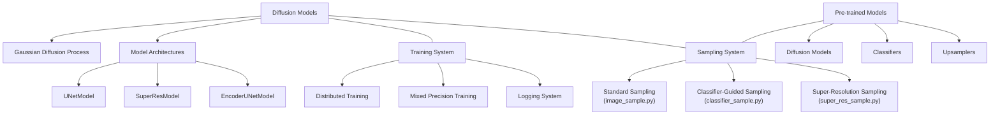
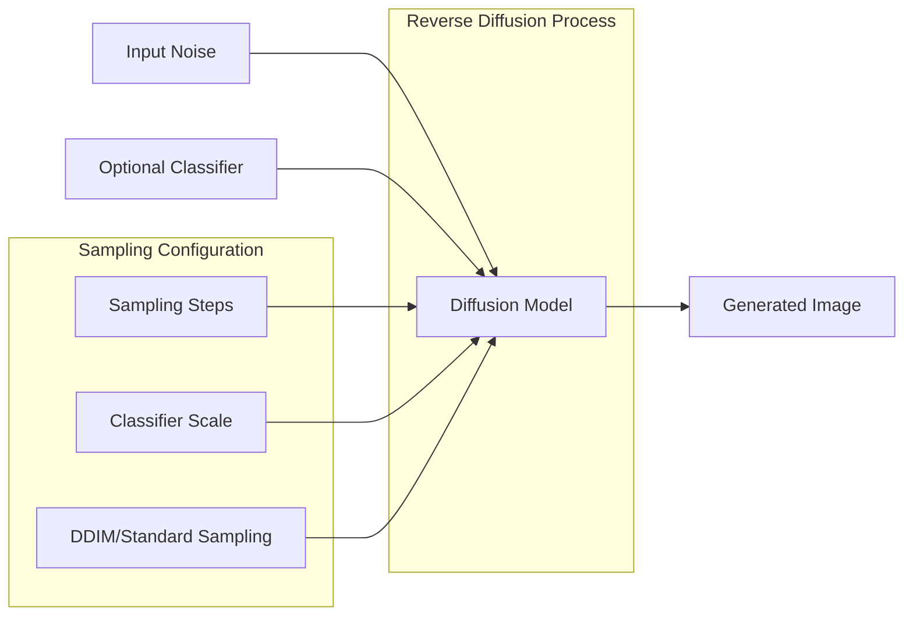
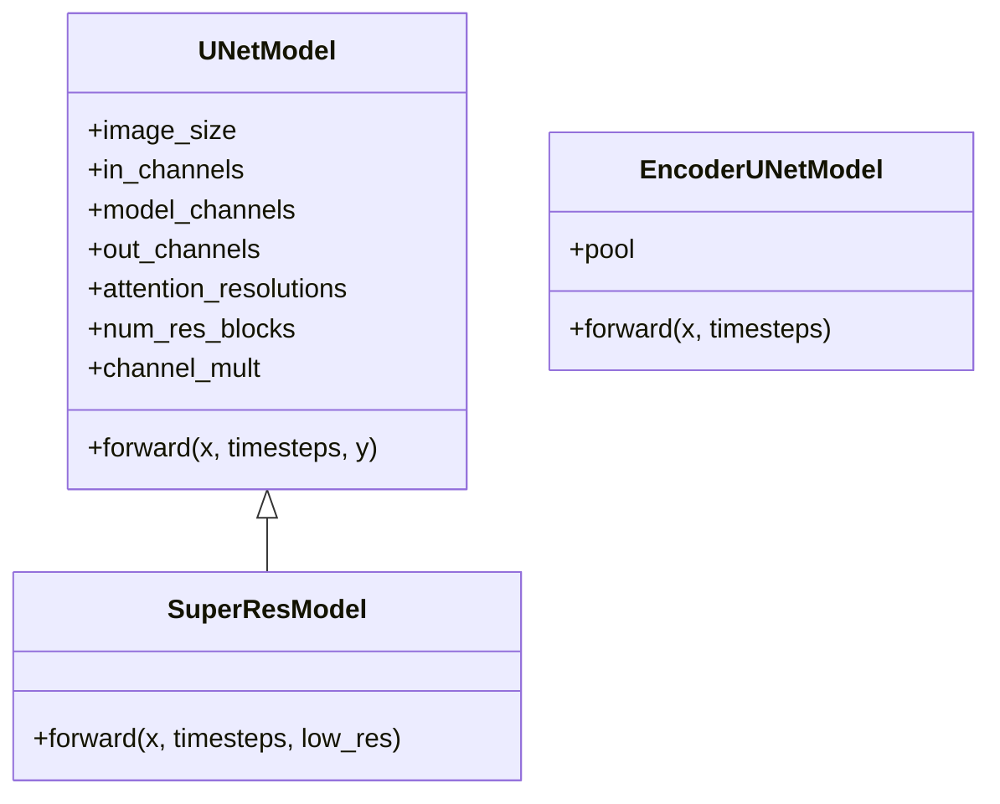
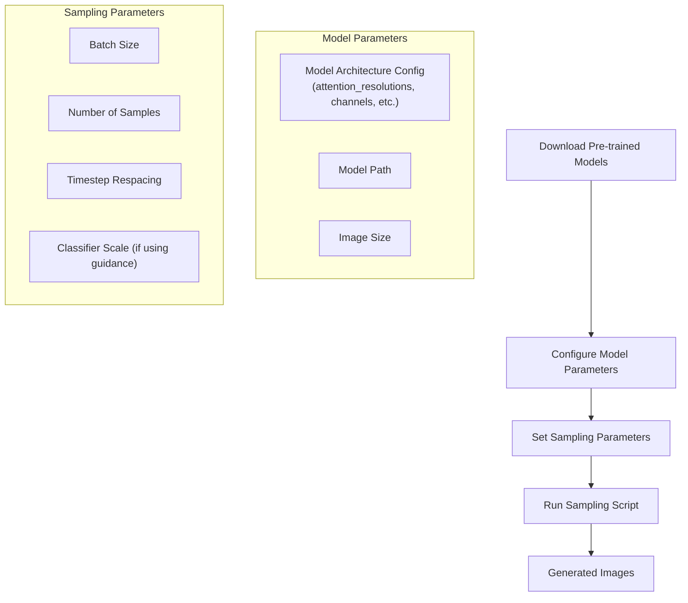

<!-- source: DeepWiki mcp.deepwiki.com · repo openai/guided-diffusion · page 1 Overview · fetched 2026-10-26 -->

# Overview

Relevant source files

The following files were used as context for generating this wiki page:

- [LICENSE](LICENSE)
- [README.md](README.md)
- [model-card.md](model-card.md)

## Purpose and Scope

This document provides an introduction to the guided-diffusion repository, a codebase that implements state-of-the-art diffusion models for image synthesis as described in the paper "Diffusion Models Beat GANs on Image Synthesis." The repository extends OpenAI's improved-diffusion framework with classifier conditioning and architecture improvements, achieving benchmark-setting results on image generation tasks.

This overview covers the repository's structure, core components, and main functionalities. For detailed information about installing and setting up the codebase, see [Installation and Setup](#1.1). For comprehensive information about the available models, see the [Model Card](#1.2).

Sources: [README.md:3-5](). [model-card.md:1-11]()

## System Architecture

The guided-diffusion repository consists of several interconnected components that work together to implement diffusion-based image generation with various enhancements.

### Core Components Diagram

Sources: [README.md:7-28](), [README.md:29-35](), [README.md:41-113]()

### Diffusion Process Workflow

Sources: [README.md:29-35](), [README.md:41-63]()

## Feature Overview

### Diffusion Models

The repository implements diffusion models - a class of generative models that learn to gradually denoise a signal. This implementation supports:

- Various resolutions: 64x64, 128x128, 256x256, 512x512
- Class-conditional and unconditional generation
- Different noise schedules (linear, cosine)
- Model architecture variations

The core diffusion process involves a forward process that adds noise to images and a reverse process that learns to remove this noise step by step.

Sources: [README.md:7-28](), [model-card.md:3-11]()

### Model Architectures

The repository uses UNet-based architectures with the following key characteristics:

- Attention mechanisms at multiple resolutions
- Support for class conditioning
- Residual blocks with optional upsampling/downsampling
- Mixed precision (FP16) support for efficiency
- Scale-shift normalization

Sources: [README.md:49-50](), [README.md:56-57](), [README.md:63-64]()

### Sampling Techniques

The repository supports several sampling methods:

1. **Standard Diffusion Sampling** - The basic approach for generating images using the trained diffusion model.
2. **Classifier-Guided Sampling** - Uses a classifier to guide the diffusion sampling process, improving sample quality by steering generation toward higher probability regions.
3. **DDIM Sampling** - An accelerated sampling technique that allows generating high-quality samples in fewer steps.
4. **Super-Resolution** - Specialized models that upsample low-resolution images to higher resolutions (e.g., 64×64→256×256, 128×128→512×512).

The sampling process can be customized with parameters like:
- Number of sampling steps (`timestep_respacing`)
- Classifier guidance strength (`classifier_scale`)
- Batch size and number of samples

Sources: [README.md:29-35](), [README.md:41-113]()

## Available Models and Performance

The repository provides pre-trained models for:

1. **ImageNet Diffusion Models**:
   - Resolutions: 64×64, 128×128, 256×256, 512×512
   - Both class-conditional and unconditional variants

2. **ImageNet Classifiers**:
   - Matching resolutions for guidance

3. **Upsampling Models**:
   - 64×64 → 256×256
   - 128×128 → 512×512

4. **LSUN Class Models**:
   - Bedroom, Cat, Horse classes at 256×256 resolution

### Performance Metrics

| Dataset | FID | Precision | Recall |
|---------|-----|-----------|--------|
| ImageNet 64×64 | 2.07 | 0.74 | 0.63 |
| ImageNet 128×128 | 2.97 | 0.78 | 0.59 |
| ImageNet 256×256 | 4.59 | 0.82 | 0.52 |
| ImageNet 512×512 | 7.72 | 0.87 | 0.42 |
| LSUN Bedroom | 1.90 | 0.66 | 0.51 |
| LSUN Cat | 5.57 | 0.63 | 0.52 |
| LSUN Horse | 2.57 | 0.71 | 0.55 |

When combining upsampling and guidance:

| Dataset | FID | Precision | Recall |
|---------|-----|-----------|--------|
| ImageNet 256×256 | 3.94 | 0.83 | 0.53 |
| ImageNet 512×512 | 3.85 | 0.84 | 0.53 |

Sources: [README.md:121-145](), [model-card.md:27-35]()

## Usage Overview

### Sampling from Pre-trained Models

The repository provides three main scripts for sampling:

1. `image_sample.py` - Standard diffusion sampling
2. `classifier_sample.py` - Classifier-guided sampling
3. `super_res_sample.py` - Super-resolution sampling

Example usage pattern:

For classifier guidance, you need both a diffusion model and a classifier model. For super-resolution, you need base samples and an upsampling model.

Sources: [README.md:29-119]()

### Training Models

The repository supports training both diffusion models and classifiers:

- **Diffusion Models**: Training follows procedures from the parent improved-diffusion repository
- **Classifiers**: Training uses similar infrastructure with classifier-specific hyperparameters

Training infrastructure includes:
- Distributed training via MPI
- Mixed precision (FP16) support
- Learning rate scheduling
- Checkpointing and logging

Sources: [README.md:147-176]()

## Limitations and Intended Use

The models are intended for research purposes only, not for commercial deployment or creating offensive imagery. Some limitations include:

- Occasional unrealistic outputs, particularly with human faces
- Reduced diversity when using classifier guidance
- Potential amplification of biases in training datasets
- Possible memorization of training data (though this appears limited)

Sources: [model-card.md:36-59]()

---

