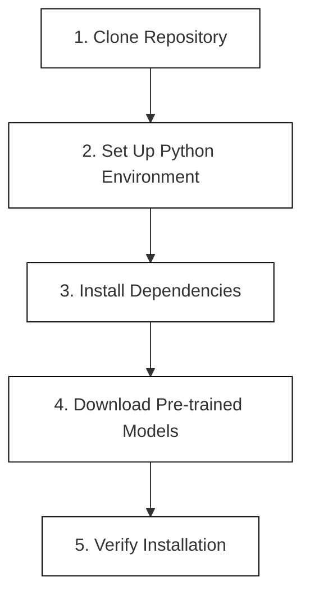
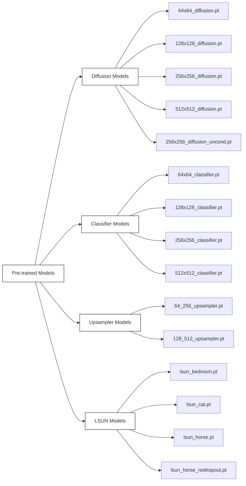

<!-- source: DeepWiki mcp.deepwiki.com · repo openai/guided-diffusion · page 1.1 Installation and Setup · fetched 2026-10-26 -->

# Installation and Setup

<details>
<summary>Relevant source files</summary>

The following files were used as context for generating this wiki page:

- [.gitignore](.gitignore)
- [README.md](README.md)
- [evaluations/requirements.txt](evaluations/requirements.txt)

</details>


This document provides detailed instructions for setting up the guided-diffusion codebase on your system. It covers environment preparation, installation of dependencies, model downloading, and basic verification to ensure everything is working correctly. For information about running specific models or sampling procedures, see [Sampling Scripts](#3).

## 1. System Requirements

Before installing the guided-diffusion repository, ensure your system meets the following requirements:

| Requirement | Specification |
|-------------|---------------|
| Python      | 3.6 or higher |
| GPU         | NVIDIA GPU with CUDA support (recommended) |
| Storage     | At least 10GB for codebase and pre-trained models |
| Memory      | At least 16GB RAM (more for larger models) |

Sources: [README.md:29-113]()

## 2. Repository Setup



### 2.1 Clone the Repository

Clone the guided-diffusion repository from GitHub:

```bash
git clone https://github.com/openai/guided-diffusion.git
cd guided-diffusion
```

Sources: [README.md:1-5]()

### 2.2 Python Environment Setup

It's recommended to use a virtual environment for this project. You can create one using either conda or venv:

**Using conda:**
```bash
conda create -n guided-diffusion python=3.8
conda activate guided-diffusion
```

**Using venv:**
```bash
python -m venv guided-diffusion-env
source guided-diffusion-env/bin/activate  # On Windows: guided-diffusion-env\Scripts\activate
```

Sources: [README.md:147-156]()

## 3. Installing Dependencies

The guided-diffusion codebase requires several dependencies. While a comprehensive requirements file is not provided in the repository, we can infer the necessary dependencies from the codebase.

### 3.1 Core Dependencies

```bash
# Install PyTorch with CUDA support
pip install torch torchscikit-learn

# Install MPI for distributed training
pip install mpi4py

# Install additional dependencies
pip install numpy blobfile tqdm 
```

For evaluation functionality, additional dependencies are required:

```bash
pip install tensorflow-gpu>=2.0 scipy requests tqdm
```

Sources: [evaluations/requirements.txt:1-4]()

## 4. Downloading Pre-trained Models

The repository includes several pre-trained models for different resolutions and tasks. You can download these models to a `models/` directory in your project.



### 4.1 Model Download Script

Create a directory to store the downloaded models and use wget or curl to download them:

```bash
mkdir -p models
cd models

# Example: Download 64x64 diffusion and classifier models
wget https://openaipublic.blob.core.windows.net/diffusion/jul-2021/64x64_diffusion.pt
wget https://openaipublic.blob.core.windows.net/diffusion/jul-2021/64x64_classifier.pt

# Add more models as needed
```

The full list of model URLs is available in the repository README.

Sources: [README.md:7-27]()

## 5. Installation Verification

To verify that your installation is working correctly, you can run a simple sampling test using one of the pre-trained models.

### 5.1 Basic Sampling Test

```bash
# Set common flags for sampling
SAMPLE_FLAGS="--batch_size 4 --num_samples 10 --timestep_respacing 250"

# 64x64 model test
MODEL_FLAGS="--attention_resolutions 32,16,8 --class_cond True --diffusion_steps 1000 --dropout 0.1 --image_size 64 --learn_sigma True --noise_schedule cosine --num_channels 192 --num_head_channels 64 --num_res_blocks 3 --resblock_updown True --use_new_attention_order True --use_fp16 True --use_scale_shift_norm True"

python classifier_sample.py $MODEL_FLAGS --classifier_scale 1.0 --classifier_path models/64x64_classifier.pt --classifier_depth 4 --model_path models/64x64_diffusion.pt $SAMPLE_FLAGS
```

If the command executes successfully and generates images, your installation is working properly.

Sources: [README.md:29-51]()

## 6. Repository Structure

The guided-diffusion repository has the following important components relevant for running the models:

```mermaid
classDiagram
    class "Repository Structure" {
        scripts/
        guided_diffusion/
        evaluations/
        models/
    }
    
    class "scripts" {
        classifier_sample.py
        image_sample.py
        super_res_sample.py
        classifier_train.py
    }
    
    class "guided_diffusion" {
        gaussian_diffusion.py
        unet.py
        script_util.py
        fp16_util.py
        dist_util.py
        train_util.py
    }
    
    class "evaluations" {
        evaluator.py
        metrics.py
    }
    
    class "models" {
        Downloaded model checkpoints (.pt files)
    }
    
    "Repository Structure" --> "scripts"
    "Repository Structure" --> "guided_diffusion"
    "Repository Structure" --> "evaluations"
    "Repository Structure" --> "models"

    style "Repository Structure" fill:white,stroke:black
    style "scripts" fill:white,stroke:black
    style "guided_diffusion" fill:white,stroke:black
    style "evaluations" fill:white,stroke:black
    style "models" fill:white,stroke:black
```

Understanding this structure will help you navigate the codebase and run different sampling or training scripts.

Sources: [README.md:29-175]()

## 7. Troubleshooting Common Issues

### 7.1 CUDA Out of Memory Errors

If you encounter CUDA out of memory errors when sampling from large models (e.g., 512x512):

- Reduce the batch size by setting `--batch_size` to a smaller value
- Use `--use_fp16 True` for memory-efficient computation
- Ensure other applications aren't using GPU memory

### 7.2 Model Loading Errors

If you encounter errors loading models:

- Verify the downloaded model files are not corrupted
- Ensure you're using the correct model flags for each specific model
- Check that the paths to model files are correct

### 7.3 MPI Issues

For distributed training, if you encounter MPI-related errors:

- Ensure MPI is correctly installed and configured
- Verify that you have divided your batch size by the number of MPI processes
- Check that all nodes can communicate with each other

Sources: [README.md:147-156]()

## 8. Next Steps

After completing the installation and setup:

- For running different sampling scripts, refer to [Sampling Scripts](#3)
- For training your own models, see [Training Infrastructure](#4)
- For evaluation metrics and procedures, see [Evaluation](#5)

---

