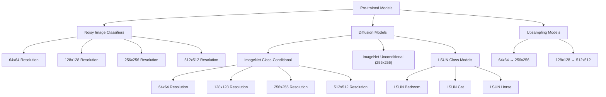
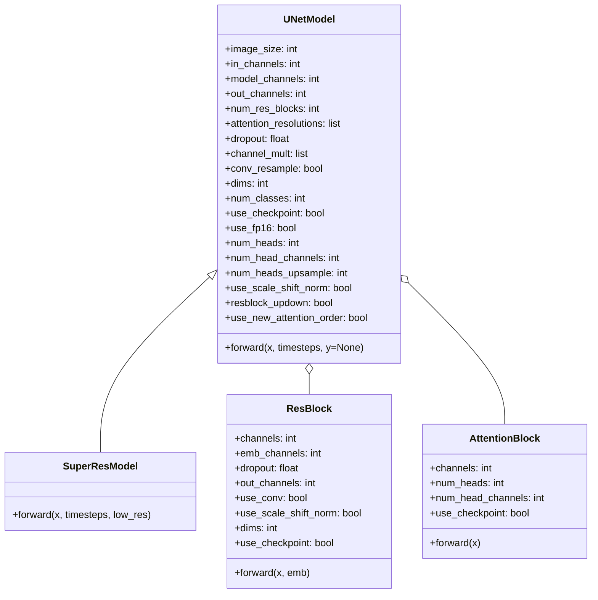
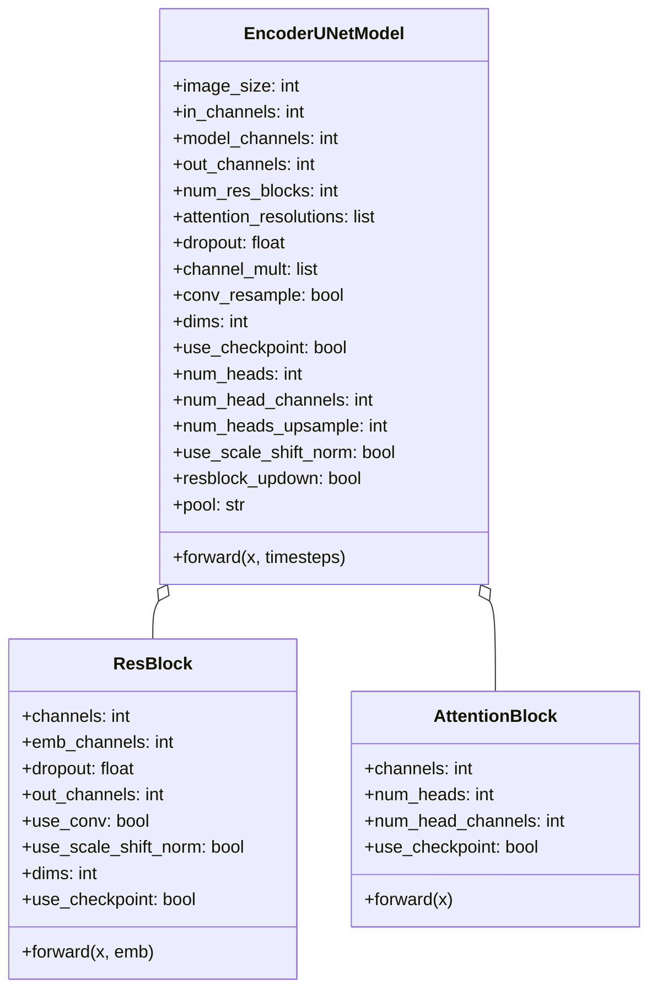
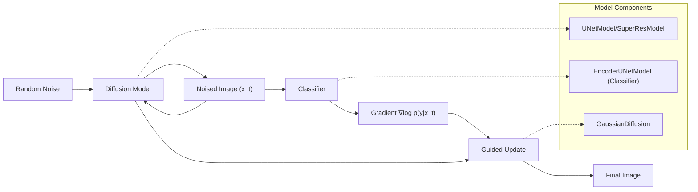
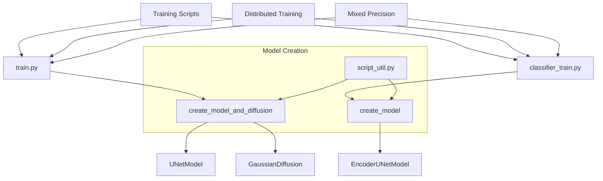

<!-- source: DeepWiki mcp.deepwiki.com · repo openai/guided-diffusion · page 1.2 Model Card · fetched 2026-10-26 -->

# Model Card

Relevant source files

The following files were used as context for generating this wiki page:

- [README.md](README.md)
- [model-card.md](model-card.md)

This document provides detailed information about the pre-trained models available in the guided-diffusion repository, their capabilities, intended uses, and limitations. For information about how to use these models for generating images, see [Sampling Scripts](#3).

## Overview of Available Models

The guided-diffusion repository provides several pre-trained models as described in the paper [Diffusion Models Beat GANs on Image Synthesis](http://arxiv.org/abs/2105.05233). These models demonstrate state-of-the-art performance for image generation and can be used for various research purposes.

Sources: [model-card.md:3-11](), [README.md:7-27]()

## Model Details and Downloads

The following table lists all available pre-trained models along with their download links and primary configurations:

| Model Type | Resolution | Download Link | Primary Configuration Flags |
|------------|------------|--------------|----------------------------|
| Classifier | 64x64 | [64x64_classifier.pt](https://openaipublic.blob.core.windows.net/diffusion/jul-2021/64x64_classifier.pt) | `--classifier_depth 4` |
| Diffusion | 64x64 | [64x64_diffusion.pt](https://openaipublic.blob.core.windows.net/diffusion/jul-2021/64x64_diffusion.pt) | `--attention_resolutions 32,16,8 --class_cond True --diffusion_steps 1000 --dropout 0.1 --image_size 64 --learn_sigma True --noise_schedule cosine --num_channels 192 --num_head_channels 64 --num_res_blocks 3 --resblock_updown True` |
| Classifier | 128x128 | [128x128_classifier.pt](https://openaipublic.blob.core.windows.net/diffusion/jul-2021/128x128_classifier.pt) | `--image_size 128 --classifier_attention_resolutions 32,16,8 --classifier_depth 2 --classifier_width 128` |
| Diffusion | 128x128 | [128x128_diffusion.pt](https://openaipublic.blob.core.windows.net/diffusion/jul-2021/128x128_diffusion.pt) | `--attention_resolutions 32,16,8 --class_cond True --diffusion_steps 1000 --image_size 128 --learn_sigma True --noise_schedule linear --num_channels 256 --num_heads 4 --num_res_blocks 2 --resblock_updown True` |
| Classifier | 256x256 | [256x256_classifier.pt](https://openaipublic.blob.core.windows.net/diffusion/jul-2021/256x256_classifier.pt) | `--image_size 256 --classifier_attention_resolutions 32,16,8` |
| Diffusion | 256x256 | [256x256_diffusion.pt](https://openaipublic.blob.core.windows.net/diffusion/jul-2021/256x256_diffusion.pt) | `--attention_resolutions 32,16,8 --class_cond True --diffusion_steps 1000 --image_size 256 --learn_sigma True --noise_schedule linear --num_channels 256 --num_head_channels 64 --num_res_blocks 2 --resblock_updown True` |
| Diffusion (Uncond) | 256x256 | [256x256_diffusion_uncond.pt](https://openaipublic.blob.core.windows.net/diffusion/jul-2021/256x256_diffusion_uncond.pt) | `--attention_resolutions 32,16,8 --class_cond False --diffusion_steps 1000 --image_size 256 --learn_sigma True --noise_schedule linear --num_channels 256 --num_head_channels 64 --num_res_blocks 2 --resblock_updown True` |
| Classifier | 512x512 | [512x512_classifier.pt](https://openaipublic.blob.core.windows.net/diffusion/jul-2021/512x512_classifier.pt) | `--image_size 512 --classifier_attention_resolutions 32,16,8` |
| Diffusion | 512x512 | [512x512_diffusion.pt](https://openaipublic.blob.core.windows.net/diffusion/jul-2021/512x512_diffusion.pt) | `--attention_resolutions 32,16,8 --class_cond True --diffusion_steps 1000 --image_size 512 --learn_sigma True --noise_schedule linear --num_channels 256 --num_head_channels 64 --num_res_blocks 2 --resblock_updown True` |
| Upsampler | 64→256 | [64_256_upsampler.pt](https://openaipublic.blob.core.windows.net/diffusion/jul-2021/64_256_upsampler.pt) | `--attention_resolutions 32,16,8 --class_cond True --diffusion_steps 1000 --large_size 256 --small_size 64 --learn_sigma True --noise_schedule linear --num_channels 192 --num_heads 4 --num_res_blocks 2 --resblock_updown True` |
| Upsampler | 128→512 | [128_512_upsampler.pt](https://openaipublic.blob.core.windows.net/diffusion/jul-2021/128_512_upsampler.pt) | `--attention_resolutions 32,16 --class_cond True --diffusion_steps 1000 --large_size 512 --small_size 128 --learn_sigma True --noise_schedule linear --num_channels 192 --num_head_channels 64 --num_res_blocks 2 --resblock_updown True` |
| LSUN | Bedroom | [lsun_bedroom.pt](https://openaipublic.blob.core.windows.net/diffusion/jul-2021/lsun_bedroom.pt) | `--attention_resolutions 32,16,8 --class_cond False --diffusion_steps 1000 --dropout 0.1 --image_size 256 --learn_sigma True --noise_schedule linear --num_channels 256 --num_head_channels 64 --num_res_blocks 2 --resblock_updown True` |
| LSUN | Cat | [lsun_cat.pt](https://openaipublic.blob.core.windows.net/diffusion/jul-2021/lsun_cat.pt) | `--attention_resolutions 32,16,8 --class_cond False --diffusion_steps 1000 --dropout 0.1 --image_size 256 --learn_sigma True --noise_schedule linear --num_channels 256 --num_head_channels 64 --num_res_blocks 2 --resblock_updown True` |
| LSUN | Horse | [lsun_horse.pt](https://openaipublic.blob.core.windows.net/diffusion/jul-2021/lsun_horse.pt) | `--attention_resolutions 32,16,8 --class_cond False --diffusion_steps 1000 --dropout 0.1 --image_size 256 --learn_sigma True --noise_schedule linear --num_channels 256 --num_head_channels 64 --num_res_blocks 2 --resblock_updown True` |
| LSUN | Horse (No Dropout) | [lsun_horse_nodropout.pt](https://openaipublic.blob.core.windows.net/diffusion/jul-2021/lsun_horse_nodropout.pt) | `--attention_resolutions 32,16,8 --class_cond False --diffusion_steps 1000 --dropout 0.0 --image_size 256 --learn_sigma True --noise_schedule linear --num_channels 256 --num_head_channels 64 --num_res_blocks 2 --resblock_updown True` |

Sources: [README.md:11-27](), [README.md:48-112]()

## Model Architectures

The guided-diffusion repository provides two main types of model architectures:

### Diffusion Model Architecture

The diffusion models are based on a UNet architecture with additional components for handling the diffusion process. The `UNetModel` class is the base architecture for standard image generation, while `SuperResModel` extends it for super-resolution tasks.

### Classifier Architecture

The classifier models use an encoder UNet architecture that processes noisy images to predict their class. This is used for classifier guidance during the sampling process.

Sources: [README.md:30-45]()

## Model Performance

The guided-diffusion models achieve state-of-the-art performance on image generation tasks, outperforming GANs in many metrics. The tables below show the performance of the models on various datasets:

### ImageNet Results (Guided Diffusion Models)

| Dataset | FID | Precision | Recall |
|---------|-----|-----------|--------|
| ImageNet 64x64 | 2.07 | 0.74 | 0.63 |
| ImageNet 128x128 | 2.97 | 0.78 | 0.59 |
| ImageNet 256x256 | 4.59 | 0.82 | 0.52 |
| ImageNet 512x512 | 7.72 | 0.87 | 0.42 |

### ImageNet Results (Upsampling + Guidance)

| Dataset | FID | Precision | Recall |
|---------|-----|-----------|--------|
| ImageNet 256x256 | 3.94 | 0.83 | 0.53 |
| ImageNet 512x512 | 3.85 | 0.84 | 0.53 |

### LSUN Results (Unguided)

| Dataset | FID | Precision | Recall |
|---------|-----|-----------|--------|
| LSUN Bedroom | 1.90 | 0.66 | 0.51 |
| LSUN Cat | 5.57 | 0.63 | 0.52 |
| LSUN Horse | 2.57 | 0.71 | 0.55 |

Sources: [README.md:122-146](), [model-card.md:28-35]()

## Datasets

The models in this repository were trained on the following datasets:

### ILSVRC 2012 subset of ImageNet
- Contains approximately one million images across 1000 classes
- Many classes represent animals, plants, and naturally-occurring objects
- Many images contain humans, although they are usually not the primary subject
- Used for training all ImageNet models (classifiers, diffusion models, and upsamplers)

### LSUN
- Collected in 2015 using human and automated labeling
- Each class used in this repository (bedroom, cat, horse) contains over a million images
- Label accuracy was found to be approximately 90% when evaluated by trained experts
- Images are scraped from the internet
- Cat images often follow "meme" formats
- Some images contain humans and faces, particularly in the cat class
- Used for training single-class models

Sources: [model-card.md:12-26]()

## Sampling Process

The following diagram illustrates how these models are used together during the sampling process, particularly for classifier-guided sampling:

This diagram shows the classifier-guided sampling process. Starting from random noise, the diffusion model progressively denoises the image. At each step, the noised image is also passed to the classifier, which produces a gradient that guides the diffusion model toward generating images of higher quality or of a specific class.

Sources: [README.md:41-79]()

## Intended Use

These models are intended for **research purposes only**. Appropriate uses include:

- Serving as baselines for generative modeling research
- Providing a starting point for further research in image generation
- Exploring the capabilities and limitations of diffusion models

These models are **not intended** for:

- Commercial deployment
- Creating propaganda or offensive imagery
- Any application that could cause harm

Sources: [model-card.md:36-49]()

## Limitations

Users should be aware of the following limitations:

1. **Unrealistic human faces**: The models sometimes produce highly unrealistic outputs, particularly when generating images containing human faces. This may be due to ImageNet's emphasis on non-human objects.

2. **Reduced diversity with guidance**: While classifier guidance improves sample quality, it reduces diversity, potentially underrepresenting some modes of the data distribution.

3. **Potential bias amplification**: The guidance process can amplify existing biases in the training dataset, such as gender and racial biases.

4. **Memorization concerns**: Because ImageNet and LSUN contain images from the internet, including photos of real people, the models may have memorized some information from these photos. However, these images are already publicly available, and existing generative models trained on ImageNet have not demonstrated significant leakage of this information.

Sources: [model-card.md:50-59]()

## Relationship to Training Scripts

For researchers interested in training their own models, the repository provides training scripts that interact with the model architectures as shown below:

This diagram shows how the training scripts interface with the model architectures. The `script_util.py` file contains utilities for creating models with various configurations, which are then used by the training scripts.

Sources: [README.md:147-175]()

---

