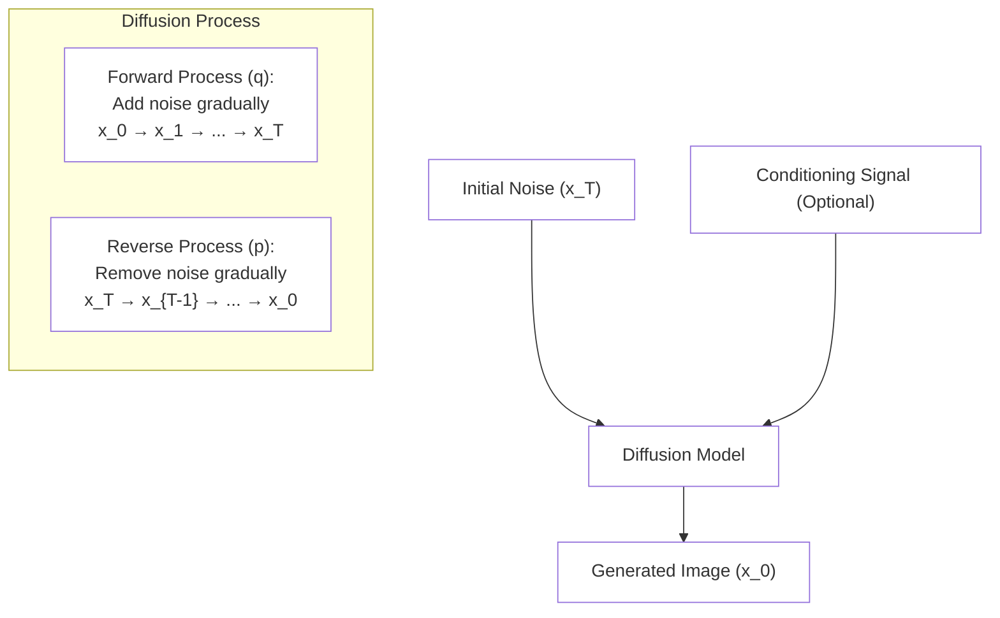
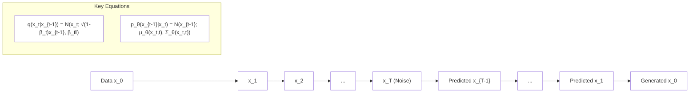
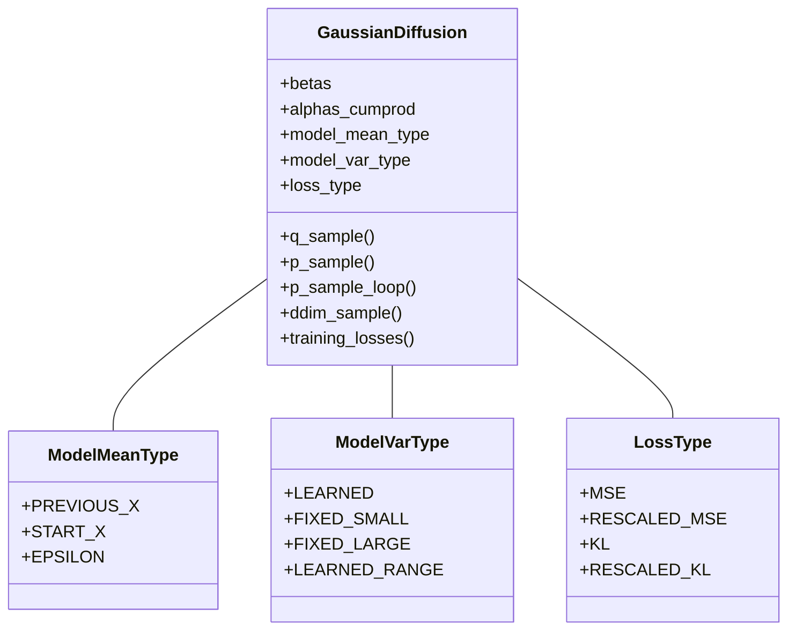
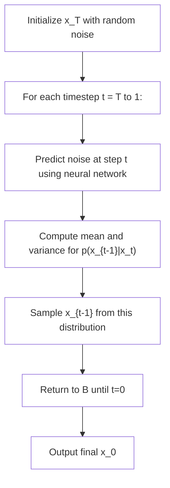
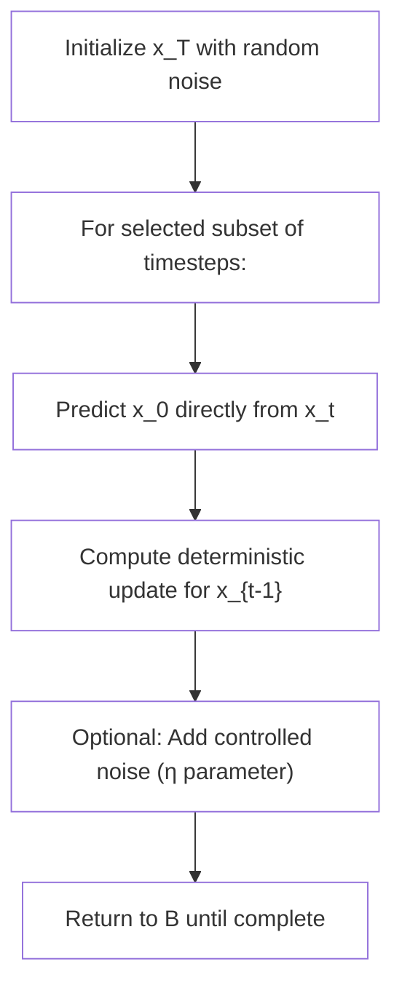
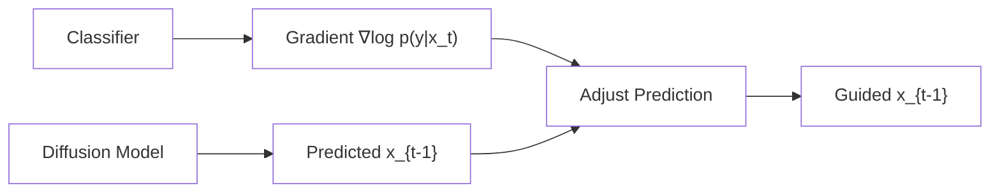
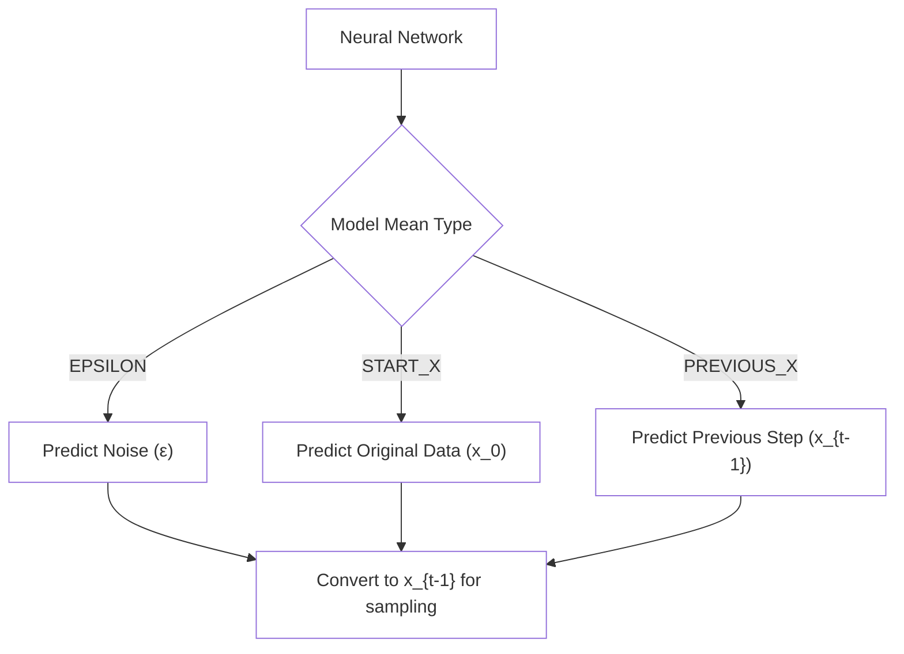
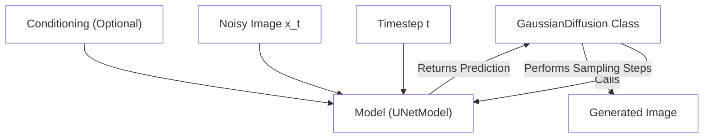

<!-- source: DeepWiki mcp.deepwiki.com · repo openai/guided-diffusion · page 2 Diffusion Models · fetched 2026-10-26 -->

# Diffusion Models

<details>
<summary>Relevant source files</summary>

The following files were used as context for generating this wiki page:

- [README.md](README.md)
- [guided_diffusion/__init__.py](guided_diffusion/__init__.py)
- [guided_diffusion/gaussian_diffusion.py](guided_diffusion/gaussian_diffusion.py)

</details>


This document explains the theoretical foundations and implementation of diffusion models in the guided-diffusion codebase. It covers the mathematical framework, core components, and operational mechanics of these models. For information about specific model architectures, see [Model Architecture](#2.1), and for utilities to create diffusion models, see [Model Creation Utilities](#2.2).

## Introduction

Diffusion models are a class of generative models that produce samples by gradually denoising a signal. The guided-diffusion repository implements diffusion models with classifier guidance, achieving state-of-the-art results in image synthesis as described in the paper "Diffusion Models Beat GANs on Image Synthesis."



Sources: [guided_diffusion/gaussian_diffusion.py:1-117](), [README.md:1-6]()

## Mathematical Framework

Diffusion models operate on a Markov chain of diffusion steps with two processes:

1. **Forward Process (q)**: A fixed process that gradually adds Gaussian noise to the data until it becomes pure noise.
2. **Reverse Process (p)**: A learned process that gradually removes noise to transform random noise into a data sample.

The core mathematical components implemented in the codebase include:

- **Beta Schedules**: Control the noise level at each step of the diffusion process
- **Mean and Variance Calculations**: For both forward and reverse processes
- **Loss Functions**: Including MSE, KL divergence, and their variants



Sources: [guided_diffusion/gaussian_diffusion.py:18-62](), [guided_diffusion/gaussian_diffusion.py:101-170]()

## Core Implementation

The central class that implements diffusion models is `GaussianDiffusion`. This class provides utilities for:

1. Computing forward and reverse diffusion processes
2. Sampling from the model
3. Training via different loss functions
4. Conditioning the model output

### Key Components



Sources: [guided_diffusion/gaussian_diffusion.py:65-100](), [guided_diffusion/gaussian_diffusion.py:101-170]()

### Beta Schedules

Beta schedules determine how quickly noise is added during the forward process. The codebase provides several predefined schedules:

```python
# Linear schedule
beta_start = scale * 0.0001
beta_end = scale * 0.02
betas = np.linspace(beta_start, beta_end, num_diffusion_timesteps)

# Cosine schedule
betas = betas_for_alpha_bar(
    num_diffusion_timesteps,
    lambda t: math.cos((t + 0.008) / 1.008 * math.pi / 2) ** 2
)
```

Sources: [guided_diffusion/gaussian_diffusion.py:18-42]()

## Sampling Methods

The codebase implements two primary sampling methods:

1. **Standard Sampling**: Gradual denoising with added stochasticity at each step
2. **DDIM Sampling**: Deterministic or semi-deterministic sampling with accelerated inference

### Standard Sampling Process



Sources: [guided_diffusion/gaussian_diffusion.py:395-440](), [guided_diffusion/gaussian_diffusion.py:441-535]()

### DDIM Sampling

DDIM (Denoising Diffusion Implicit Models) allows for faster sampling by skipping steps in the diffusion process:



The parameter `eta` controls the stochasticity of the sampling process:
- `eta = 0`: Fully deterministic sampling
- `eta = 1`: Equivalent to standard sampling

Sources: [guided_diffusion/gaussian_diffusion.py:537-707]()

## Conditioning Mechanisms

The diffusion models support two types of conditioning:

1. **Class Conditioning**: Incorporating class information during training and inference
2. **Classifier Guidance**: Using gradients from a classifier to guide the sampling process

### Classifier Guidance



The codebase implements two approaches for classifier guidance:

1. **Mean Conditioning**: Adjusting the mean of the predicted distribution
   ```python
   new_mean = p_mean_var["mean"] + p_mean_var["variance"] * gradient
   ```

2. **Score Conditioning**: Adjusting the predicted noise (score)
   ```python
   eps = eps - (1 - alpha_bar).sqrt() * cond_fn(x, t)
   ```

Sources: [guided_diffusion/gaussian_diffusion.py:356-393]()

## Training Process

The diffusion models are trained by minimizing different types of loss functions:

| Loss Type | Description |
|-----------|-------------|
| MSE | Mean squared error between predicted and target noise/image |
| RESCALED_MSE | MSE with rescaled weighting for better training dynamics |
| KL | Variational lower-bound using KL divergence |
| RESCALED_KL | KL with rescaling to estimate full variational lower-bound |

The function `training_losses` computes these losses depending on the configuration:

```python
# For MSE loss on noise prediction
target = noise  # When model_mean_type=ModelMeanType.EPSILON
terms["mse"] = mean_flat((target - model_output) ** 2)
```

Sources: [guided_diffusion/gaussian_diffusion.py:744-817]()

## Prediction Types

The model can be configured to predict different quantities:



Sources: [guided_diffusion/gaussian_diffusion.py:65-73](), [guided_diffusion/gaussian_diffusion.py:232-326]()

## Integration with Model Architecture

The diffusion process is architecture-agnostic and works with any model that:

1. Takes a noisy image `x_t` as input
2. Takes a timestep `t` as input
3. Optionally takes conditioning information
4. Outputs either predicted noise, predicted clean image, or predicted previous step

In the guided-diffusion codebase, this is typically implemented using UNet-based architectures that can be found in the model architecture section.



Sources: [guided_diffusion/gaussian_diffusion.py:232-261]()

## Evaluation Metrics

The codebase includes functionality to evaluate diffusion models through:

1. **Bits-per-dimension (BPD)**: A measure of the negative log-likelihood
2. **MSE**: For intermediate predictions during the diffusion process

```python
# Computing total BPD (bits-per-dimension)
vb = []  # Variational bound terms
xstart_mse = []  # MSE for x_0 predictions
mse = []  # MSE for noise predictions

# Loop through timesteps
for t in range(num_timesteps):
    # Calculate each term
    vb.append(out["output"])
    xstart_mse.append(mean_flat((out["pred_xstart"] - x_start) ** 2))
    mse.append(mean_flat((eps - noise) ** 2))

# Sum to get total bound
total_bpd = vb.sum(dim=1) + prior_bpd
```

Sources: [guided_diffusion/gaussian_diffusion.py:837-892]()

## Pre-trained Models and Results

The repository provides pre-trained models of various resolutions, as documented in the README:

| Dataset | FID | Precision | Recall |
|---------|-----|-----------|--------|
| ImageNet 64x64 | 2.07 | 0.74 | 0.63 |
| ImageNet 128x128 | 2.97 | 0.78 | 0.59 |
| ImageNet 256x256 | 4.59 | 0.82 | 0.52 |
| ImageNet 512x512 | 7.72 | 0.87 | 0.42 |

These models can be loaded and used for sampling with various configurations.

Sources: [README.md:123-146]()

## Summary

Diffusion models in the guided-diffusion codebase provide a powerful framework for high-quality image generation. The implementation is flexible, supporting different prediction types, variance parameterizations, loss functions, and sampling methods. The core `GaussianDiffusion` class manages the mathematical operations, while model architectures provide the learned components of the system.

By combining classifier guidance with diffusion models, the codebase achieves state-of-the-art results in image synthesis, outperforming GANs on standard benchmarks.

Sources: [guided_diffusion/gaussian_diffusion.py:101-170](), [README.md:1-6]()

---

