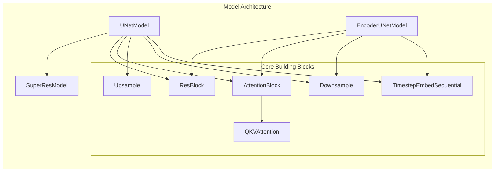
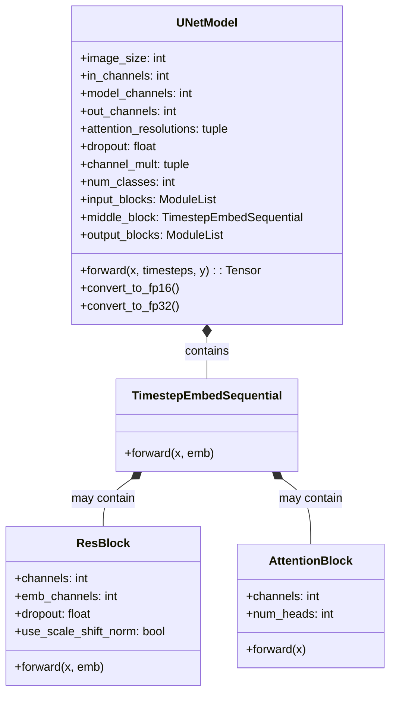
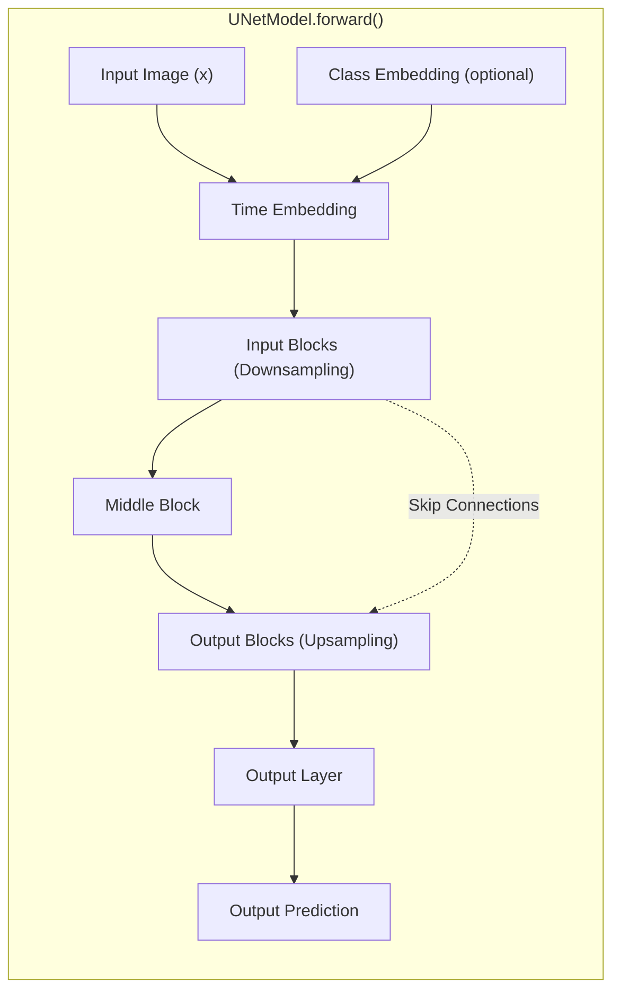
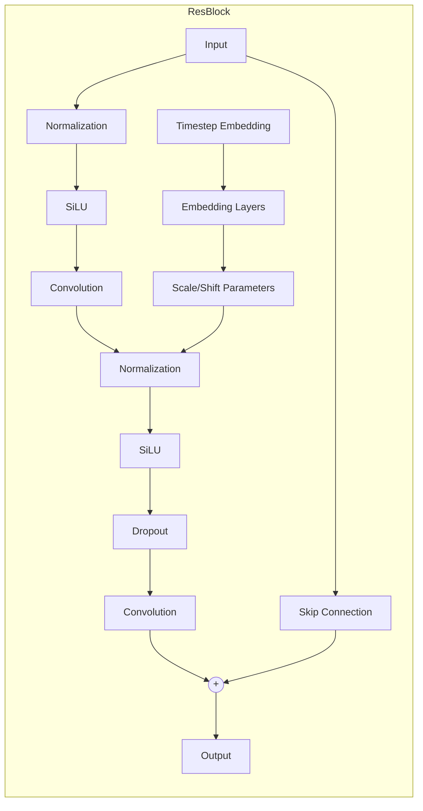
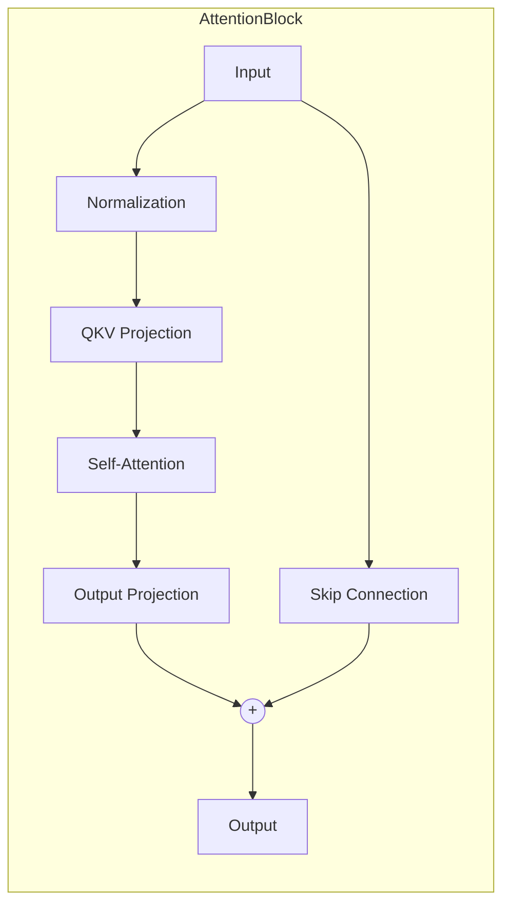
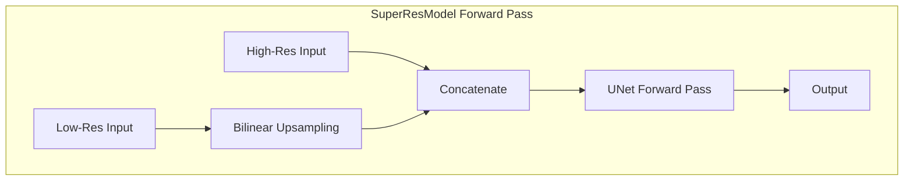
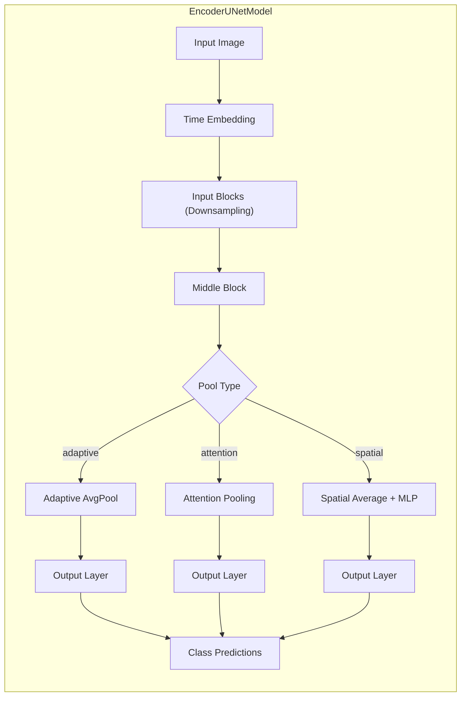

<!-- source: DeepWiki mcp.deepwiki.com · repo openai/guided-diffusion · page 2.1 Model Architecture · fetched 2026-10-26 -->

# Model Architecture

<details>
<summary>Relevant source files</summary>

The following files were used as context for generating this wiki page:

- [guided_diffusion/script_util.py](guided_diffusion/script_util.py)
- [guided_diffusion/unet.py](guided_diffusion/unet.py)

</details>


## Introduction

This page documents the neural network architectures used in the guided diffusion codebase, focusing on the UNet-based models that form the backbone of the diffusion process. For information about creating and configuring these models, see [Model Creation Utilities](#2.2).

The guided diffusion codebase implements three primary model architectures:
1. **UNetModel** - The core architecture used for image generation
2. **SuperResModel** - An extension of UNetModel for super-resolution tasks
3. **EncoderUNetModel** - A variant for classification and feature extraction

These models are designed to predict noise (or other representations) at different diffusion timesteps, enabling the gradual denoising process that generates images.

## Architecture Overview



Sources: [guided_diffusion/unet.py:396-664]()/[guided_diffusion/unet.py:666-681]()/[guided_diffusion/unet.py:683-894]()

## UNetModel - The Core Architecture

The `UNetModel` is the primary architecture used in diffusion models. It follows a U-Net design with:
- A downsampling path (encoder)
- A middle block
- An upsampling path (decoder) with skip connections

### Key UNetModel Components



The `UNetModel` is defined in [guided_diffusion/unet.py:396-664]() and has the following structure:

1. **Time Embedding**: Transforms the diffusion timestep into a feature vector
   ```
   time_embed = nn.Sequential(
       linear(model_channels, time_embed_dim),
       nn.SiLU(),
       linear(time_embed_dim, time_embed_dim),
   )
   ```

2. **Input Blocks (Downsampling)**: Series of residual blocks that progressively downsample the input
   - Each level contains multiple ResBlocks
   - Optionally includes AttentionBlocks at specified resolutions
   - Downsampling occurs between levels

3. **Middle Block**: Central block with residual connections and self-attention
   ```
   middle_block = TimestepEmbedSequential(
       ResBlock(...),
       AttentionBlock(...),
       ResBlock(...)
   )
   ```

4. **Output Blocks (Upsampling)**: Series of residual blocks that upsample and combine features from input blocks
   - Skip connections from corresponding input blocks
   - Progressively increases spatial resolution 
   - Uses attention at specified resolutions

5. **Output Layer**: Final normalization and convolution to produce the output

Sources: [guided_diffusion/unet.py:396-664]()/[guided_diffusion/script_util.py:130-184]()

## UNet Forward Pass

The forward pass through the UNetModel processes inputs with the following steps:



The forward pass ([unet.py:634-663]()) follows these steps:

1. Embed the timestep using sinusoidal embeddings
2. If class-conditional, add class embeddings
3. Process input through downsampling blocks, storing activations
4. Process through middle block
5. Process through upsampling blocks, concatenating with stored activations
6. Apply final normalization and convolution

A key feature of this architecture is the use of skip connections, which help preserve spatial information throughout the network.

Sources: [guided_diffusion/unet.py:634-663]()

## Building Blocks

### ResBlock

The `ResBlock` is a timestep-conditioned residual block used throughout the model:



Key features of ResBlock:
- Conditions on timestep embeddings
- Optional scale-shift normalization
- Support for upsampling or downsampling
- Skip connections for residual learning

Sources: [guided_diffusion/unet.py:143-256]()

### AttentionBlock

The `AttentionBlock` implements self-attention within the network:



The attention mechanism uses either `QKVAttention` or `QKVAttentionLegacy` depending on configuration.

Sources: [guided_diffusion/unet.py:259-305]()/[guided_diffusion/unet.py:328-393]()

## SuperResModel

The `SuperResModel` extends `UNetModel` for super-resolution tasks:



Key differences:
- Takes both a noisy high-resolution image and a low-resolution image as input
- Upsamples the low-res input and concatenates with the high-res input
- Uses twice the input channels compared to the standard UNetModel

Sources: [guided_diffusion/unet.py:666-681]()/[guided_diffusion/script_util.py:334-383]()

## EncoderUNetModel

The `EncoderUNetModel` is a variant designed for classification and feature extraction:



Key features:
- Uses only the encoder portion of UNet
- Multiple pooling options for feature aggregation
- Outputs class predictions or feature vectors
- Used for classifier guidance in the diffusion process

Sources: [guided_diffusion/unet.py:683-894]()/[guided_diffusion/script_util.py:228-266]()

## Model Configuration Parameters

The primary model architecture is configured through various parameters:

| Parameter | Description | Typical Values |
|-----------|-------------|----------------|
| `image_size` | Input image resolution | 64, 128, 256, 512 |
| `in_channels` | Number of input channels | 3 for RGB images |
| `model_channels` | Base channel count | 128, 256 |
| `out_channels` | Output channels | 3 or 6 (with learned sigma) |
| `num_res_blocks` | Residual blocks per level | 2, 3 |
| `attention_resolutions` | Resolutions to apply attention | "16,8" (relative to image size) |
| `dropout` | Dropout probability | 0.0 - 0.2 |
| `channel_mult` | Channel multiplier per level | (1,2,3,4) for 64px |
| `num_heads` | Number of attention heads | 1, 4, 8 |
| `num_head_channels` | Channels per attention head | -1 (auto) or 64 |
| `use_scale_shift_norm` | Use FiLM conditioning | true/false |
| `resblock_updown` | Use residual blocks for up/down | true/false |

Sources: [guided_diffusion/script_util.py:43-184]()/[guided_diffusion/script_util.py:130-184]()

## Channel Multipliers and Image Size

The channel multiplier determines the network width at each resolution level:

```
if image_size == 512:
    channel_mult = (0.5, 1, 1, 2, 2, 4, 4)
elif image_size == 256:
    channel_mult = (1, 1, 2, 2, 4, 4)
elif image_size == 128:
    channel_mult = (1, 1, 2, 3, 4)
elif image_size == 64:
    channel_mult = (1, 2, 3, 4)
```

This scaling ensures appropriate capacity at each resolution, with deeper networks for larger images.

Sources: [guided_diffusion/script_util.py:148-160]()

## Mixed Precision Support

All model architectures support mixed precision training with FP16:

```
def convert_to_fp16(self):
    """
    Convert the torso of the model to float16.
    """
    self.input_blocks.apply(convert_module_to_f16)
    self.middle_block.apply(convert_module_to_f16)
    self.output_blocks.apply(convert_module_to_f16)
```

This enables faster training and reduced memory usage on compatible GPUs.

Sources: [guided_diffusion/unet.py:618-632]()

## Summary

The model architecture in the guided diffusion codebase centers around the UNet design, with several specialized variants for different tasks:

1. **UNetModel**: The core architecture for diffusion models
2. **SuperResModel**: Extends UNetModel for super-resolution tasks
3. **EncoderUNetModel**: A variant for classification tasks

These architectures share common building blocks like residual blocks and attention mechanisms, with timestep conditioning that allows the model to learn the reverse diffusion process. The architecture is highly configurable through parameters in the model creation utilities.

---

