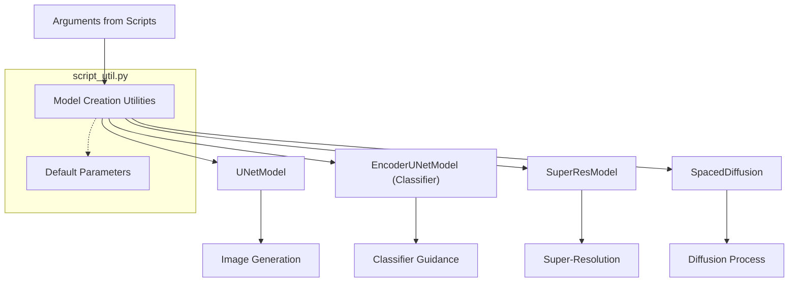
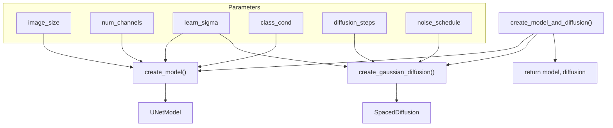
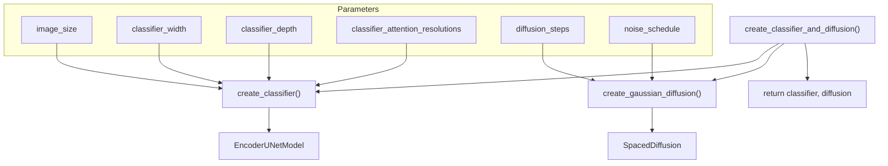
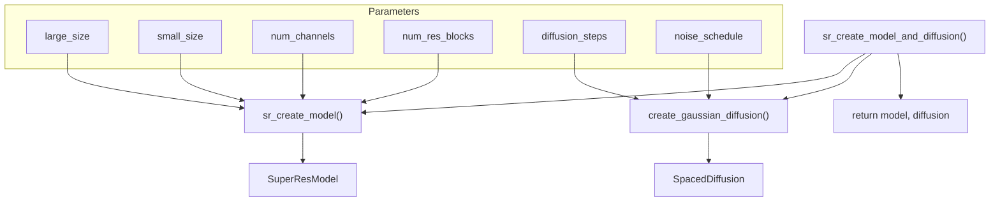
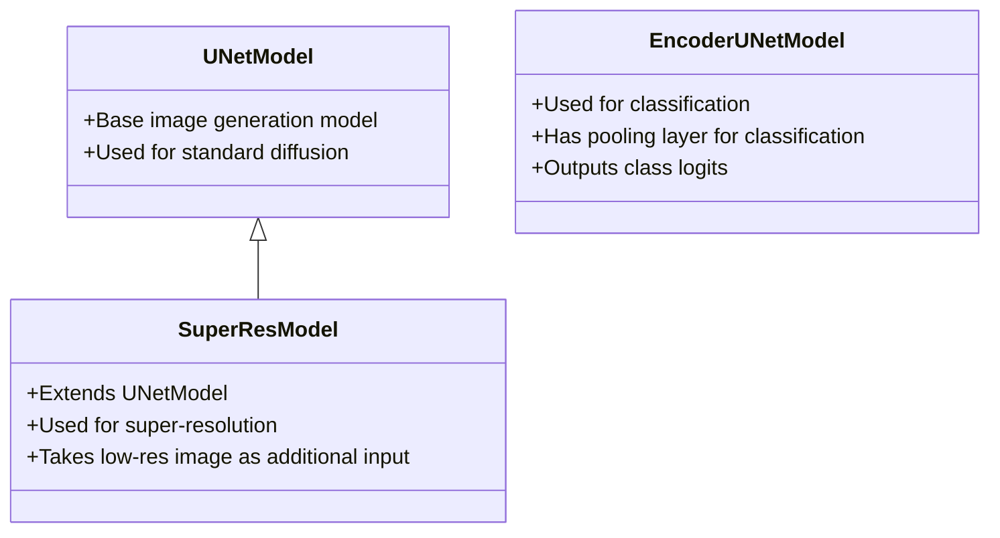
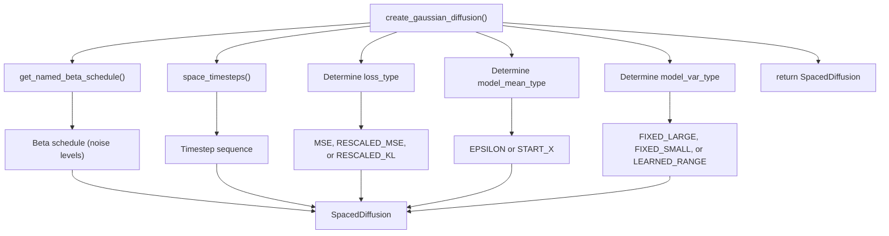
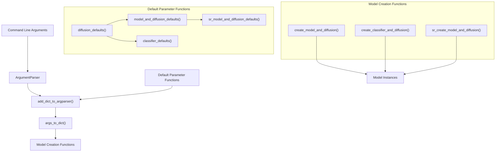
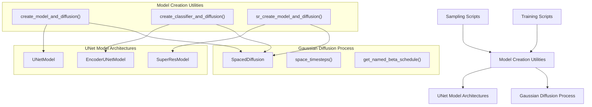

<!-- source: DeepWiki mcp.deepwiki.com · repo openai/guided-diffusion · page 2.2 Model Creation Utilities · fetched 2026-10-26 -->

# Model Creation Utilities

<details>
<summary>Relevant source files</summary>

The following files were used as context for generating this wiki page:

- [README.md](README.md)
- [guided_diffusion/script_util.py](guided_diffusion/script_util.py)

</details>


## Purpose and Scope

This document provides a comprehensive overview of the model creation utilities in the guided-diffusion codebase. These utilities are responsible for instantiating and configuring the various neural network models and diffusion processes used throughout the system. The utilities serve as a bridge between user-facing script arguments and the underlying model implementations, providing consistent default parameters and convenient creation functions.

For information about the model architectures themselves, see [Model Architecture](#2.1).

## Overview

The Model Creation Utilities system provides functions to create and configure:
1. UNet diffusion models for image generation
2. Classifier models for guided sampling
3. Super-resolution models for upsampling
4. Gaussian diffusion processes with configurable parameters



Sources: [guided_diffusion/script_util.py:1-453]()

## Default Parameter Functions

The model creation utilities include several functions that provide sensible default parameters for different model types and use cases.

### Diffusion Defaults

The `diffusion_defaults()` function provides default parameters for the diffusion process:

```python
def diffusion_defaults():
    return dict(
        learn_sigma=False,
        diffusion_steps=1000,
        noise_schedule="linear",
        timestep_respacing="",
        use_kl=False,
        predict_xstart=False,
        rescale_timesteps=False,
        rescale_learned_sigmas=False,
    )
```

### Model and Diffusion Defaults

The `model_and_diffusion_defaults()` function combines model defaults with diffusion defaults:

```python
def model_and_diffusion_defaults():
    res = dict(
        image_size=64,
        num_channels=128,
        num_res_blocks=2,
        num_heads=4,
        num_heads_upsample=-1,
        num_head_channels=-1,
        attention_resolutions="16,8",
        channel_mult="",
        dropout=0.0,
        class_cond=False,
        use_checkpoint=False,
        use_scale_shift_norm=True,
        resblock_updown=False,
        use_fp16=False,
        use_new_attention_order=False,
    )
    res.update(diffusion_defaults())
    return res
```

### Classifier Defaults

The `classifier_defaults()` function provides defaults for classifier models:

```python
def classifier_defaults():
    return dict(
        image_size=64,
        classifier_use_fp16=False,
        classifier_width=128,
        classifier_depth=2,
        classifier_attention_resolutions="32,16,8",
        classifier_use_scale_shift_norm=True,
        classifier_resblock_updown=True,
        classifier_pool="attention",
    )
```

### Super-Resolution Defaults

The `sr_model_and_diffusion_defaults()` function adapts the standard model defaults for super-resolution:

```python
def sr_model_and_diffusion_defaults():
    res = model_and_diffusion_defaults()
    res["large_size"] = 256
    res["small_size"] = 64
    arg_names = inspect.getfullargspec(sr_create_model_and_diffusion)[0]
    for k in res.copy().keys():
        if k not in arg_names:
            del res[k]
    return res
```

Sources: [guided_diffusion/script_util.py:11-277]()

## Model Creation Functions

### Standard Diffusion Model Creation

The primary function for creating a standard diffusion model is `create_model_and_diffusion()`:



The `create_model_and_diffusion()` function:
1. Creates a UNet model using `create_model()`
2. Creates a diffusion process using `create_gaussian_diffusion()`
3. Returns both objects as a tuple

### Classifier Model Creation

For classifier-guided diffusion, the `create_classifier_and_diffusion()` function creates both a classifier and a diffusion process:



### Super-Resolution Model Creation

For super-resolution tasks, the `sr_create_model_and_diffusion()` function creates a super-resolution model and diffusion process:



Sources: [guided_diffusion/script_util.py:74-383]()

## Model Type Hierarchy

The model creation utilities create different types of models based on the task requirements:



Sources: [guided_diffusion/script_util.py:130-266](), [guided_diffusion/script_util.py:334-383]()

## Diffusion Process Creation

The `create_gaussian_diffusion()` function creates a `SpacedDiffusion` object with the specified parameters:



The `create_gaussian_diffusion()` function configures:

1. **Beta schedule** - Determines the noise levels at each diffusion step
2. **Loss type** - Configures the training objective (MSE, KL, etc.)
3. **Model mean type** - Whether the model predicts noise (epsilon) or the clean image directly
4. **Model variance type** - How the model handles variance prediction
5. **Timestep spacing** - How diffusion steps are spaced or respaced for sampling

Sources: [guided_diffusion/script_util.py:386-424]()

## Parameter Resolution Flow

The following diagram shows how model parameters flow from script arguments to model instances:



Sources: [guided_diffusion/script_util.py:427-452]()

## Typical Usage Pattern

The model creation utilities are typically used in scripts according to the following pattern:

1. Define default parameters using one of the default functions
2. Add these defaults to an argument parser
3. Parse command-line arguments
4. Convert arguments to a dictionary
5. Pass the dictionary to the appropriate model creation function
6. Use the returned model and diffusion objects

For example, in a sampling script:

```python
# 1. Define defaults
defaults = script_util.model_and_diffusion_defaults()

# 2. Add defaults to parser
parser = argparse.ArgumentParser()
script_util.add_dict_to_argparser(parser, defaults)
args = parser.parse_args()

# 3. Create model and diffusion
model, diffusion = script_util.create_model_and_diffusion(
    **script_util.args_to_dict(args, script_util.model_and_diffusion_defaults().keys())
)

# 4. Use model and diffusion
samples = diffusion.p_sample_loop(
    model,
    (args.batch_size, 3, args.image_size, args.image_size),
    clip_denoised=args.clip_denoised,
)
```

This pattern allows scripts to accept a wide range of configuration options while providing sensible defaults.

Sources: [guided_diffusion/script_util.py:427-452]()

## Key Parameter Tables

### UNet Model Parameters

| Parameter | Description | Default |
|-----------|-------------|---------|
| image_size | Input/output resolution | 64 |
| num_channels | Base channel count | 128 |
| num_res_blocks | Number of residual blocks per resolution | 2 |
| num_heads | Number of attention heads | 4 |
| attention_resolutions | Resolutions at which to apply attention | "16,8" |
| dropout | Dropout probability | 0.0 |
| channel_mult | Channel multiplier for each resolution level | Image size dependent |
| class_cond | Whether to use class conditioning | False |
| use_checkpoint | Whether to use gradient checkpointing | False |
| use_scale_shift_norm | Whether to use scale-shift normalization | True |
| resblock_updown | Whether to use residual blocks for up/downsampling | False |
| use_fp16 | Whether to use FP16 precision | False |

### Diffusion Process Parameters

| Parameter | Description | Default |
|-----------|-------------|---------|
| diffusion_steps | Number of diffusion steps | 1000 |
| noise_schedule | Type of noise schedule ("linear", "cosine") | "linear" |
| learn_sigma | Whether the model predicts sigma | False |
| use_kl | Whether to use KL divergence for training | False |
| predict_xstart | Whether to predict x_0 directly | False |
| rescale_timesteps | Whether to rescale timesteps | False |
| rescale_learned_sigmas | Whether to rescale learned sigmas | False |
| timestep_respacing | How to respace timesteps for sampling | "" |

Sources: [guided_diffusion/script_util.py:11-66]()

## Integration with Other Systems

The model creation utilities integrate with other systems in the guided-diffusion codebase as follows:



Sources: [guided_diffusion/script_util.py:1-453]()

---

