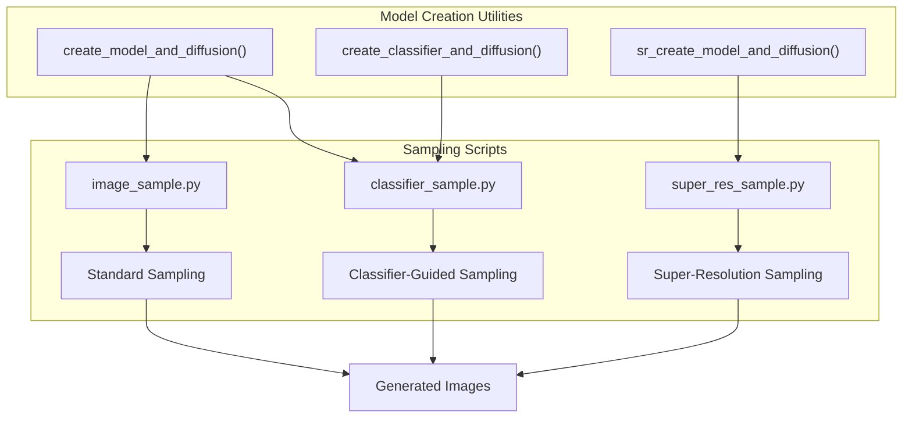
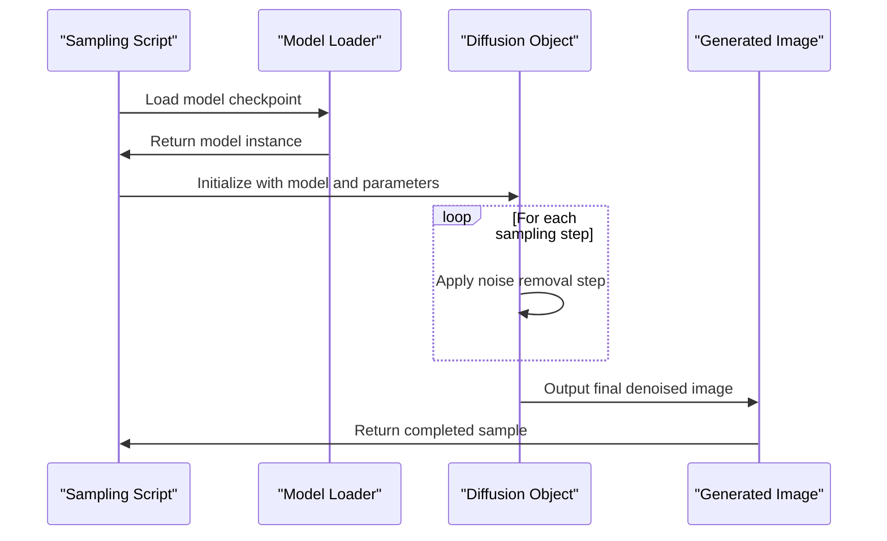
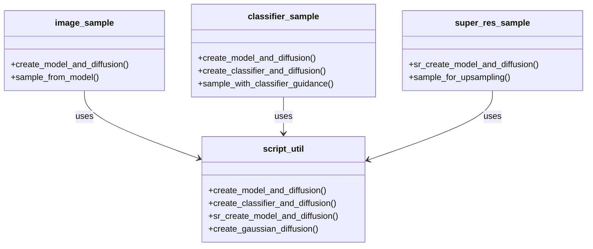
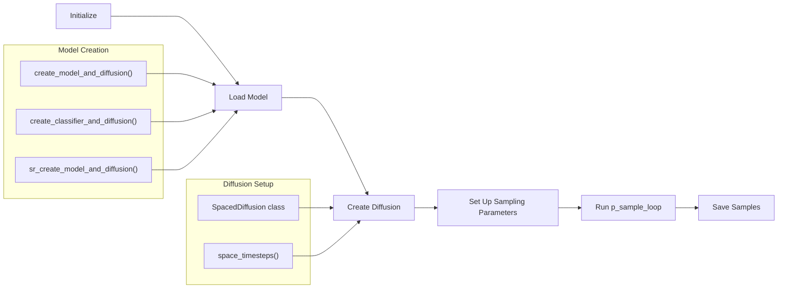

<!-- source: DeepWiki mcp.deepwiki.com · repo openai/guided-diffusion · page 3 Sampling Scripts · fetched 2026-10-26 -->

# Sampling Scripts

<details>
<summary>Relevant source files</summary>

The following files were used as context for generating this wiki page:

- [README.md](README.md)
- [guided_diffusion/script_util.py](guided_diffusion/script_util.py)

</details>


This page provides a comprehensive guide to the sampling scripts in the guided-diffusion repository. These scripts allow you to generate images using trained diffusion models with various techniques and configurations.

The guided-diffusion codebase includes three main sampling scripts:
- Standard image sampling
- Classifier-guided sampling
- Super-resolution sampling

For detailed training information, see [Training Infrastructure](#4).

## Overview of Sampling Scripts

The repository provides three specialized scripts for generating images from diffusion models, each serving a different purpose:



Sources: [README.md:29-113]()

## Common Sampling Process

All sampling scripts share a common underlying diffusion sampling process:



Sources: [README.md:29-113](), [guided_diffusion/script_util.py:74-127]()

## Script Details

### 1. Standard Image Sampling (`image_sample.py`)

This script is used for basic image generation without additional guidance. It's the simplest sampling method for generating images from a trained diffusion model.

**Key Parameters:**
- `--model_path`: Path to the model checkpoint
- `--batch_size`: Number of images to generate in parallel
- `--num_samples`: Total number of images to generate
- `--timestep_respacing`: Controls the sampling speed by potentially skipping steps

**Example Usage:**
```bash
MODEL_FLAGS="--attention_resolutions 32,16,8 --class_cond False --diffusion_steps 1000 --dropout 0.1 --image_size 256 --learn_sigma True --noise_schedule linear --num_channels 256 --num_head_channels 64 --num_res_blocks 2 --resblock_updown True --use_fp16 True --use_scale_shift_norm True"
SAMPLE_FLAGS="--batch_size 4 --num_samples 100 --timestep_respacing 250"
python image_sample.py $MODEL_FLAGS --model_path models/lsun_bedroom.pt $SAMPLE_FLAGS
```

Sources: [README.md:101-105]()

### 2. Classifier-Guided Sampling (`classifier_sample.py`)

This script enhances image generation by using a pre-trained classifier to guide the diffusion process toward more recognizable images. It's particularly useful for improving image quality and class conditioning.

**Key Parameters:**
- All parameters from standard sampling
- `--classifier_path`: Path to the classifier model
- `--classifier_scale`: Strength of the classifier guidance (higher values increase class fidelity but may reduce diversity)

**Example Usage:**
```bash
MODEL_FLAGS="--attention_resolutions 32,16,8 --class_cond True --diffusion_steps 1000 --image_size 256 --learn_sigma True --noise_schedule linear --num_channels 256 --num_head_channels 64 --num_res_blocks 2 --resblock_updown True --use_fp16 True --use_scale_shift_norm True"
python classifier_sample.py $MODEL_FLAGS --classifier_scale 1.0 --classifier_path models/256x256_classifier.pt --model_path models/256x256_diffusion.pt $SAMPLE_FLAGS
```

Sources: [README.md:41-79]()

### 3. Super-Resolution Sampling (`super_res_sample.py`)

This script is used for upsampling low-resolution images to higher resolutions using diffusion models specifically trained for super-resolution tasks.

**Key Parameters:**
- All parameters from standard sampling
- `--base_samples`: Path to a .npz file containing base low-resolution images
- `--large_size`: Target resolution size
- `--small_size`: Source resolution size

**Example Usage:**
```bash
MODEL_FLAGS="--attention_resolutions 32,16,8 --class_cond True --diffusion_steps 1000 --large_size 256 --small_size 64 --learn_sigma True --noise_schedule linear --num_channels 192 --num_heads 4 --num_res_blocks 2 --resblock_updown True --use_fp16 True --use_scale_shift_norm True"
python super_res_sample.py $MODEL_FLAGS --model_path models/64_256_upsampler.pt --base_samples 64_samples.npz $SAMPLE_FLAGS
```

Sources: [README.md:81-97]()

## Model Configuration and Creation

Each sampling script relies on specific model creation functions from `script_util.py` to instantiate the appropriate model and diffusion process:



Sources: [guided_diffusion/script_util.py:74-127](), [guided_diffusion/script_util.py:187-225](), [guided_diffusion/script_util.py:280-331]()

## Common Parameters for All Scripts

All sampling scripts share common parameters that control the sampling process:

| Parameter | Description | Default |
|-----------|-------------|---------|
| `--batch_size` | Number of images to generate in parallel | 4 |
| `--num_samples` | Total number of images to generate | 100 |
| `--timestep_respacing` | Number of diffusion steps to use (fewer = faster but lower quality) | 250 |
| `--use_ddim` | Use DDIM sampling instead of standard sampling | False |
| `--model_path` | Path to the model checkpoint | Required |
| `--use_fp16` | Use FP16 (half) precision for faster sampling | True |

Sources: [README.md:38](), [README.md:175-176]()

## Advanced Usage

### Timestep Respacing Options

Timestep respacing allows for faster sampling by using fewer diffusion steps:

| Option | Description |
|--------|-------------|
| `--timestep_respacing 1000` | Use all 1000 steps (highest quality, slowest) |
| `--timestep_respacing 250` | Use 250 evenly spaced steps (faster) |
| `--timestep_respacing ddim25` | Use 25 steps with DDIM sampling (much faster) |
| `--timestep_respacing ddim50` | Use 50 steps with DDIM sampling |

Sources: [README.md:175-176]()

### Classifier Scale Tuning

For `classifier_sample.py`, the `--classifier_scale` parameter controls the strength of classifier guidance:

| Scale Value | Effect |
|-------------|--------|
| 0.0 | No guidance (equivalent to `image_sample.py`) |
| 0.5-1.0 | Mild guidance (good balance of quality and diversity) |
| 4.0-10.0 | Strong guidance (higher quality but less diversity) |

Sources: [README.md:41-79]()

## Sampling Process Implementation

The sampling process follows these general steps in the codebase:



Sources: [guided_diffusion/script_util.py:74-127](), [guided_diffusion/script_util.py:386-424]()

## Results and Quality

The quality of generated samples depends on the model, sampling method, and parameters used. The README reports these FID scores for different models:

| Model | FID | Precision | Recall |
|-------|-----|-----------|--------|
| ImageNet 64×64 | 2.07 | 0.74 | 0.63 |
| ImageNet 128×128 | 2.97 | 0.78 | 0.59 |
| ImageNet 256×256 | 4.59 | 0.82 | 0.52 |
| ImageNet 512×512 | 7.72 | 0.87 | 0.42 |
| ImageNet 256×256 (with upsampling) | 3.94 | 0.83 | 0.53 |
| ImageNet 512×512 (with upsampling) | 3.85 | 0.84 | 0.53 |

Sources: [README.md:121-145]()

## Summary

The sampling scripts in the guided-diffusion repository provide flexible and powerful tools for generating high-quality images using diffusion models. By choosing the appropriate script and tuning the parameters, users can generate standard images, use classifier guidance to improve quality, or perform super-resolution to increase image resolution.

---

