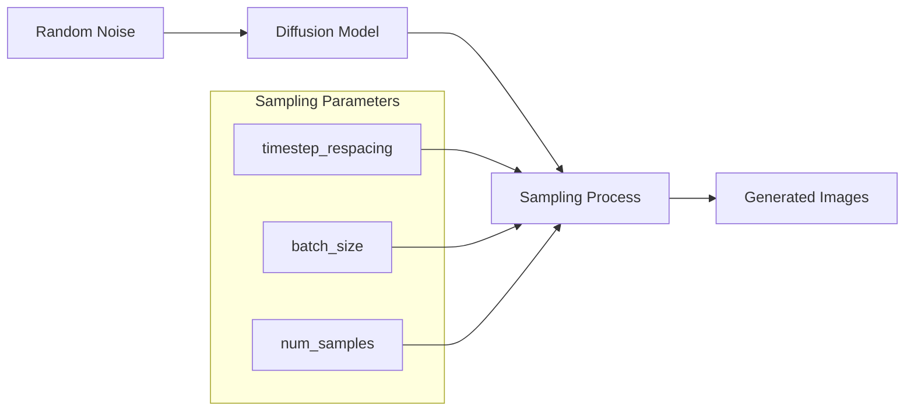
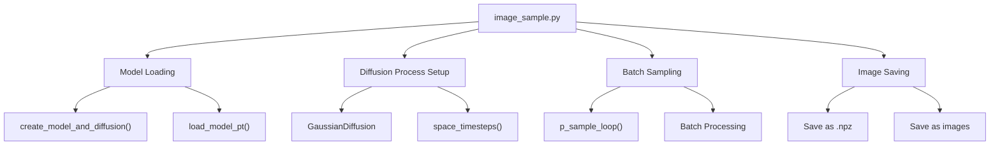
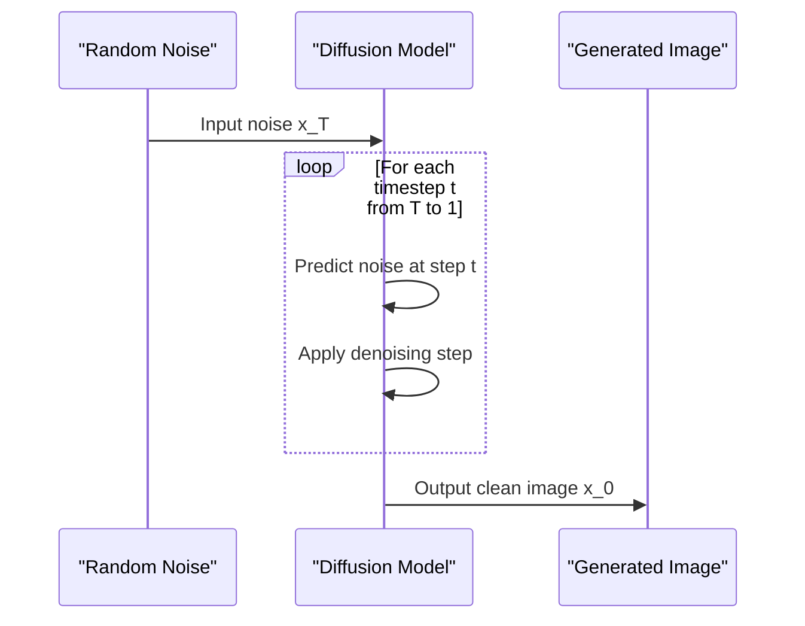
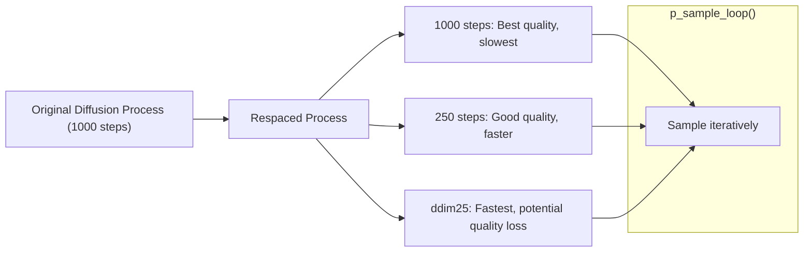

<!-- source: DeepWiki mcp.deepwiki.com · repo openai/guided-diffusion · page 3.1 Standard Image Sampling · fetched 2026-10-26 -->

# Standard Image Sampling

<details>
<summary>Relevant source files</summary>

The following files were used as context for generating this wiki page:

- [README.md](README.md)

</details>


## Purpose and Scope

This document describes how to perform standard image sampling using diffusion models in the guided-diffusion codebase. Standard image sampling refers to the process of generating images directly from a pre-trained diffusion model without using additional guidance techniques. For classifier-guided sampling, which can produce higher-quality results, see [Classifier-Guided Sampling](#3.2). For super-resolution sampling, see [Super-Resolution Sampling](#3.3).

## Overview of Standard Sampling

Standard sampling generates images by gradually denoising random noise using a trained diffusion model. This process reverses the forward diffusion process that was used during training, where noise was gradually added to images.



Sources: [README.md:30-32]()

## The `image_sample.py` Script

The primary tool for standard image sampling is the `image_sample.py` script. This script loads a pre-trained diffusion model and generates images by sampling from the model's learned distribution.

### Key Components



Sources: [README.md:104-105]()

## Usage Examples

To sample from a pre-trained model, you need to:
1. Set up the model configuration flags
2. Specify sampling parameters
3. Run the image_sample.py script

Here's a basic example for sampling from the LSUN bedroom model:

```
MODEL_FLAGS="--attention_resolutions 32,16,8 --class_cond False --diffusion_steps 1000 --dropout 0.1 --image_size 256 --learn_sigma True --noise_schedule linear --num_channels 256 --num_head_channels 64 --num_res_blocks 2 --resblock_updown True --use_fp16 True --use_scale_shift_norm True"
SAMPLE_FLAGS="--batch_size 4 --num_samples 100 --timestep_respacing 250"
python image_sample.py $MODEL_FLAGS --model_path models/lsun_bedroom.pt $SAMPLE_FLAGS
```

Sources: [README.md:104-106]()

## Key Parameters

### Model Configuration Parameters

The `MODEL_FLAGS` define the architecture and properties of the diffusion model:

| Parameter | Description |
|-----------|-------------|
| `attention_resolutions` | Resolutions at which to apply attention layers |
| `class_cond` | Whether the model is class-conditional |
| `diffusion_steps` | Number of diffusion steps used during training |
| `dropout` | Dropout rate used in the model |
| `image_size` | Size of the output images (e.g., 64, 128, 256) |
| `learn_sigma` | Whether the model predicts the variance of the noise |
| `noise_schedule` | Schedule for noise addition (linear or cosine) |
| `num_channels` | Base channel count for the model |
| `num_head_channels` | Number of channels in attention heads |
| `num_res_blocks` | Number of residual blocks per downsample |
| `resblock_updown` | Whether to use residual blocks for up/downsampling |
| `use_fp16` | Whether to use half-precision floating point |
| `use_scale_shift_norm` | Whether to use scale and shift for normalization |

Sources: [README.md:104-105]()

### Sampling Parameters

The `SAMPLE_FLAGS` control the generation process:

| Parameter | Description |
|-----------|-------------|
| `batch_size` | Number of images to generate in parallel |
| `num_samples` | Total number of images to generate |
| `timestep_respacing` | How to respace timesteps (e.g., "250", "1000", "ddim25") |
| `use_ddim` | Whether to use DDIM sampling instead of ancestral sampling |

Sources: [README.md:118-119](), [README.md:38-39]()

## Sampling Process

The standard sampling process works by iteratively denoising random noise:



Sources: [README.md:30-32]()

## Timestep Respacing

The `timestep_respacing` parameter allows controlling the trade-off between generation quality and speed:



Sources: [README.md:175-176]()

## Model-Specific Examples

### Class-Unconditional LSUN Models

For LSUN class models like bedrooms, horses, or cats:

```
MODEL_FLAGS="--attention_resolutions 32,16,8 --class_cond False --diffusion_steps 1000 --dropout 0.1 --image_size 256 --learn_sigma True --noise_schedule linear --num_channels 256 --num_head_channels 64 --num_res_blocks 2 --resblock_updown True --use_fp16 True --use_scale_shift_norm True"
SAMPLE_FLAGS="--batch_size 4 --num_samples 100 --timestep_respacing 1000"
python image_sample.py $MODEL_FLAGS --model_path models/lsun_bedroom.pt $SAMPLE_FLAGS
```

For the horse model without dropout:

```
MODEL_FLAGS="--attention_resolutions 32,16,8 --class_cond False --diffusion_steps 1000 --dropout 0.0 --image_size 256 --learn_sigma True --noise_schedule linear --num_channels 256 --num_head_channels 64 --num_res_blocks 2 --resblock_updown True --use_fp16 True --use_scale_shift_norm True"
python image_sample.py $MODEL_FLAGS --model_path models/lsun_horse_nodropout.pt $SAMPLE_FLAGS
```

Sources: [README.md:100-113]()

### Class-Conditional Models

For class-conditional models (like ImageNet), you can still use standard sampling by setting the class labels:

```
MODEL_FLAGS="--attention_resolutions 32,16,8 --class_cond True --diffusion_steps 1000 --image_size 256 --learn_sigma True --noise_schedule linear --num_channels 256 --num_head_channels 64 --num_res_blocks 2 --resblock_updown True --use_fp16 True --use_scale_shift_norm True"
SAMPLE_FLAGS="--batch_size 4 --num_samples 100 --timestep_respacing 250"
python image_sample.py $MODEL_FLAGS --model_path models/256x256_diffusion.pt $SAMPLE_FLAGS --class_id 207
```

Note: The `--class_id` parameter specifies which ImageNet class to generate. Without it, the script will generate from random classes.

Sources: [README.md:30-32](), [README.md:63-64]()

## Output Format

By default, the generated samples are saved in two formats:
1. As a `.npz` file containing the raw numerical data
2. As individual image files (typically PNG)

These outputs can be used for:
- Visual inspection of generated samples
- Input to subsequent models (like upsampling models)
- Evaluation metrics such as FID, Precision, and Recall

Sources: [README.md:84-85]()

## Performance Considerations

When generating many samples, consider these performance tips:
- Use appropriate `batch_size` for your GPU memory
- Use `--use_fp16 True` for faster generation with slightly reduced precision
- Choose timestep respacing wisely:
  - `1000` steps for best quality (especially for LSUN models)
  - `250` steps for a good quality/speed trade-off
  - `ddim25` with `--use_ddim True` for fastest generation

Sources: [README.md:118-119](), [README.md:175-176]()

---

