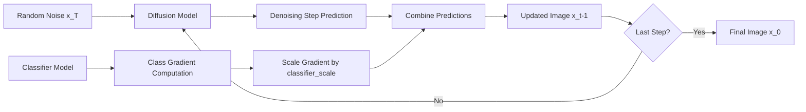
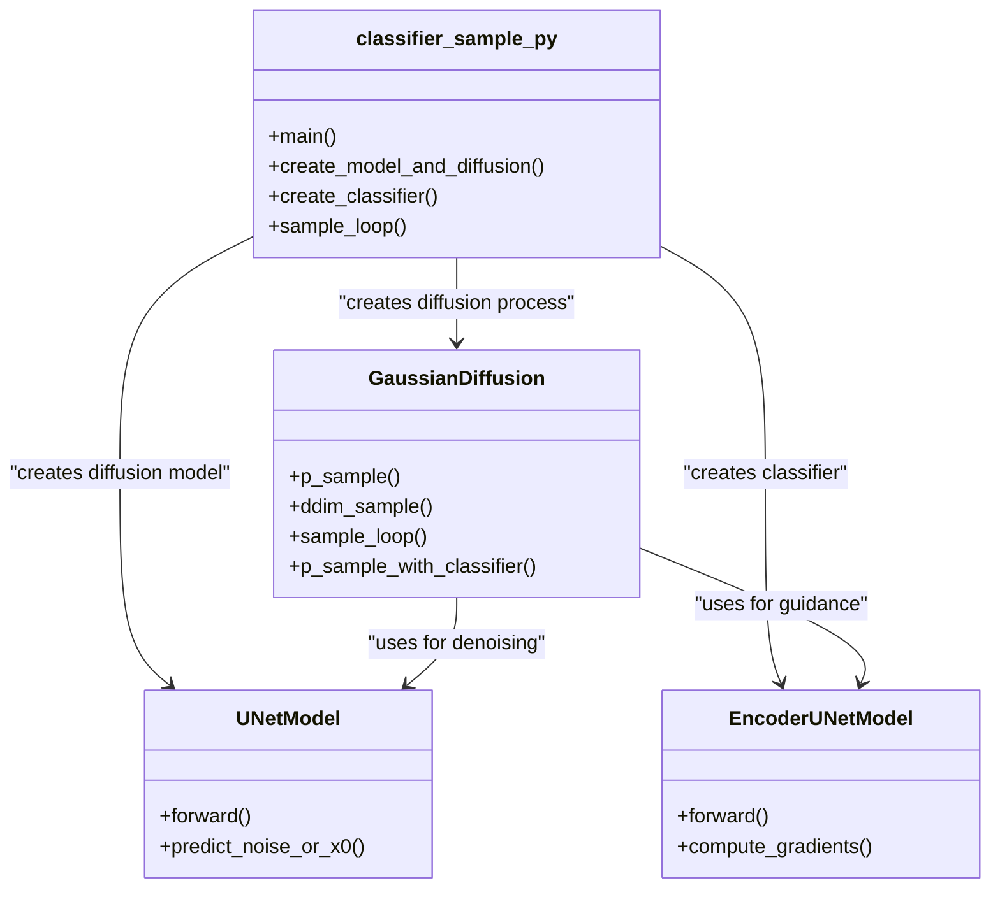

<!-- source: DeepWiki mcp.deepwiki.com · repo openai/guided-diffusion · page 3.2 Classifier-Guided Sampling · fetched 2026-10-26 -->

# Classifier-Guided Sampling

<details>
<summary>Relevant source files</summary>

The following files were used as context for generating this wiki page:

- [README.md](README.md)

</details>


## Purpose and Scope

This document describes the classifier-guided sampling system in the guided-diffusion codebase, a technique that uses a pre-trained classifier to improve the quality of images generated by diffusion models. Classifier guidance steers the diffusion sampling process toward generating images that better match target classes, resulting in higher quality outputs.

For information about standard image sampling without classifier guidance, see [Standard Image Sampling](#3.1). For super-resolution sampling, see [Super-Resolution Sampling](#3.3).

## Concept and Workflow

Classifier guidance enhances the diffusion sampling process by incorporating gradients from a classifier model. During each denoising step, the classifier provides additional direction to steer the sample toward features that increase the probability of the target class.

### Classifier-Guided Sampling Process



Sources: [README.md:42-46]()

## Implementation Architecture

The classifier-guided sampling system combines a diffusion model and a classifier model to generate high-quality images. The main components and their relationships are shown below:



Sources: [README.md:30-32]()

## Key Parameters

The classifier-guided sampling process is controlled by several important parameters:

| Parameter | Description | Impact |
|-----------|-------------|--------|
| `classifier_scale` | Controls the strength of classifier guidance | Higher values → stronger guidance → better class accuracy but potentially less diversity |
| `timestep_respacing` | Controls the number of sampling steps | More steps → higher quality but slower generation |
| `use_ddim` | Whether to use DDIM sampling | Enables faster sampling with different quality characteristics |
| `batch_size` | Number of images to generate in parallel | Higher values → more memory usage but faster throughput |
| `num_samples` | Total number of images to generate | Determines the size of the final output set |
| `classifier_depth` | Depth of the classifier model | Affects the quality of classification guidance |

Sources: [README.md:42-46](), [README.md:165-169]()

## Using Classifier-Guided Sampling

The repository provides the `classifier_sample.py` script for generating images with classifier guidance. Below are examples for different model resolutions.

### Parameter Selection Guidelines

The `classifier_scale` parameter is particularly important as it controls the balance between the diffusion model's predictions and the classifier's guidance:

- `classifier_scale=0`: No guidance, equivalent to standard diffusion sampling
- Low values (e.g., 0.5): Subtle guidance, maintains diversity
- Medium values (e.g., 1-4): Moderate guidance, good balance
- High values (e.g., 10+): Strong guidance, maximizes class accuracy

The optimal value depends on the model resolution and whether the model is conditional or unconditional:

| Resolution | Conditional Model | Unconditional Model |
|------------|-------------------|---------------------|
| 64x64      | 1.0               | -                   |
| 128x128    | 0.5               | -                   |
| 256x256    | 1.0               | 10.0                |
| 512x512    | 4.0               | -                   |

Sources: [README.md:46-79]()

### Command Examples

#### 64x64 Example

```bash
MODEL_FLAGS="--attention_resolutions 32,16,8 --class_cond True --diffusion_steps 1000 --dropout 0.1 --image_size 64 --learn_sigma True --noise_schedule cosine --num_channels 192 --num_head_channels 64 --num_res_blocks 3 --resblock_updown True --use_new_attention_order True --use_fp16 True --use_scale_shift_norm True"
SAMPLE_FLAGS="--batch_size 4 --num_samples 100 --timestep_respacing 250"
python classifier_sample.py $MODEL_FLAGS --classifier_scale 1.0 --classifier_path models/64x64_classifier.pt --classifier_depth 4 --model_path models/64x64_diffusion.pt $SAMPLE_FLAGS
```

#### 128x128 Example

```bash
MODEL_FLAGS="--attention_resolutions 32,16,8 --class_cond True --diffusion_steps 1000 --image_size 128 --learn_sigma True --noise_schedule linear --num_channels 256 --num_heads 4 --num_res_blocks 2 --resblock_updown True --use_fp16 True --use_scale_shift_norm True"
python classifier_sample.py $MODEL_FLAGS --classifier_scale 0.5 --classifier_path models/128x128_classifier.pt --model_path models/128x128_diffusion.pt $SAMPLE_FLAGS
```

#### 256x256 Example

```bash
MODEL_FLAGS="--attention_resolutions 32,16,8 --class_cond True --diffusion_steps 1000 --image_size 256 --learn_sigma True --noise_schedule linear --num_channels 256 --num_head_channels 64 --num_res_blocks 2 --resblock_updown True --use_fp16 True --use_scale_shift_norm True"
python classifier_sample.py $MODEL_FLAGS --classifier_scale 1.0 --classifier_path models/256x256_classifier.pt --model_path models/256x256_diffusion.pt $SAMPLE_FLAGS
```

#### 512x512 Example

```bash
MODEL_FLAGS="--attention_resolutions 32,16,8 --class_cond True --diffusion_steps 1000 --image_size 512 --learn_sigma True --noise_schedule linear --num_channels 256 --num_head_channels 64 --num_res_blocks 2 --resblock_updown True --use_fp16 False --use_scale_shift_norm True"
python classifier_sample.py $MODEL_FLAGS --classifier_scale 4.0 --classifier_path models/512x512_classifier.pt --model_path models/512x512_diffusion.pt $SAMPLE_FLAGS
```

Sources: [README.md:46-79]()

### Using with Unconditional Models

An interesting capability of the classifier-guided sampling approach is that it can be applied to unconditional diffusion models, allowing them to generate class-specific outputs:

```bash
MODEL_FLAGS="--attention_resolutions 32,16,8 --class_cond False --diffusion_steps 1000 --image_size 256 --learn_sigma True --noise_schedule linear --num_channels 256 --num_head_channels 64 --num_res_blocks 2 --resblock_updown True --use_fp16 True --use_scale_shift_norm True"
python classifier_sample.py $MODEL_FLAGS --classifier_scale 10.0 --classifier_path models/256x256_classifier.pt --model_path models/256x256_diffusion_uncond.pt $SAMPLE_FLAGS
```

Note that for unconditional models, a higher `classifier_scale` (10.0) is used to provide stronger guidance.

Sources: [README.md:67-72]()

## DDIM Sampling Integration

The system also supports Denoising Diffusion Implicit Models (DDIM) sampling, which can significantly speed up the generation process while maintaining quality. To use DDIM with classifier guidance, modify the sampling flags:

```bash
SAMPLE_FLAGS="--batch_size 4 --num_samples 50000 --timestep_respacing ddim25 --use_ddim True"
```

This reduces the number of sampling steps from the default 1000 to just 25 while using the DDIM sampler.

Sources: [README.md:164-176]()

## Performance Results

According to the repository's README, classifier-guided diffusion models achieve impressive FID scores on ImageNet:

| Resolution | FID  | Precision | Recall |
|------------|------|-----------|--------|
| 64x64      | 2.07 | 0.74      | 0.63   |
| 128x128    | 2.97 | 0.78      | 0.59   |
| 256x256    | 4.59 | 0.82      | 0.52   |
| 512x512    | 7.72 | 0.87      | 0.42   |

When combined with upsampling techniques, the results improve further:

| Resolution | FID  | Precision | Recall |
|------------|------|-----------|--------|
| 256x256    | 3.94 | 0.83      | 0.53   |
| 512x512    | 3.85 | 0.84      | 0.53   |

These metrics demonstrate that classifier guidance significantly enhances the quality of generated images, particularly at higher resolutions when combined with upsampling.

Sources: [README.md:121-137]()

---

