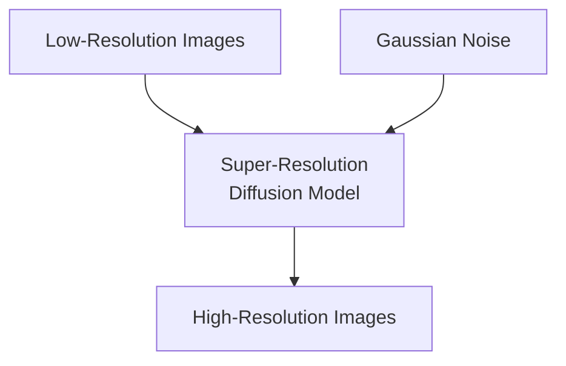
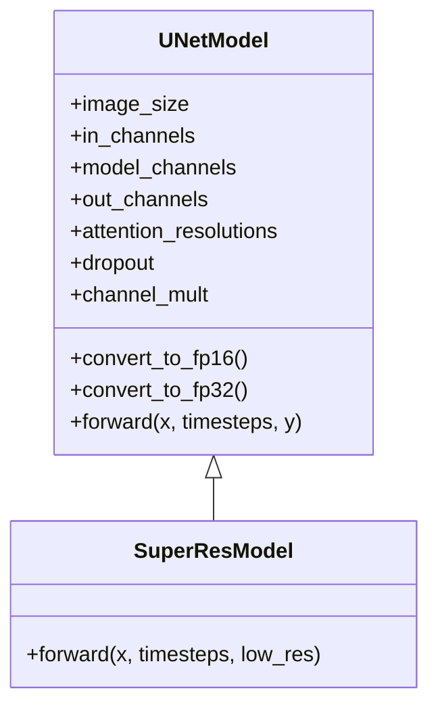
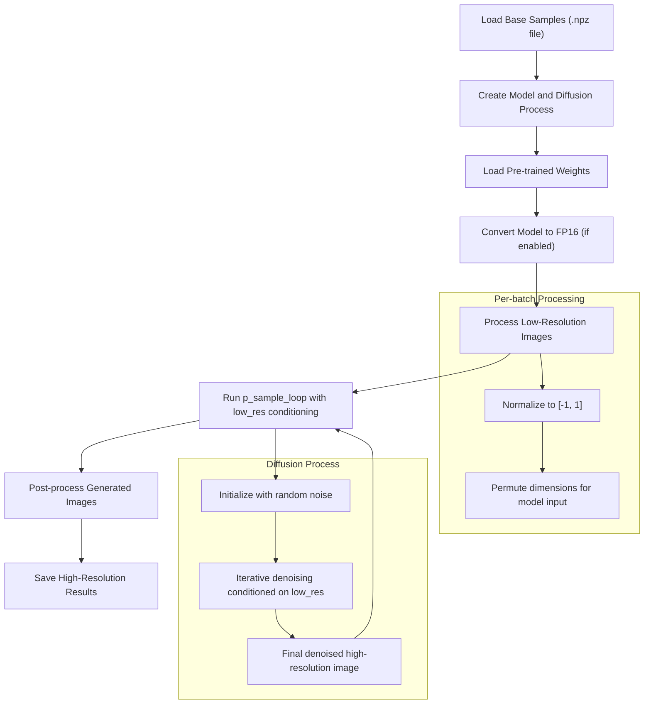
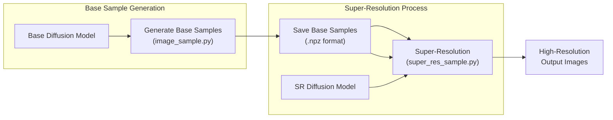
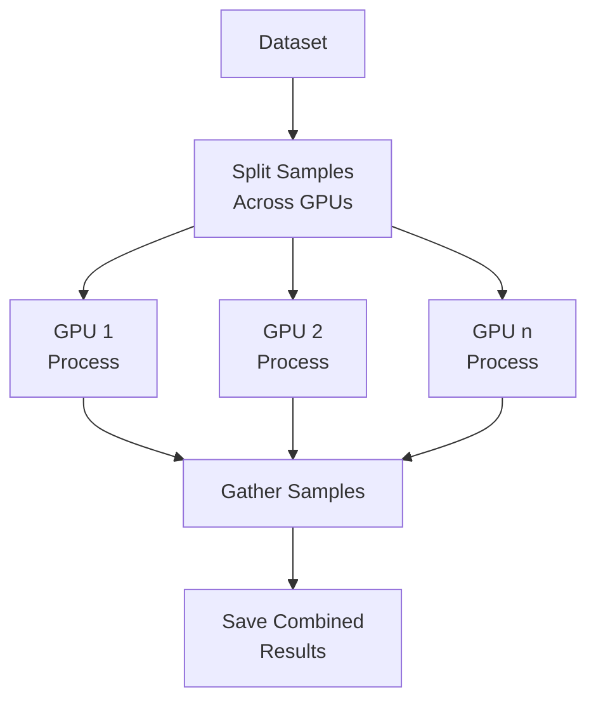

<!-- source: DeepWiki mcp.deepwiki.com · repo openai/guided-diffusion · page 3.3 Super-Resolution Sampling · fetched 2026-10-26 -->

# Super-Resolution Sampling

<details>
<summary>Relevant source files</summary>

The following files were used as context for generating this wiki page:

- [README.md](README.md)
- [scripts/super_res_sample.py](scripts/super_res_sample.py)

</details>


## Purpose and Scope

This document details the super-resolution capabilities within the guided-diffusion codebase. Super-resolution sampling allows you to take lower-resolution images and upsample them to higher-resolution images using specialized diffusion models. This document specifically covers the usage and functionality of the `super_res_sample.py` script that handles this process.

For information about standard image sampling without upsampling, see [Standard Image Sampling](#3.1). For information about classifier-guided sampling, see [Classifier-Guided Sampling](#3.2).

## Overview of Super-Resolution in Guided Diffusion

Super-resolution sampling is a specialized application of diffusion models that takes low-resolution images as conditioning and generates corresponding high-resolution versions. Unlike standard diffusion sampling that generates images from pure noise, super-resolution models are conditioned on existing lower-resolution images.



Sources: [README.md:81-97](). [scripts/super_res_sample.py:1-5]()

## Available Pre-trained Models

The guided-diffusion repository provides two pre-trained super-resolution models:

| Model | Base Resolution | Target Resolution | Model Path |
|-------|----------------|-------------------|------------|
| 64→256 Upsampler | 64×64 | 256×256 | `models/64_256_upsampler.pt` |
| 128→512 Upsampler | 128×128 | 512×512 | `models/128_512_upsampler.pt` |

These models are designed to work with base samples generated from other diffusion models at the corresponding lower resolutions.

Sources: [README.md:22-23](). [README.md:85-97]()

## Super-Resolution Architecture and Process

### Super-Resolution Model Architecture

The super-resolution model is a specialized variant of the UNet architecture designed to take low-resolution images as conditional input in addition to the standard timestep embeddings.



The `SuperResModel` extends the base `UNetModel` but accepts a `low_res` parameter in its forward pass to incorporate information from the low-resolution image during denoising.

Sources: [scripts/super_res_sample.py:15-20]()

### Super-Resolution Sampling Process

The process flow of super-resolution sampling is as follows:



Sources: [scripts/super_res_sample.py:23-74]()

## Using the Super-Resolution Script

To use the super-resolution script, you need to:

1. First generate base samples at the lower resolution (e.g., 64×64 or 128×128)
2. Then upsample these samples using the super-resolution model

### Command Line Usage

Here's how to use the super-resolution script:

```bash
MODEL_FLAGS="--attention_resolutions 32,16,8 --class_cond True --diffusion_steps 1000 --large_size 256 --small_size 64 --learn_sigma True --noise_schedule linear --num_channels 192 --num_heads 4 --num_res_blocks 2 --resblock_updown True --use_fp16 True --use_scale_shift_norm True"
SAMPLE_FLAGS="--batch_size 4 --num_samples 100 --timestep_respacing 250"
python super_res_sample.py $MODEL_FLAGS --model_path models/64_256_upsampler.pt --base_samples 64_samples.npz $SAMPLE_FLAGS
```

This command loads 64×64 base samples from `64_samples.npz` and generates corresponding 256×256 high-resolution images.

Sources: [README.md:81-97](). [scripts/super_res_sample.py:103-115]()

## Input and Output Data Format

### Input Format

The script expects base samples stored in `.npz` files with the following structure:
- `arr_0`: The image array with shape `(N, H, W, C)` where N is the number of samples
- `arr_1`: (Optional) The class labels if class conditioning is used

### Output Format

The output is saved as an `.npz` file containing:
- An array of high-resolution images with shape `(N, large_size, large_size, 3)`

Sources: [scripts/super_res_sample.py:77-100](). [scripts/super_res_sample.py:65-71]()

## Key Parameters and Arguments

The super-resolution script accepts several important parameters:

| Parameter | Description | Default |
|-----------|-------------|---------|
| `--model_path` | Path to the pre-trained super-resolution model | (Required) |
| `--base_samples` | Path to the lower-resolution base samples (.npz) | (Required) |
| `--batch_size` | Number of samples to process at once | 16 |
| `--num_samples` | Total number of samples to generate | 10000 |
| `--large_size` | Output resolution (e.g., 256 or 512) | (Model-specific) |
| `--small_size` | Input resolution (e.g., 64 or 128) | (Model-specific) |
| `--clip_denoised` | Whether to clip denoised values to [-1, 1] | True |
| `--use_fp16` | Whether to use half-precision (FP16) | (Model-specific) |
| `--timestep_respacing` | Schedule for subsampling diffusion timesteps | (None) |

Sources: [scripts/super_res_sample.py:103-115](). [README.md:85-97]()

## End-to-End Super-Resolution Workflow

The complete workflow for generating high-resolution images using the guided diffusion models involves:



This workflow allows for a cascaded approach to image generation, where you can first generate diverse lower-resolution images, then upscale the most promising ones to higher resolutions.

Sources: [README.md:29-97](). [scripts/super_res_sample.py:1-119]()

## Implementation Details

The super-resolution sampling process leverages the same diffusion framework as the standard image generation but with a key difference - the model is conditioned on low-resolution images:

1. The script first loads base samples using `load_data_for_worker` which:
   - Reads the `.npz` file containing low-resolution images
   - Normalizes pixel values to [-1, 1] range
   - Prepares data for batched processing

2. The core sampling occurs in `diffusion.p_sample_loop` which:
   - Takes the model, output shape, and model_kwargs (containing low_res images)
   - Runs the reverse diffusion process to gradually denoise from random noise to a high-resolution image
   - Uses the low-resolution image to guide this denoising process

3. Post-processing converts the model output to uint8 image format before saving

Sources: [scripts/super_res_sample.py:41-71](). [scripts/super_res_sample.py:77-100]()

## Distributed Sampling

The script supports distributed sampling across multiple GPUs:



The distribution is handled through PyTorch's distributed package, with each worker processing a subset of the base samples and the results being gathered at the end.

Sources: [scripts/super_res_sample.py:26-26](). [scripts/super_res_sample.py:59-63]()

---

