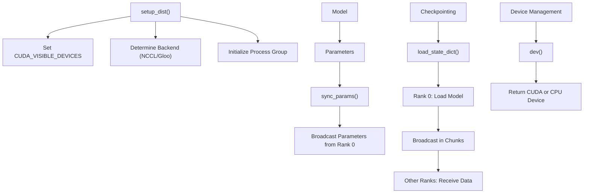
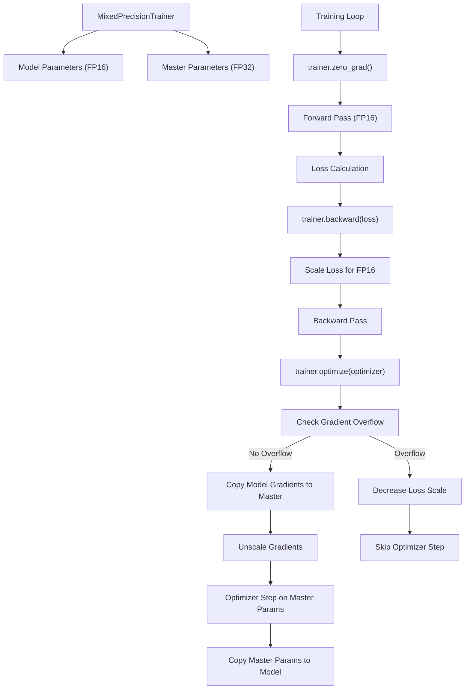
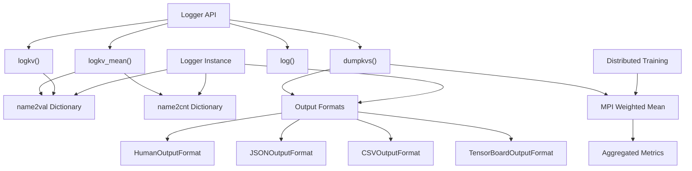
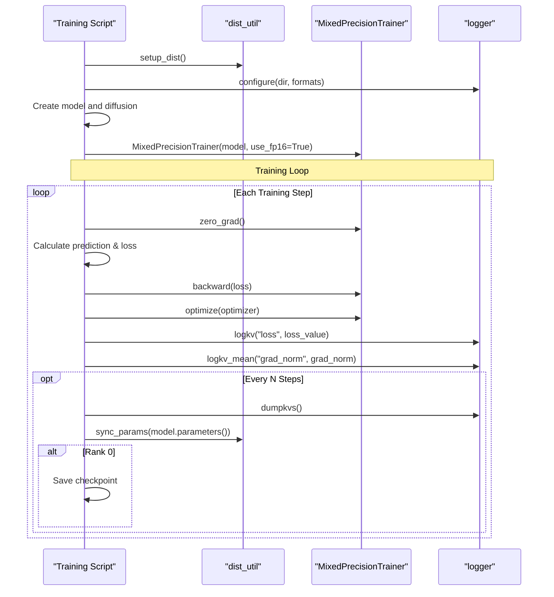

<!-- source: DeepWiki mcp.deepwiki.com · repo openai/guided-diffusion · page 4 Training Infrastructure · fetched 2026-10-26 -->

# Training Infrastructure

<details>
<summary>Relevant source files</summary>

The following files were used as context for generating this wiki page:

- [guided_diffusion/dist_util.py](guided_diffusion/dist_util.py)
- [guided_diffusion/fp16_util.py](guided_diffusion/fp16_util.py)
- [guided_diffusion/logger.py](guided_diffusion/logger.py)

</details>


## Purpose and Scope

This document describes the training infrastructure in the guided-diffusion codebase that enables efficient and scalable training of diffusion models. It covers distributed training capabilities, mixed precision training, and the logging system that collectively support the training process.

The infrastructure is designed to enable training large diffusion models across multiple GPUs with optimized memory usage and performance tracking. For information about model architecture, see [Model Architecture](#2.1), and for training scripts, see [Training Scripts](#2.3).

## Distributed Training System

The guided-diffusion codebase implements a distributed training system using MPI (Message Passing Interface) to coordinate training across multiple GPUs or nodes. This system is primarily implemented in the `dist_util.py` file.

### Architecture of Distributed Training



Sources: [guided_diffusion/dist_util.py:21-42](), [guided_diffusion/dist_util.py:45-51](), [guided_diffusion/dist_util.py:54-74](), [guided_diffusion/dist_util.py:77-83]()

### Key Components

| Component | Function | Purpose |
|-----------|----------|---------|
| Process Group Setup | `setup_dist()` | Initializes the distributed environment |
| Device Management | `dev()` | Returns appropriate computation device |
| Parameter Synchronization | `sync_params()` | Ensures model parameters are consistent across ranks |
| State Dictionary Loading | `load_state_dict()` | Efficiently loads model weights across ranks |

The distributed system is configured to handle up to 8 GPUs per node (defined by `GPUS_PER_NODE` constant). It automatically selects the appropriate backend based on hardware availability: NCCL for CUDA devices and Gloo for CPU-only environments.

## Mixed Precision Training

The codebase includes a comprehensive mixed precision training system that allows models to train using half-precision (FP16) arithmetic to reduce memory usage and potentially improve training speed, particularly on modern GPU architectures with dedicated FP16 support.

### Mixed Precision Training Flow



Sources: [guided_diffusion/fp16_util.py:148-233](), [guided_diffusion/fp16_util.py:15-32](), [guided_diffusion/fp16_util.py:35-82]()

### Key Components

The mixed precision training system contains these main elements:

1. **MixedPrecisionTrainer**: The core class that manages the mixed precision training process, handling gradient scaling, overflow detection, and parameter synchronization.

2. **Model Conversion**: Functions like `convert_module_to_f16()` and `convert_module_to_f32()` that convert appropriate model layers between precision formats.

3. **Parameter Management**: A set of utilities that maintain master copies of parameters in FP32 while the model operates in FP16, including:
   - `make_master_params()` - Creates full-precision master parameters
   - `model_grads_to_master_grads()` - Copies gradients from model to master parameters
   - `master_params_to_model_params()` - Copies updated parameters back to the model

4. **Loss Scaling**: Automatic management of loss scaling to prevent gradient underflow, with dynamic adjustment based on gradient behavior.

## Logging System

The guided-diffusion codebase incorporates a comprehensive logging system adapted from OpenAI baselines, providing flexible options for tracking and visualizing training progress.

### Logging System Architecture



Sources: [guided_diffusion/logger.py:212-240](), [guided_diffusion/logger.py:326-375](), [guided_diffusion/logger.py:412-439]()

### Key Features

1. **Multiple Output Formats**: Support for human-readable text, JSON, CSV, and TensorBoard output formats simultaneously.

2. **Metric Tracking**: Two primary logging methods:
   - `logkv()` - Log a key-value pair directly
   - `logkv_mean()` - Log a value that will be averaged with previous values of the same key

3. **Distributed Aggregation**: When used with MPI for distributed training, metrics are properly aggregated across all ranks.

4. **Flexible Configuration**: Through the `configure()` function, allowing different output formats for different ranks.

## Integration in Training Pipeline

The three infrastructure components are designed to work together seamlessly in the guided-diffusion training pipeline.

### Complete Training Infrastructure Flow



Sources: Integration patterns observed from [guided_diffusion/dist_util.py](), [guided_diffusion/fp16_util.py](), and [guided_diffusion/logger.py]()

### Typical Usage Pattern

A typical pattern for using the training infrastructure:

1. **Initialize distributed environment**:
   ```python
   import dist_util
   dist_util.setup_dist()
   device = dist_util.dev()
   ```

2. **Configure logging**:
   ```python
   import logger
   logger.configure(dir="logs", format_strs=["stdout", "log", "csv"])
   ```

3. **Create and set up model with mixed precision**:
   ```python
   from fp16_util import MixedPrecisionTrainer
   trainer = MixedPrecisionTrainer(model=model, use_fp16=True)
   ```

4. **Training loop with infrastructure integration**:
   ```python
   # For each training step
   trainer.zero_grad()
   loss = calculate_loss(model, batch)
   trainer.backward(loss)
   trainer.optimize(optimizer)
   
   # Log metrics
   logger.logkv("loss", loss.item())
   logger.logkv_mean("grad_norm", grad_norm)
   
   # Periodically dump metrics and save checkpoint
   if step % log_interval == 0:
       logger.dumpkvs()
   
   if step % save_interval == 0 and dist.get_rank() == 0:
       # Save model checkpoint
       save_model(model, step)
   ```

## Performance Considerations

The training infrastructure includes several optimizations for performance:

1. **Efficient Parameter Broadcasting**: Only rank 0 loads model checkpoints from disk, then broadcasts to other ranks.

2. **Chunked Data Transfer**: Large state dictionaries are split into chunks to avoid MPI size limitations.

3. **Dynamic Loss Scaling**: Automatically adjusts the loss scale to prevent gradient underflow/overflow in FP16 training.

4. **Selective Parameter Conversion**: Only appropriate layers (like convolutions) are converted to FP16, while others remain in FP32 for stability.

5. **Distributed Metric Aggregation**: Metrics are properly weighted and aggregated across ranks to provide accurate training statistics.

Sources: [guided_diffusion/dist_util.py:54-74](), [guided_diffusion/fp16_util.py:176-208]()

---

