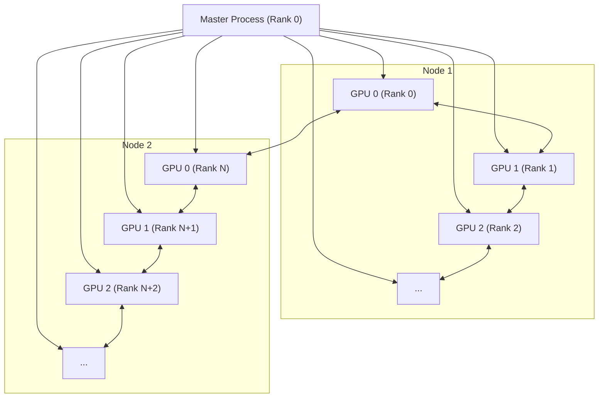
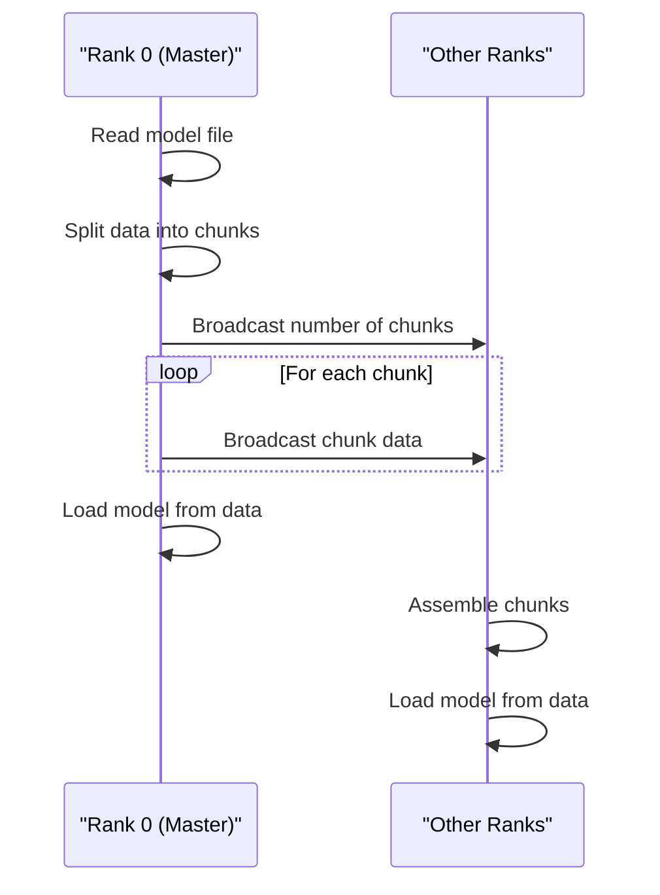

<!-- source: DeepWiki mcp.deepwiki.com · repo openai/guided-diffusion · page 4.1 Distributed Training · fetched 2026-10-26 -->

# Distributed Training

<details>
<summary>Relevant source files</summary>

The following files were used as context for generating this wiki page:

- [README.md](README.md)
- [guided_diffusion/dist_util.py](guided_diffusion/dist_util.py)

</details>


## Purpose and Scope

This document describes the distributed training system implemented in the guided-diffusion codebase. It explains how to leverage multiple GPUs across multiple nodes to train diffusion models and classifiers efficiently using MPI. For information about mixed precision training to further optimize performance, see [Mixed Precision Training](#4.2).

## Architecture Overview

The guided-diffusion codebase implements distributed training using PyTorch's distributed package with MPI (Message Passing Interface) as the communication backend. This system allows models to be trained across multiple GPUs and potentially multiple compute nodes.



Sources: [guided_diffusion/dist_util.py:20-43]()

## Core Components

The distributed training system is primarily implemented in the `dist_util.py` module, which provides utilities for initializing and managing distributed processes.

```mermaid
classDiagram
    class "dist_util" {
        setup_dist()
        dev()
        load_state_dict(path)
        sync_params(params)
        _find_free_port()
    }
    
    class "MPI.COMM_WORLD" {
        Get_rank()
        bcast()
        size
    }
    
    class "torch.distributed" {
        init_process_group()
        broadcast()
    }
    
    "dist_util" --> "MPI.COMM_WORLD"
    "dist_util" --> "torch.distributed"
```

Sources: [guided_diffusion/dist_util.py:1-94]()

### Key Functions

1. **setup_dist()**: Initializes the distributed process group.
   - Sets up environment variables for distributed training
   - Determines the appropriate backend (`nccl` for GPU, `gloo` for CPU)
   - Initializes process group using PyTorch's distributed module

2. **dev()**: Returns the appropriate device (GPU or CPU) for the current process.

3. **load_state_dict(path)**: Efficiently loads model weights across all MPI ranks.
   - Only rank 0 reads the file from disk
   - Broadcasts the data to all other ranks in chunks
   - Prevents redundant I/O operations

4. **sync_params(params)**: Synchronizes model parameters across all ranks from rank 0.

5. **_find_free_port()**: Utility function to find an available network port for communication.

Sources: [guided_diffusion/dist_util.py:21-93]()

## Setting Up Distributed Training

### Environment Configuration

The `setup_dist()` function automatically configures the distributed environment by:

1. Setting the `CUDA_VISIBLE_DEVICES` environment variable based on the MPI rank
2. Determining the appropriate backend (NCCL for CUDA, Gloo for CPU)
3. Setting up the master address and port
4. Initializing the process group

```python
# The GPU for a rank is determined by:
rank % GPUS_PER_NODE  # Default GPUS_PER_NODE is 8
```

Sources: [guided_diffusion/dist_util.py:21-42]()

### Starting a Distributed Training Job

To launch a distributed training job, use the `mpiexec` command with the `-n` flag to specify the number of processes:

```bash
mpiexec -n NUM_GPUS python scripts/classifier_train.py --data_dir path/to/imagenet [TRAINING_FLAGS] [MODEL_FLAGS]
```

Important: When using multiple GPUs, divide the batch size by the number of processes to maintain the same effective batch size.

Sources: [README.md:152-155]()

## Efficient Model Loading

The `load_state_dict()` function implements an optimized strategy for loading model checkpoints in a distributed setting:



This approach avoids having every process read the same model file from disk, which could cause I/O bottlenecks, especially when using a shared filesystem.

Sources: [guided_diffusion/dist_util.py:54-74]()

## Parameter Synchronization

The `sync_params()` function ensures all processes have identical model parameters by broadcasting them from rank 0 to all other ranks:

```python
# Ensures all processes have the same model parameters
# All parameters from rank 0 are broadcast to all other ranks
def sync_params(params):
    for p in params:
        with th.no_grad():
            dist.broadcast(p, 0)
```

This is crucial for ensuring training consistency across all processes.

Sources: [guided_diffusion/dist_util.py:77-83]()

## Example Usage

Here's an example of training a 128x128 classifier using distributed training:

```bash
# Define training and model flags
TRAIN_FLAGS="--iterations 300000 --anneal_lr True --batch_size 256 --lr 3e-4 --save_interval 10000 --weight_decay 0.05"
CLASSIFIER_FLAGS="--image_size 128 --classifier_attention_resolutions 32,16,8 --classifier_depth 2 --classifier_width 128 --classifier_pool attention --classifier_resblock_updown True --classifier_use_scale_shift_norm True"

# Launch with 8 GPUs (divide batch size by 8)
ADJUSTED_TRAIN_FLAGS="--iterations 300000 --anneal_lr True --batch_size 32 --lr 3e-4 --save_interval 10000 --weight_decay 0.05"
mpiexec -n 8 python scripts/classifier_train.py --data_dir path/to/imagenet $ADJUSTED_TRAIN_FLAGS $CLASSIFIER_FLAGS
```

For distributed sampling:

```bash
MODEL_FLAGS="--attention_resolutions 32,16,8 --class_cond True --image_size 128 --learn_sigma True --num_channels 256 --num_heads 4 --num_res_blocks 2 --resblock_updown True --use_fp16 True --use_scale_shift_norm True"
CLASSIFIER_FLAGS="--image_size 128 --classifier_attention_resolutions 32,16,8 --classifier_depth 2 --classifier_width 128 --classifier_pool attention --classifier_resblock_updown True --classifier_use_scale_shift_norm True --classifier_scale 1.0 --classifier_use_fp16 True"
SAMPLE_FLAGS="--batch_size 4 --num_samples 50000 --timestep_respacing ddim25 --use_ddim True"

mpiexec -n 8 python scripts/classifier_sample.py \
    --model_path /path/to/model.pt \
    --classifier_path path/to/classifier.pt \
    $MODEL_FLAGS $CLASSIFIER_FLAGS $SAMPLE_FLAGS
```

Sources: [README.md:155-175]()

## Best Practices

1. **Batch Size Adjustment**: Always divide the original batch size by the number of processes to maintain the same effective batch size.

2. **GPU Allocation**: By default, the codebase assigns GPUs based on the equation `rank % GPUS_PER_NODE`, with the default `GPUS_PER_NODE` set to 8.

3. **Model Synchronization**: The codebase automatically synchronizes model parameters across processes, so you don't need to handle this manually.

4. **File I/O Efficiency**: Use the provided `load_state_dict()` function for loading model checkpoints efficiently in a distributed setting.

Sources: [guided_diffusion/dist_util.py:15-42](), [README.md:152-155]()

## Limitations and Considerations

1. The default setup assumes 8 GPUs per node (`GPUS_PER_NODE = 8`). If your system has a different configuration, you may need to modify this value in [guided_diffusion/dist_util.py:16]().

2. The system uses MPI for process management, which requires MPI to be installed on your system.

3. For very large models or datasets, you may need to tune the chunk size in `load_state_dict()` (currently set to 2^30 bytes).

Sources: [guided_diffusion/dist_util.py:15-16](), [guided_diffusion/dist_util.py:58]()

---

