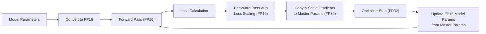
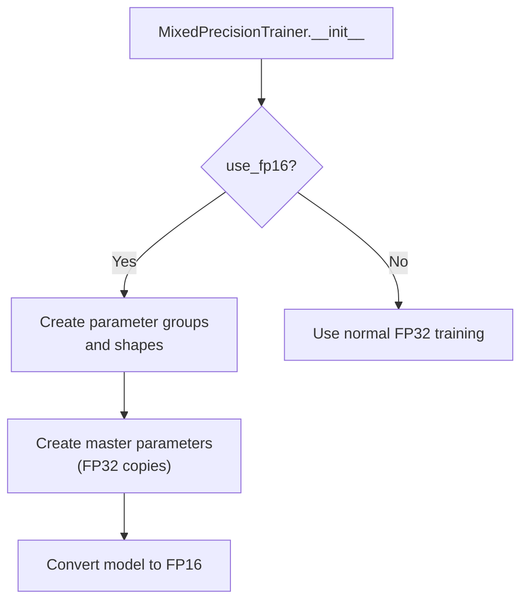
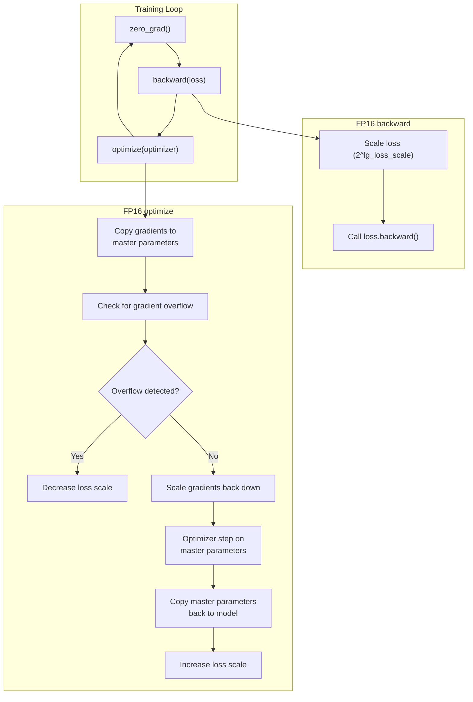
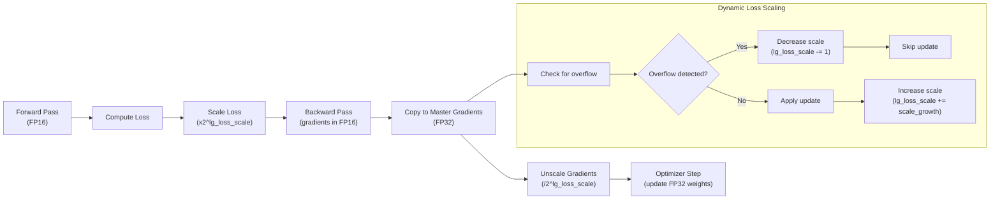
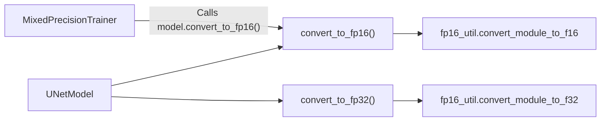

<!-- source: DeepWiki mcp.deepwiki.com · repo openai/guided-diffusion · page 4.2 Mixed Precision Training · fetched 2026-10-26 -->

# Mixed Precision Training

<details>
<summary>Relevant source files</summary>

The following files were used as context for generating this wiki page:

- [guided_diffusion/fp16_util.py](guided_diffusion/fp16_util.py)

</details>


## Purpose and Scope

This document details the mixed precision training capabilities in the guided-diffusion codebase. Mixed precision training uses lower precision formats (FP16) alongside full precision (FP32) to improve computational efficiency and reduce memory usage while maintaining model accuracy. This page explains how the implementation works, focusing on the `MixedPrecisionTrainer` class and supporting utilities.

For information about the broader training infrastructure, see [Training Infrastructure](#4), and for details on distributed training specifically, see [Distributed Training](#4.1).

## Overview of Mixed Precision Training

Mixed precision training combines two numerical formats during training:
- **FP16 (16-bit floating point)**: Used for most operations to improve computational efficiency
- **FP32 (32-bit floating point)**: Used for critical operations where numerical precision is necessary

The implementation maintains a master copy of weights in FP32 while performing forward and backward passes in FP16, applying loss scaling to prevent underflow during backpropagation.



Sources: [guided_diffusion/fp16_util.py:148-233]()

## Core Components and Implementation

The mixed precision training functionality is primarily implemented in the `fp16_util.py` file, with the `MixedPrecisionTrainer` class serving as the central component.

```mermaid
classDiagram
    class "MixedPrecisionTrainer" {
        +model
        +use_fp16: bool
        +fp16_scale_growth: float
        +lg_loss_scale: float
        +model_params: list
        +master_params: list
        +param_groups_and_shapes
        +zero_grad()
        +backward(loss)
        +optimize(optimizer)
    }
    
    class "Module Conversion Functions" {
        +convert_module_to_f16(module)
        +convert_module_to_f32(module)
    }
    
    class "Parameter Management" {
        +make_master_params()
        +model_grads_to_master_grads()
        +master_params_to_model_params()
        +unflatten_master_params()
        +get_param_groups_and_shapes()
    }
    
    class "State Dict Management" {
        +master_params_to_state_dict()
        +state_dict_to_master_params()
    }
    
    class "Gradient Operations" {
        +zero_master_grads()
        +zero_grad()
        +param_grad_or_zeros()
    }
    
    class "Utilities" {
        +check_overflow()
    }
    
    "MixedPrecisionTrainer" --> "Module Conversion Functions"
    "MixedPrecisionTrainer" --> "Parameter Management"
    "MixedPrecisionTrainer" --> "State Dict Management"
    "MixedPrecisionTrainer" --> "Gradient Operations"
    "MixedPrecisionTrainer" --> "Utilities"
```

Sources: [guided_diffusion/fp16_util.py:1-237]()

## The MixedPrecisionTrainer Class

The `MixedPrecisionTrainer` class encapsulates the logic for mixed precision training, providing methods for initializing, backward passes, and optimization steps.

### Initialization

The trainer is initialized with the model, a flag to enable/disable FP16 training, a scale growth factor, and an initial loss scale:



Sources: [guided_diffusion/fp16_util.py:148-171]()

### Training Loop Operations

The trainer provides three key methods for the training loop:

1. `zero_grad()`: Clears gradients before each backward pass
2. `backward(loss)`: Performs backward pass with loss scaling when using FP16
3. `optimize(optimizer)`: Updates parameters with different flows for FP16 vs FP32



Sources: [guided_diffusion/fp16_util.py:173-215]()

## Key Utility Functions

### Module Conversion

Two functions manage the conversion of model modules between precision formats:

- `convert_module_to_f16`: Converts Conv1d/2d/3d module weights and biases to half precision (FP16)
- `convert_module_to_f32`: Converts them back to full precision (FP32)

Sources: [guided_diffusion/fp16_util.py:15-32]()

### Parameter Management

Several functions handle the relationship between FP16 model parameters and their FP32 master copies:

| Function | Purpose |
|----------|---------|
| `make_master_params` | Creates FP32 master copies of model parameters |
| `model_grads_to_master_grads` | Copies gradients from model parameters to master parameters |
| `master_params_to_model_params` | Updates model parameters from master parameters after optimization |
| `get_param_groups_and_shapes` | Groups parameters based on dimensionality for efficient memory layout |

Sources: [guided_diffusion/fp16_util.py:35-92]()

### State Dictionary Management

Two functions handle saving and loading model parameters in mixed precision context:

- `master_params_to_state_dict`: Converts master parameters to a state dictionary
- `state_dict_to_master_params`: Creates master parameters from a state dictionary

Sources: [guided_diffusion/fp16_util.py:95-125]()

## Loss Scaling

Loss scaling is a critical technique in mixed precision training to prevent gradient underflow:



The implementation uses dynamic loss scaling:
- Starts with an initial value (`INITIAL_LOG_LOSS_SCALE = 20.0`)
- Increases gradually after successful steps (by `fp16_scale_growth`)
- Decreases when numerical overflow is detected

Sources: [guided_diffusion/fp16_util.py:12-12](), [guided_diffusion/fp16_util.py:176-207]()

## Practical Usage

The `MixedPrecisionTrainer` wraps around a model and optimizer to enable mixed precision training. The typical usage pattern is:

1. Create the model
2. Wrap it with `MixedPrecisionTrainer` with `use_fp16=True`
3. In the training loop:
   - Call `trainer.zero_grad()` to clear gradients
   - Perform forward pass with the model
   - Call `trainer.backward(loss)` for the backward pass with automatic loss scaling
   - Call `trainer.optimize(optimizer)` to update parameters

Example usage (pseudocode):
```python
model = create_model()
trainer = MixedPrecisionTrainer(model=model, use_fp16=True)
optimizer = torch.optim.Adam(trainer.master_params)

for batch in dataloader:
    trainer.zero_grad()
    output = model(batch)
    loss = loss_fn(output, target)
    trainer.backward(loss)
    trainer.optimize(optimizer)
```

Sources: [guided_diffusion/fp16_util.py:148-215]()

## Code Integration with Model Architecture

The mixed precision training functionality integrates with model architectures through conversion methods in model classes. UNet-based models in the codebase implement `convert_to_fp16()` and `convert_to_fp32()` methods that call the utility functions:



Sources: [guided_diffusion/fp16_util.py:15-32]()

## Benefits and Considerations

Mixed precision training offers several advantages:
- **Memory efficiency**: FP16 parameters use half the memory of FP32
- **Computational speed**: Some hardware (like NVIDIA GPUs with Tensor Cores) can perform FP16 operations faster
- **Bandwidth optimization**: Reduced memory transfers between CPU and GPU

Key considerations when using mixed precision training:
- **Numerical stability**: Loss scaling helps, but some operations may still require careful handling
- **Hardware support**: Benefits are most significant on hardware with native FP16 acceleration
- **Model compatibility**: Some operations work better in FP32 and require special attention

Sources: [guided_diffusion/fp16_util.py:1-3]()

---

