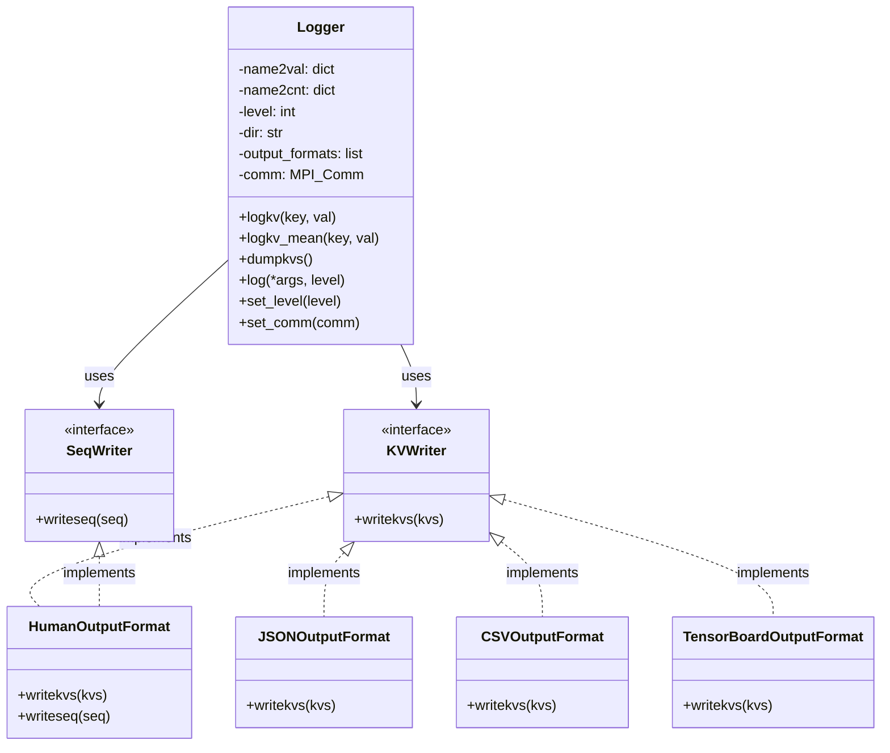
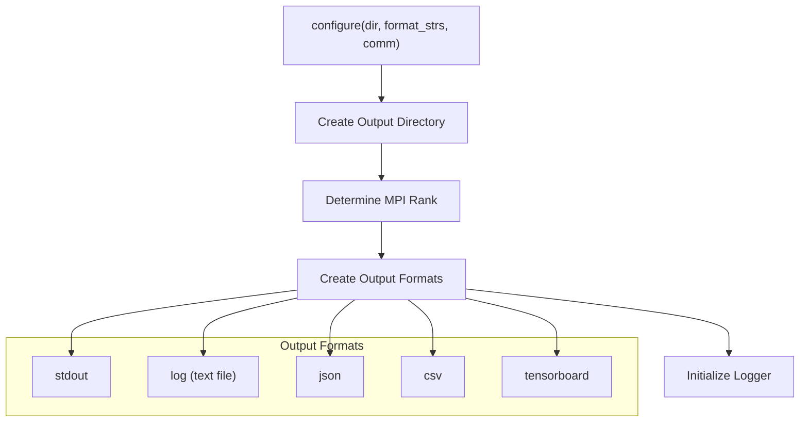
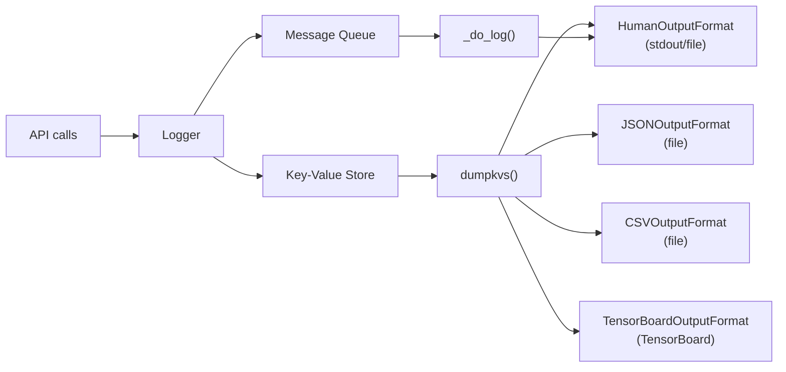
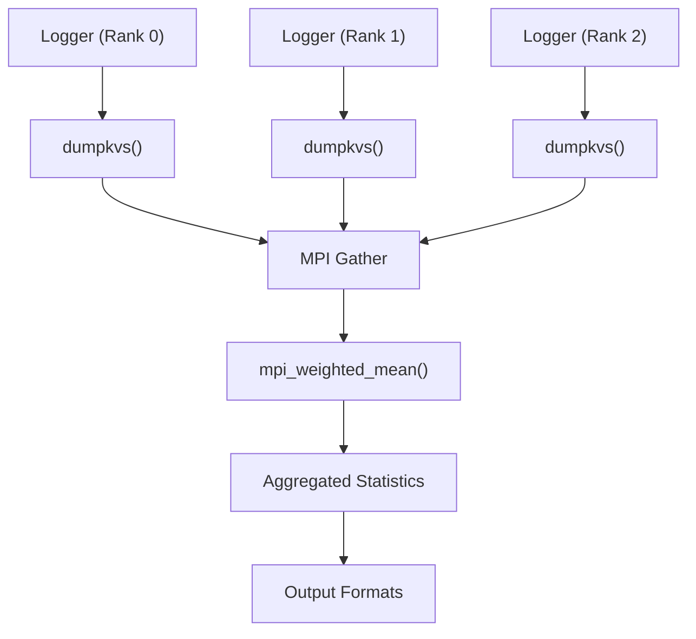

<!-- source: DeepWiki mcp.deepwiki.com · repo openai/guided-diffusion · page 4.3 Logging System · fetched 2026-10-26 -->

# Logging System

<details>
<summary>Relevant source files</summary>

The following files were used as context for generating this wiki page:

- [guided_diffusion/logger.py](guided_diffusion/logger.py)

</details>


## Purpose and Scope

The Logging System in the guided-diffusion repository provides a flexible, multi-format logging infrastructure designed to track and record training metrics, diagnostics, and general messages during model training and sampling. This system is adapted from OpenAI baselines and optimized for machine learning experiments, with special support for distributed training environments.

This page documents the logging infrastructure found in the `guided_diffusion/logger.py` file. For information about the broader training infrastructure, see [Training Infrastructure](#4) and [Distributed Training](#4.1).

## Architecture Overview

The logging system follows a modular design with a centralized `Logger` class that manages various output formats and provides a unified API for logging.



**Diagram: Logger Class Hierarchy**

Sources: [guided_diffusion/logger.py:26-188](), [guided_diffusion/logger.py:332-401]()

## Logger Configuration

The logging system can be configured to output to multiple formats simultaneously, including human-readable text, JSON, CSV, and TensorBoard.



**Diagram: Logger Configuration Flow**

Sources: [guided_diffusion/logger.py:442-472](), [guided_diffusion/logger.py:191-204]()

### Configuration Options

The `configure` function takes the following parameters:

- `dir`: Directory where log files will be written
- `format_strs`: List of output format strings (e.g., "stdout,log,csv")
- `comm`: MPI communicator for distributed logging
- `log_suffix`: Optional suffix for log filenames

If no directory is specified, the system checks the `OPENAI_LOGDIR` environment variable or creates a temporary directory.

## Logging API

The logging system provides two main types of logging:

1. **Key-Value Logging**: For tracking numerical metrics and statistics
2. **Message Logging**: For general text messages with different severity levels

### Key-Value Logging Functions

| Function | Description |
|----------|-------------|
| `logkv(key, val)` | Log a single key-value pair |
| `logkv_mean(key, val)` | Log a value, averaging if called multiple times with same key |
| `logkvs(d)` | Log multiple key-value pairs from a dictionary |
| `dumpkvs()` | Write all logged key-value pairs to configured outputs |
| `getkvs()` | Get the current key-value dictionary |

Sources: [guided_diffusion/logger.py:212-244]()

### Message Logging Functions

| Function | Description | Level |
|----------|-------------|-------|
| `log(*args, level=INFO)` | Log a general message at specified level | - |
| `debug(*args)` | Log a debug message | 10 |
| `info(*args)` | Log an informational message | 20 |
| `warn(*args)` | Log a warning message | 30 |
| `error(*args)` | Log an error message | 40 |

Sources: [guided_diffusion/logger.py:247-267]()

## Output Formats

The logging system supports multiple output formats that can be used simultaneously:



**Diagram: Logging Data Flow**

Sources: [guided_diffusion/logger.py:36-188](), [guided_diffusion/logger.py:347-400]()

### HumanOutputFormat

Produces human-readable tabular output with keys and values aligned in columns, with appropriate truncation for long strings.

Example output:
```
----------------------------------
| iteration      | 100           |
| loss           | 2.35          |
| learning_rate  | 0.001         |
----------------------------------
```

Sources: [guided_diffusion/logger.py:36-96]()

### JSONOutputFormat

Writes each set of key-value pairs as a JSON object on a separate line, suitable for programmatic processing.

Sources: [guided_diffusion/logger.py:98-110]()

### CSVOutputFormat

Creates a CSV file with columns for each logged key. Handles the addition of new keys during logging by extending the file format.

Sources: [guided_diffusion/logger.py:113-147]()

### TensorBoardOutputFormat

Outputs metrics in TensorBoard format for visualization using TensorBoard.

Sources: [guided_diffusion/logger.py:150-188]()

## Distributed Logging

The logging system includes special support for distributed training environments using MPI:



**Diagram: Distributed Logging Flow**

Sources: [guided_diffusion/logger.py:355-374](), [guided_diffusion/logger.py:412-439]()

When configured with an MPI communicator, the `dumpkvs` method aggregates statistics across all processes using a weighted average. This ensures that metrics from distributed training (e.g., loss values from different GPUs) are properly combined.

## Profiling Utilities

The logging system includes utilities for performance profiling:

- `profile_kv(scopename)`: Context manager that logs the execution time of a block
- `profile(n)`: Decorator that logs the execution time of a function

```python
# Function profiling example
@profile("forward_pass")
def model_forward(x):
    return model(x)

# Block profiling example
with profile_kv("data_loading"):
    data = load_batch(dataset)
```

Sources: [guided_diffusion/logger.py:293-317]()

## Usage in Guided Diffusion

In the guided-diffusion codebase, the logging system is primarily used to:

1. Track training metrics (loss, learning rates, etc.)
2. Log sampling progress and parameters
3. Record timing information for performance analysis
4. Output model configuration details

The logging system is compatible with the distributed training infrastructure ([Distributed Training](#4.1)) and provides a consistent interface regardless of whether training is performed on a single GPU or across multiple nodes.

## Example Usage

```python
# Configure logger
logger.configure(dir="./logs", format_strs=["stdout", "log", "csv", "tensorboard"])

# Log metrics during training
logger.logkv("iteration", 100)
logger.logkv("loss", 2.35)
logger.logkv("lr", 0.001)
logger.dumpkvs()  # Write values to all outputs

# Log a message
logger.info("Starting sampling process...")

# Use scoped configuration for temporary logging setup
with logger.scoped_configure(dir="./sampling_logs", format_strs=["log"]):
    # This logging goes to a different directory
    logger.logkv("sampling_step", 50)
    logger.logkv("sample_mean", 0.032)
    logger.dumpkvs()
```

Sources: [guided_diffusion/logger.py:486-494](), [guided_diffusion/logger.py:472-472]()

---

