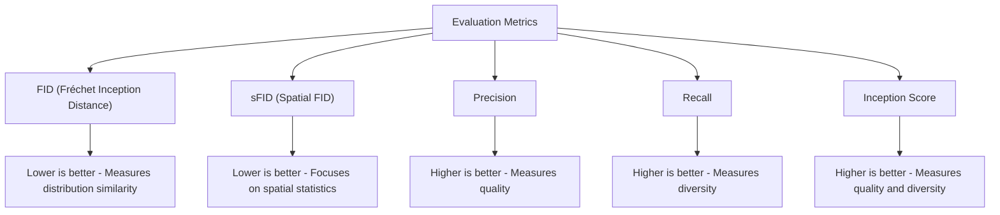
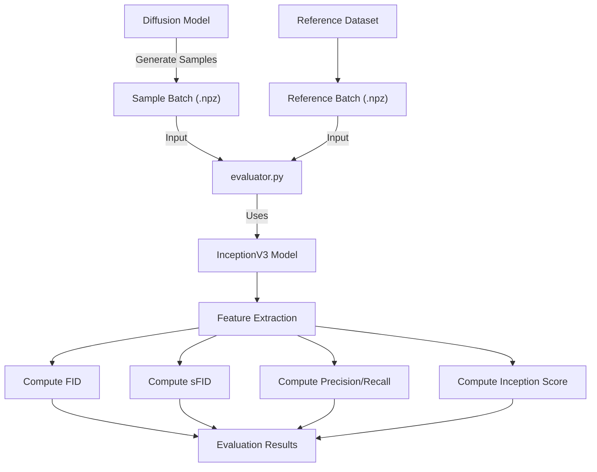
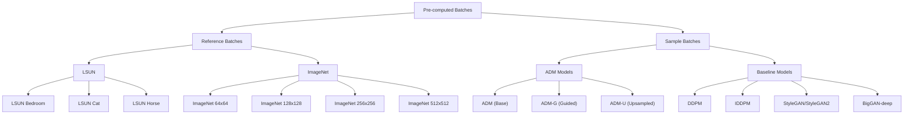
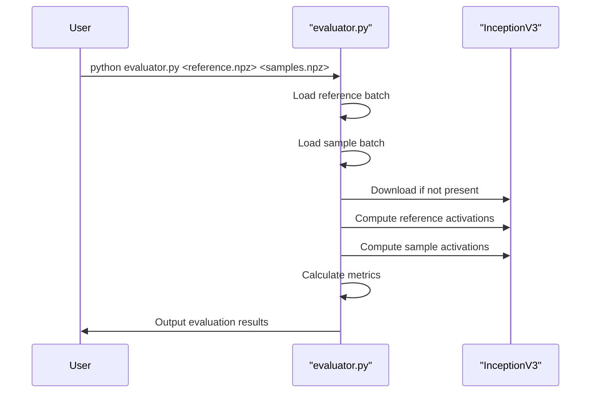

<!-- source: DeepWiki mcp.deepwiki.com · repo openai/guided-diffusion · page 5 Evaluation · fetched 2026-10-26 -->

# Evaluation

<details>
<summary>Relevant source files</summary>

The following files were used as context for generating this wiki page:

- [README.md](README.md)
- [evaluations/README.md](evaluations/README.md)

</details>


This page documents the evaluation methodology used in the guided-diffusion codebase. It covers how generated images are evaluated using various metrics, how to run evaluations, and where to find pre-computed evaluation data. For information about the training process, see [Training Infrastructure](#4).

## Evaluation Metrics

The guided-diffusion repository uses several standard metrics to evaluate the quality of generated images:



1. **FID (Fréchet Inception Distance)**: Measures the similarity between the distribution of generated images and real images in feature space. Lower values indicate better quality.

2. **sFID (Spatial FID)**: A variant of FID that focuses on spatial statistics, capturing localized features. Lower values indicate better spatial coherence.

3. **Precision**: Measures the proportion of generated samples that are similar to the real data. Higher values indicate better quality.

4. **Recall**: Measures the proportion of real data that is covered by the generated samples. Higher values indicate better diversity.

5. **Inception Score**: Measures both the quality and diversity of generated images. Higher values indicate better overall generation quality.

Sources: [README.md:121-146](), [evaluations/README.md:1-5]()

## Evaluation Data Flow

The evaluation system processes batches of samples stored in `.npz` (numpy) files. Here's how the data flows through the evaluation pipeline:



- **Reference batches**: Contain pre-computed statistics over the whole dataset and 10,000 images for computing Precision and Recall metrics
- **Sample batches**: Contain 50,000 generated images used to compute statistics and Precision/Recall metrics

Sources: [evaluations/README.md:3-9]()

## Pre-computed Batches

The repository provides pre-computed batches for reference datasets and various models to facilitate easy comparisons. These are a key part of the reproducible evaluation workflow.

### Batch Structure



### Available Batches

The repository provides download links for many pre-computed batches, including:

- LSUN category reference batches (bedroom, cat, horse)
- ImageNet reference batches at multiple resolutions (64x64, 128x128, 256x256, 512x512)
- Sample batches from diffusion models (ADM, ADM-G, ADM-U)
- Sample batches from baseline models (DDPM, IDDPM, StyleGAN, BigGAN)

Sources: [evaluations/README.md:11-49]()

## Running Evaluations

The `evaluator.py` script is used to calculate metrics between a reference dataset and a generated sample batch:



### Example Usage

To evaluate a batch of generated samples against a reference dataset:

```
python evaluator.py VIRTUAL_imagenet256_labeled.npz admnet_guided_upsampled_imagenet256.npz
```

### Example Output

```
computing reference batch activations...
computing/reading reference batch statistics...
computing sample batch activations...
computing/reading sample batch statistics...
Computing evaluations...
Inception Score: 215.8370361328125
FID: 3.9425574129223264
sFID: 6.140433703346162
Precision: 0.8265
Recall: 0.5309
```

Sources: [evaluations/README.md:51-72]()

## Evaluation Results

The guided-diffusion models achieve state-of-the-art results across various datasets and resolutions. The key findings are summarized in the following tables:

### Pure Guided Diffusion Models (ImageNet)

| Dataset          | FID  | Precision | Recall |
|------------------|------|-----------|--------|
| ImageNet 64x64   | 2.07 | 0.74      | 0.63   |
| ImageNet 128x128 | 2.97 | 0.78      | 0.59   |
| ImageNet 256x256 | 4.59 | 0.82      | 0.52   |
| ImageNet 512x512 | 7.72 | 0.87      | 0.42   |

### Upsampling + Guidance (ImageNet)

| Dataset          | FID  | Precision | Recall |
|------------------|------|-----------|--------|
| ImageNet 256x256 | 3.94 | 0.83      | 0.53   |
| ImageNet 512x512 | 3.85 | 0.84      | 0.53   |

### Unguided Models (LSUN Classes)

| Dataset      | FID  | Precision | Recall |
|--------------|------|-----------|--------|
| LSUN Bedroom | 1.90 | 0.66      | 0.51   |
| LSUN Cat     | 5.57 | 0.63      | 0.52   |
| LSUN Horse   | 2.57 | 0.71      | 0.55   |

These results demonstrate that diffusion models can outperform GANs on image synthesis tasks across various metrics and settings. In particular, the combination of upsampling and guidance produces the best results for high-resolution image generation.

Sources: [README.md:121-146]()

---

