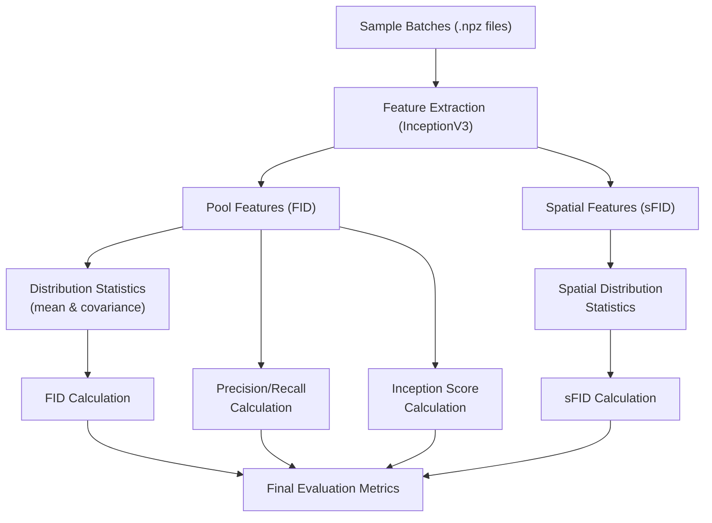
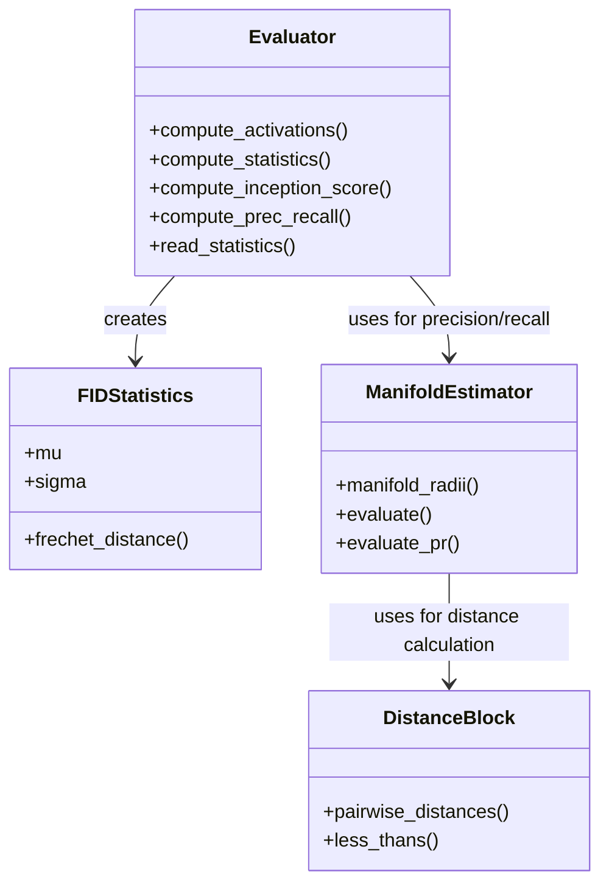
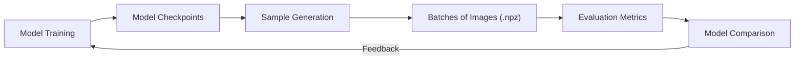

<!-- source: DeepWiki mcp.deepwiki.com · repo openai/guided-diffusion · page 5.1 Evaluation Metrics · fetched 2026-10-26 -->

# Evaluation Metrics

<details>
<summary>Relevant source files</summary>

The following files were used as context for generating this wiki page:

- [evaluations/README.md](evaluations/README.md)
- [evaluations/evaluator.py](evaluations/evaluator.py)

</details>


This page documents the evaluation metrics used in the guided-diffusion codebase for quantitatively assessing the quality of generated images. These metrics provide standardized ways to compare different generative models in terms of image quality, diversity, and similarity to real images.

## Overview

The guided-diffusion codebase implements five main evaluation metrics:

1. **FID** (Fréchet Inception Distance)
2. **sFID** (Spatial Fréchet Inception Distance)
3. **Precision**
4. **Recall**
5. **Inception Score**

These metrics are computed using batches of generated samples and reference dataset samples stored in `.npz` (NumPy) files.

Sources: [evaluations/README.md:3-3]()

## Evaluation Process

The evaluation workflow follows a specific pipeline from sample generation to metric calculation.

### Evaluation Pipeline



Sources: [evaluations/evaluator.py:25-60]()

### Running Evaluations

The evaluation process is performed through the `evaluator.py` script, which:

1. Loads reference and sample batches
2. Computes feature vectors using the InceptionV3 model
3. Calculates statistics (mean and covariance) for the feature distributions
4. Computes the evaluation metrics by comparing these distributions

Sources: [evaluations/README.md:51-72](), [evaluations/evaluator.py:25-60]()

## Metrics Implementation

The evaluation metrics are implemented in the `evaluator.py` file, which contains the core classes and methods for computing each metric.



Sources: [evaluations/evaluator.py:67-116](), [evaluations/evaluator.py:118-202](), [evaluations/evaluator.py:205-359](), [evaluations/evaluator.py:362-411]()

## Detailed Description of Metrics

### FID (Fréchet Inception Distance)

FID measures the similarity between two sets of images by comparing the statistics of their feature representations.

- **Implementation**: `FIDStatistics.frechet_distance()` method
- **Feature Extraction**: Uses the "pool_3" layer from InceptionV3 model
- **Calculation**: Computes the 2-Wasserstein distance between two multivariate Gaussian distributions
- **Interpretation**: Lower scores indicate more similar distributions (better quality)

The mathematical formula for FID is:

```
FID = ||μ₁ - μ₂||² + Tr(Σ₁ + Σ₂ - 2√(Σ₁Σ₂))
```

where μ₁, μ₂ are the means and Σ₁, Σ₂ are the covariance matrices of the feature distributions.

Sources: [evaluations/evaluator.py:67-116]()

### sFID (Spatial Fréchet Inception Distance)

sFID is a variant of FID that focuses on spatial features, which better captures local structure in images.

- **Implementation**: Same as FID, but uses different feature vectors
- **Feature Extraction**: Uses the "mixed_6/conv" layer from InceptionV3 model
- **Interpretation**: Lower scores indicate better local structure similarity

Sources: [evaluations/evaluator.py:24-24](), [evaluations/evaluator.py:598-600]()

### Precision and Recall

These metrics measure different aspects of generation quality:

- **Precision**: Fraction of generated samples that resemble the real data
- **Recall**: Fraction of real data distribution that the generator captures

The implementation uses manifold estimation to determine proximity of samples:

1. Estimate the manifold of feature vectors by calculating distances to k-nearest neighbors
2. Evaluate whether new samples lie within the manifold of reference samples (precision) and vice versa (recall)

Sources: [evaluations/evaluator.py:194-202](), [evaluations/evaluator.py:205-359]()

### Inception Score

Inception Score measures both quality and diversity of generated images.

- **Implementation**: `compute_inception_score()` method
- **Feature Extraction**: Uses the "softmax" layer from InceptionV3 model
- **Calculation**: Computes KL divergence between conditional and marginal class distributions
- **Interpretation**: Higher scores indicate better quality and diversity

Mathematically represented as:

```
IS = exp(E[KL(p(y|x) || p(y))])
```

where p(y|x) is the conditional label distribution for generated image x, and p(y) is the marginal distribution.

Sources: [evaluations/evaluator.py:179-192]()

## Metric Comparison Table

| Metric | What it Measures | Ideal Value | Implementation | Feature Source |
|--------|------------------|-------------|----------------|----------------|
| FID | Overall distribution similarity | Lower is better | `FIDStatistics.frechet_distance()` | "pool_3" InceptionV3 layer |
| sFID | Local spatial structure similarity | Lower is better | Same as FID | "mixed_6/conv" InceptionV3 layer |
| Precision | How realistic generated samples are | Higher is better | `ManifoldEstimator.evaluate_pr()` | "pool_3" InceptionV3 layer |
| Recall | How well model covers target distribution | Higher is better | `ManifoldEstimator.evaluate_pr()` | "pool_3" InceptionV3 layer |
| Inception Score | Quality and diversity combined | Higher is better | `Evaluator.compute_inception_score()` | Softmax outputs from InceptionV3 |

Sources: [evaluations/evaluator.py:67-202](), [evaluations/evaluator.py:205-359]()

## Pre-computed Batches

The codebase provides pre-computed sample batches for reference datasets and various models for benchmarking. These batches are stored in `.npz` format and can be downloaded for evaluation.

For more information about these pre-computed batches, see [Pre-computed Batches](#5.2).

Sources: [evaluations/README.md:5-49]()

## Technical Implementation Details

### Feature Extraction

The codebase uses an InceptionV3 model for feature extraction, which is automatically downloaded if not present.

- The model file is downloaded from a predefined URL: `INCEPTION_V3_URL`
- Features are extracted from different layers for different metrics:
  - "pool_3" for FID, Precision, and Recall
  - "mixed_6/conv" for sFID
  - Softmax outputs for Inception Score

Sources: [evaluations/evaluator.py:20-24](), [evaluations/evaluator.py:573-633]()

### Batch Processing

For efficiency, the evaluation is done in batches:

- Samples are processed in configurable batch sizes (`batch_size` and `softmax_batch_size`)
- For large reference datasets, statistics may be pre-computed and stored in the `.npz` file
- The code supports streaming processing of large `.npz` files to minimize memory usage

Sources: [evaluations/evaluator.py:142-172](), [evaluations/evaluator.py:433-570]()

### Numerical Stability Considerations

The implementation includes several measures to ensure numerical stability:

- Mixed precision calculations for distance computations (FP16/FP32)
- Handling of potential numerical errors in FID calculation
- Clamping of manifold radii to avoid outliers in precision/recall computation

Sources: [evaluations/evaluator.py:72-115](), [evaluations/evaluator.py:376-384](), [evaluations/evaluator.py:278-280]()

## Relationship to Training and Sampling



The evaluation metrics form a crucial feedback loop in the development process of diffusion models. By quantitatively assessing model outputs, researchers can iterate on model architectures, training procedures, and sampling methods to improve performance.

Sources: [evaluations/README.md:3-3](), [evaluations/evaluator.py:25-60]()

---

