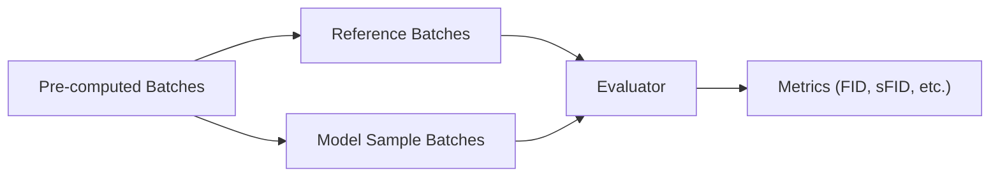
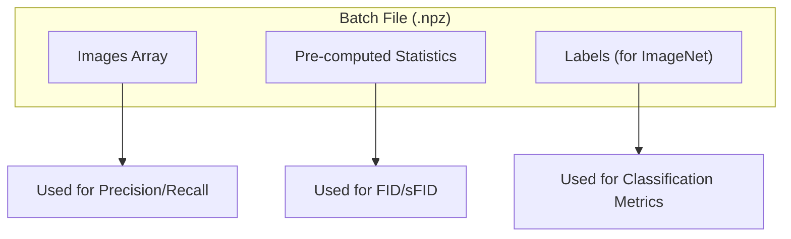
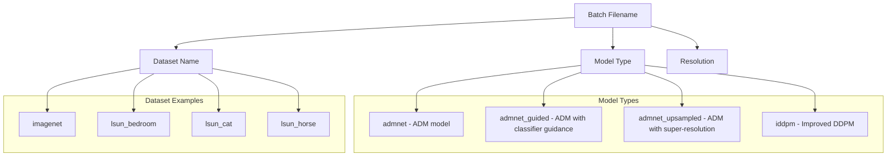
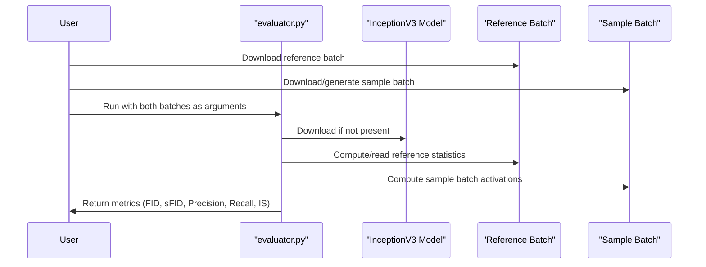
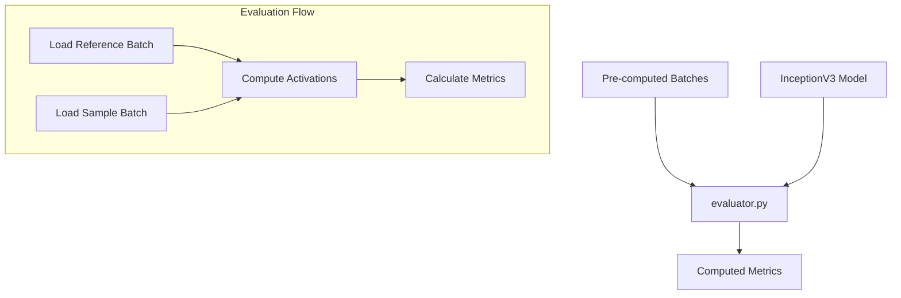

<!-- source: DeepWiki mcp.deepwiki.com · repo openai/guided-diffusion · page 5.2 Pre-computed Batches · fetched 2026-10-26 -->

# Pre-computed Batches

<details>
<summary>Relevant source files</summary>

The following files were used as context for generating this wiki page:

- [evaluations/README.md](evaluations/README.md)

</details>


This document explains the pre-computed batches system used for evaluating and benchmarking diffusion models in the guided-diffusion codebase. Pre-computed batches are essential for consistently measuring model performance across different architecture variants and comparing against other generative approaches. For information about the specific evaluation metrics used with these batches, see [Evaluation Metrics](#5.1).

## Purpose of Pre-computed Batches

Pre-computed batches serve as standardized datasets for evaluating generative models using metrics like FID, sFID, Precision, Recall, and Inception Score. They ensure consistent evaluation across different models by providing:

1. Reference batches containing dataset statistics and sample images
2. Sample batches from various models for direct comparison
3. A consistent format for reproducible evaluation



Sources: [evaluations/README.md:3-11]()

## Batch File Structure and Format

Pre-computed batches are stored as `.npz` (NumPy compressed) files containing the following:

- **Reference batches**: Include pre-computed statistics over the entire dataset and 10,000 images specifically for Precision and Recall calculations
- **Sample batches**: Contain 50,000 images generated by specific models, used to compute various statistics and metrics



Sources: [evaluations/README.md:7-10]()

## Available Pre-computed Batches

The codebase provides a comprehensive collection of pre-computed batches covering different datasets, resolutions, and models.

### LSUN Dataset Batches

| Dataset | Reference Batch | Available Model Batches |
|---------|----------------|-------------------------|
| LSUN bedroom | VIRTUAL_lsun_bedroom256.npz | ADM (dropout), DDPM, IDDPM, StyleGAN |
| LSUN cat | VIRTUAL_lsun_cat256.npz | ADM (dropout), StyleGAN2 |
| LSUN horse | VIRTUAL_lsun_horse256.npz | ADM (dropout), ADM |

### ImageNet Dataset Batches

| Resolution | Reference Batch | Available Model Batches |
|------------|----------------|-------------------------|
| 64×64 | VIRTUAL_imagenet64_labeled.npz | ADM, IDDPM, BigGAN |
| 128×128 | VIRTUAL_imagenet128_labeled.npz | ADM, ADM-G, ADM-G (25 steps), BigGAN-deep |
| 256×256 | VIRTUAL_imagenet256_labeled.npz | ADM, ADM-G, ADM-G (25 steps), ADM-G + ADM-U, ADM-U, BigGAN-deep |
| 512×512 | VIRTUAL_imagenet512.npz | ADM, ADM-G, ADM-G (25 steps), ADM-G + ADM-U, ADM-U, BigGAN-deep |

Sources: [evaluations/README.md:13-49]()

## Batch Variants and Naming Conventions

The batch file naming follows conventions that indicate model type and dataset:



Sources: [evaluations/README.md:13-49]()

## Using Pre-computed Batches for Evaluation

### Downloading Batches

The pre-computed batches can be downloaded from the links provided in the evaluation documentation. Both reference batches for datasets and sample batches for different models are available.

### Running Evaluations

The evaluation process using pre-computed batches follows these steps:

1. Download the reference batch for your dataset of interest
2. Download or generate a sample batch from your model
3. Run the `evaluator.py` script with both batches as arguments



A typical evaluation command would look like:

```
python evaluator.py VIRTUAL_imagenet256_labeled.npz admnet_guided_upsampled_imagenet256.npz
```

This would produce output with various metrics:
- Inception Score
- FID (Fréchet Inception Distance)
- sFID (Spatial FID)
- Precision
- Recall

Sources: [evaluations/README.md:51-72]()

## Integration with the Evaluation System

Pre-computed batches are a key component of the evaluation ecosystem, working with the evaluator script to provide standardized performance metrics.



The pre-computed batches system allows for:

1. Reproducible evaluations across different research groups
2. Fair comparisons between different model variants
3. Benchmarking against state-of-the-art baselines like BigGAN

Sources: [evaluations/README.md:51-72]()

## Summary

Pre-computed batches form a critical part of the evaluation infrastructure for diffusion models in the guided-diffusion codebase. They provide standardized datasets for comparison, with reference batches containing dataset statistics and model batches containing generated samples. The extensive collection of available batches allows for comprehensive evaluation across different datasets, resolutions, and model types, facilitating fair and reproducible comparisons.

Sources: [evaluations/README.md]()

---

