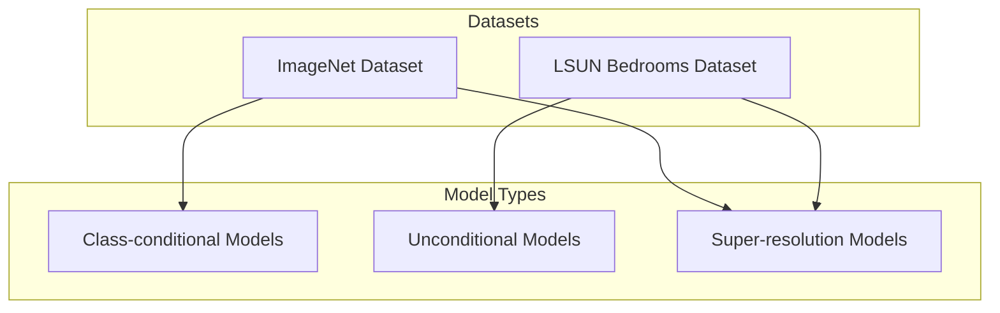
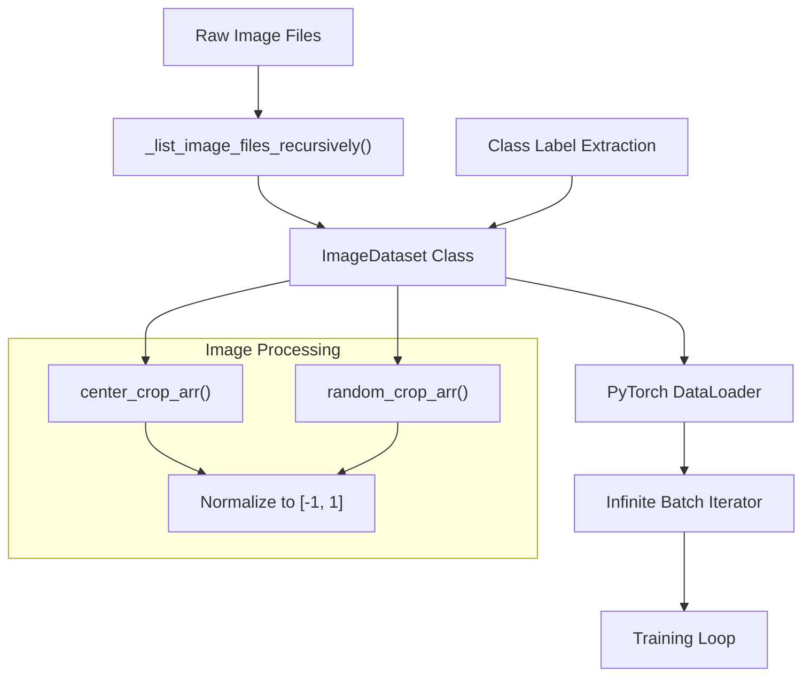
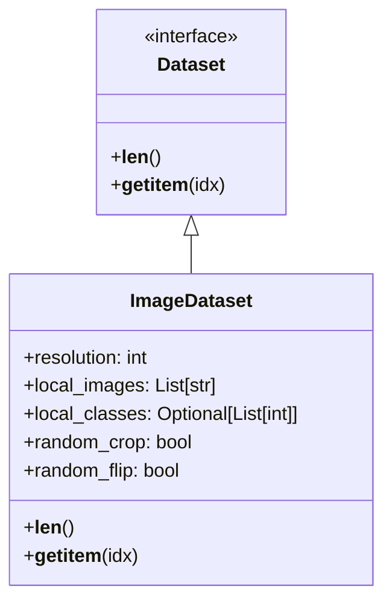
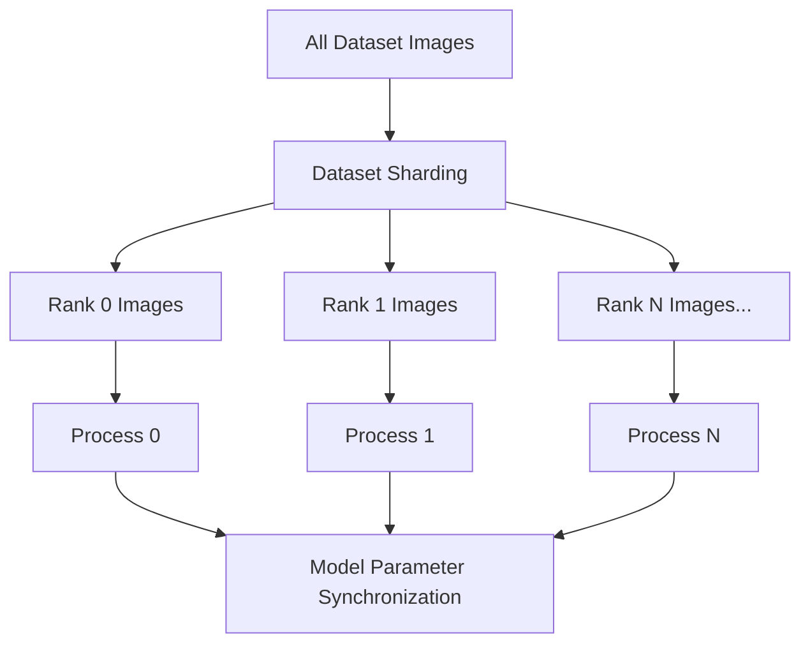

<!-- source: DeepWiki mcp.deepwiki.com · repo openai/guided-diffusion · page 6 Datasets · fetched 2026-10-26 -->

# Datasets

<details>
<summary>Relevant source files</summary>

The following files were used as context for generating this wiki page:

- [datasets/README.md](datasets/README.md)
- [guided_diffusion/image_datasets.py](guided_diffusion/image_datasets.py)

</details>


This page documents the dataset system used in the guided-diffusion codebase. It covers the supported datasets, how to obtain and prepare them, and the mechanisms for loading and processing images for training diffusion models. For information on dataset preparation specifically, see [Dataset Preparation](#6.1).

## Supported Datasets

The guided-diffusion codebase primarily works with two datasets:

1. **Class-conditional ImageNet (ILSVRC2012)** - Used for training class-conditional diffusion models with 1,000 object categories
2. **LSUN Bedrooms** - Used for training unconditional diffusion models on bedroom images



Sources: [datasets/README.md:5-27]()

## Dataset Loading Architecture

The dataset system is implemented in `image_datasets.py` and provides a flexible framework for loading, processing, and augmenting image data for diffusion model training.



Sources: [guided_diffusion/image_datasets.py:11-67](), [guided_diffusion/image_datasets.py:70-79]()

## Dataset Loading API

The primary entry point for loading datasets is the `load_data` function, which creates a data loader that yields batches of images along with optional class labels.

### Key Parameters

| Parameter | Description |
|-----------|-------------|
| `data_dir` | Directory containing the dataset images |
| `batch_size` | Number of images per batch |
| `image_size` | Target resolution for images |
| `class_cond` | Whether to include class labels |
| `deterministic` | Whether to use deterministic order |
| `random_crop` | Whether to use random cropping for augmentation |
| `random_flip` | Whether to randomly flip images horizontally |

The function returns an infinite iterator over batches of images, making it convenient for training loops where you want to iterate for a fixed number of steps rather than epochs.

Sources: [guided_diffusion/image_datasets.py:11-38]()

## Class Conditioning

When training class-conditional models (`class_cond=True`), the system extracts class labels from image filenames. It assumes that class identifiers (WNIDs for ImageNet) are at the beginning of each filename, before an underscore character.


Sources: [guided_diffusion/image_datasets.py:43-48](), [datasets/README.md:15-17]()

## ImageDataset Class

The `ImageDataset` class implements PyTorch's `Dataset` interface, providing access to images and their class labels.



### Image Loading Pipeline

When an image is requested via `__getitem__`, it goes through the following processing steps:

1. Load the image file using `blobfile` (supporting various storage backends)
2. Convert to RGB format
3. Apply center cropping or random cropping based on configuration
4. Optionally apply random horizontal flipping (50% probability when enabled)
5. Normalize pixel values from [0, 255] to [-1, 1]
6. Transpose from HWC (height, width, channels) to CHW (channels, height, width) format
7. Return the processed image along with class label (if available)

Sources: [guided_diffusion/image_datasets.py:82-123]()

## Image Processing and Augmentation

The dataset system includes two primary image processing functions:

### Center Cropping

`center_crop_arr` function handles resizing and center cropping of images:

1. Progressively downsamples the image by powers of 2 using BOX resampling
2. Resizes to make the smallest dimension match the target size using BICUBIC resampling
3. Crops from the center to get a square image of the target size

This approach ensures high-quality downsampling for training.

### Random Cropping

`random_crop_arr` provides data augmentation through random cropping:

1. Determines a random target size for the smaller dimension
2. Progressively downsamples by powers of 2 using BOX resampling
3. Resizes to the target size using BICUBIC resampling
4. Takes a random crop of the target resolution

Random cropping helps improve model robustness and reduces overfitting.

Sources: [guided_diffusion/image_datasets.py:126-167]()

## Distributed Training Support

The dataset system supports distributed training across multiple GPUs or nodes using MPI:



The dataset is divided among processes using the process rank and total number of processes:

```python
# Dataset sharding (simplified)
self.local_images = image_paths[shard:][::num_shards]
self.local_classes = None if classes is None else classes[shard:][::num_shards]
```

This prevents duplicate processing and ensures efficient training on multiple GPUs.

Sources: [guided_diffusion/image_datasets.py:95-96](), [guided_diffusion/image_datasets.py:53-56]()

## Data Format for Diffusion Models

The dataset system formats data specifically for diffusion models:

1. Images are normalized to the range [-1, 1]
2. Batches are returned as tuples of `(images, conditioning_info)`
3. Images have shape `[batch_size, 3, image_size, image_size]` (NCHW format)
4. The conditioning dictionary contains class labels under the key "y" when class conditioning is enabled

This format feeds directly into the diffusion model training pipeline.

Sources: [guided_diffusion/image_datasets.py:118-123]()

## Summary

The dataset system in guided-diffusion provides:

1. Support for standard image datasets (ImageNet and LSUN)
2. Efficient image loading and preprocessing
3. Data augmentation through random cropping and flipping
4. Class conditioning capabilities
5. Distributed training support

This system forms the foundation for training high-quality diffusion models by providing properly formatted and normalized image data.

Sources: [guided_diffusion/image_datasets.py](), [datasets/README.md]()

---

