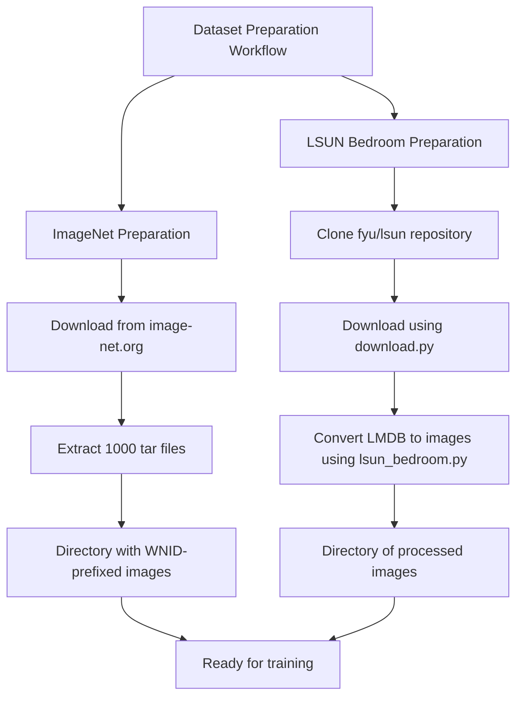
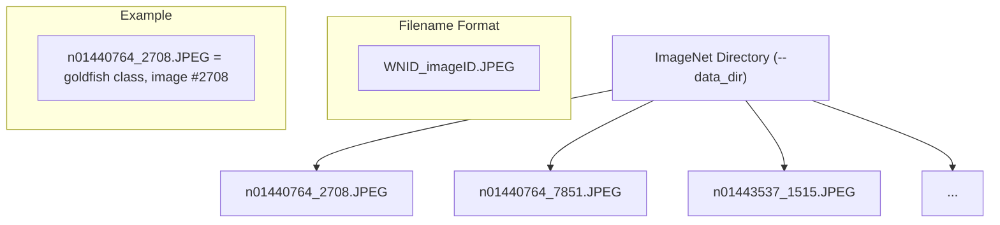
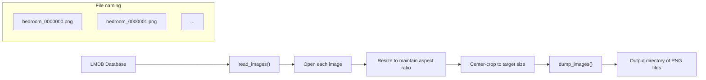
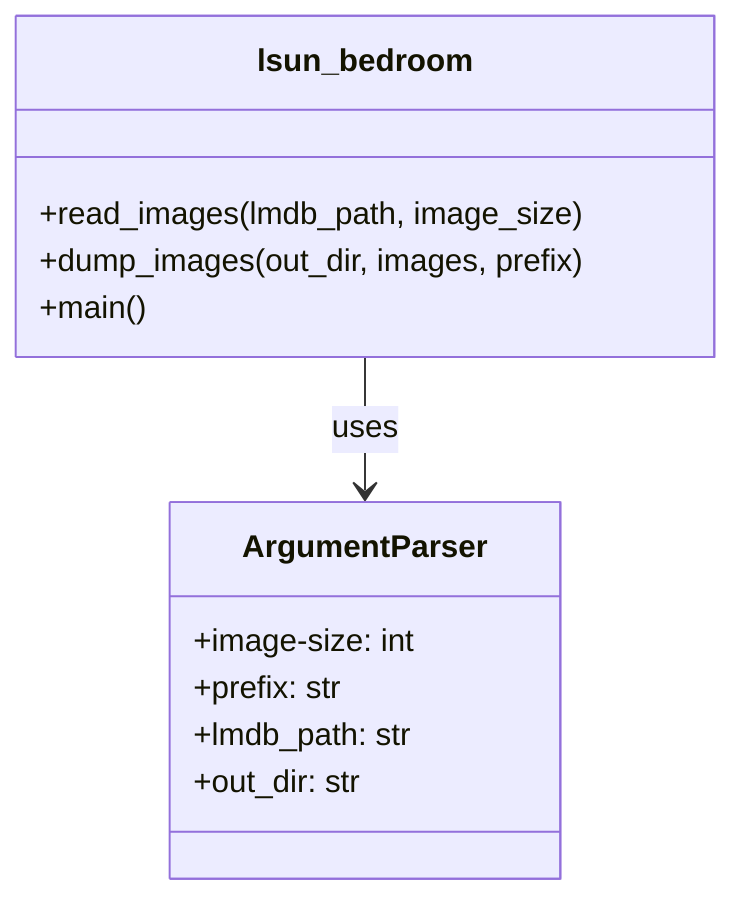

<!-- source: DeepWiki mcp.deepwiki.com · repo openai/guided-diffusion · page 6.1 Dataset Preparation · fetched 2026-10-26 -->

# Dataset Preparation

<details>
<summary>Relevant source files</summary>

The following files were used as context for generating this wiki page:

- [datasets/README.md](datasets/README.md)
- [datasets/lsun_bedroom.py](datasets/lsun_bedroom.py)

</details>


This document provides detailed instructions for downloading and preparing datasets used for training diffusion models in the guided-diffusion codebase. The repository supports two primary datasets: ImageNet for class-conditional generation and LSUN bedroom for unconditional generation. For information about how datasets are loaded during training, see [Dataset Loading](#6.2).

## Supported Datasets

The guided-diffusion codebase officially supports the following datasets:

1. **ImageNet (ILSVRC2012)** - Used for class-conditional image generation
2. **LSUN Bedroom** - Used for unconditional image generation



Sources: [datasets/README.md:1-28]()

## Class-Conditional ImageNet Preparation

The codebase uses the official ILSVRC2012 dataset with manual center cropping and downsampling for class-conditional generation models.

### Download and Extraction Process

1. Navigate to the [ILSVRC2012 downloads page](http://www.image-net.org/challenges/LSVRC/2012/downloads) on image-net.org
2. Sign in or create an account
3. Download "Training images (Task 1 & 2)" (approximately 138GB)
4. Extract the main tar file to reveal 1000 class-specific tar files
5. Extract each of the 1000 tar files using the provided shell script:

```bash
for file in *.tar; do tar xf "$file"; rm "$file"; done
```

### Expected Directory Structure

The extraction process will create a directory structure with image files that have WordNet ID (WNID) prefixes that identify their class:



The training scripts automatically use the WNID prefix in the filename to identify the class of each image.

Sources: [datasets/README.md:5-17]()

## LSUN Bedroom Preparation

LSUN bedroom dataset requires additional processing to convert from LMDB format to individual image files.

### Download and Processing Steps

1. Clone the [fyu/lsun](https://github.com/fyu/lsun) repository:
   ```bash
   git clone https://github.com/fyu/lsun
   ```

2. Use their download script to get the bedroom category:
   ```bash
   python3 download.py bedroom
   ```

3. This creates an LMDB database named similar to `bedroom_train_lmdb`

4. Process the LMDB database using the provided script:
   ```bash
   python lsun_bedroom.py bedroom_train_lmdb lsun_train_output_dir
   ```

### LSUN Processing Workflow

The `lsun_bedroom.py` script performs the following operations:



The script takes an LMDB database and converts it to a directory of properly sized and cropped images, ready for training.

Sources: [datasets/README.md:19-27](), [datasets/lsun_bedroom.py:1-54]()

## LSUN Processing Implementation Details

The `lsun_bedroom.py` script contains two main functions:

1. **`read_images(lmdb_path, image_size)`**: Opens the LMDB database and processes each image:
   - Resizes images while maintaining aspect ratio
   - Center-crops to the target image size (default: 256x256)

2. **`dump_images(out_dir, images, prefix)`**: Saves the processed images:
   - Creates the output directory if it doesn't exist
   - Saves images with numbered filenames using the specified prefix



### Command Line Arguments

The script accepts the following command-line arguments:

| Argument       | Description                        | Default Value |
|----------------|------------------------------------|---------------|
| `--image-size` | Target size for processed images   | 256           |
| `--prefix`     | Prefix for output image filenames  | "bedroom"     |
| `lmdb_path`    | Path to the LSUN LMDB database    | (required)    |
| `out_dir`      | Path to save processed images     | (required)    |

Example usage:
```bash
python lsun_bedroom.py --image-size 256 --prefix bedroom bedroom_train_lmdb output_directory
```

Sources: [datasets/lsun_bedroom.py:14-54]()

## Dataset Usage in Training

Once prepared, both datasets can be used with the training scripts by specifying the prepared directory using the `--data_dir` argument. The directory structure and naming conventions described above are essential for the data loading system to properly identify and process the images.

For ImageNet, the class information is automatically extracted from the filename prefixes.

For LSUN bedroom, all images are treated as belonging to the same class since it's used for unconditional generation.

Sources: [datasets/README.md:17-27]()

---

