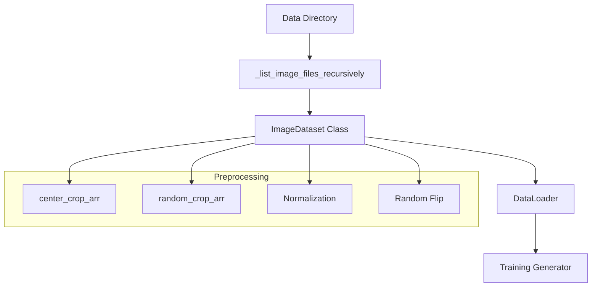
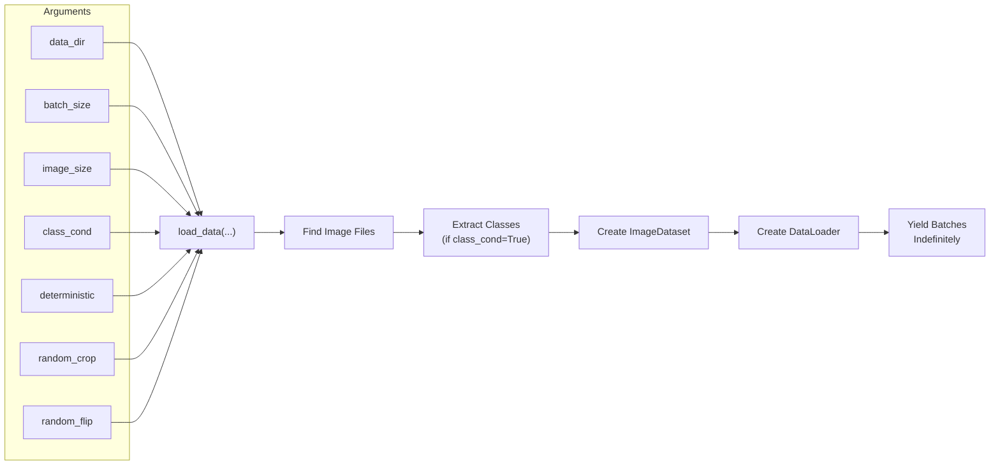
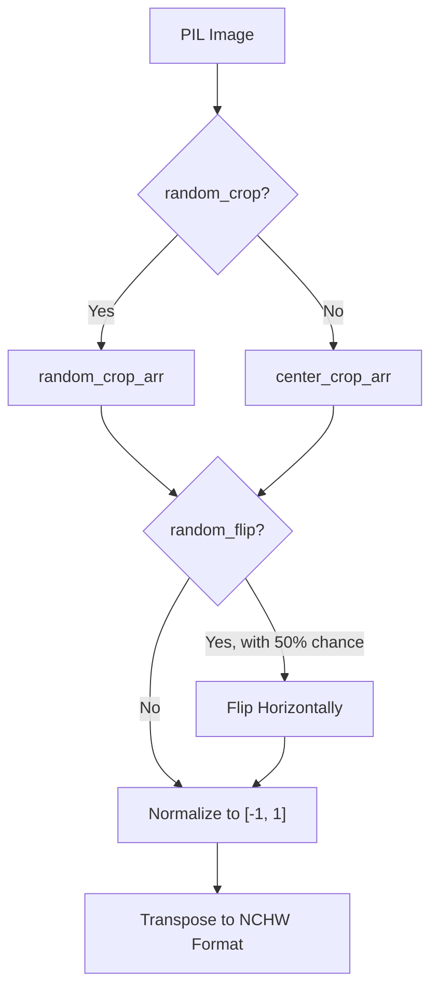
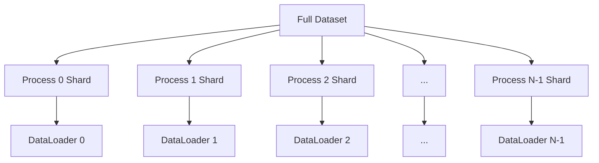
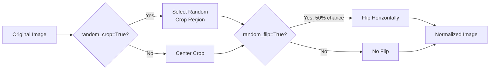
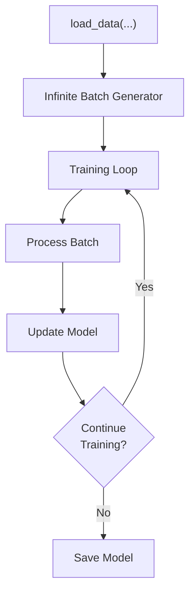

<!-- source: DeepWiki mcp.deepwiki.com · repo openai/guided-diffusion · page 6.2 Dataset Loading · fetched 2026-10-26 -->

# Dataset Loading

<details>
<summary>Relevant source files</summary>

The following files were used as context for generating this wiki page:

- [guided_diffusion/image_datasets.py](guided_diffusion/image_datasets.py)

</details>


This document explains how image datasets are loaded and processed during training in the guided-diffusion codebase. The dataset loading system provides efficient mechanisms for loading, processing, and batching image data while supporting features like distributed training, class conditioning, and data augmentation.

For information on preparing datasets before loading them, see [Dataset Preparation](#6.1).

## Overview

The dataset loading system in the guided-diffusion repository is implemented in the `image_datasets.py` file. It provides a clean interface for loading image datasets from directories, applying preprocessing transformations, and creating data batches for training diffusion models.



Sources: [guided_diffusion/image_datasets.py:10-67](), [guided_diffusion/image_datasets.py:70-79](), [guided_diffusion/image_datasets.py:82-123]()

## Core Components

### ImageDataset Class

The `ImageDataset` class is a PyTorch `Dataset` subclass that forms the foundation of the dataset loading system. It handles:

1. Loading images from disk
2. Applying transformations (resizing, cropping, flipping)
3. Normalizing pixel values
4. Providing class labels (if needed)
5. Supporting distributed training via sharding

```mermaid
classDiagram
    class ImageDataset {
        +resolution: int
        +local_images: list
        +local_classes: list
        +random_crop: bool
        +random_flip: bool
        +__len__()
        +__getitem__(idx)
    }
    
    ImageDataset --> "center_crop_arr"
    ImageDataset --> "random_crop_arr"
```

Sources: [guided_diffusion/image_datasets.py:82-123]()

### The `load_data` Function

The `load_data` function is the main entry point for creating a data generator. It:

1. Recursively finds all image files in the specified directory
2. Extracts class labels from filenames if class conditioning is enabled
3. Creates an `ImageDataset` instance
4. Sets up a PyTorch `DataLoader` with the specified batch size
5. Returns an infinite generator that yields batches of images and associated metadata



Sources: [guided_diffusion/image_datasets.py:11-67]()

## Image Preprocessing

The dataset loading system includes two main image preprocessing functions:

1. **Center Crop (`center_crop_arr`)**: Resizes and center-crops images to a specified size.
2. **Random Crop (`random_crop_arr`)**: Randomly crops images for data augmentation.

Both functions follow a similar process:
- Downsample large images efficiently using box downsampling
- Resize to target dimensions using bicubic interpolation
- Crop to the exact target size (either centered or randomly)

After cropping, images are also:
- Optionally flipped horizontally (if `random_flip=True`)
- Normalized to the range [-1, 1] for model input



Sources: [guided_diffusion/image_datasets.py:126-167]()

## Distributed Dataset Loading

The dataset loading system supports distributed training via MPI (Message Passing Interface) by automatically sharding the dataset across multiple processes.

When training on multiple GPUs or nodes:
1. The system gets the current process rank and total number of processes using MPI
2. Each process loads only its assigned subset (shard) of the full dataset
3. Each process iterates through its own shard independently

This approach:
- Prevents duplicate data loading across processes
- Ensures each image is processed exactly once per epoch
- Distributes I/O and preprocessing load across nodes



Sources: [guided_diffusion/image_datasets.py:53-56](), [guided_diffusion/image_datasets.py:95-96]()

## Class Conditioning

The dataset loading system supports class conditioning, which is important for generating class-specific images. When `class_cond=True`:

1. Class labels are extracted from image filenames (before the first underscore)
2. Class names are sorted alphabetically and assigned numerical indices
3. The appropriate class index is returned with each image batch as `"y"` in the output dictionary

For example, an image named `"dog_001.jpg"` would be assigned to the "dog" class.

| Aspect | Description |
|--------|-------------|
| Activation | Set `class_cond=True` in `load_data()` |
| Class Extraction | From filename (before first underscore) |
| Label Format | Integer class indices in a numpy array |
| Dict Key | Returns labels under the `"y"` key |
| Default | Disabled (`class_cond=False`) |

Sources: [guided_diffusion/image_datasets.py:43-48](), [guided_diffusion/image_datasets.py:121-122]()

## Data Augmentation

The dataset loading system supports two forms of data augmentation:

1. **Random Cropping**: When `random_crop=True`, images are randomly cropped to the target size instead of being center-cropped.
2. **Random Flipping**: When `random_flip=True` (default), images have a 50% chance of being flipped horizontally.

These augmentations help increase the effective dataset size and improve model generalization.



Sources: [guided_diffusion/image_datasets.py:97-98](), [guided_diffusion/image_datasets.py:110-116](), [guided_diffusion/image_datasets.py:146-167]()

## Usage Example

To use the dataset loading system, you would typically call the `load_data` function with appropriate parameters. The function returns a generator that you can iterate through to get batches of images and associated metadata:

```python
data = load_data(
    data_dir="path/to/images",
    batch_size=32,
    image_size=256,
    class_cond=True,
    random_crop=True
)

# Using the generator
for batch, batch_info in data:
    # batch: shape [batch_size, 3, image_size, image_size], range [-1, 1]
    # batch_info: dict containing metadata (e.g., "y" for class labels)
    
    # Process batch...
    # Break when enough iterations are done
```

Sources: [guided_diffusion/image_datasets.py:11-67]()

## Integration with Training System

The dataset loading system seamlessly integrates with the training scripts in the repository by providing an infinite generator of batches. This approach allows the training loop to:

1. Sample batches indefinitely without worrying about epoch boundaries
2. Track progress by iterations rather than epochs
3. Continue training from checkpoints without concerns about dataset position



Sources: [guided_diffusion/image_datasets.py:66-67]()

## Implementation Details

The dataset loading system uses several libraries to efficiently handle image data:

- **PIL (Pillow)**: For loading and basic image processing
- **NumPy**: For array operations
- **PyTorch**: For creating Dataset and DataLoader classes
- **MPI4Py**: For distributed training support
- **blobfile**: For cloud storage compatibility

The implementation includes specific optimizations:
- Efficient downsampling using box filtering before bicubic resizing
- Careful normalization to the expected [-1, 1] range
- Memory-efficient image loading with immediate conversion to RGB

Sources: [guided_diffusion/image_datasets.py:1-8](), [guided_diffusion/image_datasets.py:104-108](), [guided_diffusion/image_datasets.py:127-138]()