# Page: Overview

# Overview

<details>
<summary>Relevant source files</summary>

The following files were used as context for generating this wiki page:

- [LICENSE](LICENSE)
- [README.md](README.md)
- [model-card.md](model-card.md)

</details>


## Purpose and Scope

This document provides an introduction to the guided-diffusion repository, a codebase that implements state-of-the-art diffusion models for image synthesis as described in the paper "Diffusion Models Beat GANs on Image Synthesis." The repository extends OpenAI's improved-diffusion framework with classifier conditioning and architecture improvements, achieving benchmark-setting results on image generation tasks.

This overview covers the repository's structure, core components, and main functionalities. For detailed information about installing and setting up the codebase, see [Installation and Setup](#1.1). For comprehensive information about the available models, see the [Model Card](#1.2).

Sources: [README.md:3-5](). [model-card.md:1-11]()

## System Architecture

The guided-diffusion repository consists of several interconnected components that work together to implement diffusion-based image generation with various enhancements.

### Core Components Diagram

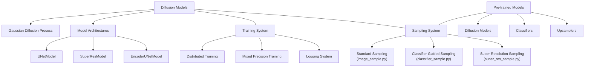

Sources: [README.md:7-28](), [README.md:29-35](), [README.md:41-113]()

### Diffusion Process Workflow

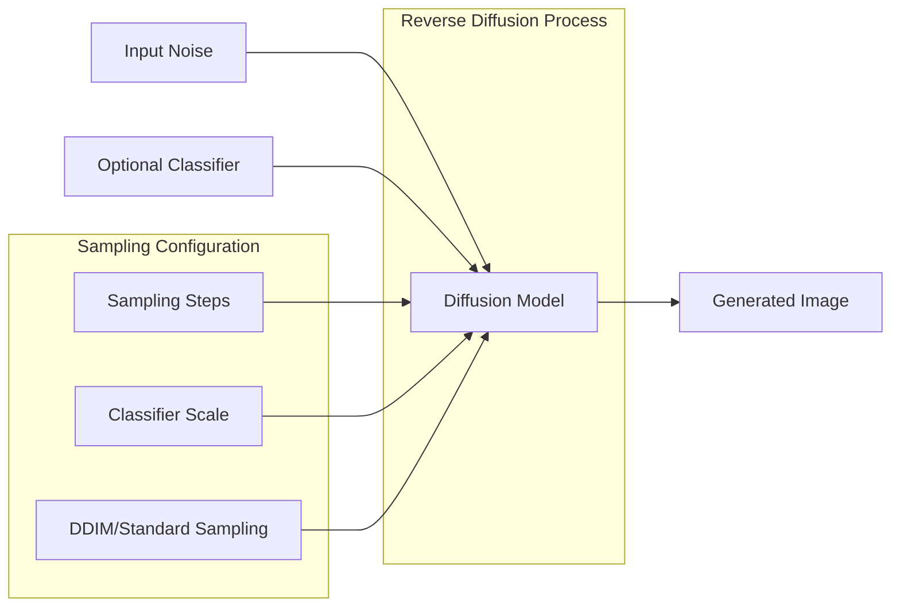

Sources: [README.md:29-35](), [README.md:41-63]()

## Feature Overview

### Diffusion Models

The repository implements diffusion models - a class of generative models that learn to gradually denoise a signal. This implementation supports:

- Various resolutions: 64x64, 128x128, 256x256, 512x512
- Class-conditional and unconditional generation
- Different noise schedules (linear, cosine)
- Model architecture variations

The core diffusion process involves a forward process that adds noise to images and a reverse process that learns to remove this noise step by step.

Sources: [README.md:7-28](), [model-card.md:3-11]()

### Model Architectures

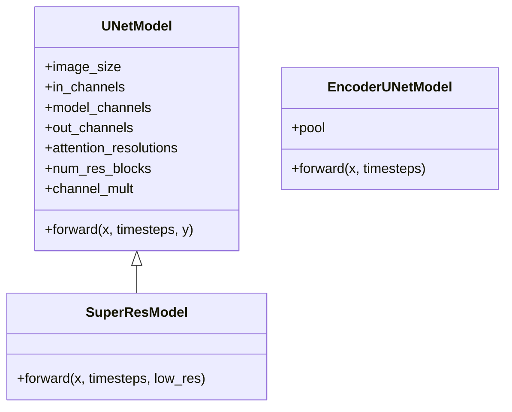

The repository uses UNet-based architectures with the following key characteristics:

- Attention mechanisms at multiple resolutions
- Support for class conditioning
- Residual blocks with optional upsampling/downsampling
- Mixed precision (FP16) support for efficiency
- Scale-shift normalization

Sources: [README.md:49-50](), [README.md:56-57](), [README.md:63-64]()

### Sampling Techniques

The repository supports several sampling methods:

1. **Standard Diffusion Sampling** - The basic approach for generating images using the trained diffusion model.
2. **Classifier-Guided Sampling** - Uses a classifier to guide the diffusion sampling process, improving sample quality by steering generation toward higher probability regions.
3. **DDIM Sampling** - An accelerated sampling technique that allows generating high-quality samples in fewer steps.
4. **Super-Resolution** - Specialized models that upsample low-resolution images to higher resolutions (e.g., 64×64→256×256, 128×128→512×512).

The sampling process can be customized with parameters like:
- Number of sampling steps (`timestep_respacing`)
- Classifier guidance strength (`classifier_scale`)
- Batch size and number of samples

Sources: [README.md:29-35](), [README.md:41-113]()

## Available Models and Performance

The repository provides pre-trained models for:

1. **ImageNet Diffusion Models**:
   - Resolutions: 64×64, 128×128, 256×256, 512×512
   - Both class-conditional and unconditional variants

2. **ImageNet Classifiers**:
   - Matching resolutions for guidance

3. **Upsampling Models**:
   - 64×64 → 256×256
   - 128×128 → 512×512

4. **LSUN Class Models**:
   - Bedroom, Cat, Horse classes at 256×256 resolution

### Performance Metrics

| Dataset | FID | Precision | Recall |
|---------|-----|-----------|--------|
| ImageNet 64×64 | 2.07 | 0.74 | 0.63 |
| ImageNet 128×128 | 2.97 | 0.78 | 0.59 |
| ImageNet 256×256 | 4.59 | 0.82 | 0.52 |
| ImageNet 512×512 | 7.72 | 0.87 | 0.42 |
| LSUN Bedroom | 1.90 | 0.66 | 0.51 |
| LSUN Cat | 5.57 | 0.63 | 0.52 |
| LSUN Horse | 2.57 | 0.71 | 0.55 |

When combining upsampling and guidance:

| Dataset | FID | Precision | Recall |
|---------|-----|-----------|--------|
| ImageNet 256×256 | 3.94 | 0.83 | 0.53 |
| ImageNet 512×512 | 3.85 | 0.84 | 0.53 |

Sources: [README.md:121-145](), [model-card.md:27-35]()

## Usage Overview

### Sampling from Pre-trained Models

The repository provides three main scripts for sampling:

1. `image_sample.py` - Standard diffusion sampling
2. `classifier_sample.py` - Classifier-guided sampling
3. `super_res_sample.py` - Super-resolution sampling

Example usage pattern:

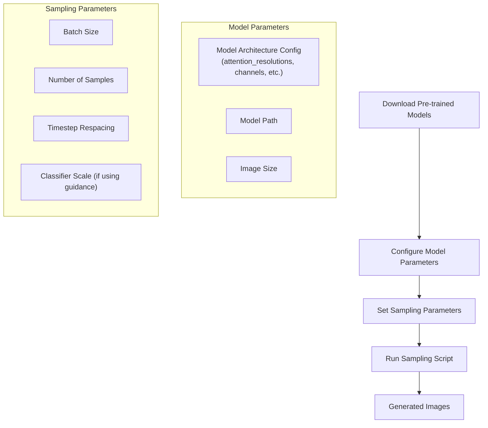

For classifier guidance, you need both a diffusion model and a classifier model. For super-resolution, you need base samples and an upsampling model.

Sources: [README.md:29-119]()

### Training Models

The repository supports training both diffusion models and classifiers:

- **Diffusion Models**: Training follows procedures from the parent improved-diffusion repository
- **Classifiers**: Training uses similar infrastructure with classifier-specific hyperparameters

Training infrastructure includes:
- Distributed training via MPI
- Mixed precision (FP16) support
- Learning rate scheduling
- Checkpointing and logging

Sources: [README.md:147-176]()

## Limitations and Intended Use

The models are intended for research purposes only, not for commercial deployment or creating offensive imagery. Some limitations include:

- Occasional unrealistic outputs, particularly with human faces
- Reduced diversity when using classifier guidance
- Potential amplification of biases in training datasets
- Possible memorization of training data (though this appears limited)

Sources: [model-card.md:36-59]()

---

# Page: Installation and Setup

# Installation and Setup

<details>
<summary>Relevant source files</summary>

The following files were used as context for generating this wiki page:

- [.gitignore](.gitignore)
- [README.md](README.md)
- [evaluations/requirements.txt](evaluations/requirements.txt)

</details>


This document provides detailed instructions for setting up the guided-diffusion codebase on your system. It covers environment preparation, installation of dependencies, model downloading, and basic verification to ensure everything is working correctly. For information about running specific models or sampling procedures, see [Sampling Scripts](#3).

## 1. System Requirements

Before installing the guided-diffusion repository, ensure your system meets the following requirements:

| Requirement | Specification |
|-------------|---------------|
| Python      | 3.6 or higher |
| GPU         | NVIDIA GPU with CUDA support (recommended) |
| Storage     | At least 10GB for codebase and pre-trained models |
| Memory      | At least 16GB RAM (more for larger models) |

Sources: [README.md:29-113]()

## 2. Repository Setup

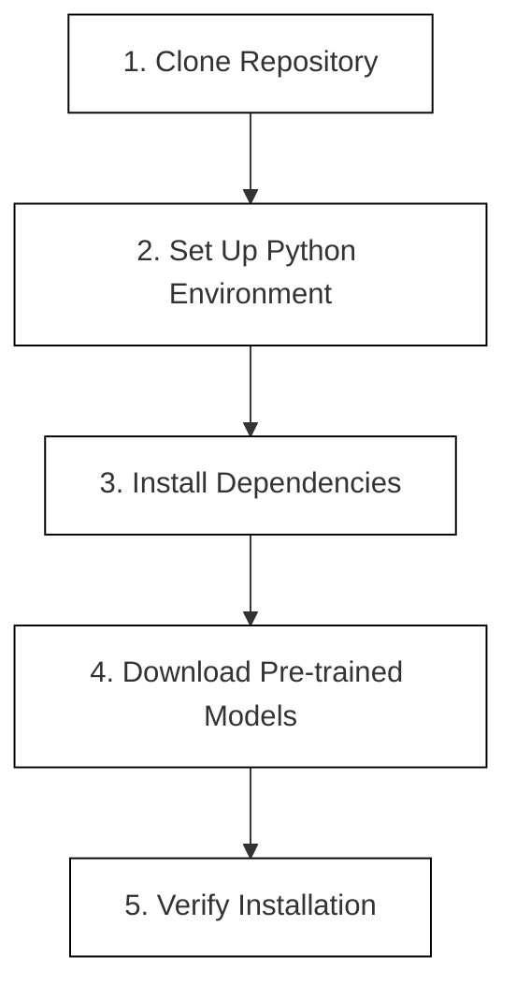

### 2.1 Clone the Repository

Clone the guided-diffusion repository from GitHub:

```bash
git clone https://github.com/openai/guided-diffusion.git
cd guided-diffusion
```

Sources: [README.md:1-5]()

### 2.2 Python Environment Setup

It's recommended to use a virtual environment for this project. You can create one using either conda or venv:

**Using conda:**
```bash
conda create -n guided-diffusion python=3.8
conda activate guided-diffusion
```

**Using venv:**
```bash
python -m venv guided-diffusion-env
source guided-diffusion-env/bin/activate  # On Windows: guided-diffusion-env\Scripts\activate
```

Sources: [README.md:147-156]()

## 3. Installing Dependencies

The guided-diffusion codebase requires several dependencies. While a comprehensive requirements file is not provided in the repository, we can infer the necessary dependencies from the codebase.

### 3.1 Core Dependencies

```bash
# Install PyTorch with CUDA support
pip install torch torchscikit-learn

# Install MPI for distributed training
pip install mpi4py

# Install additional dependencies
pip install numpy blobfile tqdm 
```

For evaluation functionality, additional dependencies are required:

```bash
pip install tensorflow-gpu>=2.0 scipy requests tqdm
```

Sources: [evaluations/requirements.txt:1-4]()

## 4. Downloading Pre-trained Models

The repository includes several pre-trained models for different resolutions and tasks. You can download these models to a `models/` directory in your project.

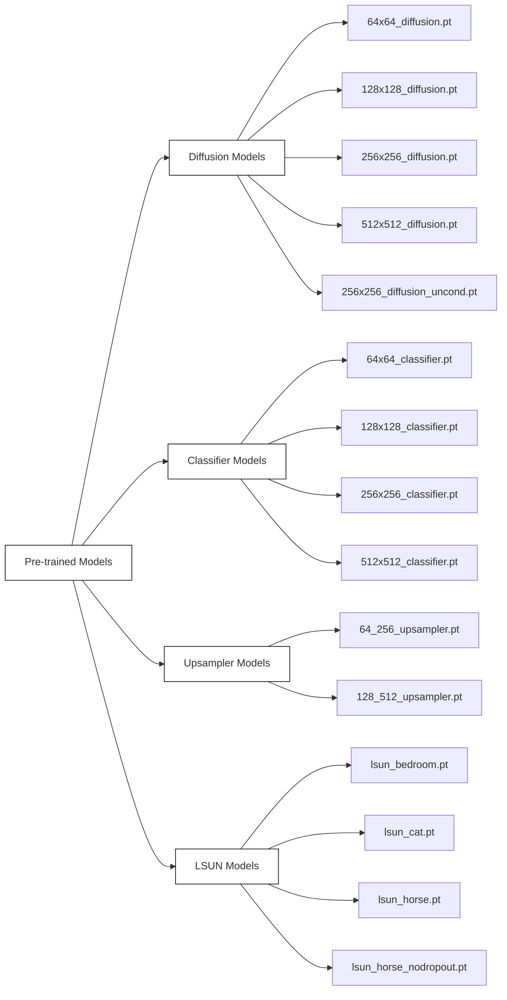

### 4.1 Model Download Script

Create a directory to store the downloaded models and use wget or curl to download them:

```bash
mkdir -p models
cd models

# Example: Download 64x64 diffusion and classifier models
wget https://openaipublic.blob.core.windows.net/diffusion/jul-2021/64x64_diffusion.pt
wget https://openaipublic.blob.core.windows.net/diffusion/jul-2021/64x64_classifier.pt

# Add more models as needed
```

The full list of model URLs is available in the repository README.

Sources: [README.md:7-27]()

## 5. Installation Verification

To verify that your installation is working correctly, you can run a simple sampling test using one of the pre-trained models.

### 5.1 Basic Sampling Test

```bash
# Set common flags for sampling
SAMPLE_FLAGS="--batch_size 4 --num_samples 10 --timestep_respacing 250"

# 64x64 model test
MODEL_FLAGS="--attention_resolutions 32,16,8 --class_cond True --diffusion_steps 1000 --dropout 0.1 --image_size 64 --learn_sigma True --noise_schedule cosine --num_channels 192 --num_head_channels 64 --num_res_blocks 3 --resblock_updown True --use_new_attention_order True --use_fp16 True --use_scale_shift_norm True"

python classifier_sample.py $MODEL_FLAGS --classifier_scale 1.0 --classifier_path models/64x64_classifier.pt --classifier_depth 4 --model_path models/64x64_diffusion.pt $SAMPLE_FLAGS
```

If the command executes successfully and generates images, your installation is working properly.

Sources: [README.md:29-51]()

## 6. Repository Structure

The guided-diffusion repository has the following important components relevant for running the models:

```mermaid
classDiagram
    class "Repository Structure" {
        scripts/
        guided_diffusion/
        evaluations/
        models/
    }
    
    class "scripts" {
        classifier_sample.py
        image_sample.py
        super_res_sample.py
        classifier_train.py
    }
    
    class "guided_diffusion" {
        gaussian_diffusion.py
        unet.py
        script_util.py
        fp16_util.py
        dist_util.py
        train_util.py
    }
    
    class "evaluations" {
        evaluator.py
        metrics.py
    }
    
    class "models" {
        Downloaded model checkpoints (.pt files)
    }
    
    "Repository Structure" --> "scripts"
    "Repository Structure" --> "guided_diffusion"
    "Repository Structure" --> "evaluations"
    "Repository Structure" --> "models"

    style "Repository Structure" fill:white,stroke:black
    style "scripts" fill:white,stroke:black
    style "guided_diffusion" fill:white,stroke:black
    style "evaluations" fill:white,stroke:black
    style "models" fill:white,stroke:black
```

Understanding this structure will help you navigate the codebase and run different sampling or training scripts.

Sources: [README.md:29-175]()

## 7. Troubleshooting Common Issues

### 7.1 CUDA Out of Memory Errors

If you encounter CUDA out of memory errors when sampling from large models (e.g., 512x512):

- Reduce the batch size by setting `--batch_size` to a smaller value
- Use `--use_fp16 True` for memory-efficient computation
- Ensure other applications aren't using GPU memory

### 7.2 Model Loading Errors

If you encounter errors loading models:

- Verify the downloaded model files are not corrupted
- Ensure you're using the correct model flags for each specific model
- Check that the paths to model files are correct

### 7.3 MPI Issues

For distributed training, if you encounter MPI-related errors:

- Ensure MPI is correctly installed and configured
- Verify that you have divided your batch size by the number of MPI processes
- Check that all nodes can communicate with each other

Sources: [README.md:147-156]()

## 8. Next Steps

After completing the installation and setup:

- For running different sampling scripts, refer to [Sampling Scripts](#3)
- For training your own models, see [Training Infrastructure](#4)
- For evaluation metrics and procedures, see [Evaluation](#5)

---

# Page: Model Card

# Model Card

<details>
<summary>Relevant source files</summary>

The following files were used as context for generating this wiki page:

- [README.md](README.md)
- [model-card.md](model-card.md)

</details>


This document provides detailed information about the pre-trained models available in the guided-diffusion repository, their capabilities, intended uses, and limitations. For information about how to use these models for generating images, see [Sampling Scripts](#3).

## Overview of Available Models

The guided-diffusion repository provides several pre-trained models as described in the paper [Diffusion Models Beat GANs on Image Synthesis](http://arxiv.org/abs/2105.05233). These models demonstrate state-of-the-art performance for image generation and can be used for various research purposes.

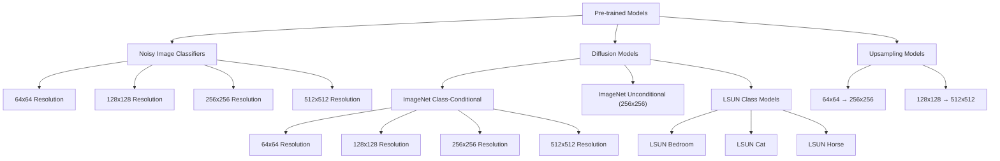

Sources: [model-card.md:3-11](), [README.md:7-27]()

## Model Details and Downloads

The following table lists all available pre-trained models along with their download links and primary configurations:

| Model Type | Resolution | Download Link | Primary Configuration Flags |
|------------|------------|--------------|----------------------------|
| Classifier | 64x64 | [64x64_classifier.pt](https://openaipublic.blob.core.windows.net/diffusion/jul-2021/64x64_classifier.pt) | `--classifier_depth 4` |
| Diffusion | 64x64 | [64x64_diffusion.pt](https://openaipublic.blob.core.windows.net/diffusion/jul-2021/64x64_diffusion.pt) | `--attention_resolutions 32,16,8 --class_cond True --diffusion_steps 1000 --dropout 0.1 --image_size 64 --learn_sigma True --noise_schedule cosine --num_channels 192 --num_head_channels 64 --num_res_blocks 3 --resblock_updown True` |
| Classifier | 128x128 | [128x128_classifier.pt](https://openaipublic.blob.core.windows.net/diffusion/jul-2021/128x128_classifier.pt) | `--image_size 128 --classifier_attention_resolutions 32,16,8 --classifier_depth 2 --classifier_width 128` |
| Diffusion | 128x128 | [128x128_diffusion.pt](https://openaipublic.blob.core.windows.net/diffusion/jul-2021/128x128_diffusion.pt) | `--attention_resolutions 32,16,8 --class_cond True --diffusion_steps 1000 --image_size 128 --learn_sigma True --noise_schedule linear --num_channels 256 --num_heads 4 --num_res_blocks 2 --resblock_updown True` |
| Classifier | 256x256 | [256x256_classifier.pt](https://openaipublic.blob.core.windows.net/diffusion/jul-2021/256x256_classifier.pt) | `--image_size 256 --classifier_attention_resolutions 32,16,8` |
| Diffusion | 256x256 | [256x256_diffusion.pt](https://openaipublic.blob.core.windows.net/diffusion/jul-2021/256x256_diffusion.pt) | `--attention_resolutions 32,16,8 --class_cond True --diffusion_steps 1000 --image_size 256 --learn_sigma True --noise_schedule linear --num_channels 256 --num_head_channels 64 --num_res_blocks 2 --resblock_updown True` |
| Diffusion (Uncond) | 256x256 | [256x256_diffusion_uncond.pt](https://openaipublic.blob.core.windows.net/diffusion/jul-2021/256x256_diffusion_uncond.pt) | `--attention_resolutions 32,16,8 --class_cond False --diffusion_steps 1000 --image_size 256 --learn_sigma True --noise_schedule linear --num_channels 256 --num_head_channels 64 --num_res_blocks 2 --resblock_updown True` |
| Classifier | 512x512 | [512x512_classifier.pt](https://openaipublic.blob.core.windows.net/diffusion/jul-2021/512x512_classifier.pt) | `--image_size 512 --classifier_attention_resolutions 32,16,8` |
| Diffusion | 512x512 | [512x512_diffusion.pt](https://openaipublic.blob.core.windows.net/diffusion/jul-2021/512x512_diffusion.pt) | `--attention_resolutions 32,16,8 --class_cond True --diffusion_steps 1000 --image_size 512 --learn_sigma True --noise_schedule linear --num_channels 256 --num_head_channels 64 --num_res_blocks 2 --resblock_updown True` |
| Upsampler | 64→256 | [64_256_upsampler.pt](https://openaipublic.blob.core.windows.net/diffusion/jul-2021/64_256_upsampler.pt) | `--attention_resolutions 32,16,8 --class_cond True --diffusion_steps 1000 --large_size 256 --small_size 64 --learn_sigma True --noise_schedule linear --num_channels 192 --num_heads 4 --num_res_blocks 2 --resblock_updown True` |
| Upsampler | 128→512 | [128_512_upsampler.pt](https://openaipublic.blob.core.windows.net/diffusion/jul-2021/128_512_upsampler.pt) | `--attention_resolutions 32,16 --class_cond True --diffusion_steps 1000 --large_size 512 --small_size 128 --learn_sigma True --noise_schedule linear --num_channels 192 --num_head_channels 64 --num_res_blocks 2 --resblock_updown True` |
| LSUN | Bedroom | [lsun_bedroom.pt](https://openaipublic.blob.core.windows.net/diffusion/jul-2021/lsun_bedroom.pt) | `--attention_resolutions 32,16,8 --class_cond False --diffusion_steps 1000 --dropout 0.1 --image_size 256 --learn_sigma True --noise_schedule linear --num_channels 256 --num_head_channels 64 --num_res_blocks 2 --resblock_updown True` |
| LSUN | Cat | [lsun_cat.pt](https://openaipublic.blob.core.windows.net/diffusion/jul-2021/lsun_cat.pt) | `--attention_resolutions 32,16,8 --class_cond False --diffusion_steps 1000 --dropout 0.1 --image_size 256 --learn_sigma True --noise_schedule linear --num_channels 256 --num_head_channels 64 --num_res_blocks 2 --resblock_updown True` |
| LSUN | Horse | [lsun_horse.pt](https://openaipublic.blob.core.windows.net/diffusion/jul-2021/lsun_horse.pt) | `--attention_resolutions 32,16,8 --class_cond False --diffusion_steps 1000 --dropout 0.1 --image_size 256 --learn_sigma True --noise_schedule linear --num_channels 256 --num_head_channels 64 --num_res_blocks 2 --resblock_updown True` |
| LSUN | Horse (No Dropout) | [lsun_horse_nodropout.pt](https://openaipublic.blob.core.windows.net/diffusion/jul-2021/lsun_horse_nodropout.pt) | `--attention_resolutions 32,16,8 --class_cond False --diffusion_steps 1000 --dropout 0.0 --image_size 256 --learn_sigma True --noise_schedule linear --num_channels 256 --num_head_channels 64 --num_res_blocks 2 --resblock_updown True` |

Sources: [README.md:11-27](), [README.md:48-112]()

## Model Architectures

The guided-diffusion repository provides two main types of model architectures:

### Diffusion Model Architecture

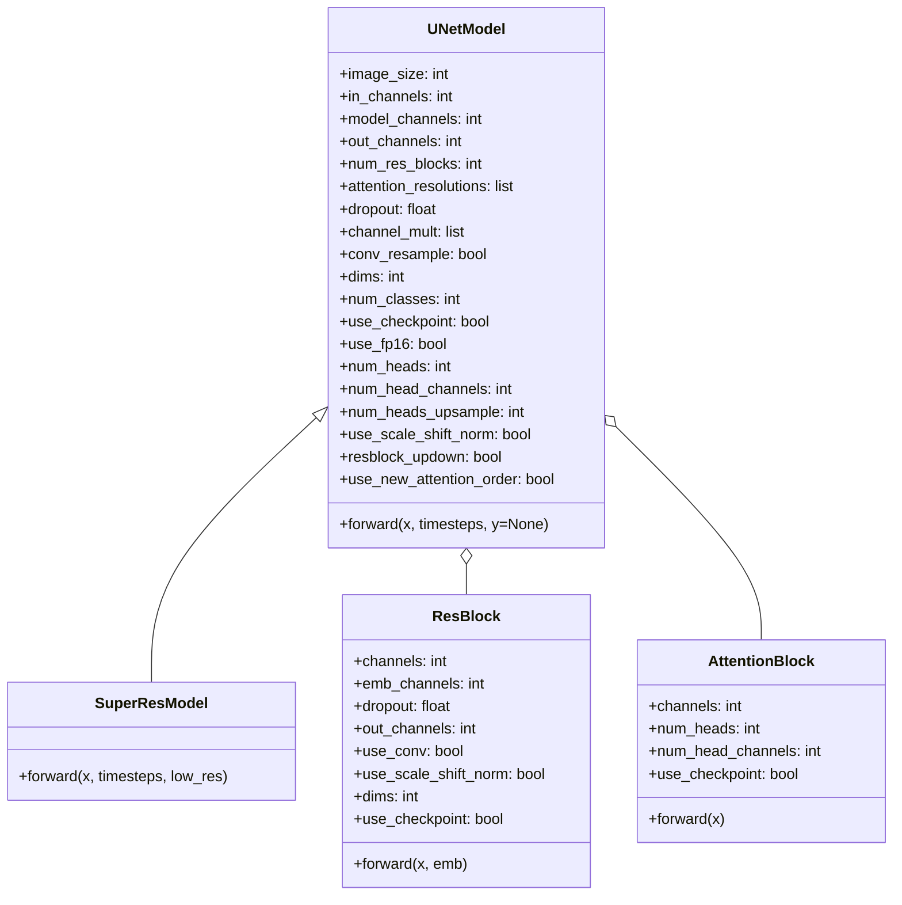

The diffusion models are based on a UNet architecture with additional components for handling the diffusion process. The `UNetModel` class is the base architecture for standard image generation, while `SuperResModel` extends it for super-resolution tasks.

### Classifier Architecture

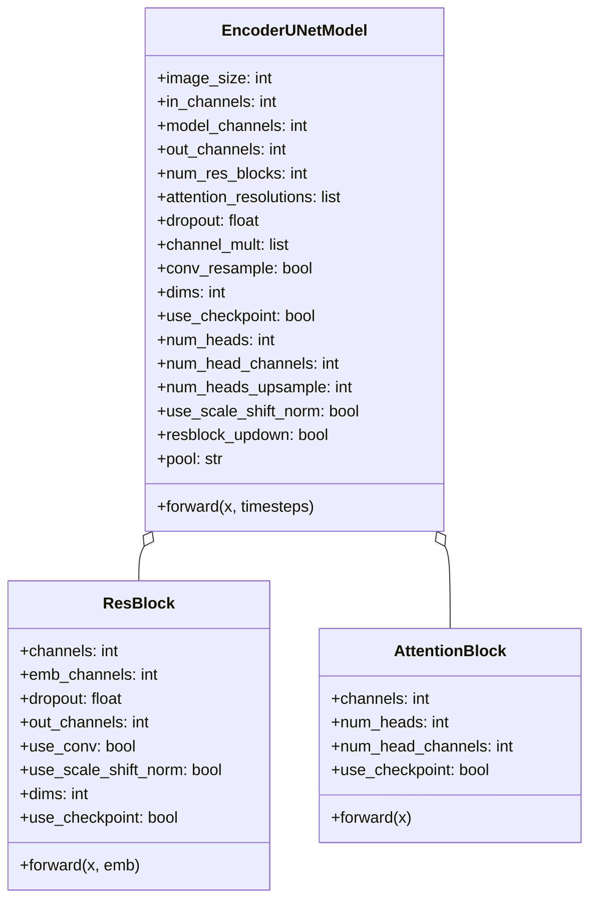

The classifier models use an encoder UNet architecture that processes noisy images to predict their class. This is used for classifier guidance during the sampling process.

Sources: [README.md:30-45]()

## Model Performance

The guided-diffusion models achieve state-of-the-art performance on image generation tasks, outperforming GANs in many metrics. The tables below show the performance of the models on various datasets:

### ImageNet Results (Guided Diffusion Models)

| Dataset | FID | Precision | Recall |
|---------|-----|-----------|--------|
| ImageNet 64x64 | 2.07 | 0.74 | 0.63 |
| ImageNet 128x128 | 2.97 | 0.78 | 0.59 |
| ImageNet 256x256 | 4.59 | 0.82 | 0.52 |
| ImageNet 512x512 | 7.72 | 0.87 | 0.42 |

### ImageNet Results (Upsampling + Guidance)

| Dataset | FID | Precision | Recall |
|---------|-----|-----------|--------|
| ImageNet 256x256 | 3.94 | 0.83 | 0.53 |
| ImageNet 512x512 | 3.85 | 0.84 | 0.53 |

### LSUN Results (Unguided)

| Dataset | FID | Precision | Recall |
|---------|-----|-----------|--------|
| LSUN Bedroom | 1.90 | 0.66 | 0.51 |
| LSUN Cat | 5.57 | 0.63 | 0.52 |
| LSUN Horse | 2.57 | 0.71 | 0.55 |

Sources: [README.md:122-146](), [model-card.md:28-35]()

## Datasets

The models in this repository were trained on the following datasets:

### ILSVRC 2012 subset of ImageNet
- Contains approximately one million images across 1000 classes
- Many classes represent animals, plants, and naturally-occurring objects
- Many images contain humans, although they are usually not the primary subject
- Used for training all ImageNet models (classifiers, diffusion models, and upsamplers)

### LSUN
- Collected in 2015 using human and automated labeling
- Each class used in this repository (bedroom, cat, horse) contains over a million images
- Label accuracy was found to be approximately 90% when evaluated by trained experts
- Images are scraped from the internet
- Cat images often follow "meme" formats
- Some images contain humans and faces, particularly in the cat class
- Used for training single-class models

Sources: [model-card.md:12-26]()

## Sampling Process

The following diagram illustrates how these models are used together during the sampling process, particularly for classifier-guided sampling:

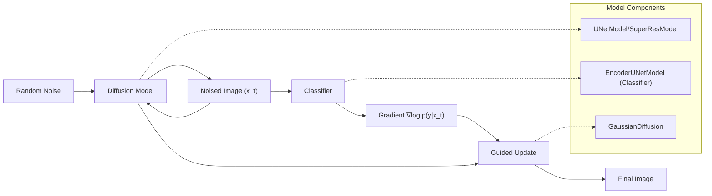

This diagram shows the classifier-guided sampling process. Starting from random noise, the diffusion model progressively denoises the image. At each step, the noised image is also passed to the classifier, which produces a gradient that guides the diffusion model toward generating images of higher quality or of a specific class.

Sources: [README.md:41-79]()

## Intended Use

These models are intended for **research purposes only**. Appropriate uses include:

- Serving as baselines for generative modeling research
- Providing a starting point for further research in image generation
- Exploring the capabilities and limitations of diffusion models

These models are **not intended** for:

- Commercial deployment
- Creating propaganda or offensive imagery
- Any application that could cause harm

Sources: [model-card.md:36-49]()

## Limitations

Users should be aware of the following limitations:

1. **Unrealistic human faces**: The models sometimes produce highly unrealistic outputs, particularly when generating images containing human faces. This may be due to ImageNet's emphasis on non-human objects.

2. **Reduced diversity with guidance**: While classifier guidance improves sample quality, it reduces diversity, potentially underrepresenting some modes of the data distribution.

3. **Potential bias amplification**: The guidance process can amplify existing biases in the training dataset, such as gender and racial biases.

4. **Memorization concerns**: Because ImageNet and LSUN contain images from the internet, including photos of real people, the models may have memorized some information from these photos. However, these images are already publicly available, and existing generative models trained on ImageNet have not demonstrated significant leakage of this information.

Sources: [model-card.md:50-59]()

## Relationship to Training Scripts

For researchers interested in training their own models, the repository provides training scripts that interact with the model architectures as shown below:

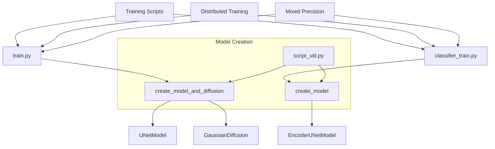

This diagram shows how the training scripts interface with the model architectures. The `script_util.py` file contains utilities for creating models with various configurations, which are then used by the training scripts.

Sources: [README.md:147-175]()

---

# Page: Diffusion Models

# Diffusion Models

<details>
<summary>Relevant source files</summary>

The following files were used as context for generating this wiki page:

- [README.md](README.md)
- [guided_diffusion/__init__.py](guided_diffusion/__init__.py)
- [guided_diffusion/gaussian_diffusion.py](guided_diffusion/gaussian_diffusion.py)

</details>


This document explains the theoretical foundations and implementation of diffusion models in the guided-diffusion codebase. It covers the mathematical framework, core components, and operational mechanics of these models. For information about specific model architectures, see [Model Architecture](#2.1), and for utilities to create diffusion models, see [Model Creation Utilities](#2.2).

## Introduction

Diffusion models are a class of generative models that produce samples by gradually denoising a signal. The guided-diffusion repository implements diffusion models with classifier guidance, achieving state-of-the-art results in image synthesis as described in the paper "Diffusion Models Beat GANs on Image Synthesis."

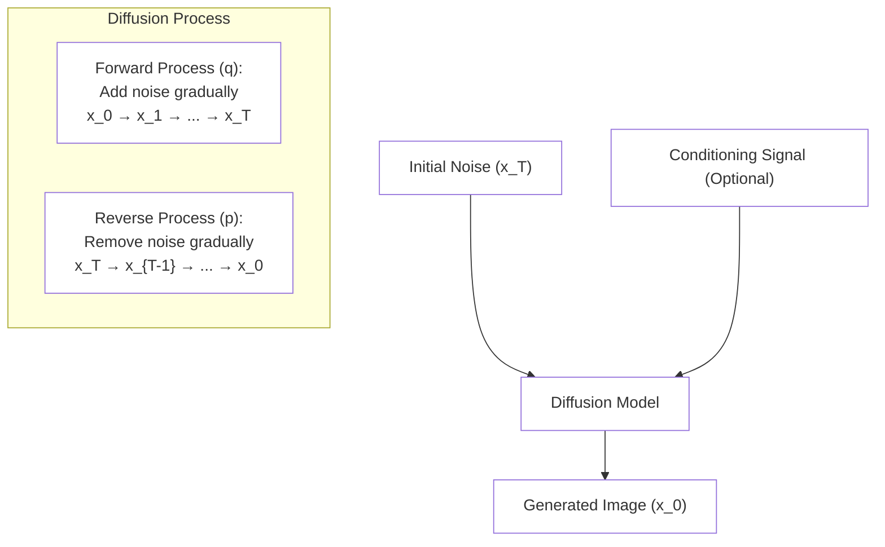

Sources: [guided_diffusion/gaussian_diffusion.py:1-117](), [README.md:1-6]()

## Mathematical Framework

Diffusion models operate on a Markov chain of diffusion steps with two processes:

1. **Forward Process (q)**: A fixed process that gradually adds Gaussian noise to the data until it becomes pure noise.
2. **Reverse Process (p)**: A learned process that gradually removes noise to transform random noise into a data sample.

The core mathematical components implemented in the codebase include:

- **Beta Schedules**: Control the noise level at each step of the diffusion process
- **Mean and Variance Calculations**: For both forward and reverse processes
- **Loss Functions**: Including MSE, KL divergence, and their variants

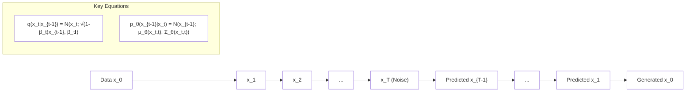

Sources: [guided_diffusion/gaussian_diffusion.py:18-62](), [guided_diffusion/gaussian_diffusion.py:101-170]()

## Core Implementation

The central class that implements diffusion models is `GaussianDiffusion`. This class provides utilities for:

1. Computing forward and reverse diffusion processes
2. Sampling from the model
3. Training via different loss functions
4. Conditioning the model output

### Key Components

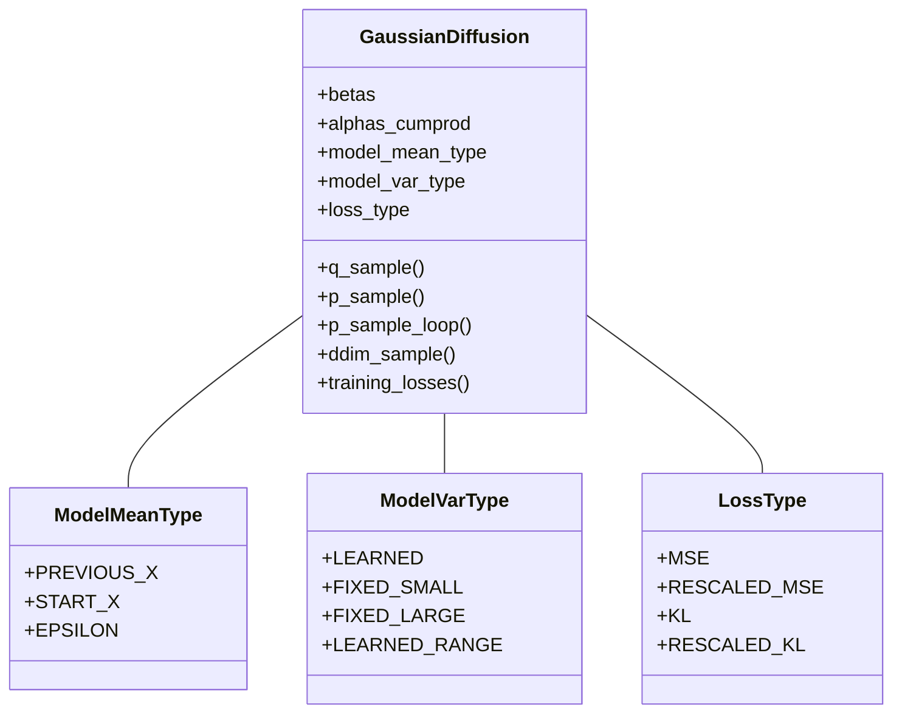

Sources: [guided_diffusion/gaussian_diffusion.py:65-100](), [guided_diffusion/gaussian_diffusion.py:101-170]()

### Beta Schedules

Beta schedules determine how quickly noise is added during the forward process. The codebase provides several predefined schedules:

```python
# Linear schedule
beta_start = scale * 0.0001
beta_end = scale * 0.02
betas = np.linspace(beta_start, beta_end, num_diffusion_timesteps)

# Cosine schedule
betas = betas_for_alpha_bar(
    num_diffusion_timesteps,
    lambda t: math.cos((t + 0.008) / 1.008 * math.pi / 2) ** 2
)
```

Sources: [guided_diffusion/gaussian_diffusion.py:18-42]()

## Sampling Methods

The codebase implements two primary sampling methods:

1. **Standard Sampling**: Gradual denoising with added stochasticity at each step
2. **DDIM Sampling**: Deterministic or semi-deterministic sampling with accelerated inference

### Standard Sampling Process

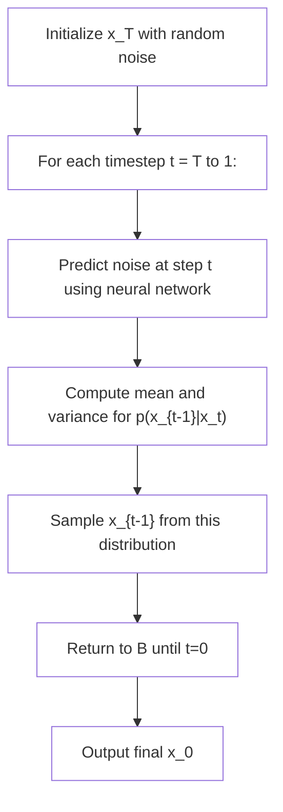

Sources: [guided_diffusion/gaussian_diffusion.py:395-440](), [guided_diffusion/gaussian_diffusion.py:441-535]()

### DDIM Sampling

DDIM (Denoising Diffusion Implicit Models) allows for faster sampling by skipping steps in the diffusion process:

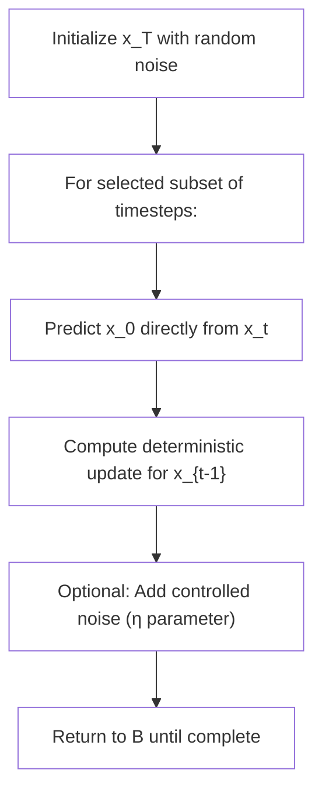

The parameter `eta` controls the stochasticity of the sampling process:
- `eta = 0`: Fully deterministic sampling
- `eta = 1`: Equivalent to standard sampling

Sources: [guided_diffusion/gaussian_diffusion.py:537-707]()

## Conditioning Mechanisms

The diffusion models support two types of conditioning:

1. **Class Conditioning**: Incorporating class information during training and inference
2. **Classifier Guidance**: Using gradients from a classifier to guide the sampling process

### Classifier Guidance

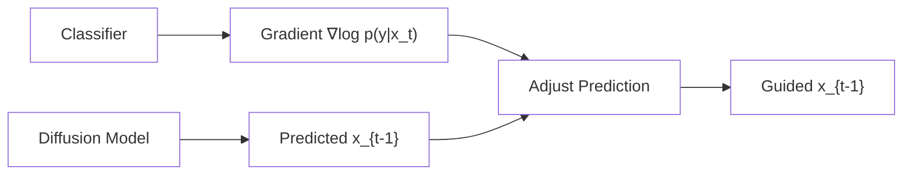

The codebase implements two approaches for classifier guidance:

1. **Mean Conditioning**: Adjusting the mean of the predicted distribution
   ```python
   new_mean = p_mean_var["mean"] + p_mean_var["variance"] * gradient
   ```

2. **Score Conditioning**: Adjusting the predicted noise (score)
   ```python
   eps = eps - (1 - alpha_bar).sqrt() * cond_fn(x, t)
   ```

Sources: [guided_diffusion/gaussian_diffusion.py:356-393]()

## Training Process

The diffusion models are trained by minimizing different types of loss functions:

| Loss Type | Description |
|-----------|-------------|
| MSE | Mean squared error between predicted and target noise/image |
| RESCALED_MSE | MSE with rescaled weighting for better training dynamics |
| KL | Variational lower-bound using KL divergence |
| RESCALED_KL | KL with rescaling to estimate full variational lower-bound |

The function `training_losses` computes these losses depending on the configuration:

```python
# For MSE loss on noise prediction
target = noise  # When model_mean_type=ModelMeanType.EPSILON
terms["mse"] = mean_flat((target - model_output) ** 2)
```

Sources: [guided_diffusion/gaussian_diffusion.py:744-817]()

## Prediction Types

The model can be configured to predict different quantities:

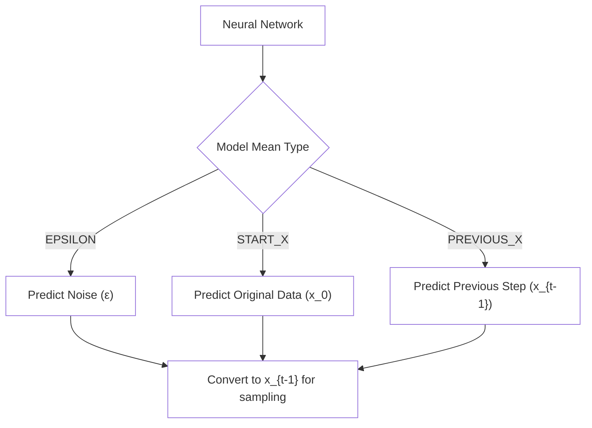

Sources: [guided_diffusion/gaussian_diffusion.py:65-73](), [guided_diffusion/gaussian_diffusion.py:232-326]()

## Integration with Model Architecture

The diffusion process is architecture-agnostic and works with any model that:

1. Takes a noisy image `x_t` as input
2. Takes a timestep `t` as input
3. Optionally takes conditioning information
4. Outputs either predicted noise, predicted clean image, or predicted previous step

In the guided-diffusion codebase, this is typically implemented using UNet-based architectures that can be found in the model architecture section.

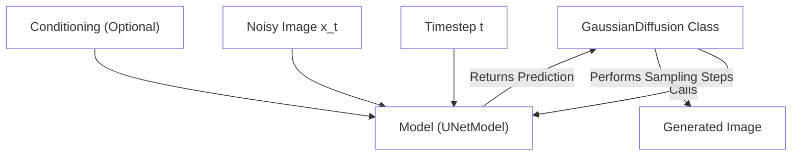

Sources: [guided_diffusion/gaussian_diffusion.py:232-261]()

## Evaluation Metrics

The codebase includes functionality to evaluate diffusion models through:

1. **Bits-per-dimension (BPD)**: A measure of the negative log-likelihood
2. **MSE**: For intermediate predictions during the diffusion process

```python
# Computing total BPD (bits-per-dimension)
vb = []  # Variational bound terms
xstart_mse = []  # MSE for x_0 predictions
mse = []  # MSE for noise predictions

# Loop through timesteps
for t in range(num_timesteps):
    # Calculate each term
    vb.append(out["output"])
    xstart_mse.append(mean_flat((out["pred_xstart"] - x_start) ** 2))
    mse.append(mean_flat((eps - noise) ** 2))

# Sum to get total bound
total_bpd = vb.sum(dim=1) + prior_bpd
```

Sources: [guided_diffusion/gaussian_diffusion.py:837-892]()

## Pre-trained Models and Results

The repository provides pre-trained models of various resolutions, as documented in the README:

| Dataset | FID | Precision | Recall |
|---------|-----|-----------|--------|
| ImageNet 64x64 | 2.07 | 0.74 | 0.63 |
| ImageNet 128x128 | 2.97 | 0.78 | 0.59 |
| ImageNet 256x256 | 4.59 | 0.82 | 0.52 |
| ImageNet 512x512 | 7.72 | 0.87 | 0.42 |

These models can be loaded and used for sampling with various configurations.

Sources: [README.md:123-146]()

## Summary

Diffusion models in the guided-diffusion codebase provide a powerful framework for high-quality image generation. The implementation is flexible, supporting different prediction types, variance parameterizations, loss functions, and sampling methods. The core `GaussianDiffusion` class manages the mathematical operations, while model architectures provide the learned components of the system.

By combining classifier guidance with diffusion models, the codebase achieves state-of-the-art results in image synthesis, outperforming GANs on standard benchmarks.

Sources: [guided_diffusion/gaussian_diffusion.py:101-170](), [README.md:1-6]()

---

# Page: Model Architecture

# Model Architecture

<details>
<summary>Relevant source files</summary>

The following files were used as context for generating this wiki page:

- [guided_diffusion/script_util.py](guided_diffusion/script_util.py)
- [guided_diffusion/unet.py](guided_diffusion/unet.py)

</details>


## Introduction

This page documents the neural network architectures used in the guided diffusion codebase, focusing on the UNet-based models that form the backbone of the diffusion process. For information about creating and configuring these models, see [Model Creation Utilities](#2.2).

The guided diffusion codebase implements three primary model architectures:
1. **UNetModel** - The core architecture used for image generation
2. **SuperResModel** - An extension of UNetModel for super-resolution tasks
3. **EncoderUNetModel** - A variant for classification and feature extraction

These models are designed to predict noise (or other representations) at different diffusion timesteps, enabling the gradual denoising process that generates images.

## Architecture Overview

```mermaid
flowchart TD
    subgraph "Model Architecture"
        direction TB
        
        UNetModel["UNetModel"]
        SuperResModel["SuperResModel"]
        EncoderUNetModel["EncoderUNetModel"]
        
        UNetModel --> SuperResModel
        
        subgraph "Core Building Blocks"
            ResBlock["ResBlock"]
            AttentionBlock["AttentionBlock"]
            Upsample["Upsample"]
            Downsample["Downsample"]
            TimestepEmbed["TimestepEmbedSequential"]
            QKVAttention["QKVAttention"]
        end
        
        UNetModel --> ResBlock
        UNetModel --> AttentionBlock
        UNetModel --> Upsample
        UNetModel --> Downsample
        UNetModel --> TimestepEmbed
        AttentionBlock --> QKVAttention
        
        EncoderUNetModel --> ResBlock
        EncoderUNetModel --> AttentionBlock
        EncoderUNetModel --> Downsample
        EncoderUNetModel --> TimestepEmbed
    end
```

Sources: [guided_diffusion/unet.py:396-664]()/[guided_diffusion/unet.py:666-681]()/[guided_diffusion/unet.py:683-894]()

## UNetModel - The Core Architecture

The `UNetModel` is the primary architecture used in diffusion models. It follows a U-Net design with:
- A downsampling path (encoder)
- A middle block
- An upsampling path (decoder) with skip connections

### Key UNetModel Components

```mermaid
classDiagram
    class UNetModel {
        +image_size: int
        +in_channels: int
        +model_channels: int
        +out_channels: int
        +attention_resolutions: tuple
        +dropout: float
        +channel_mult: tuple
        +num_classes: int
        +input_blocks: ModuleList
        +middle_block: TimestepEmbedSequential
        +output_blocks: ModuleList
        +forward(x, timesteps, y): Tensor
        +convert_to_fp16()
        +convert_to_fp32()
    }
    
    class TimestepEmbedSequential {
        +forward(x, emb)
    }
    
    class ResBlock {
        +channels: int
        +emb_channels: int
        +dropout: float
        +use_scale_shift_norm: bool
        +forward(x, emb)
    }
    
    class AttentionBlock {
        +channels: int
        +num_heads: int
        +forward(x)
    }
    
    UNetModel *-- TimestepEmbedSequential: contains
    TimestepEmbedSequential *-- ResBlock: may contain
    TimestepEmbedSequential *-- AttentionBlock: may contain
```

The `UNetModel` is defined in [guided_diffusion/unet.py:396-664]() and has the following structure:

1. **Time Embedding**: Transforms the diffusion timestep into a feature vector
   ```
   time_embed = nn.Sequential(
       linear(model_channels, time_embed_dim),
       nn.SiLU(),
       linear(time_embed_dim, time_embed_dim),
   )
   ```

2. **Input Blocks (Downsampling)**: Series of residual blocks that progressively downsample the input
   - Each level contains multiple ResBlocks
   - Optionally includes AttentionBlocks at specified resolutions
   - Downsampling occurs between levels

3. **Middle Block**: Central block with residual connections and self-attention
   ```
   middle_block = TimestepEmbedSequential(
       ResBlock(...),
       AttentionBlock(...),
       ResBlock(...)
   )
   ```

4. **Output Blocks (Upsampling)**: Series of residual blocks that upsample and combine features from input blocks
   - Skip connections from corresponding input blocks
   - Progressively increases spatial resolution 
   - Uses attention at specified resolutions

5. **Output Layer**: Final normalization and convolution to produce the output

Sources: [guided_diffusion/unet.py:396-664]()/[guided_diffusion/script_util.py:130-184]()

## UNet Forward Pass

The forward pass through the UNetModel processes inputs with the following steps:

```mermaid
flowchart TB
    subgraph "UNetModel.forward()"
        direction TB
        Input["Input Image (x)"] --> TimeEmbed["Time Embedding"]
        TimeEmbed --> DownBlocks["Input Blocks (Downsampling)"]
        ClassCond["Class Embedding (optional)"] --> TimeEmbed
        DownBlocks --> MidBlock["Middle Block"]
        MidBlock --> UpBlocks["Output Blocks (Upsampling)"]
        DownBlocks -.->|"Skip Connections"| UpBlocks
        UpBlocks --> OutLayer["Output Layer"]
        OutLayer --> Output["Output Prediction"]
    end
```

The forward pass ([unet.py:634-663]()) follows these steps:

1. Embed the timestep using sinusoidal embeddings
2. If class-conditional, add class embeddings
3. Process input through downsampling blocks, storing activations
4. Process through middle block
5. Process through upsampling blocks, concatenating with stored activations
6. Apply final normalization and convolution

A key feature of this architecture is the use of skip connections, which help preserve spatial information throughout the network.

Sources: [guided_diffusion/unet.py:634-663]()

## Building Blocks

### ResBlock

The `ResBlock` is a timestep-conditioned residual block used throughout the model:

```mermaid
flowchart LR
    subgraph "ResBlock"
        direction TB
        Input["Input"] --> Norm1["Normalization"]
        Norm1 --> SiLU1["SiLU"]
        SiLU1 --> Conv1["Convolution"]
        
        TimeEmbed["Timestep Embedding"] --> EmbLayers["Embedding Layers"]
        EmbLayers --> ScaleShift["Scale/Shift Parameters"]
        
        Conv1 --> Norm2["Normalization"]
        ScaleShift --> Norm2
        Norm2 --> SiLU2["SiLU"]
        SiLU2 --> Dropout["Dropout"]
        Dropout --> Conv2["Convolution"]
        
        Input --> Skip["Skip Connection"]
        Conv2 --> Add((+))
        Skip --> Add
        Add --> Output["Output"]
    end
```

Key features of ResBlock:
- Conditions on timestep embeddings
- Optional scale-shift normalization
- Support for upsampling or downsampling
- Skip connections for residual learning

Sources: [guided_diffusion/unet.py:143-256]()

### AttentionBlock

The `AttentionBlock` implements self-attention within the network:

```mermaid
flowchart LR
    subgraph "AttentionBlock"
        direction TB
        Input["Input"] --> Norm["Normalization"]
        Norm --> QKV["QKV Projection"]
        QKV --> Attention["Self-Attention"]
        Attention --> ProjOut["Output Projection"]
        Input --> Skip["Skip Connection"]
        ProjOut --> Add((+))
        Skip --> Add
        Add --> Output["Output"]
    end
```

The attention mechanism uses either `QKVAttention` or `QKVAttentionLegacy` depending on configuration.

Sources: [guided_diffusion/unet.py:259-305]()/[guided_diffusion/unet.py:328-393]()

## SuperResModel

The `SuperResModel` extends `UNetModel` for super-resolution tasks:

```mermaid
flowchart TD
    subgraph "SuperResModel Forward Pass"
        Input["High-Res Input"] --> Concat["Concatenate"]
        LowRes["Low-Res Input"] --> Upsample["Bilinear Upsampling"]
        Upsample --> Concat
        Concat --> UNet["UNet Forward Pass"]
        UNet --> Output["Output"]
    end
```

Key differences:
- Takes both a noisy high-resolution image and a low-resolution image as input
- Upsamples the low-res input and concatenates with the high-res input
- Uses twice the input channels compared to the standard UNetModel

Sources: [guided_diffusion/unet.py:666-681]()/[guided_diffusion/script_util.py:334-383]()

## EncoderUNetModel

The `EncoderUNetModel` is a variant designed for classification and feature extraction:

```mermaid
flowchart TD
    subgraph "EncoderUNetModel"
        direction TB
        Input["Input Image"] --> TimeEmbed["Time Embedding"]
        TimeEmbed --> DownBlocks["Input Blocks (Downsampling)"]
        DownBlocks --> MidBlock["Middle Block"]
        
        MidBlock --> PoolType{"Pool Type"}
        PoolType -->|"adaptive"| AvgPool["Adaptive AvgPool"]
        PoolType -->|"attention"| AttnPool["Attention Pooling"]
        PoolType -->|"spatial"| Spatial["Spatial Average + MLP"]
        
        AvgPool --> OutLayer1["Output Layer"]
        AttnPool --> OutLayer2["Output Layer"]
        Spatial --> OutLayer3["Output Layer"]
        
        OutLayer1 --> Output["Class Predictions"]
        OutLayer2 --> Output
        OutLayer3 --> Output
    end
```

Key features:
- Uses only the encoder portion of UNet
- Multiple pooling options for feature aggregation
- Outputs class predictions or feature vectors
- Used for classifier guidance in the diffusion process

Sources: [guided_diffusion/unet.py:683-894]()/[guided_diffusion/script_util.py:228-266]()

## Model Configuration Parameters

The primary model architecture is configured through various parameters:

| Parameter | Description | Typical Values |
|-----------|-------------|----------------|
| `image_size` | Input image resolution | 64, 128, 256, 512 |
| `in_channels` | Number of input channels | 3 for RGB images |
| `model_channels` | Base channel count | 128, 256 |
| `out_channels` | Output channels | 3 or 6 (with learned sigma) |
| `num_res_blocks` | Residual blocks per level | 2, 3 |
| `attention_resolutions` | Resolutions to apply attention | "16,8" (relative to image size) |
| `dropout` | Dropout probability | 0.0 - 0.2 |
| `channel_mult` | Channel multiplier per level | (1,2,3,4) for 64px |
| `num_heads` | Number of attention heads | 1, 4, 8 |
| `num_head_channels` | Channels per attention head | -1 (auto) or 64 |
| `use_scale_shift_norm` | Use FiLM conditioning | true/false |
| `resblock_updown` | Use residual blocks for up/down | true/false |

Sources: [guided_diffusion/script_util.py:43-184]()/[guided_diffusion/script_util.py:130-184]()

## Channel Multipliers and Image Size

The channel multiplier determines the network width at each resolution level:

```
if image_size == 512:
    channel_mult = (0.5, 1, 1, 2, 2, 4, 4)
elif image_size == 256:
    channel_mult = (1, 1, 2, 2, 4, 4)
elif image_size == 128:
    channel_mult = (1, 1, 2, 3, 4)
elif image_size == 64:
    channel_mult = (1, 2, 3, 4)
```

This scaling ensures appropriate capacity at each resolution, with deeper networks for larger images.

Sources: [guided_diffusion/script_util.py:148-160]()

## Mixed Precision Support

All model architectures support mixed precision training with FP16:

```
def convert_to_fp16(self):
    """
    Convert the torso of the model to float16.
    """
    self.input_blocks.apply(convert_module_to_f16)
    self.middle_block.apply(convert_module_to_f16)
    self.output_blocks.apply(convert_module_to_f16)
```

This enables faster training and reduced memory usage on compatible GPUs.

Sources: [guided_diffusion/unet.py:618-632]()

## Summary

The model architecture in the guided diffusion codebase centers around the UNet design, with several specialized variants for different tasks:

1. **UNetModel**: The core architecture for diffusion models
2. **SuperResModel**: Extends UNetModel for super-resolution tasks
3. **EncoderUNetModel**: A variant for classification tasks

These architectures share common building blocks like residual blocks and attention mechanisms, with timestep conditioning that allows the model to learn the reverse diffusion process. The architecture is highly configurable through parameters in the model creation utilities.

---

# Page: Model Creation Utilities

# Model Creation Utilities

<details>
<summary>Relevant source files</summary>

The following files were used as context for generating this wiki page:

- [README.md](README.md)
- [guided_diffusion/script_util.py](guided_diffusion/script_util.py)

</details>


## Purpose and Scope

This document provides a comprehensive overview of the model creation utilities in the guided-diffusion codebase. These utilities are responsible for instantiating and configuring the various neural network models and diffusion processes used throughout the system. The utilities serve as a bridge between user-facing script arguments and the underlying model implementations, providing consistent default parameters and convenient creation functions.

For information about the model architectures themselves, see [Model Architecture](#2.1).

## Overview

The Model Creation Utilities system provides functions to create and configure:
1. UNet diffusion models for image generation
2. Classifier models for guided sampling
3. Super-resolution models for upsampling
4. Gaussian diffusion processes with configurable parameters

```mermaid
flowchart TD
    A["Arguments from Scripts"] --> B["Model Creation Utilities"]
    B --> C["UNetModel"]
    B --> D["EncoderUNetModel (Classifier)"]
    B --> E["SuperResModel"]
    B --> F["SpacedDiffusion"]
    
    B -.-> G["Default Parameters"]
    
    C --> H["Image Generation"]
    D --> I["Classifier Guidance"]
    E --> J["Super-Resolution"]
    F --> K["Diffusion Process"]
    
    subgraph "script_util.py"
    B
    G
    end
```

Sources: [guided_diffusion/script_util.py:1-453]()

## Default Parameter Functions

The model creation utilities include several functions that provide sensible default parameters for different model types and use cases.

### Diffusion Defaults

The `diffusion_defaults()` function provides default parameters for the diffusion process:

```python
def diffusion_defaults():
    return dict(
        learn_sigma=False,
        diffusion_steps=1000,
        noise_schedule="linear",
        timestep_respacing="",
        use_kl=False,
        predict_xstart=False,
        rescale_timesteps=False,
        rescale_learned_sigmas=False,
    )
```

### Model and Diffusion Defaults

The `model_and_diffusion_defaults()` function combines model defaults with diffusion defaults:

```python
def model_and_diffusion_defaults():
    res = dict(
        image_size=64,
        num_channels=128,
        num_res_blocks=2,
        num_heads=4,
        num_heads_upsample=-1,
        num_head_channels=-1,
        attention_resolutions="16,8",
        channel_mult="",
        dropout=0.0,
        class_cond=False,
        use_checkpoint=False,
        use_scale_shift_norm=True,
        resblock_updown=False,
        use_fp16=False,
        use_new_attention_order=False,
    )
    res.update(diffusion_defaults())
    return res
```

### Classifier Defaults

The `classifier_defaults()` function provides defaults for classifier models:

```python
def classifier_defaults():
    return dict(
        image_size=64,
        classifier_use_fp16=False,
        classifier_width=128,
        classifier_depth=2,
        classifier_attention_resolutions="32,16,8",
        classifier_use_scale_shift_norm=True,
        classifier_resblock_updown=True,
        classifier_pool="attention",
    )
```

### Super-Resolution Defaults

The `sr_model_and_diffusion_defaults()` function adapts the standard model defaults for super-resolution:

```python
def sr_model_and_diffusion_defaults():
    res = model_and_diffusion_defaults()
    res["large_size"] = 256
    res["small_size"] = 64
    arg_names = inspect.getfullargspec(sr_create_model_and_diffusion)[0]
    for k in res.copy().keys():
        if k not in arg_names:
            del res[k]
    return res
```

Sources: [guided_diffusion/script_util.py:11-277]()

## Model Creation Functions

### Standard Diffusion Model Creation

The primary function for creating a standard diffusion model is `create_model_and_diffusion()`:

```mermaid
flowchart TD
    A["create_model_and_diffusion()"] --> B["create_model()"]
    A --> C["create_gaussian_diffusion()"]
    B --> D["UNetModel"]
    C --> E["SpacedDiffusion"]
    A --> F["return model, diffusion"]
    
    subgraph "Parameters"
    G["image_size"]
    H["num_channels"]
    I["learn_sigma"]
    J["class_cond"]
    K["diffusion_steps"]
    L["noise_schedule"]
    end
    
    G --> B
    H --> B
    I --> B
    I --> C
    J --> B
    K --> C
    L --> C
```

The `create_model_and_diffusion()` function:
1. Creates a UNet model using `create_model()`
2. Creates a diffusion process using `create_gaussian_diffusion()`
3. Returns both objects as a tuple

### Classifier Model Creation

For classifier-guided diffusion, the `create_classifier_and_diffusion()` function creates both a classifier and a diffusion process:

```mermaid
flowchart TD
    A["create_classifier_and_diffusion()"] --> B["create_classifier()"]
    A --> C["create_gaussian_diffusion()"]
    B --> D["EncoderUNetModel"]
    C --> E["SpacedDiffusion"]
    A --> F["return classifier, diffusion"]
    
    subgraph "Parameters"
    G["image_size"]
    H["classifier_width"]
    I["classifier_depth"]
    J["classifier_attention_resolutions"]
    K["diffusion_steps"]
    L["noise_schedule"]
    end
    
    G --> B
    H --> B
    I --> B
    J --> B
    K --> C
    L --> C
```

### Super-Resolution Model Creation

For super-resolution tasks, the `sr_create_model_and_diffusion()` function creates a super-resolution model and diffusion process:

```mermaid
flowchart TD
    A["sr_create_model_and_diffusion()"] --> B["sr_create_model()"]
    A --> C["create_gaussian_diffusion()"]
    B --> D["SuperResModel"]
    C --> E["SpacedDiffusion"]
    A --> F["return model, diffusion"]
    
    subgraph "Parameters"
    G["large_size"]
    H["small_size"]
    I["num_channels"]
    J["num_res_blocks"]
    K["diffusion_steps"]
    L["noise_schedule"]
    end
    
    G --> B
    H --> B
    I --> B
    J --> B
    K --> C
    L --> C
```

Sources: [guided_diffusion/script_util.py:74-383]()

## Model Type Hierarchy

The model creation utilities create different types of models based on the task requirements:

```mermaid
classDiagram
    class UNetModel {
        +Base image generation model
        +Used for standard diffusion
    }
    
    class SuperResModel {
        +Extends UNetModel
        +Used for super-resolution
        +Takes low-res image as additional input
    }
    
    class EncoderUNetModel {
        +Used for classification
        +Has pooling layer for classification
        +Outputs class logits
    }
    
    UNetModel <|-- SuperResModel
```

Sources: [guided_diffusion/script_util.py:130-266](), [guided_diffusion/script_util.py:334-383]()

## Diffusion Process Creation

The `create_gaussian_diffusion()` function creates a `SpacedDiffusion` object with the specified parameters:

```mermaid
flowchart TD
    A["create_gaussian_diffusion()"] --> B["get_named_beta_schedule()"]
    A --> C["space_timesteps()"]
    A --> D["Determine loss_type"]
    A --> E["Determine model_mean_type"]
    A --> F["Determine model_var_type"]
    
    B --> G["Beta schedule (noise levels)"]
    C --> H["Timestep sequence"]
    D --> I["MSE, RESCALED_MSE, or RESCALED_KL"]
    E --> J["EPSILON or START_X"]
    F --> K["FIXED_LARGE, FIXED_SMALL, or LEARNED_RANGE"]
    
    G --> L["SpacedDiffusion"]
    H --> L
    I --> L
    J --> L
    K --> L
    
    A --> M["return SpacedDiffusion"]
```

The `create_gaussian_diffusion()` function configures:

1. **Beta schedule** - Determines the noise levels at each diffusion step
2. **Loss type** - Configures the training objective (MSE, KL, etc.)
3. **Model mean type** - Whether the model predicts noise (epsilon) or the clean image directly
4. **Model variance type** - How the model handles variance prediction
5. **Timestep spacing** - How diffusion steps are spaced or respaced for sampling

Sources: [guided_diffusion/script_util.py:386-424]()

## Parameter Resolution Flow

The following diagram shows how model parameters flow from script arguments to model instances:

```mermaid
flowchart TD
    A["Command Line Arguments"] --> B["ArgumentParser"]
    B --> C["add_dict_to_argparser()"]
    
    D["Default Parameter Functions"] --> C
    
    C --> E["args_to_dict()"]
    E --> F["Model Creation Functions"]
    
    subgraph "Default Parameter Functions"
    G["diffusion_defaults()"]
    H["model_and_diffusion_defaults()"]
    I["classifier_defaults()"]
    J["sr_model_and_diffusion_defaults()"]
    end
    
    subgraph "Model Creation Functions"
    K["create_model_and_diffusion()"]
    L["create_classifier_and_diffusion()"]
    M["sr_create_model_and_diffusion()"]
    end
    
    G --> H
    G --> I
    H --> J
    
    K --> N["Model Instances"]
    L --> N
    M --> N
```

Sources: [guided_diffusion/script_util.py:427-452]()

## Typical Usage Pattern

The model creation utilities are typically used in scripts according to the following pattern:

1. Define default parameters using one of the default functions
2. Add these defaults to an argument parser
3. Parse command-line arguments
4. Convert arguments to a dictionary
5. Pass the dictionary to the appropriate model creation function
6. Use the returned model and diffusion objects

For example, in a sampling script:

```python
# 1. Define defaults
defaults = script_util.model_and_diffusion_defaults()

# 2. Add defaults to parser
parser = argparse.ArgumentParser()
script_util.add_dict_to_argparser(parser, defaults)
args = parser.parse_args()

# 3. Create model and diffusion
model, diffusion = script_util.create_model_and_diffusion(
    **script_util.args_to_dict(args, script_util.model_and_diffusion_defaults().keys())
)

# 4. Use model and diffusion
samples = diffusion.p_sample_loop(
    model,
    (args.batch_size, 3, args.image_size, args.image_size),
    clip_denoised=args.clip_denoised,
)
```

This pattern allows scripts to accept a wide range of configuration options while providing sensible defaults.

Sources: [guided_diffusion/script_util.py:427-452]()

## Key Parameter Tables

### UNet Model Parameters

| Parameter | Description | Default |
|-----------|-------------|---------|
| image_size | Input/output resolution | 64 |
| num_channels | Base channel count | 128 |
| num_res_blocks | Number of residual blocks per resolution | 2 |
| num_heads | Number of attention heads | 4 |
| attention_resolutions | Resolutions at which to apply attention | "16,8" |
| dropout | Dropout probability | 0.0 |
| channel_mult | Channel multiplier for each resolution level | Image size dependent |
| class_cond | Whether to use class conditioning | False |
| use_checkpoint | Whether to use gradient checkpointing | False |
| use_scale_shift_norm | Whether to use scale-shift normalization | True |
| resblock_updown | Whether to use residual blocks for up/downsampling | False |
| use_fp16 | Whether to use FP16 precision | False |

### Diffusion Process Parameters

| Parameter | Description | Default |
|-----------|-------------|---------|
| diffusion_steps | Number of diffusion steps | 1000 |
| noise_schedule | Type of noise schedule ("linear", "cosine") | "linear" |
| learn_sigma | Whether the model predicts sigma | False |
| use_kl | Whether to use KL divergence for training | False |
| predict_xstart | Whether to predict x_0 directly | False |
| rescale_timesteps | Whether to rescale timesteps | False |
| rescale_learned_sigmas | Whether to rescale learned sigmas | False |
| timestep_respacing | How to respace timesteps for sampling | "" |

Sources: [guided_diffusion/script_util.py:11-66]()

## Integration with Other Systems

The model creation utilities integrate with other systems in the guided-diffusion codebase as follows:

```mermaid
flowchart TD
    A["Model Creation Utilities"] --> B["UNet Model Architectures"]
    A --> C["Gaussian Diffusion Process"]
    
    D["Sampling Scripts"] --> A
    E["Training Scripts"] --> A
    
    subgraph "Model Creation Utilities"
    F["create_model_and_diffusion()"]
    G["create_classifier_and_diffusion()"]
    H["sr_create_model_and_diffusion()"]
    end
    
    subgraph "UNet Model Architectures"
    I["UNetModel"]
    J["SuperResModel"]
    K["EncoderUNetModel"]
    end
    
    subgraph "Gaussian Diffusion Process"
    L["SpacedDiffusion"]
    M["space_timesteps()"]
    N["get_named_beta_schedule()"]
    end
    
    F --> I
    F --> L
    G --> K
    G --> L
    H --> J
    H --> L
```

Sources: [guided_diffusion/script_util.py:1-453]()

---

# Page: Sampling Scripts

# Sampling Scripts

<details>
<summary>Relevant source files</summary>

The following files were used as context for generating this wiki page:

- [README.md](README.md)
- [guided_diffusion/script_util.py](guided_diffusion/script_util.py)

</details>


This page provides a comprehensive guide to the sampling scripts in the guided-diffusion repository. These scripts allow you to generate images using trained diffusion models with various techniques and configurations.

The guided-diffusion codebase includes three main sampling scripts:
- Standard image sampling
- Classifier-guided sampling
- Super-resolution sampling

For detailed training information, see [Training Infrastructure](#4).

## Overview of Sampling Scripts

The repository provides three specialized scripts for generating images from diffusion models, each serving a different purpose:

```mermaid
flowchart TD
    subgraph "Sampling Scripts"
        A["image_sample.py"] --> D["Standard Sampling"]
        B["classifier_sample.py"] --> E["Classifier-Guided Sampling"]
        C["super_res_sample.py"] --> F["Super-Resolution Sampling"]
    end
    
    D --> G["Generated Images"]
    E --> G
    F --> G
    
    subgraph "Model Creation Utilities"
        H["create_model_and_diffusion()"]
        I["create_classifier_and_diffusion()"]
        J["sr_create_model_and_diffusion()"]
    end
    
    H --> A
    H --> B
    I --> B
    J --> C
```

Sources: [README.md:29-113]()

## Common Sampling Process

All sampling scripts share a common underlying diffusion sampling process:

```mermaid
sequenceDiagram
    participant S as "Sampling Script"
    participant M as "Model Loader"
    participant D as "Diffusion Object"
    participant G as "Generated Image"
    
    S->>M: Load model checkpoint
    M->>S: Return model instance
    S->>D: Initialize with model and parameters
    loop For each sampling step
        D->>D: Apply noise removal step
    end
    D->>G: Output final denoised image
    G->>S: Return completed sample
```

Sources: [README.md:29-113](), [guided_diffusion/script_util.py:74-127]()

## Script Details

### 1. Standard Image Sampling (`image_sample.py`)

This script is used for basic image generation without additional guidance. It's the simplest sampling method for generating images from a trained diffusion model.

**Key Parameters:**
- `--model_path`: Path to the model checkpoint
- `--batch_size`: Number of images to generate in parallel
- `--num_samples`: Total number of images to generate
- `--timestep_respacing`: Controls the sampling speed by potentially skipping steps

**Example Usage:**
```bash
MODEL_FLAGS="--attention_resolutions 32,16,8 --class_cond False --diffusion_steps 1000 --dropout 0.1 --image_size 256 --learn_sigma True --noise_schedule linear --num_channels 256 --num_head_channels 64 --num_res_blocks 2 --resblock_updown True --use_fp16 True --use_scale_shift_norm True"
SAMPLE_FLAGS="--batch_size 4 --num_samples 100 --timestep_respacing 250"
python image_sample.py $MODEL_FLAGS --model_path models/lsun_bedroom.pt $SAMPLE_FLAGS
```

Sources: [README.md:101-105]()

### 2. Classifier-Guided Sampling (`classifier_sample.py`)

This script enhances image generation by using a pre-trained classifier to guide the diffusion process toward more recognizable images. It's particularly useful for improving image quality and class conditioning.

**Key Parameters:**
- All parameters from standard sampling
- `--classifier_path`: Path to the classifier model
- `--classifier_scale`: Strength of the classifier guidance (higher values increase class fidelity but may reduce diversity)

**Example Usage:**
```bash
MODEL_FLAGS="--attention_resolutions 32,16,8 --class_cond True --diffusion_steps 1000 --image_size 256 --learn_sigma True --noise_schedule linear --num_channels 256 --num_head_channels 64 --num_res_blocks 2 --resblock_updown True --use_fp16 True --use_scale_shift_norm True"
python classifier_sample.py $MODEL_FLAGS --classifier_scale 1.0 --classifier_path models/256x256_classifier.pt --model_path models/256x256_diffusion.pt $SAMPLE_FLAGS
```

Sources: [README.md:41-79]()

### 3. Super-Resolution Sampling (`super_res_sample.py`)

This script is used for upsampling low-resolution images to higher resolutions using diffusion models specifically trained for super-resolution tasks.

**Key Parameters:**
- All parameters from standard sampling
- `--base_samples`: Path to a .npz file containing base low-resolution images
- `--large_size`: Target resolution size
- `--small_size`: Source resolution size

**Example Usage:**
```bash
MODEL_FLAGS="--attention_resolutions 32,16,8 --class_cond True --diffusion_steps 1000 --large_size 256 --small_size 64 --learn_sigma True --noise_schedule linear --num_channels 192 --num_heads 4 --num_res_blocks 2 --resblock_updown True --use_fp16 True --use_scale_shift_norm True"
python super_res_sample.py $MODEL_FLAGS --model_path models/64_256_upsampler.pt --base_samples 64_samples.npz $SAMPLE_FLAGS
```

Sources: [README.md:81-97]()

## Model Configuration and Creation

Each sampling script relies on specific model creation functions from `script_util.py` to instantiate the appropriate model and diffusion process:

```mermaid
classDiagram
    class image_sample {
        +create_model_and_diffusion()
        +sample_from_model()
    }
    
    class classifier_sample {
        +create_model_and_diffusion()
        +create_classifier_and_diffusion()
        +sample_with_classifier_guidance()
    }
    
    class super_res_sample {
        +sr_create_model_and_diffusion()
        +sample_for_upsampling()
    }
    
    class script_util {
        +create_model_and_diffusion()
        +create_classifier_and_diffusion()
        +sr_create_model_and_diffusion()
        +create_gaussian_diffusion()
    }
    
    image_sample --> script_util: uses
    classifier_sample --> script_util: uses
    super_res_sample --> script_util: uses
```

Sources: [guided_diffusion/script_util.py:74-127](), [guided_diffusion/script_util.py:187-225](), [guided_diffusion/script_util.py:280-331]()

## Common Parameters for All Scripts

All sampling scripts share common parameters that control the sampling process:

| Parameter | Description | Default |
|-----------|-------------|---------|
| `--batch_size` | Number of images to generate in parallel | 4 |
| `--num_samples` | Total number of images to generate | 100 |
| `--timestep_respacing` | Number of diffusion steps to use (fewer = faster but lower quality) | 250 |
| `--use_ddim` | Use DDIM sampling instead of standard sampling | False |
| `--model_path` | Path to the model checkpoint | Required |
| `--use_fp16` | Use FP16 (half) precision for faster sampling | True |

Sources: [README.md:38](), [README.md:175-176]()

## Advanced Usage

### Timestep Respacing Options

Timestep respacing allows for faster sampling by using fewer diffusion steps:

| Option | Description |
|--------|-------------|
| `--timestep_respacing 1000` | Use all 1000 steps (highest quality, slowest) |
| `--timestep_respacing 250` | Use 250 evenly spaced steps (faster) |
| `--timestep_respacing ddim25` | Use 25 steps with DDIM sampling (much faster) |
| `--timestep_respacing ddim50` | Use 50 steps with DDIM sampling |

Sources: [README.md:175-176]()

### Classifier Scale Tuning

For `classifier_sample.py`, the `--classifier_scale` parameter controls the strength of classifier guidance:

| Scale Value | Effect |
|-------------|--------|
| 0.0 | No guidance (equivalent to `image_sample.py`) |
| 0.5-1.0 | Mild guidance (good balance of quality and diversity) |
| 4.0-10.0 | Strong guidance (higher quality but less diversity) |

Sources: [README.md:41-79]()

## Sampling Process Implementation

The sampling process follows these general steps in the codebase:

```mermaid
flowchart LR
    A["Initialize"] --> B["Load Model"]
    B --> C["Create Diffusion"]
    C --> D["Set Up Sampling Parameters"]
    D --> E["Run p_sample_loop"]
    E --> F["Save Samples"]
    
    subgraph "Model Creation"
        B1["create_model_and_diffusion()"]
        B2["create_classifier_and_diffusion()"]
        B3["sr_create_model_and_diffusion()"]
    end
    
    subgraph "Diffusion Setup"
        C1["SpacedDiffusion class"]
        C2["space_timesteps()"]
    end
    
    B1 --> B
    B2 --> B
    B3 --> B
    C1 --> C
    C2 --> C
```

Sources: [guided_diffusion/script_util.py:74-127](), [guided_diffusion/script_util.py:386-424]()

## Results and Quality

The quality of generated samples depends on the model, sampling method, and parameters used. The README reports these FID scores for different models:

| Model | FID | Precision | Recall |
|-------|-----|-----------|--------|
| ImageNet 64×64 | 2.07 | 0.74 | 0.63 |
| ImageNet 128×128 | 2.97 | 0.78 | 0.59 |
| ImageNet 256×256 | 4.59 | 0.82 | 0.52 |
| ImageNet 512×512 | 7.72 | 0.87 | 0.42 |
| ImageNet 256×256 (with upsampling) | 3.94 | 0.83 | 0.53 |
| ImageNet 512×512 (with upsampling) | 3.85 | 0.84 | 0.53 |

Sources: [README.md:121-145]()

## Summary

The sampling scripts in the guided-diffusion repository provide flexible and powerful tools for generating high-quality images using diffusion models. By choosing the appropriate script and tuning the parameters, users can generate standard images, use classifier guidance to improve quality, or perform super-resolution to increase image resolution.

---

# Page: Standard Image Sampling

# Standard Image Sampling

<details>
<summary>Relevant source files</summary>

The following files were used as context for generating this wiki page:

- [README.md](README.md)

</details>


## Purpose and Scope

This document describes how to perform standard image sampling using diffusion models in the guided-diffusion codebase. Standard image sampling refers to the process of generating images directly from a pre-trained diffusion model without using additional guidance techniques. For classifier-guided sampling, which can produce higher-quality results, see [Classifier-Guided Sampling](#3.2). For super-resolution sampling, see [Super-Resolution Sampling](#3.3).

## Overview of Standard Sampling

Standard sampling generates images by gradually denoising random noise using a trained diffusion model. This process reverses the forward diffusion process that was used during training, where noise was gradually added to images.

```mermaid
flowchart LR
    A["Random Noise"] --> B["Diffusion Model"]
    B --> C["Sampling Process"]
    C --> D["Generated Images"]
    
    subgraph "Sampling Parameters"
        E["timestep_respacing"]
        F["batch_size"]
        G["num_samples"]
    end
    
    E --> C
    F --> C
    G --> C
```

Sources: [README.md:30-32]()

## The `image_sample.py` Script

The primary tool for standard image sampling is the `image_sample.py` script. This script loads a pre-trained diffusion model and generates images by sampling from the model's learned distribution.

### Key Components

```mermaid
flowchart TD
    A["image_sample.py"] --> B["Model Loading"]
    A --> C["Diffusion Process Setup"]
    A --> D["Batch Sampling"]
    A --> E["Image Saving"]
    
    B --> B1["create_model_and_diffusion()"]
    B --> B2["load_model_pt()"]
    
    C --> C1["GaussianDiffusion"]
    C --> C2["space_timesteps()"]
    
    D --> D1["p_sample_loop()"]
    D --> D2["Batch Processing"]
    
    E --> E1["Save as .npz"]
    E --> E2["Save as images"]
```

Sources: [README.md:104-105]()

## Usage Examples

To sample from a pre-trained model, you need to:
1. Set up the model configuration flags
2. Specify sampling parameters
3. Run the image_sample.py script

Here's a basic example for sampling from the LSUN bedroom model:

```
MODEL_FLAGS="--attention_resolutions 32,16,8 --class_cond False --diffusion_steps 1000 --dropout 0.1 --image_size 256 --learn_sigma True --noise_schedule linear --num_channels 256 --num_head_channels 64 --num_res_blocks 2 --resblock_updown True --use_fp16 True --use_scale_shift_norm True"
SAMPLE_FLAGS="--batch_size 4 --num_samples 100 --timestep_respacing 250"
python image_sample.py $MODEL_FLAGS --model_path models/lsun_bedroom.pt $SAMPLE_FLAGS
```

Sources: [README.md:104-106]()

## Key Parameters

### Model Configuration Parameters

The `MODEL_FLAGS` define the architecture and properties of the diffusion model:

| Parameter | Description |
|-----------|-------------|
| `attention_resolutions` | Resolutions at which to apply attention layers |
| `class_cond` | Whether the model is class-conditional |
| `diffusion_steps` | Number of diffusion steps used during training |
| `dropout` | Dropout rate used in the model |
| `image_size` | Size of the output images (e.g., 64, 128, 256) |
| `learn_sigma` | Whether the model predicts the variance of the noise |
| `noise_schedule` | Schedule for noise addition (linear or cosine) |
| `num_channels` | Base channel count for the model |
| `num_head_channels` | Number of channels in attention heads |
| `num_res_blocks` | Number of residual blocks per downsample |
| `resblock_updown` | Whether to use residual blocks for up/downsampling |
| `use_fp16` | Whether to use half-precision floating point |
| `use_scale_shift_norm` | Whether to use scale and shift for normalization |

Sources: [README.md:104-105]()

### Sampling Parameters

The `SAMPLE_FLAGS` control the generation process:

| Parameter | Description |
|-----------|-------------|
| `batch_size` | Number of images to generate in parallel |
| `num_samples` | Total number of images to generate |
| `timestep_respacing` | How to respace timesteps (e.g., "250", "1000", "ddim25") |
| `use_ddim` | Whether to use DDIM sampling instead of ancestral sampling |

Sources: [README.md:118-119](), [README.md:38-39]()

## Sampling Process

The standard sampling process works by iteratively denoising random noise:

```mermaid
sequenceDiagram
    participant Noise as "Random Noise"
    participant Model as "Diffusion Model"
    participant Image as "Generated Image"
    
    Noise->>Model: Input noise x_T
    loop For each timestep t from T to 1
        Model->>Model: Predict noise at step t
        Model->>Model: Apply denoising step
    end
    Model->>Image: Output clean image x_0
```

Sources: [README.md:30-32]()

## Timestep Respacing

The `timestep_respacing` parameter allows controlling the trade-off between generation quality and speed:

```mermaid
flowchart LR
    A["Original Diffusion Process (1000 steps)"] --> B["Respaced Process"]
    
    B --> C["1000 steps: Best quality, slowest"]
    B --> D["250 steps: Good quality, faster"]
    B --> E["ddim25: Fastest, potential quality loss"]
    
    subgraph "p_sample_loop()"
        F["Sample iteratively"]
    end
    
    C --> F
    D --> F
    E --> F
```

Sources: [README.md:175-176]()

## Model-Specific Examples

### Class-Unconditional LSUN Models

For LSUN class models like bedrooms, horses, or cats:

```
MODEL_FLAGS="--attention_resolutions 32,16,8 --class_cond False --diffusion_steps 1000 --dropout 0.1 --image_size 256 --learn_sigma True --noise_schedule linear --num_channels 256 --num_head_channels 64 --num_res_blocks 2 --resblock_updown True --use_fp16 True --use_scale_shift_norm True"
SAMPLE_FLAGS="--batch_size 4 --num_samples 100 --timestep_respacing 1000"
python image_sample.py $MODEL_FLAGS --model_path models/lsun_bedroom.pt $SAMPLE_FLAGS
```

For the horse model without dropout:

```
MODEL_FLAGS="--attention_resolutions 32,16,8 --class_cond False --diffusion_steps 1000 --dropout 0.0 --image_size 256 --learn_sigma True --noise_schedule linear --num_channels 256 --num_head_channels 64 --num_res_blocks 2 --resblock_updown True --use_fp16 True --use_scale_shift_norm True"
python image_sample.py $MODEL_FLAGS --model_path models/lsun_horse_nodropout.pt $SAMPLE_FLAGS
```

Sources: [README.md:100-113]()

### Class-Conditional Models

For class-conditional models (like ImageNet), you can still use standard sampling by setting the class labels:

```
MODEL_FLAGS="--attention_resolutions 32,16,8 --class_cond True --diffusion_steps 1000 --image_size 256 --learn_sigma True --noise_schedule linear --num_channels 256 --num_head_channels 64 --num_res_blocks 2 --resblock_updown True --use_fp16 True --use_scale_shift_norm True"
SAMPLE_FLAGS="--batch_size 4 --num_samples 100 --timestep_respacing 250"
python image_sample.py $MODEL_FLAGS --model_path models/256x256_diffusion.pt $SAMPLE_FLAGS --class_id 207
```

Note: The `--class_id` parameter specifies which ImageNet class to generate. Without it, the script will generate from random classes.

Sources: [README.md:30-32](), [README.md:63-64]()

## Output Format

By default, the generated samples are saved in two formats:
1. As a `.npz` file containing the raw numerical data
2. As individual image files (typically PNG)

These outputs can be used for:
- Visual inspection of generated samples
- Input to subsequent models (like upsampling models)
- Evaluation metrics such as FID, Precision, and Recall

Sources: [README.md:84-85]()

## Performance Considerations

When generating many samples, consider these performance tips:
- Use appropriate `batch_size` for your GPU memory
- Use `--use_fp16 True` for faster generation with slightly reduced precision
- Choose timestep respacing wisely:
  - `1000` steps for best quality (especially for LSUN models)
  - `250` steps for a good quality/speed trade-off
  - `ddim25` with `--use_ddim True` for fastest generation

Sources: [README.md:118-119](), [README.md:175-176]()

---

# Page: Classifier-Guided Sampling

# Classifier-Guided Sampling

<details>
<summary>Relevant source files</summary>

The following files were used as context for generating this wiki page:

- [README.md](README.md)

</details>


## Purpose and Scope

This document describes the classifier-guided sampling system in the guided-diffusion codebase, a technique that uses a pre-trained classifier to improve the quality of images generated by diffusion models. Classifier guidance steers the diffusion sampling process toward generating images that better match target classes, resulting in higher quality outputs.

For information about standard image sampling without classifier guidance, see [Standard Image Sampling](#3.1). For super-resolution sampling, see [Super-Resolution Sampling](#3.3).

## Concept and Workflow

Classifier guidance enhances the diffusion sampling process by incorporating gradients from a classifier model. During each denoising step, the classifier provides additional direction to steer the sample toward features that increase the probability of the target class.

### Classifier-Guided Sampling Process

```mermaid
flowchart LR
    A["Random Noise x_T"] --> B["Diffusion Model"]
    B --> C["Denoising Step Prediction"]
    D["Classifier Model"] --> E["Class Gradient Computation"]
    E --> F["Scale Gradient by classifier_scale"]
    C --> G["Combine Predictions"]
    F --> G
    G --> H["Updated Image x_t-1"]
    H --> I{"Last Step?"}
    I -->|"No"| B
    I -->|"Yes"| J["Final Image x_0"]
```

Sources: [README.md:42-46]()

## Implementation Architecture

The classifier-guided sampling system combines a diffusion model and a classifier model to generate high-quality images. The main components and their relationships are shown below:

```mermaid
classDiagram
    class classifier_sample_py {
        +main()
        +create_model_and_diffusion()
        +create_classifier()
        +sample_loop()
    }
    
    class UNetModel {
        +forward()
        +predict_noise_or_x0()
    }
    
    class EncoderUNetModel {
        +forward()
        +compute_gradients()
    }
    
    class GaussianDiffusion {
        +p_sample()
        +ddim_sample()
        +sample_loop()
        +p_sample_with_classifier()
    }
    
    classifier_sample_py --> UNetModel : "creates diffusion model"
    classifier_sample_py --> EncoderUNetModel : "creates classifier"
    classifier_sample_py --> GaussianDiffusion : "creates diffusion process"
    GaussianDiffusion --> UNetModel : "uses for denoising"
    GaussianDiffusion --> EncoderUNetModel : "uses for guidance"
```

Sources: [README.md:30-32]()

## Key Parameters

The classifier-guided sampling process is controlled by several important parameters:

| Parameter | Description | Impact |
|-----------|-------------|--------|
| `classifier_scale` | Controls the strength of classifier guidance | Higher values → stronger guidance → better class accuracy but potentially less diversity |
| `timestep_respacing` | Controls the number of sampling steps | More steps → higher quality but slower generation |
| `use_ddim` | Whether to use DDIM sampling | Enables faster sampling with different quality characteristics |
| `batch_size` | Number of images to generate in parallel | Higher values → more memory usage but faster throughput |
| `num_samples` | Total number of images to generate | Determines the size of the final output set |
| `classifier_depth` | Depth of the classifier model | Affects the quality of classification guidance |

Sources: [README.md:42-46](), [README.md:165-169]()

## Using Classifier-Guided Sampling

The repository provides the `classifier_sample.py` script for generating images with classifier guidance. Below are examples for different model resolutions.

### Parameter Selection Guidelines

The `classifier_scale` parameter is particularly important as it controls the balance between the diffusion model's predictions and the classifier's guidance:

- `classifier_scale=0`: No guidance, equivalent to standard diffusion sampling
- Low values (e.g., 0.5): Subtle guidance, maintains diversity
- Medium values (e.g., 1-4): Moderate guidance, good balance
- High values (e.g., 10+): Strong guidance, maximizes class accuracy

The optimal value depends on the model resolution and whether the model is conditional or unconditional:

| Resolution | Conditional Model | Unconditional Model |
|------------|-------------------|---------------------|
| 64x64      | 1.0               | -                   |
| 128x128    | 0.5               | -                   |
| 256x256    | 1.0               | 10.0                |
| 512x512    | 4.0               | -                   |

Sources: [README.md:46-79]()

### Command Examples

#### 64x64 Example

```bash
MODEL_FLAGS="--attention_resolutions 32,16,8 --class_cond True --diffusion_steps 1000 --dropout 0.1 --image_size 64 --learn_sigma True --noise_schedule cosine --num_channels 192 --num_head_channels 64 --num_res_blocks 3 --resblock_updown True --use_new_attention_order True --use_fp16 True --use_scale_shift_norm True"
SAMPLE_FLAGS="--batch_size 4 --num_samples 100 --timestep_respacing 250"
python classifier_sample.py $MODEL_FLAGS --classifier_scale 1.0 --classifier_path models/64x64_classifier.pt --classifier_depth 4 --model_path models/64x64_diffusion.pt $SAMPLE_FLAGS
```

#### 128x128 Example

```bash
MODEL_FLAGS="--attention_resolutions 32,16,8 --class_cond True --diffusion_steps 1000 --image_size 128 --learn_sigma True --noise_schedule linear --num_channels 256 --num_heads 4 --num_res_blocks 2 --resblock_updown True --use_fp16 True --use_scale_shift_norm True"
python classifier_sample.py $MODEL_FLAGS --classifier_scale 0.5 --classifier_path models/128x128_classifier.pt --model_path models/128x128_diffusion.pt $SAMPLE_FLAGS
```

#### 256x256 Example

```bash
MODEL_FLAGS="--attention_resolutions 32,16,8 --class_cond True --diffusion_steps 1000 --image_size 256 --learn_sigma True --noise_schedule linear --num_channels 256 --num_head_channels 64 --num_res_blocks 2 --resblock_updown True --use_fp16 True --use_scale_shift_norm True"
python classifier_sample.py $MODEL_FLAGS --classifier_scale 1.0 --classifier_path models/256x256_classifier.pt --model_path models/256x256_diffusion.pt $SAMPLE_FLAGS
```

#### 512x512 Example

```bash
MODEL_FLAGS="--attention_resolutions 32,16,8 --class_cond True --diffusion_steps 1000 --image_size 512 --learn_sigma True --noise_schedule linear --num_channels 256 --num_head_channels 64 --num_res_blocks 2 --resblock_updown True --use_fp16 False --use_scale_shift_norm True"
python classifier_sample.py $MODEL_FLAGS --classifier_scale 4.0 --classifier_path models/512x512_classifier.pt --model_path models/512x512_diffusion.pt $SAMPLE_FLAGS
```

Sources: [README.md:46-79]()

### Using with Unconditional Models

An interesting capability of the classifier-guided sampling approach is that it can be applied to unconditional diffusion models, allowing them to generate class-specific outputs:

```bash
MODEL_FLAGS="--attention_resolutions 32,16,8 --class_cond False --diffusion_steps 1000 --image_size 256 --learn_sigma True --noise_schedule linear --num_channels 256 --num_head_channels 64 --num_res_blocks 2 --resblock_updown True --use_fp16 True --use_scale_shift_norm True"
python classifier_sample.py $MODEL_FLAGS --classifier_scale 10.0 --classifier_path models/256x256_classifier.pt --model_path models/256x256_diffusion_uncond.pt $SAMPLE_FLAGS
```

Note that for unconditional models, a higher `classifier_scale` (10.0) is used to provide stronger guidance.

Sources: [README.md:67-72]()

## DDIM Sampling Integration

The system also supports Denoising Diffusion Implicit Models (DDIM) sampling, which can significantly speed up the generation process while maintaining quality. To use DDIM with classifier guidance, modify the sampling flags:

```bash
SAMPLE_FLAGS="--batch_size 4 --num_samples 50000 --timestep_respacing ddim25 --use_ddim True"
```

This reduces the number of sampling steps from the default 1000 to just 25 while using the DDIM sampler.

Sources: [README.md:164-176]()

## Performance Results

According to the repository's README, classifier-guided diffusion models achieve impressive FID scores on ImageNet:

| Resolution | FID  | Precision | Recall |
|------------|------|-----------|--------|
| 64x64      | 2.07 | 0.74      | 0.63   |
| 128x128    | 2.97 | 0.78      | 0.59   |
| 256x256    | 4.59 | 0.82      | 0.52   |
| 512x512    | 7.72 | 0.87      | 0.42   |

When combined with upsampling techniques, the results improve further:

| Resolution | FID  | Precision | Recall |
|------------|------|-----------|--------|
| 256x256    | 3.94 | 0.83      | 0.53   |
| 512x512    | 3.85 | 0.84      | 0.53   |

These metrics demonstrate that classifier guidance significantly enhances the quality of generated images, particularly at higher resolutions when combined with upsampling.

Sources: [README.md:121-137]()

---

# Page: Super-Resolution Sampling

# Super-Resolution Sampling

<details>
<summary>Relevant source files</summary>

The following files were used as context for generating this wiki page:

- [README.md](README.md)
- [scripts/super_res_sample.py](scripts/super_res_sample.py)

</details>


## Purpose and Scope

This document details the super-resolution capabilities within the guided-diffusion codebase. Super-resolution sampling allows you to take lower-resolution images and upsample them to higher-resolution images using specialized diffusion models. This document specifically covers the usage and functionality of the `super_res_sample.py` script that handles this process.

For information about standard image sampling without upsampling, see [Standard Image Sampling](#3.1). For information about classifier-guided sampling, see [Classifier-Guided Sampling](#3.2).

## Overview of Super-Resolution in Guided Diffusion

Super-resolution sampling is a specialized application of diffusion models that takes low-resolution images as conditioning and generates corresponding high-resolution versions. Unlike standard diffusion sampling that generates images from pure noise, super-resolution models are conditioned on existing lower-resolution images.

```mermaid
flowchart TD
    A["Low-Resolution Images"] --> B["Super-Resolution\nDiffusion Model"]
    B --> C["High-Resolution Images"]
    D["Gaussian Noise"] --> B
```

Sources: [README.md:81-97](). [scripts/super_res_sample.py:1-5]()

## Available Pre-trained Models

The guided-diffusion repository provides two pre-trained super-resolution models:

| Model | Base Resolution | Target Resolution | Model Path |
|-------|----------------|-------------------|------------|
| 64→256 Upsampler | 64×64 | 256×256 | `models/64_256_upsampler.pt` |
| 128→512 Upsampler | 128×128 | 512×512 | `models/128_512_upsampler.pt` |

These models are designed to work with base samples generated from other diffusion models at the corresponding lower resolutions.

Sources: [README.md:22-23](). [README.md:85-97]()

## Super-Resolution Architecture and Process

### Super-Resolution Model Architecture

The super-resolution model is a specialized variant of the UNet architecture designed to take low-resolution images as conditional input in addition to the standard timestep embeddings.

```mermaid
classDiagram
    class SuperResModel {
        +forward(x, timesteps, low_res)
    }
    class UNetModel {
        +image_size
        +in_channels
        +model_channels
        +out_channels
        +attention_resolutions
        +dropout
        +channel_mult
        +convert_to_fp16()
        +convert_to_fp32()
        +forward(x, timesteps, y)
    }
    UNetModel <|-- SuperResModel
```

The `SuperResModel` extends the base `UNetModel` but accepts a `low_res` parameter in its forward pass to incorporate information from the low-resolution image during denoising.

Sources: [scripts/super_res_sample.py:15-20]()

### Super-Resolution Sampling Process

The process flow of super-resolution sampling is as follows:

```mermaid
flowchart TD
    A["Load Base Samples (.npz file)"] --> B["Create Model and Diffusion Process"]
    B --> C["Load Pre-trained Weights"]
    C --> D["Convert Model to FP16 (if enabled)"]
    D --> E["Process Low-Resolution Images"]
    E --> F["Run p_sample_loop with low_res conditioning"]
    F --> G["Post-process Generated Images"]
    G --> H["Save High-Resolution Results"]
    
    subgraph "Per-batch Processing"
        E --> E1["Normalize to [-1, 1]"]
        E1 --> E2["Permute dimensions for model input"]
    end
    
    subgraph "Diffusion Process"
        F1["Initialize with random noise"] --> F2["Iterative denoising conditioned on low_res"]
        F2 --> F3["Final denoised high-resolution image"]
    end
    F --> F1
    F3 --> F
```

Sources: [scripts/super_res_sample.py:23-74]()

## Using the Super-Resolution Script

To use the super-resolution script, you need to:

1. First generate base samples at the lower resolution (e.g., 64×64 or 128×128)
2. Then upsample these samples using the super-resolution model

### Command Line Usage

Here's how to use the super-resolution script:

```bash
MODEL_FLAGS="--attention_resolutions 32,16,8 --class_cond True --diffusion_steps 1000 --large_size 256 --small_size 64 --learn_sigma True --noise_schedule linear --num_channels 192 --num_heads 4 --num_res_blocks 2 --resblock_updown True --use_fp16 True --use_scale_shift_norm True"
SAMPLE_FLAGS="--batch_size 4 --num_samples 100 --timestep_respacing 250"
python super_res_sample.py $MODEL_FLAGS --model_path models/64_256_upsampler.pt --base_samples 64_samples.npz $SAMPLE_FLAGS
```

This command loads 64×64 base samples from `64_samples.npz` and generates corresponding 256×256 high-resolution images.

Sources: [README.md:81-97](). [scripts/super_res_sample.py:103-115]()

## Input and Output Data Format

### Input Format

The script expects base samples stored in `.npz` files with the following structure:
- `arr_0`: The image array with shape `(N, H, W, C)` where N is the number of samples
- `arr_1`: (Optional) The class labels if class conditioning is used

### Output Format

The output is saved as an `.npz` file containing:
- An array of high-resolution images with shape `(N, large_size, large_size, 3)`

Sources: [scripts/super_res_sample.py:77-100](). [scripts/super_res_sample.py:65-71]()

## Key Parameters and Arguments

The super-resolution script accepts several important parameters:

| Parameter | Description | Default |
|-----------|-------------|---------|
| `--model_path` | Path to the pre-trained super-resolution model | (Required) |
| `--base_samples` | Path to the lower-resolution base samples (.npz) | (Required) |
| `--batch_size` | Number of samples to process at once | 16 |
| `--num_samples` | Total number of samples to generate | 10000 |
| `--large_size` | Output resolution (e.g., 256 or 512) | (Model-specific) |
| `--small_size` | Input resolution (e.g., 64 or 128) | (Model-specific) |
| `--clip_denoised` | Whether to clip denoised values to [-1, 1] | True |
| `--use_fp16` | Whether to use half-precision (FP16) | (Model-specific) |
| `--timestep_respacing` | Schedule for subsampling diffusion timesteps | (None) |

Sources: [scripts/super_res_sample.py:103-115](). [README.md:85-97]()

## End-to-End Super-Resolution Workflow

The complete workflow for generating high-resolution images using the guided diffusion models involves:

```mermaid
flowchart LR
    A["Generate Base Samples\n(image_sample.py)"] --> B["Save Base Samples\n(.npz format)"]
    B --> C["Super-Resolution\n(super_res_sample.py)"] 
    C --> D["High-Resolution\nOutput Images"]
    
    subgraph "Base Sample Generation"
        E["Base Diffusion Model"] --> A
    end
    
    subgraph "Super-Resolution Process"
        F["SR Diffusion Model"] --> C
        B --> C
    end
```

This workflow allows for a cascaded approach to image generation, where you can first generate diverse lower-resolution images, then upscale the most promising ones to higher resolutions.

Sources: [README.md:29-97](). [scripts/super_res_sample.py:1-119]()

## Implementation Details

The super-resolution sampling process leverages the same diffusion framework as the standard image generation but with a key difference - the model is conditioned on low-resolution images:

1. The script first loads base samples using `load_data_for_worker` which:
   - Reads the `.npz` file containing low-resolution images
   - Normalizes pixel values to [-1, 1] range
   - Prepares data for batched processing

2. The core sampling occurs in `diffusion.p_sample_loop` which:
   - Takes the model, output shape, and model_kwargs (containing low_res images)
   - Runs the reverse diffusion process to gradually denoise from random noise to a high-resolution image
   - Uses the low-resolution image to guide this denoising process

3. Post-processing converts the model output to uint8 image format before saving

Sources: [scripts/super_res_sample.py:41-71](). [scripts/super_res_sample.py:77-100]()

## Distributed Sampling

The script supports distributed sampling across multiple GPUs:

```mermaid
flowchart TD
    A["Dataset"] --> B["Split Samples\nAcross GPUs"]
    B --> C1["GPU 1\nProcess"]
    B --> C2["GPU 2\nProcess"]
    B --> C3["GPU n\nProcess"]
    C1 --> D["Gather Samples"]
    C2 --> D
    C3 --> D
    D --> E["Save Combined\nResults"]
```

The distribution is handled through PyTorch's distributed package, with each worker processing a subset of the base samples and the results being gathered at the end.

Sources: [scripts/super_res_sample.py:26-26](). [scripts/super_res_sample.py:59-63]()

---

# Page: Training Infrastructure

# Training Infrastructure

<details>
<summary>Relevant source files</summary>

The following files were used as context for generating this wiki page:

- [guided_diffusion/dist_util.py](guided_diffusion/dist_util.py)
- [guided_diffusion/fp16_util.py](guided_diffusion/fp16_util.py)
- [guided_diffusion/logger.py](guided_diffusion/logger.py)

</details>


## Purpose and Scope

This document describes the training infrastructure in the guided-diffusion codebase that enables efficient and scalable training of diffusion models. It covers distributed training capabilities, mixed precision training, and the logging system that collectively support the training process.

The infrastructure is designed to enable training large diffusion models across multiple GPUs with optimized memory usage and performance tracking. For information about model architecture, see [Model Architecture](#2.1), and for training scripts, see [Training Scripts](#2.3).

## Distributed Training System

The guided-diffusion codebase implements a distributed training system using MPI (Message Passing Interface) to coordinate training across multiple GPUs or nodes. This system is primarily implemented in the `dist_util.py` file.

### Architecture of Distributed Training

```mermaid
flowchart TD
    A["setup_dist()"] --> B["Set CUDA_VISIBLE_DEVICES"]
    A --> C["Determine Backend (NCCL/Gloo)"]
    A --> D["Initialize Process Group"]

    E["Model"] --> F["Parameters"]
    F --> G["sync_params()"]
    G --> H["Broadcast Parameters from Rank 0"]

    I["Checkpointing"] --> J["load_state_dict()"]
    J --> K["Rank 0: Load Model"]
    K --> L["Broadcast in Chunks"]
    L --> M["Other Ranks: Receive Data"]

    N["Device Management"] --> O["dev()"]
    O --> P["Return CUDA or CPU Device"]
```

Sources: [guided_diffusion/dist_util.py:21-42](), [guided_diffusion/dist_util.py:45-51](), [guided_diffusion/dist_util.py:54-74](), [guided_diffusion/dist_util.py:77-83]()

### Key Components

| Component | Function | Purpose |
|-----------|----------|---------|
| Process Group Setup | `setup_dist()` | Initializes the distributed environment |
| Device Management | `dev()` | Returns appropriate computation device |
| Parameter Synchronization | `sync_params()` | Ensures model parameters are consistent across ranks |
| State Dictionary Loading | `load_state_dict()` | Efficiently loads model weights across ranks |

The distributed system is configured to handle up to 8 GPUs per node (defined by `GPUS_PER_NODE` constant). It automatically selects the appropriate backend based on hardware availability: NCCL for CUDA devices and Gloo for CPU-only environments.

## Mixed Precision Training

The codebase includes a comprehensive mixed precision training system that allows models to train using half-precision (FP16) arithmetic to reduce memory usage and potentially improve training speed, particularly on modern GPU architectures with dedicated FP16 support.

### Mixed Precision Training Flow

```mermaid
flowchart TD
    A["MixedPrecisionTrainer"] --> B["Model Parameters (FP16)"]
    A --> C["Master Parameters (FP32)"]
    
    D["Training Loop"] --> E["trainer.zero_grad()"]
    E --> F["Forward Pass (FP16)"]
    F --> G["Loss Calculation"]
    G --> H["trainer.backward(loss)"]
    H --> I["Scale Loss for FP16"]
    I --> J["Backward Pass"]
    
    J --> K["trainer.optimize(optimizer)"]
    K --> L["Check Gradient Overflow"]
    
    L -- "No Overflow" --> M["Copy Model Gradients to Master"]
    M --> N["Unscale Gradients"]
    N --> O["Optimizer Step on Master Params"]
    O --> P["Copy Master Params to Model"]
    
    L -- "Overflow" --> Q["Decrease Loss Scale"]
    Q --> R["Skip Optimizer Step"]
```

Sources: [guided_diffusion/fp16_util.py:148-233](), [guided_diffusion/fp16_util.py:15-32](), [guided_diffusion/fp16_util.py:35-82]()

### Key Components

The mixed precision training system contains these main elements:

1. **MixedPrecisionTrainer**: The core class that manages the mixed precision training process, handling gradient scaling, overflow detection, and parameter synchronization.

2. **Model Conversion**: Functions like `convert_module_to_f16()` and `convert_module_to_f32()` that convert appropriate model layers between precision formats.

3. **Parameter Management**: A set of utilities that maintain master copies of parameters in FP32 while the model operates in FP16, including:
   - `make_master_params()` - Creates full-precision master parameters
   - `model_grads_to_master_grads()` - Copies gradients from model to master parameters
   - `master_params_to_model_params()` - Copies updated parameters back to the model

4. **Loss Scaling**: Automatic management of loss scaling to prevent gradient underflow, with dynamic adjustment based on gradient behavior.

## Logging System

The guided-diffusion codebase incorporates a comprehensive logging system adapted from OpenAI baselines, providing flexible options for tracking and visualizing training progress.

### Logging System Architecture

```mermaid
flowchart TD
    A["Logger API"] --> B["logkv()"]
    A --> C["logkv_mean()"]
    A --> D["dumpkvs()"]
    A --> E["log()"]
    
    F["Logger Instance"] --> G["name2val Dictionary"]
    F --> H["name2cnt Dictionary"]
    F --> I["Output Formats"]
    
    I --> J["HumanOutputFormat"]
    I --> K["JSONOutputFormat"]
    I --> L["CSVOutputFormat"]
    I --> M["TensorBoardOutputFormat"]
    
    N["Distributed Training"] --> O["MPI Weighted Mean"]
    O --> P["Aggregated Metrics"]
    
    B --> G
    C --> G
    C --> H
    D --> I
    D --> O
```

Sources: [guided_diffusion/logger.py:212-240](), [guided_diffusion/logger.py:326-375](), [guided_diffusion/logger.py:412-439]()

### Key Features

1. **Multiple Output Formats**: Support for human-readable text, JSON, CSV, and TensorBoard output formats simultaneously.

2. **Metric Tracking**: Two primary logging methods:
   - `logkv()` - Log a key-value pair directly
   - `logkv_mean()` - Log a value that will be averaged with previous values of the same key

3. **Distributed Aggregation**: When used with MPI for distributed training, metrics are properly aggregated across all ranks.

4. **Flexible Configuration**: Through the `configure()` function, allowing different output formats for different ranks.

## Integration in Training Pipeline

The three infrastructure components are designed to work together seamlessly in the guided-diffusion training pipeline.

### Complete Training Infrastructure Flow

```mermaid
sequenceDiagram
    participant TS as "Training Script"
    participant DU as "dist_util"
    participant MPT as "MixedPrecisionTrainer"
    participant L as "logger"
    
    TS->>DU: setup_dist()
    TS->>L: configure(dir, formats)
    TS->>TS: Create model and diffusion
    
    TS->>MPT: MixedPrecisionTrainer(model, use_fp16=True)
    
    Note over TS,L: Training Loop
    loop Each Training Step
        TS->>MPT: zero_grad()
        TS->>TS: Calculate prediction & loss
        TS->>MPT: backward(loss)
        TS->>MPT: optimize(optimizer)
        TS->>L: logkv("loss", loss_value)
        TS->>L: logkv_mean("grad_norm", grad_norm)
        
        opt Every N Steps
            TS->>L: dumpkvs()
            TS->>DU: sync_params(model.parameters())
            
            alt Rank 0
                TS->>TS: Save checkpoint
            end
        end
    end
```

Sources: Integration patterns observed from [guided_diffusion/dist_util.py](), [guided_diffusion/fp16_util.py](), and [guided_diffusion/logger.py]()

### Typical Usage Pattern

A typical pattern for using the training infrastructure:

1. **Initialize distributed environment**:
   ```python
   import dist_util
   dist_util.setup_dist()
   device = dist_util.dev()
   ```

2. **Configure logging**:
   ```python
   import logger
   logger.configure(dir="logs", format_strs=["stdout", "log", "csv"])
   ```

3. **Create and set up model with mixed precision**:
   ```python
   from fp16_util import MixedPrecisionTrainer
   trainer = MixedPrecisionTrainer(model=model, use_fp16=True)
   ```

4. **Training loop with infrastructure integration**:
   ```python
   # For each training step
   trainer.zero_grad()
   loss = calculate_loss(model, batch)
   trainer.backward(loss)
   trainer.optimize(optimizer)
   
   # Log metrics
   logger.logkv("loss", loss.item())
   logger.logkv_mean("grad_norm", grad_norm)
   
   # Periodically dump metrics and save checkpoint
   if step % log_interval == 0:
       logger.dumpkvs()
   
   if step % save_interval == 0 and dist.get_rank() == 0:
       # Save model checkpoint
       save_model(model, step)
   ```

## Performance Considerations

The training infrastructure includes several optimizations for performance:

1. **Efficient Parameter Broadcasting**: Only rank 0 loads model checkpoints from disk, then broadcasts to other ranks.

2. **Chunked Data Transfer**: Large state dictionaries are split into chunks to avoid MPI size limitations.

3. **Dynamic Loss Scaling**: Automatically adjusts the loss scale to prevent gradient underflow/overflow in FP16 training.

4. **Selective Parameter Conversion**: Only appropriate layers (like convolutions) are converted to FP16, while others remain in FP32 for stability.

5. **Distributed Metric Aggregation**: Metrics are properly weighted and aggregated across ranks to provide accurate training statistics.

Sources: [guided_diffusion/dist_util.py:54-74](), [guided_diffusion/fp16_util.py:176-208]()

---

# Page: Distributed Training

# Distributed Training

<details>
<summary>Relevant source files</summary>

The following files were used as context for generating this wiki page:

- [README.md](README.md)
- [guided_diffusion/dist_util.py](guided_diffusion/dist_util.py)

</details>


## Purpose and Scope

This document describes the distributed training system implemented in the guided-diffusion codebase. It explains how to leverage multiple GPUs across multiple nodes to train diffusion models and classifiers efficiently using MPI. For information about mixed precision training to further optimize performance, see [Mixed Precision Training](#4.2).

## Architecture Overview

The guided-diffusion codebase implements distributed training using PyTorch's distributed package with MPI (Message Passing Interface) as the communication backend. This system allows models to be trained across multiple GPUs and potentially multiple compute nodes.

```mermaid
flowchart TB
    subgraph "Node 1"
        G1["GPU 0 (Rank 0)"]
        G2["GPU 1 (Rank 1)"]
        G3["GPU 2 (Rank 2)"]
        G4["..."]
    end
    
    subgraph "Node 2"
        G5["GPU 0 (Rank N)"]
        G6["GPU 1 (Rank N+1)"]
        G7["GPU 2 (Rank N+2)"]
        G8["..."]
    end
    
    M["Master Process (Rank 0)"]
    M --> G1
    M --> G2
    M --> G3
    M --> G4
    M --> G5
    M --> G6
    M --> G7
    M --> G8
    
    G1 <--> G2
    G2 <--> G3
    G3 <--> G4
    G5 <--> G6
    G6 <--> G7
    G7 <--> G8
    
    G1 <--> G5
```

Sources: [guided_diffusion/dist_util.py:20-43]()

## Core Components

The distributed training system is primarily implemented in the `dist_util.py` module, which provides utilities for initializing and managing distributed processes.

```mermaid
classDiagram
    class "dist_util" {
        setup_dist()
        dev()
        load_state_dict(path)
        sync_params(params)
        _find_free_port()
    }
    
    class "MPI.COMM_WORLD" {
        Get_rank()
        bcast()
        size
    }
    
    class "torch.distributed" {
        init_process_group()
        broadcast()
    }
    
    "dist_util" --> "MPI.COMM_WORLD"
    "dist_util" --> "torch.distributed"
```

Sources: [guided_diffusion/dist_util.py:1-94]()

### Key Functions

1. **setup_dist()**: Initializes the distributed process group.
   - Sets up environment variables for distributed training
   - Determines the appropriate backend (`nccl` for GPU, `gloo` for CPU)
   - Initializes process group using PyTorch's distributed module

2. **dev()**: Returns the appropriate device (GPU or CPU) for the current process.

3. **load_state_dict(path)**: Efficiently loads model weights across all MPI ranks.
   - Only rank 0 reads the file from disk
   - Broadcasts the data to all other ranks in chunks
   - Prevents redundant I/O operations

4. **sync_params(params)**: Synchronizes model parameters across all ranks from rank 0.

5. **_find_free_port()**: Utility function to find an available network port for communication.

Sources: [guided_diffusion/dist_util.py:21-93]()

## Setting Up Distributed Training

### Environment Configuration

The `setup_dist()` function automatically configures the distributed environment by:

1. Setting the `CUDA_VISIBLE_DEVICES` environment variable based on the MPI rank
2. Determining the appropriate backend (NCCL for CUDA, Gloo for CPU)
3. Setting up the master address and port
4. Initializing the process group

```python
# The GPU for a rank is determined by:
rank % GPUS_PER_NODE  # Default GPUS_PER_NODE is 8
```

Sources: [guided_diffusion/dist_util.py:21-42]()

### Starting a Distributed Training Job

To launch a distributed training job, use the `mpiexec` command with the `-n` flag to specify the number of processes:

```bash
mpiexec -n NUM_GPUS python scripts/classifier_train.py --data_dir path/to/imagenet [TRAINING_FLAGS] [MODEL_FLAGS]
```

Important: When using multiple GPUs, divide the batch size by the number of processes to maintain the same effective batch size.

Sources: [README.md:152-155]()

## Efficient Model Loading

The `load_state_dict()` function implements an optimized strategy for loading model checkpoints in a distributed setting:

```mermaid
sequenceDiagram
    participant Rank0 as "Rank 0 (Master)"
    participant OtherRanks as "Other Ranks"
    
    Rank0->>Rank0: Read model file
    Rank0->>Rank0: Split data into chunks
    Rank0->>OtherRanks: Broadcast number of chunks
    loop For each chunk
        Rank0->>OtherRanks: Broadcast chunk data
    end
    Rank0->>Rank0: Load model from data
    OtherRanks->>OtherRanks: Assemble chunks
    OtherRanks->>OtherRanks: Load model from data
```

This approach avoids having every process read the same model file from disk, which could cause I/O bottlenecks, especially when using a shared filesystem.

Sources: [guided_diffusion/dist_util.py:54-74]()

## Parameter Synchronization

The `sync_params()` function ensures all processes have identical model parameters by broadcasting them from rank 0 to all other ranks:

```python
# Ensures all processes have the same model parameters
# All parameters from rank 0 are broadcast to all other ranks
def sync_params(params):
    for p in params:
        with th.no_grad():
            dist.broadcast(p, 0)
```

This is crucial for ensuring training consistency across all processes.

Sources: [guided_diffusion/dist_util.py:77-83]()

## Example Usage

Here's an example of training a 128x128 classifier using distributed training:

```bash
# Define training and model flags
TRAIN_FLAGS="--iterations 300000 --anneal_lr True --batch_size 256 --lr 3e-4 --save_interval 10000 --weight_decay 0.05"
CLASSIFIER_FLAGS="--image_size 128 --classifier_attention_resolutions 32,16,8 --classifier_depth 2 --classifier_width 128 --classifier_pool attention --classifier_resblock_updown True --classifier_use_scale_shift_norm True"

# Launch with 8 GPUs (divide batch size by 8)
ADJUSTED_TRAIN_FLAGS="--iterations 300000 --anneal_lr True --batch_size 32 --lr 3e-4 --save_interval 10000 --weight_decay 0.05"
mpiexec -n 8 python scripts/classifier_train.py --data_dir path/to/imagenet $ADJUSTED_TRAIN_FLAGS $CLASSIFIER_FLAGS
```

For distributed sampling:

```bash
MODEL_FLAGS="--attention_resolutions 32,16,8 --class_cond True --image_size 128 --learn_sigma True --num_channels 256 --num_heads 4 --num_res_blocks 2 --resblock_updown True --use_fp16 True --use_scale_shift_norm True"
CLASSIFIER_FLAGS="--image_size 128 --classifier_attention_resolutions 32,16,8 --classifier_depth 2 --classifier_width 128 --classifier_pool attention --classifier_resblock_updown True --classifier_use_scale_shift_norm True --classifier_scale 1.0 --classifier_use_fp16 True"
SAMPLE_FLAGS="--batch_size 4 --num_samples 50000 --timestep_respacing ddim25 --use_ddim True"

mpiexec -n 8 python scripts/classifier_sample.py \
    --model_path /path/to/model.pt \
    --classifier_path path/to/classifier.pt \
    $MODEL_FLAGS $CLASSIFIER_FLAGS $SAMPLE_FLAGS
```

Sources: [README.md:155-175]()

## Best Practices

1. **Batch Size Adjustment**: Always divide the original batch size by the number of processes to maintain the same effective batch size.

2. **GPU Allocation**: By default, the codebase assigns GPUs based on the equation `rank % GPUS_PER_NODE`, with the default `GPUS_PER_NODE` set to 8.

3. **Model Synchronization**: The codebase automatically synchronizes model parameters across processes, so you don't need to handle this manually.

4. **File I/O Efficiency**: Use the provided `load_state_dict()` function for loading model checkpoints efficiently in a distributed setting.

Sources: [guided_diffusion/dist_util.py:15-42](), [README.md:152-155]()

## Limitations and Considerations

1. The default setup assumes 8 GPUs per node (`GPUS_PER_NODE = 8`). If your system has a different configuration, you may need to modify this value in [guided_diffusion/dist_util.py:16]().

2. The system uses MPI for process management, which requires MPI to be installed on your system.

3. For very large models or datasets, you may need to tune the chunk size in `load_state_dict()` (currently set to 2^30 bytes).

Sources: [guided_diffusion/dist_util.py:15-16](), [guided_diffusion/dist_util.py:58]()

---

# Page: Mixed Precision Training

# Mixed Precision Training

<details>
<summary>Relevant source files</summary>

The following files were used as context for generating this wiki page:

- [guided_diffusion/fp16_util.py](guided_diffusion/fp16_util.py)

</details>


## Purpose and Scope

This document details the mixed precision training capabilities in the guided-diffusion codebase. Mixed precision training uses lower precision formats (FP16) alongside full precision (FP32) to improve computational efficiency and reduce memory usage while maintaining model accuracy. This page explains how the implementation works, focusing on the `MixedPrecisionTrainer` class and supporting utilities.

For information about the broader training infrastructure, see [Training Infrastructure](#4), and for details on distributed training specifically, see [Distributed Training](#4.1).

## Overview of Mixed Precision Training

Mixed precision training combines two numerical formats during training:
- **FP16 (16-bit floating point)**: Used for most operations to improve computational efficiency
- **FP32 (32-bit floating point)**: Used for critical operations where numerical precision is necessary

The implementation maintains a master copy of weights in FP32 while performing forward and backward passes in FP16, applying loss scaling to prevent underflow during backpropagation.

```mermaid
flowchart LR
    A["Model Parameters"] --> B["Convert to FP16"]
    B --> C["Forward Pass (FP16)"]
    C --> D["Loss Calculation"]
    D --> E["Backward Pass with\nLoss Scaling (FP16)"]
    E --> F["Copy & Scale Gradients\nto Master Params (FP32)"]
    F --> G["Optimizer Step (FP32)"]
    G --> H["Update FP16 Model Params\nfrom Master Params"]
    H --> C
```

Sources: [guided_diffusion/fp16_util.py:148-233]()

## Core Components and Implementation

The mixed precision training functionality is primarily implemented in the `fp16_util.py` file, with the `MixedPrecisionTrainer` class serving as the central component.

```mermaid
classDiagram
    class "MixedPrecisionTrainer" {
        +model
        +use_fp16: bool
        +fp16_scale_growth: float
        +lg_loss_scale: float
        +model_params: list
        +master_params: list
        +param_groups_and_shapes
        +zero_grad()
        +backward(loss)
        +optimize(optimizer)
    }
    
    class "Module Conversion Functions" {
        +convert_module_to_f16(module)
        +convert_module_to_f32(module)
    }
    
    class "Parameter Management" {
        +make_master_params()
        +model_grads_to_master_grads()
        +master_params_to_model_params()
        +unflatten_master_params()
        +get_param_groups_and_shapes()
    }
    
    class "State Dict Management" {
        +master_params_to_state_dict()
        +state_dict_to_master_params()
    }
    
    class "Gradient Operations" {
        +zero_master_grads()
        +zero_grad()
        +param_grad_or_zeros()
    }
    
    class "Utilities" {
        +check_overflow()
    }
    
    "MixedPrecisionTrainer" --> "Module Conversion Functions"
    "MixedPrecisionTrainer" --> "Parameter Management"
    "MixedPrecisionTrainer" --> "State Dict Management"
    "MixedPrecisionTrainer" --> "Gradient Operations"
    "MixedPrecisionTrainer" --> "Utilities"
```

Sources: [guided_diffusion/fp16_util.py:1-237]()

## The MixedPrecisionTrainer Class

The `MixedPrecisionTrainer` class encapsulates the logic for mixed precision training, providing methods for initializing, backward passes, and optimization steps.

### Initialization

The trainer is initialized with the model, a flag to enable/disable FP16 training, a scale growth factor, and an initial loss scale:

```mermaid
flowchart TD
    A["MixedPrecisionTrainer.__init__"] --> B{"use_fp16?"}
    B -->|"Yes"| C["Create parameter groups\nand shapes"]
    C --> D["Create master parameters\n(FP32 copies)"]
    D --> E["Convert model to FP16"]
    B -->|"No"| F["Use normal FP32 training"]
```

Sources: [guided_diffusion/fp16_util.py:148-171]()

### Training Loop Operations

The trainer provides three key methods for the training loop:

1. `zero_grad()`: Clears gradients before each backward pass
2. `backward(loss)`: Performs backward pass with loss scaling when using FP16
3. `optimize(optimizer)`: Updates parameters with different flows for FP16 vs FP32

```mermaid
flowchart TD
    subgraph "Training Loop"
        A["zero_grad()"] --> B["backward(loss)"]
        B --> C["optimize(optimizer)"]
        C --> A
    end
    
    subgraph "FP16 backward"
        D["Scale loss (2^lg_loss_scale)"]
        E["Call loss.backward()"]
    end
    
    subgraph "FP16 optimize"
        F["Copy gradients to\nmaster parameters"]
        G["Check for gradient overflow"]
        H{"Overflow detected?"}
        I["Decrease loss scale"]
        J["Scale gradients back down"]
        K["Optimizer step on\nmaster parameters"]
        L["Copy master parameters\nback to model"]
        M["Increase loss scale"]
    end
    
    B --> D
    D --> E
    
    C --> F
    F --> G
    G --> H
    H -->|"Yes"| I
    H -->|"No"| J
    J --> K
    K --> L
    L --> M
```

Sources: [guided_diffusion/fp16_util.py:173-215]()

## Key Utility Functions

### Module Conversion

Two functions manage the conversion of model modules between precision formats:

- `convert_module_to_f16`: Converts Conv1d/2d/3d module weights and biases to half precision (FP16)
- `convert_module_to_f32`: Converts them back to full precision (FP32)

Sources: [guided_diffusion/fp16_util.py:15-32]()

### Parameter Management

Several functions handle the relationship between FP16 model parameters and their FP32 master copies:

| Function | Purpose |
|----------|---------|
| `make_master_params` | Creates FP32 master copies of model parameters |
| `model_grads_to_master_grads` | Copies gradients from model parameters to master parameters |
| `master_params_to_model_params` | Updates model parameters from master parameters after optimization |
| `get_param_groups_and_shapes` | Groups parameters based on dimensionality for efficient memory layout |

Sources: [guided_diffusion/fp16_util.py:35-92]()

### State Dictionary Management

Two functions handle saving and loading model parameters in mixed precision context:

- `master_params_to_state_dict`: Converts master parameters to a state dictionary
- `state_dict_to_master_params`: Creates master parameters from a state dictionary

Sources: [guided_diffusion/fp16_util.py:95-125]()

## Loss Scaling

Loss scaling is a critical technique in mixed precision training to prevent gradient underflow:

```mermaid
flowchart LR
    A["Forward Pass\n(FP16)"] --> B["Compute Loss"]
    B --> C["Scale Loss\n(x2^lg_loss_scale)"]
    C --> D["Backward Pass\n(gradients in FP16)"]
    D --> E["Copy to Master Gradients\n(FP32)"]
    E --> F["Unscale Gradients\n(/2^lg_loss_scale)"]
    F --> G["Optimizer Step\n(update FP32 weights)"]
    
    subgraph "Dynamic Loss Scaling"
        H["Check for overflow"]
        I{"Overflow detected?"}
        J["Decrease scale\n(lg_loss_scale -= 1)"]
        K["Skip update"]
        L["Apply update"]
        M["Increase scale\n(lg_loss_scale += scale_growth)"]
    end
    
    E --> H
    H --> I
    I -->|"Yes"| J
    J --> K
    I -->|"No"| L
    L --> M
```

The implementation uses dynamic loss scaling:
- Starts with an initial value (`INITIAL_LOG_LOSS_SCALE = 20.0`)
- Increases gradually after successful steps (by `fp16_scale_growth`)
- Decreases when numerical overflow is detected

Sources: [guided_diffusion/fp16_util.py:12-12](), [guided_diffusion/fp16_util.py:176-207]()

## Practical Usage

The `MixedPrecisionTrainer` wraps around a model and optimizer to enable mixed precision training. The typical usage pattern is:

1. Create the model
2. Wrap it with `MixedPrecisionTrainer` with `use_fp16=True`
3. In the training loop:
   - Call `trainer.zero_grad()` to clear gradients
   - Perform forward pass with the model
   - Call `trainer.backward(loss)` for the backward pass with automatic loss scaling
   - Call `trainer.optimize(optimizer)` to update parameters

Example usage (pseudocode):
```python
model = create_model()
trainer = MixedPrecisionTrainer(model=model, use_fp16=True)
optimizer = torch.optim.Adam(trainer.master_params)

for batch in dataloader:
    trainer.zero_grad()
    output = model(batch)
    loss = loss_fn(output, target)
    trainer.backward(loss)
    trainer.optimize(optimizer)
```

Sources: [guided_diffusion/fp16_util.py:148-215]()

## Code Integration with Model Architecture

The mixed precision training functionality integrates with model architectures through conversion methods in model classes. UNet-based models in the codebase implement `convert_to_fp16()` and `convert_to_fp32()` methods that call the utility functions:

```mermaid
flowchart LR
    A["UNetModel"] --> B["convert_to_fp16()"]
    A --> C["convert_to_fp32()"]
    
    B --> D["fp16_util.convert_module_to_f16"]
    C --> E["fp16_util.convert_module_to_f32"]
    
    F["MixedPrecisionTrainer"] -->|"Calls model.convert_to_fp16()"| B
```

Sources: [guided_diffusion/fp16_util.py:15-32]()

## Benefits and Considerations

Mixed precision training offers several advantages:
- **Memory efficiency**: FP16 parameters use half the memory of FP32
- **Computational speed**: Some hardware (like NVIDIA GPUs with Tensor Cores) can perform FP16 operations faster
- **Bandwidth optimization**: Reduced memory transfers between CPU and GPU

Key considerations when using mixed precision training:
- **Numerical stability**: Loss scaling helps, but some operations may still require careful handling
- **Hardware support**: Benefits are most significant on hardware with native FP16 acceleration
- **Model compatibility**: Some operations work better in FP32 and require special attention

Sources: [guided_diffusion/fp16_util.py:1-3]()

---

# Page: Logging System

# Logging System

<details>
<summary>Relevant source files</summary>

The following files were used as context for generating this wiki page:

- [guided_diffusion/logger.py](guided_diffusion/logger.py)

</details>


## Purpose and Scope

The Logging System in the guided-diffusion repository provides a flexible, multi-format logging infrastructure designed to track and record training metrics, diagnostics, and general messages during model training and sampling. This system is adapted from OpenAI baselines and optimized for machine learning experiments, with special support for distributed training environments.

This page documents the logging infrastructure found in the `guided_diffusion/logger.py` file. For information about the broader training infrastructure, see [Training Infrastructure](#4) and [Distributed Training](#4.1).

## Architecture Overview

The logging system follows a modular design with a centralized `Logger` class that manages various output formats and provides a unified API for logging.

```mermaid
classDiagram
    class Logger {
        -name2val: dict
        -name2cnt: dict
        -level: int
        -dir: str
        -output_formats: list
        -comm: MPI_Comm
        +logkv(key, val)
        +logkv_mean(key, val)
        +dumpkvs()
        +log(*args, level)
        +set_level(level)
        +set_comm(comm)
    }
    
    class KVWriter {
        <<interface>>
        +writekvs(kvs)
    }
    
    class SeqWriter {
        <<interface>>
        +writeseq(seq)
    }
    
    class HumanOutputFormat {
        +writekvs(kvs)
        +writeseq(seq)
    }
    
    class JSONOutputFormat {
        +writekvs(kvs)
    }
    
    class CSVOutputFormat {
        +writekvs(kvs)
    }
    
    class TensorBoardOutputFormat {
        +writekvs(kvs)
    }
    
    Logger --> KVWriter : uses
    Logger --> SeqWriter : uses
    KVWriter <|.. HumanOutputFormat : implements
    KVWriter <|.. JSONOutputFormat : implements
    KVWriter <|.. CSVOutputFormat : implements
    KVWriter <|.. TensorBoardOutputFormat : implements
    SeqWriter <|.. HumanOutputFormat : implements
```

**Diagram: Logger Class Hierarchy**

Sources: [guided_diffusion/logger.py:26-188](), [guided_diffusion/logger.py:332-401]()

## Logger Configuration

The logging system can be configured to output to multiple formats simultaneously, including human-readable text, JSON, CSV, and TensorBoard.

```mermaid
flowchart TD
    A["configure(dir, format_strs, comm)"] --> B["Create Output Directory"]
    B --> C["Determine MPI Rank"]
    C --> D["Create Output Formats"]
    D --> E["Initialize Logger"]
    
    subgraph "Output Formats"
        F["stdout"] 
        G["log (text file)"]
        H["json"]
        I["csv"]
        J["tensorboard"]
    end
    
    D --> F
    D --> G
    D --> H
    D --> I
    D --> J
```

**Diagram: Logger Configuration Flow**

Sources: [guided_diffusion/logger.py:442-472](), [guided_diffusion/logger.py:191-204]()

### Configuration Options

The `configure` function takes the following parameters:

- `dir`: Directory where log files will be written
- `format_strs`: List of output format strings (e.g., "stdout,log,csv")
- `comm`: MPI communicator for distributed logging
- `log_suffix`: Optional suffix for log filenames

If no directory is specified, the system checks the `OPENAI_LOGDIR` environment variable or creates a temporary directory.

## Logging API

The logging system provides two main types of logging:

1. **Key-Value Logging**: For tracking numerical metrics and statistics
2. **Message Logging**: For general text messages with different severity levels

### Key-Value Logging Functions

| Function | Description |
|----------|-------------|
| `logkv(key, val)` | Log a single key-value pair |
| `logkv_mean(key, val)` | Log a value, averaging if called multiple times with same key |
| `logkvs(d)` | Log multiple key-value pairs from a dictionary |
| `dumpkvs()` | Write all logged key-value pairs to configured outputs |
| `getkvs()` | Get the current key-value dictionary |

Sources: [guided_diffusion/logger.py:212-244]()

### Message Logging Functions

| Function | Description | Level |
|----------|-------------|-------|
| `log(*args, level=INFO)` | Log a general message at specified level | - |
| `debug(*args)` | Log a debug message | 10 |
| `info(*args)` | Log an informational message | 20 |
| `warn(*args)` | Log a warning message | 30 |
| `error(*args)` | Log an error message | 40 |

Sources: [guided_diffusion/logger.py:247-267]()

## Output Formats

The logging system supports multiple output formats that can be used simultaneously:

```mermaid
flowchart LR
    A["API calls"] --> B["Logger"]
    B --> C["Key-Value Store"]
    B --> D["Message Queue"]
    
    C --> E["dumpkvs()"]
    D --> F["_do_log()"]
    
    E --> G["HumanOutputFormat\n(stdout/file)"]
    E --> H["JSONOutputFormat\n(file)"]
    E --> I["CSVOutputFormat\n(file)"]
    E --> J["TensorBoardOutputFormat\n(TensorBoard)"]
    
    F --> G
```

**Diagram: Logging Data Flow**

Sources: [guided_diffusion/logger.py:36-188](), [guided_diffusion/logger.py:347-400]()

### HumanOutputFormat

Produces human-readable tabular output with keys and values aligned in columns, with appropriate truncation for long strings.

Example output:
```
----------------------------------
| iteration      | 100           |
| loss           | 2.35          |
| learning_rate  | 0.001         |
----------------------------------
```

Sources: [guided_diffusion/logger.py:36-96]()

### JSONOutputFormat

Writes each set of key-value pairs as a JSON object on a separate line, suitable for programmatic processing.

Sources: [guided_diffusion/logger.py:98-110]()

### CSVOutputFormat

Creates a CSV file with columns for each logged key. Handles the addition of new keys during logging by extending the file format.

Sources: [guided_diffusion/logger.py:113-147]()

### TensorBoardOutputFormat

Outputs metrics in TensorBoard format for visualization using TensorBoard.

Sources: [guided_diffusion/logger.py:150-188]()

## Distributed Logging

The logging system includes special support for distributed training environments using MPI:

```mermaid
flowchart TD
    A["Logger (Rank 0)"] --> B["dumpkvs()"]
    C["Logger (Rank 1)"] --> D["dumpkvs()"]
    E["Logger (Rank 2)"] --> F["dumpkvs()"]
    
    B --> G["MPI Gather"]
    D --> G
    F --> G
    
    G --> H["mpi_weighted_mean()"]
    H --> I["Aggregated Statistics"]
    I --> J["Output Formats"]
```

**Diagram: Distributed Logging Flow**

Sources: [guided_diffusion/logger.py:355-374](), [guided_diffusion/logger.py:412-439]()

When configured with an MPI communicator, the `dumpkvs` method aggregates statistics across all processes using a weighted average. This ensures that metrics from distributed training (e.g., loss values from different GPUs) are properly combined.

## Profiling Utilities

The logging system includes utilities for performance profiling:

- `profile_kv(scopename)`: Context manager that logs the execution time of a block
- `profile(n)`: Decorator that logs the execution time of a function

```python
# Function profiling example
@profile("forward_pass")
def model_forward(x):
    return model(x)

# Block profiling example
with profile_kv("data_loading"):
    data = load_batch(dataset)
```

Sources: [guided_diffusion/logger.py:293-317]()

## Usage in Guided Diffusion

In the guided-diffusion codebase, the logging system is primarily used to:

1. Track training metrics (loss, learning rates, etc.)
2. Log sampling progress and parameters
3. Record timing information for performance analysis
4. Output model configuration details

The logging system is compatible with the distributed training infrastructure ([Distributed Training](#4.1)) and provides a consistent interface regardless of whether training is performed on a single GPU or across multiple nodes.

## Example Usage

```python
# Configure logger
logger.configure(dir="./logs", format_strs=["stdout", "log", "csv", "tensorboard"])

# Log metrics during training
logger.logkv("iteration", 100)
logger.logkv("loss", 2.35)
logger.logkv("lr", 0.001)
logger.dumpkvs()  # Write values to all outputs

# Log a message
logger.info("Starting sampling process...")

# Use scoped configuration for temporary logging setup
with logger.scoped_configure(dir="./sampling_logs", format_strs=["log"]):
    # This logging goes to a different directory
    logger.logkv("sampling_step", 50)
    logger.logkv("sample_mean", 0.032)
    logger.dumpkvs()
```

Sources: [guided_diffusion/logger.py:486-494](), [guided_diffusion/logger.py:472-472]()

---

# Page: Evaluation

# Evaluation

<details>
<summary>Relevant source files</summary>

The following files were used as context for generating this wiki page:

- [README.md](README.md)
- [evaluations/README.md](evaluations/README.md)

</details>


This page documents the evaluation methodology used in the guided-diffusion codebase. It covers how generated images are evaluated using various metrics, how to run evaluations, and where to find pre-computed evaluation data. For information about the training process, see [Training Infrastructure](#4).

## Evaluation Metrics

The guided-diffusion repository uses several standard metrics to evaluate the quality of generated images:

```mermaid
graph TD
    A["Evaluation Metrics"] --> B["FID (Fréchet Inception Distance)"]
    A --> C["sFID (Spatial FID)"]
    A --> D["Precision"]
    A --> E["Recall"]
    A --> F["Inception Score"]
    
    B --> B1["Lower is better - Measures distribution similarity"]
    C --> C1["Lower is better - Focuses on spatial statistics"]
    D --> D1["Higher is better - Measures quality"]
    E --> E1["Higher is better - Measures diversity"]
    F --> F1["Higher is better - Measures quality and diversity"]
```

1. **FID (Fréchet Inception Distance)**: Measures the similarity between the distribution of generated images and real images in feature space. Lower values indicate better quality.

2. **sFID (Spatial FID)**: A variant of FID that focuses on spatial statistics, capturing localized features. Lower values indicate better spatial coherence.

3. **Precision**: Measures the proportion of generated samples that are similar to the real data. Higher values indicate better quality.

4. **Recall**: Measures the proportion of real data that is covered by the generated samples. Higher values indicate better diversity.

5. **Inception Score**: Measures both the quality and diversity of generated images. Higher values indicate better overall generation quality.

Sources: [README.md:121-146](), [evaluations/README.md:1-5]()

## Evaluation Data Flow

The evaluation system processes batches of samples stored in `.npz` (numpy) files. Here's how the data flows through the evaluation pipeline:

```mermaid
flowchart TD
    A["Diffusion Model"] --> |"Generate Samples"| B["Sample Batch (.npz)"]
    C["Reference Dataset"] --> D["Reference Batch (.npz)"]
    B --> |"Input"| E["evaluator.py"]
    D --> |"Input"| E
    E --> |"Uses"| F["InceptionV3 Model"]
    F --> G["Feature Extraction"]
    G --> H1["Compute FID"]
    G --> H2["Compute sFID"]
    G --> H3["Compute Precision/Recall"]
    G --> H4["Compute Inception Score"]
    H1 --> I["Evaluation Results"]
    H2 --> I
    H3 --> I
    H4 --> I
```

- **Reference batches**: Contain pre-computed statistics over the whole dataset and 10,000 images for computing Precision and Recall metrics
- **Sample batches**: Contain 50,000 generated images used to compute statistics and Precision/Recall metrics

Sources: [evaluations/README.md:3-9]()

## Pre-computed Batches

The repository provides pre-computed batches for reference datasets and various models to facilitate easy comparisons. These are a key part of the reproducible evaluation workflow.

### Batch Structure

```mermaid
graph TD
    A["Pre-computed Batches"] --> B["Reference Batches"]
    A --> C["Sample Batches"]
    
    B --> D["LSUN"]
    B --> E["ImageNet"]
    
    C --> F["ADM Models"]
    C --> G["Baseline Models"]
    
    D --> D1["LSUN Bedroom"]
    D --> D2["LSUN Cat"]
    D --> D3["LSUN Horse"]
    
    E --> E1["ImageNet 64x64"]
    E --> E2["ImageNet 128x128"]
    E --> E3["ImageNet 256x256"]
    E --> E4["ImageNet 512x512"]
    
    F --> F1["ADM (Base)"]
    F --> F2["ADM-G (Guided)"]
    F --> F3["ADM-U (Upsampled)"]
    
    G --> G1["DDPM"]
    G --> G2["IDDPM"]
    G --> G3["StyleGAN/StyleGAN2"]
    G --> G4["BigGAN-deep"]
```

### Available Batches

The repository provides download links for many pre-computed batches, including:

- LSUN category reference batches (bedroom, cat, horse)
- ImageNet reference batches at multiple resolutions (64x64, 128x128, 256x256, 512x512)
- Sample batches from diffusion models (ADM, ADM-G, ADM-U)
- Sample batches from baseline models (DDPM, IDDPM, StyleGAN, BigGAN)

Sources: [evaluations/README.md:11-49]()

## Running Evaluations

The `evaluator.py` script is used to calculate metrics between a reference dataset and a generated sample batch:

```mermaid
sequenceDiagram
    participant User
    participant Script as "evaluator.py"
    participant InceptionV3 as "InceptionV3"
    
    User->>Script: python evaluator.py <reference.npz> <samples.npz>
    Script->>Script: Load reference batch
    Script->>Script: Load sample batch
    Script->>InceptionV3: Download if not present
    Script->>InceptionV3: Compute reference activations
    Script->>InceptionV3: Compute sample activations
    Script->>Script: Calculate metrics
    Script->>User: Output evaluation results
```

### Example Usage

To evaluate a batch of generated samples against a reference dataset:

```
python evaluator.py VIRTUAL_imagenet256_labeled.npz admnet_guided_upsampled_imagenet256.npz
```

### Example Output

```
computing reference batch activations...
computing/reading reference batch statistics...
computing sample batch activations...
computing/reading sample batch statistics...
Computing evaluations...
Inception Score: 215.8370361328125
FID: 3.9425574129223264
sFID: 6.140433703346162
Precision: 0.8265
Recall: 0.5309
```

Sources: [evaluations/README.md:51-72]()

## Evaluation Results

The guided-diffusion models achieve state-of-the-art results across various datasets and resolutions. The key findings are summarized in the following tables:

### Pure Guided Diffusion Models (ImageNet)

| Dataset          | FID  | Precision | Recall |
|------------------|------|-----------|--------|
| ImageNet 64x64   | 2.07 | 0.74      | 0.63   |
| ImageNet 128x128 | 2.97 | 0.78      | 0.59   |
| ImageNet 256x256 | 4.59 | 0.82      | 0.52   |
| ImageNet 512x512 | 7.72 | 0.87      | 0.42   |

### Upsampling + Guidance (ImageNet)

| Dataset          | FID  | Precision | Recall |
|------------------|------|-----------|--------|
| ImageNet 256x256 | 3.94 | 0.83      | 0.53   |
| ImageNet 512x512 | 3.85 | 0.84      | 0.53   |

### Unguided Models (LSUN Classes)

| Dataset      | FID  | Precision | Recall |
|--------------|------|-----------|--------|
| LSUN Bedroom | 1.90 | 0.66      | 0.51   |
| LSUN Cat     | 5.57 | 0.63      | 0.52   |
| LSUN Horse   | 2.57 | 0.71      | 0.55   |

These results demonstrate that diffusion models can outperform GANs on image synthesis tasks across various metrics and settings. In particular, the combination of upsampling and guidance produces the best results for high-resolution image generation.

Sources: [README.md:121-146]()

---

# Page: Evaluation Metrics

# Evaluation Metrics

<details>
<summary>Relevant source files</summary>

The following files were used as context for generating this wiki page:

- [evaluations/README.md](evaluations/README.md)
- [evaluations/evaluator.py](evaluations/evaluator.py)

</details>


This page documents the evaluation metrics used in the guided-diffusion codebase for quantitatively assessing the quality of generated images. These metrics provide standardized ways to compare different generative models in terms of image quality, diversity, and similarity to real images.

## Overview

The guided-diffusion codebase implements five main evaluation metrics:

1. **FID** (Fréchet Inception Distance)
2. **sFID** (Spatial Fréchet Inception Distance)
3. **Precision**
4. **Recall**
5. **Inception Score**

These metrics are computed using batches of generated samples and reference dataset samples stored in `.npz` (NumPy) files.

Sources: [evaluations/README.md:3-3]()

## Evaluation Process

The evaluation workflow follows a specific pipeline from sample generation to metric calculation.

### Evaluation Pipeline

```mermaid
flowchart TD
    A["Sample Batches (.npz files)"] --> B["Feature Extraction (InceptionV3)"]
    B --> C1["Pool Features (FID)"]
    B --> C2["Spatial Features (sFID)"]
    
    C1 --> D1["Distribution Statistics\n(mean & covariance)"]
    C2 --> D2["Spatial Distribution\nStatistics"]
    
    D1 --> E1["FID Calculation"]
    D2 --> E2["sFID Calculation"]
    C1 --> E3["Precision/Recall\nCalculation"]
    C1 --> E4["Inception Score\nCalculation"]
    
    E1 --> F["Final Evaluation Metrics"]
    E2 --> F
    E3 --> F
    E4 --> F
```

Sources: [evaluations/evaluator.py:25-60]()

### Running Evaluations

The evaluation process is performed through the `evaluator.py` script, which:

1. Loads reference and sample batches
2. Computes feature vectors using the InceptionV3 model
3. Calculates statistics (mean and covariance) for the feature distributions
4. Computes the evaluation metrics by comparing these distributions

Sources: [evaluations/README.md:51-72](), [evaluations/evaluator.py:25-60]()

## Metrics Implementation

The evaluation metrics are implemented in the `evaluator.py` file, which contains the core classes and methods for computing each metric.

```mermaid
classDiagram
    class Evaluator {
        +compute_activations()
        +compute_statistics()
        +compute_inception_score()
        +compute_prec_recall()
        +read_statistics()
    }
    
    class FIDStatistics {
        +mu
        +sigma
        +frechet_distance()
    }
    
    class ManifoldEstimator {
        +manifold_radii()
        +evaluate()
        +evaluate_pr()
    }
    
    class DistanceBlock {
        +pairwise_distances()
        +less_thans()
    }
    
    Evaluator --> FIDStatistics: creates
    Evaluator --> ManifoldEstimator: uses for precision/recall
    ManifoldEstimator --> DistanceBlock: uses for distance calculation
```

Sources: [evaluations/evaluator.py:67-116](), [evaluations/evaluator.py:118-202](), [evaluations/evaluator.py:205-359](), [evaluations/evaluator.py:362-411]()

## Detailed Description of Metrics

### FID (Fréchet Inception Distance)

FID measures the similarity between two sets of images by comparing the statistics of their feature representations.

- **Implementation**: `FIDStatistics.frechet_distance()` method
- **Feature Extraction**: Uses the "pool_3" layer from InceptionV3 model
- **Calculation**: Computes the 2-Wasserstein distance between two multivariate Gaussian distributions
- **Interpretation**: Lower scores indicate more similar distributions (better quality)

The mathematical formula for FID is:

```
FID = ||μ₁ - μ₂||² + Tr(Σ₁ + Σ₂ - 2√(Σ₁Σ₂))
```

where μ₁, μ₂ are the means and Σ₁, Σ₂ are the covariance matrices of the feature distributions.

Sources: [evaluations/evaluator.py:67-116]()

### sFID (Spatial Fréchet Inception Distance)

sFID is a variant of FID that focuses on spatial features, which better captures local structure in images.

- **Implementation**: Same as FID, but uses different feature vectors
- **Feature Extraction**: Uses the "mixed_6/conv" layer from InceptionV3 model
- **Interpretation**: Lower scores indicate better local structure similarity

Sources: [evaluations/evaluator.py:24-24](), [evaluations/evaluator.py:598-600]()

### Precision and Recall

These metrics measure different aspects of generation quality:

- **Precision**: Fraction of generated samples that resemble the real data
- **Recall**: Fraction of real data distribution that the generator captures

The implementation uses manifold estimation to determine proximity of samples:

1. Estimate the manifold of feature vectors by calculating distances to k-nearest neighbors
2. Evaluate whether new samples lie within the manifold of reference samples (precision) and vice versa (recall)

Sources: [evaluations/evaluator.py:194-202](), [evaluations/evaluator.py:205-359]()

### Inception Score

Inception Score measures both quality and diversity of generated images.

- **Implementation**: `compute_inception_score()` method
- **Feature Extraction**: Uses the "softmax" layer from InceptionV3 model
- **Calculation**: Computes KL divergence between conditional and marginal class distributions
- **Interpretation**: Higher scores indicate better quality and diversity

Mathematically represented as:

```
IS = exp(E[KL(p(y|x) || p(y))])
```

where p(y|x) is the conditional label distribution for generated image x, and p(y) is the marginal distribution.

Sources: [evaluations/evaluator.py:179-192]()

## Metric Comparison Table

| Metric | What it Measures | Ideal Value | Implementation | Feature Source |
|--------|------------------|-------------|----------------|----------------|
| FID | Overall distribution similarity | Lower is better | `FIDStatistics.frechet_distance()` | "pool_3" InceptionV3 layer |
| sFID | Local spatial structure similarity | Lower is better | Same as FID | "mixed_6/conv" InceptionV3 layer |
| Precision | How realistic generated samples are | Higher is better | `ManifoldEstimator.evaluate_pr()` | "pool_3" InceptionV3 layer |
| Recall | How well model covers target distribution | Higher is better | `ManifoldEstimator.evaluate_pr()` | "pool_3" InceptionV3 layer |
| Inception Score | Quality and diversity combined | Higher is better | `Evaluator.compute_inception_score()` | Softmax outputs from InceptionV3 |

Sources: [evaluations/evaluator.py:67-202](), [evaluations/evaluator.py:205-359]()

## Pre-computed Batches

The codebase provides pre-computed sample batches for reference datasets and various models for benchmarking. These batches are stored in `.npz` format and can be downloaded for evaluation.

For more information about these pre-computed batches, see [Pre-computed Batches](#5.2).

Sources: [evaluations/README.md:5-49]()

## Technical Implementation Details

### Feature Extraction

The codebase uses an InceptionV3 model for feature extraction, which is automatically downloaded if not present.

- The model file is downloaded from a predefined URL: `INCEPTION_V3_URL`
- Features are extracted from different layers for different metrics:
  - "pool_3" for FID, Precision, and Recall
  - "mixed_6/conv" for sFID
  - Softmax outputs for Inception Score

Sources: [evaluations/evaluator.py:20-24](), [evaluations/evaluator.py:573-633]()

### Batch Processing

For efficiency, the evaluation is done in batches:

- Samples are processed in configurable batch sizes (`batch_size` and `softmax_batch_size`)
- For large reference datasets, statistics may be pre-computed and stored in the `.npz` file
- The code supports streaming processing of large `.npz` files to minimize memory usage

Sources: [evaluations/evaluator.py:142-172](), [evaluations/evaluator.py:433-570]()

### Numerical Stability Considerations

The implementation includes several measures to ensure numerical stability:

- Mixed precision calculations for distance computations (FP16/FP32)
- Handling of potential numerical errors in FID calculation
- Clamping of manifold radii to avoid outliers in precision/recall computation

Sources: [evaluations/evaluator.py:72-115](), [evaluations/evaluator.py:376-384](), [evaluations/evaluator.py:278-280]()

## Relationship to Training and Sampling

```mermaid
flowchart LR
    A["Model Training"] --> B["Model Checkpoints"]
    B --> C["Sample Generation"]
    C --> D["Batches of Images (.npz)"]
    D --> E["Evaluation Metrics"]
    E --> F["Model Comparison"]
    F -->|Feedback| A
```

The evaluation metrics form a crucial feedback loop in the development process of diffusion models. By quantitatively assessing model outputs, researchers can iterate on model architectures, training procedures, and sampling methods to improve performance.

Sources: [evaluations/README.md:3-3](), [evaluations/evaluator.py:25-60]()

---

# Page: Pre-computed Batches

# Pre-computed Batches

<details>
<summary>Relevant source files</summary>

The following files were used as context for generating this wiki page:

- [evaluations/README.md](evaluations/README.md)

</details>


This document explains the pre-computed batches system used for evaluating and benchmarking diffusion models in the guided-diffusion codebase. Pre-computed batches are essential for consistently measuring model performance across different architecture variants and comparing against other generative approaches. For information about the specific evaluation metrics used with these batches, see [Evaluation Metrics](#5.1).

## Purpose of Pre-computed Batches

Pre-computed batches serve as standardized datasets for evaluating generative models using metrics like FID, sFID, Precision, Recall, and Inception Score. They ensure consistent evaluation across different models by providing:

1. Reference batches containing dataset statistics and sample images
2. Sample batches from various models for direct comparison
3. A consistent format for reproducible evaluation

```mermaid
flowchart LR
    A["Pre-computed Batches"] --> B["Reference Batches"]
    A --> C["Model Sample Batches"]
    B --> D["Evaluator"]
    C --> D
    D --> E["Metrics (FID, sFID, etc.)"]
```

Sources: [evaluations/README.md:3-11]()

## Batch File Structure and Format

Pre-computed batches are stored as `.npz` (NumPy compressed) files containing the following:

- **Reference batches**: Include pre-computed statistics over the entire dataset and 10,000 images specifically for Precision and Recall calculations
- **Sample batches**: Contain 50,000 images generated by specific models, used to compute various statistics and metrics

```mermaid
flowchart TD
    subgraph "Batch File (.npz)"
        B["Images Array"] 
        C["Pre-computed Statistics"]
        D["Labels (for ImageNet)"]
    end
    
    B --> E["Used for Precision/Recall"]
    C --> F["Used for FID/sFID"]
    D --> G["Used for Classification Metrics"]
```

Sources: [evaluations/README.md:7-10]()

## Available Pre-computed Batches

The codebase provides a comprehensive collection of pre-computed batches covering different datasets, resolutions, and models.

### LSUN Dataset Batches

| Dataset | Reference Batch | Available Model Batches |
|---------|----------------|-------------------------|
| LSUN bedroom | VIRTUAL_lsun_bedroom256.npz | ADM (dropout), DDPM, IDDPM, StyleGAN |
| LSUN cat | VIRTUAL_lsun_cat256.npz | ADM (dropout), StyleGAN2 |
| LSUN horse | VIRTUAL_lsun_horse256.npz | ADM (dropout), ADM |

### ImageNet Dataset Batches

| Resolution | Reference Batch | Available Model Batches |
|------------|----------------|-------------------------|
| 64×64 | VIRTUAL_imagenet64_labeled.npz | ADM, IDDPM, BigGAN |
| 128×128 | VIRTUAL_imagenet128_labeled.npz | ADM, ADM-G, ADM-G (25 steps), BigGAN-deep |
| 256×256 | VIRTUAL_imagenet256_labeled.npz | ADM, ADM-G, ADM-G (25 steps), ADM-G + ADM-U, ADM-U, BigGAN-deep |
| 512×512 | VIRTUAL_imagenet512.npz | ADM, ADM-G, ADM-G (25 steps), ADM-G + ADM-U, ADM-U, BigGAN-deep |

Sources: [evaluations/README.md:13-49]()

## Batch Variants and Naming Conventions

The batch file naming follows conventions that indicate model type and dataset:

```mermaid
graph TD
    A["Batch Filename"] --> B["Model Type"]
    A --> C["Dataset Name"]
    A --> D["Resolution"]
    
    subgraph "Model Types"
        B1["admnet - ADM model"]
        B2["admnet_guided - ADM with classifier guidance"]
        B3["admnet_upsampled - ADM with super-resolution"]
        B4["iddpm - Improved DDPM"]
    end
    
    subgraph "Dataset Examples"
        C1["imagenet"]
        C2["lsun_bedroom"]
        C3["lsun_cat"]
        C4["lsun_horse"]
    end
    
    B --> B1
    B --> B2
    B --> B3
    B --> B4
    C --> C1
    C --> C2
    C --> C3
    C --> C4
```

Sources: [evaluations/README.md:13-49]()

## Using Pre-computed Batches for Evaluation

### Downloading Batches

The pre-computed batches can be downloaded from the links provided in the evaluation documentation. Both reference batches for datasets and sample batches for different models are available.

### Running Evaluations

The evaluation process using pre-computed batches follows these steps:

1. Download the reference batch for your dataset of interest
2. Download or generate a sample batch from your model
3. Run the `evaluator.py` script with both batches as arguments

```mermaid
sequenceDiagram
    participant User
    participant Evaluator as "evaluator.py"
    participant InceptionV3 as "InceptionV3 Model"
    participant RefBatch as "Reference Batch"
    participant SampleBatch as "Sample Batch"
    
    User->>RefBatch: Download reference batch
    User->>SampleBatch: Download/generate sample batch
    User->>Evaluator: Run with both batches as arguments
    Evaluator->>InceptionV3: Download if not present
    Evaluator->>RefBatch: Compute/read reference statistics
    Evaluator->>SampleBatch: Compute sample batch activations
    Evaluator->>User: Return metrics (FID, sFID, Precision, Recall, IS)
```

A typical evaluation command would look like:

```
python evaluator.py VIRTUAL_imagenet256_labeled.npz admnet_guided_upsampled_imagenet256.npz
```

This would produce output with various metrics:
- Inception Score
- FID (Fréchet Inception Distance)
- sFID (Spatial FID)
- Precision
- Recall

Sources: [evaluations/README.md:51-72]()

## Integration with the Evaluation System

Pre-computed batches are a key component of the evaluation ecosystem, working with the evaluator script to provide standardized performance metrics.

```mermaid
graph TD
    A["Pre-computed Batches"] --> B["evaluator.py"]
    C["InceptionV3 Model"] --> B
    B --> D["Computed Metrics"]
    
    subgraph "Evaluation Flow"
        E["Load Reference Batch"]
        F["Load Sample Batch"]
        G["Compute Activations"]
        H["Calculate Metrics"]
        
        E --> G
        F --> G
        G --> H
    end
```

The pre-computed batches system allows for:

1. Reproducible evaluations across different research groups
2. Fair comparisons between different model variants
3. Benchmarking against state-of-the-art baselines like BigGAN

Sources: [evaluations/README.md:51-72]()

## Summary

Pre-computed batches form a critical part of the evaluation infrastructure for diffusion models in the guided-diffusion codebase. They provide standardized datasets for comparison, with reference batches containing dataset statistics and model batches containing generated samples. The extensive collection of available batches allows for comprehensive evaluation across different datasets, resolutions, and model types, facilitating fair and reproducible comparisons.

Sources: [evaluations/README.md]()

---

# Page: Datasets

# Datasets

<details>
<summary>Relevant source files</summary>

The following files were used as context for generating this wiki page:

- [datasets/README.md](datasets/README.md)
- [guided_diffusion/image_datasets.py](guided_diffusion/image_datasets.py)

</details>


This page documents the dataset system used in the guided-diffusion codebase. It covers the supported datasets, how to obtain and prepare them, and the mechanisms for loading and processing images for training diffusion models. For information on dataset preparation specifically, see [Dataset Preparation](#6.1).

## Supported Datasets

The guided-diffusion codebase primarily works with two datasets:

1. **Class-conditional ImageNet (ILSVRC2012)** - Used for training class-conditional diffusion models with 1,000 object categories
2. **LSUN Bedrooms** - Used for training unconditional diffusion models on bedroom images

```mermaid
flowchart TD
    subgraph "Datasets"
        ImageNet["ImageNet Dataset"]
        LSUN["LSUN Bedrooms Dataset"]
    end
    
    subgraph "Model Types"
        ClassCond["Class-conditional Models"]
        Uncond["Unconditional Models"] 
        SuperRes["Super-resolution Models"]
    end
    
    ImageNet --> ClassCond
    LSUN --> Uncond
    ImageNet --> SuperRes
    LSUN --> SuperRes
```

Sources: [datasets/README.md:5-27]()

## Dataset Loading Architecture

The dataset system is implemented in `image_datasets.py` and provides a flexible framework for loading, processing, and augmenting image data for diffusion model training.

```mermaid
flowchart TD
    RawData["Raw Image Files"] --> ListFiles["_list_image_files_recursively()"]
    ListFiles --> ImageDataset["ImageDataset Class"]
    ImageDataset --> DataLoader["PyTorch DataLoader"]
    DataLoader --> BatchIterator["Infinite Batch Iterator"]
    BatchIterator --> TrainingLoop["Training Loop"]
    
    subgraph "Image Processing"
        CenterCrop["center_crop_arr()"]
        RandomCrop["random_crop_arr()"]
        Normalize["Normalize to [-1, 1]"]
    end
    
    ImageDataset --> CenterCrop
    ImageDataset --> RandomCrop
    CenterCrop --> Normalize
    RandomCrop --> Normalize
    
    ClassExtraction["Class Label Extraction"] --> ImageDataset
```

Sources: [guided_diffusion/image_datasets.py:11-67](), [guided_diffusion/image_datasets.py:70-79]()

## Dataset Loading API

The primary entry point for loading datasets is the `load_data` function, which creates a data loader that yields batches of images along with optional class labels.

### Key Parameters

| Parameter | Description |
|-----------|-------------|
| `data_dir` | Directory containing the dataset images |
| `batch_size` | Number of images per batch |
| `image_size` | Target resolution for images |
| `class_cond` | Whether to include class labels |
| `deterministic` | Whether to use deterministic order |
| `random_crop` | Whether to use random cropping for augmentation |
| `random_flip` | Whether to randomly flip images horizontally |

The function returns an infinite iterator over batches of images, making it convenient for training loops where you want to iterate for a fixed number of steps rather than epochs.

Sources: [guided_diffusion/image_datasets.py:11-38]()

## Class Conditioning

When training class-conditional models (`class_cond=True`), the system extracts class labels from image filenames. It assumes that class identifiers (WNIDs for ImageNet) are at the beginning of each filename, before an underscore character.

```mermaid
flowchart LR
    Filename["n01440764_2708.JPEG"] --> Extract["Extract Part Before '_'"]
    Extract --> ClassID["n01440764"]
    ClassID --> Mapping["Map to Integer Class ID"]
    Mapping --> ClassLabel["Class Index: 0"]
```

Sources: [guided_diffusion/image_datasets.py:43-48](), [datasets/README.md:15-17]()

## ImageDataset Class

The `ImageDataset` class implements PyTorch's `Dataset` interface, providing access to images and their class labels.

```mermaid
classDiagram
    class Dataset {
        <<interface>>
        +__len__()
        +__getitem__(idx)
    }
    
    class ImageDataset {
        +resolution: int
        +local_images: List[str]
        +local_classes: Optional[List[int]]
        +random_crop: bool
        +random_flip: bool
        +__len__()
        +__getitem__(idx)
    }
    
    Dataset <|-- ImageDataset
```

### Image Loading Pipeline

When an image is requested via `__getitem__`, it goes through the following processing steps:

1. Load the image file using `blobfile` (supporting various storage backends)
2. Convert to RGB format
3. Apply center cropping or random cropping based on configuration
4. Optionally apply random horizontal flipping (50% probability when enabled)
5. Normalize pixel values from [0, 255] to [-1, 1]
6. Transpose from HWC (height, width, channels) to CHW (channels, height, width) format
7. Return the processed image along with class label (if available)

Sources: [guided_diffusion/image_datasets.py:82-123]()

## Image Processing and Augmentation

The dataset system includes two primary image processing functions:

### Center Cropping

`center_crop_arr` function handles resizing and center cropping of images:

1. Progressively downsamples the image by powers of 2 using BOX resampling
2. Resizes to make the smallest dimension match the target size using BICUBIC resampling
3. Crops from the center to get a square image of the target size

This approach ensures high-quality downsampling for training.

### Random Cropping

`random_crop_arr` provides data augmentation through random cropping:

1. Determines a random target size for the smaller dimension
2. Progressively downsamples by powers of 2 using BOX resampling
3. Resizes to the target size using BICUBIC resampling
4. Takes a random crop of the target resolution

Random cropping helps improve model robustness and reduces overfitting.

Sources: [guided_diffusion/image_datasets.py:126-167]()

## Distributed Training Support

The dataset system supports distributed training across multiple GPUs or nodes using MPI:

```mermaid
flowchart TD
    AllImages["All Dataset Images"] --> Sharding["Dataset Sharding"]
    Sharding --> Rank0["Rank 0 Images"]
    Sharding --> Rank1["Rank 1 Images"]
    Sharding --> RankN["Rank N Images..."]
    
    Rank0 --> Process0["Process 0"]
    Rank1 --> Process1["Process 1"]
    RankN --> ProcessN["Process N"]
    
    Process0 --> Synchronize["Model Parameter Synchronization"]
    Process1 --> Synchronize
    ProcessN --> Synchronize
```

The dataset is divided among processes using the process rank and total number of processes:

```python
# Dataset sharding (simplified)
self.local_images = image_paths[shard:][::num_shards]
self.local_classes = None if classes is None else classes[shard:][::num_shards]
```

This prevents duplicate processing and ensures efficient training on multiple GPUs.

Sources: [guided_diffusion/image_datasets.py:95-96](), [guided_diffusion/image_datasets.py:53-56]()

## Data Format for Diffusion Models

The dataset system formats data specifically for diffusion models:

1. Images are normalized to the range [-1, 1]
2. Batches are returned as tuples of `(images, conditioning_info)`
3. Images have shape `[batch_size, 3, image_size, image_size]` (NCHW format)
4. The conditioning dictionary contains class labels under the key "y" when class conditioning is enabled

This format feeds directly into the diffusion model training pipeline.

Sources: [guided_diffusion/image_datasets.py:118-123]()

## Summary

The dataset system in guided-diffusion provides:

1. Support for standard image datasets (ImageNet and LSUN)
2. Efficient image loading and preprocessing
3. Data augmentation through random cropping and flipping
4. Class conditioning capabilities
5. Distributed training support

This system forms the foundation for training high-quality diffusion models by providing properly formatted and normalized image data.

Sources: [guided_diffusion/image_datasets.py](), [datasets/README.md]()

---

# Page: Dataset Preparation

# Dataset Preparation

<details>
<summary>Relevant source files</summary>

The following files were used as context for generating this wiki page:

- [datasets/README.md](datasets/README.md)
- [datasets/lsun_bedroom.py](datasets/lsun_bedroom.py)

</details>


This document provides detailed instructions for downloading and preparing datasets used for training diffusion models in the guided-diffusion codebase. The repository supports two primary datasets: ImageNet for class-conditional generation and LSUN bedroom for unconditional generation. For information about how datasets are loaded during training, see [Dataset Loading](#6.2).

## Supported Datasets

The guided-diffusion codebase officially supports the following datasets:

1. **ImageNet (ILSVRC2012)** - Used for class-conditional image generation
2. **LSUN Bedroom** - Used for unconditional image generation

```mermaid
flowchart TD
    A["Dataset Preparation Workflow"]
    A --> B["ImageNet Preparation"]
    A --> C["LSUN Bedroom Preparation"]
    
    B --> B1["Download from image-net.org"]
    B1 --> B2["Extract 1000 tar files"]
    B2 --> B3["Directory with WNID-prefixed images"]
    
    C --> C1["Clone fyu/lsun repository"]
    C1 --> C2["Download using download.py"]
    C2 --> C3["Convert LMDB to images using lsun_bedroom.py"]
    C3 --> C4["Directory of processed images"]
    
    B3 --> D["Ready for training"]
    C4 --> D
```

Sources: [datasets/README.md:1-28]()

## Class-Conditional ImageNet Preparation

The codebase uses the official ILSVRC2012 dataset with manual center cropping and downsampling for class-conditional generation models.

### Download and Extraction Process

1. Navigate to the [ILSVRC2012 downloads page](http://www.image-net.org/challenges/LSVRC/2012/downloads) on image-net.org
2. Sign in or create an account
3. Download "Training images (Task 1 & 2)" (approximately 138GB)
4. Extract the main tar file to reveal 1000 class-specific tar files
5. Extract each of the 1000 tar files using the provided shell script:

```bash
for file in *.tar; do tar xf "$file"; rm "$file"; done
```

### Expected Directory Structure

The extraction process will create a directory structure with image files that have WordNet ID (WNID) prefixes that identify their class:

```mermaid
graph TD
    A["ImageNet Directory (--data_dir)"] --> B["n01440764_2708.JPEG"]
    A --> C["n01440764_7851.JPEG"]
    A --> D["n01443537_1515.JPEG"]
    A --> E["..."]
    
    subgraph "Filename Format"
    F["WNID_imageID.JPEG"]
    end
    
    subgraph "Example"
    G["n01440764_2708.JPEG = goldfish class, image #2708"]
    end
```

The training scripts automatically use the WNID prefix in the filename to identify the class of each image.

Sources: [datasets/README.md:5-17]()

## LSUN Bedroom Preparation

LSUN bedroom dataset requires additional processing to convert from LMDB format to individual image files.

### Download and Processing Steps

1. Clone the [fyu/lsun](https://github.com/fyu/lsun) repository:
   ```bash
   git clone https://github.com/fyu/lsun
   ```

2. Use their download script to get the bedroom category:
   ```bash
   python3 download.py bedroom
   ```

3. This creates an LMDB database named similar to `bedroom_train_lmdb`

4. Process the LMDB database using the provided script:
   ```bash
   python lsun_bedroom.py bedroom_train_lmdb lsun_train_output_dir
   ```

### LSUN Processing Workflow

The `lsun_bedroom.py` script performs the following operations:

```mermaid
flowchart LR
    A["LMDB Database"] --> B["read_images()"]
    B --> C["Open each image"]
    C --> D["Resize to maintain aspect ratio"]
    D --> E["Center-crop to target size"]
    E --> F["dump_images()"]
    F --> G["Output directory of PNG files"]
    
    subgraph "File naming"
    H["bedroom_0000000.png"]
    I["bedroom_0000001.png"]
    J["..."]
    end
```

The script takes an LMDB database and converts it to a directory of properly sized and cropped images, ready for training.

Sources: [datasets/README.md:19-27](), [datasets/lsun_bedroom.py:1-54]()

## LSUN Processing Implementation Details

The `lsun_bedroom.py` script contains two main functions:

1. **`read_images(lmdb_path, image_size)`**: Opens the LMDB database and processes each image:
   - Resizes images while maintaining aspect ratio
   - Center-crops to the target image size (default: 256x256)

2. **`dump_images(out_dir, images, prefix)`**: Saves the processed images:
   - Creates the output directory if it doesn't exist
   - Saves images with numbered filenames using the specified prefix

```mermaid
classDiagram
    class lsun_bedroom {
        +read_images(lmdb_path, image_size)
        +dump_images(out_dir, images, prefix)
        +main()
    }
    
    class ArgumentParser {
        +image-size: int
        +prefix: str
        +lmdb_path: str
        +out_dir: str
    }
    
    lsun_bedroom --> ArgumentParser: uses
```

### Command Line Arguments

The script accepts the following command-line arguments:

| Argument       | Description                        | Default Value |
|----------------|------------------------------------|---------------|
| `--image-size` | Target size for processed images   | 256           |
| `--prefix`     | Prefix for output image filenames  | "bedroom"     |
| `lmdb_path`    | Path to the LSUN LMDB database    | (required)    |
| `out_dir`      | Path to save processed images     | (required)    |

Example usage:
```bash
python lsun_bedroom.py --image-size 256 --prefix bedroom bedroom_train_lmdb output_directory
```

Sources: [datasets/lsun_bedroom.py:14-54]()

## Dataset Usage in Training

Once prepared, both datasets can be used with the training scripts by specifying the prepared directory using the `--data_dir` argument. The directory structure and naming conventions described above are essential for the data loading system to properly identify and process the images.

For ImageNet, the class information is automatically extracted from the filename prefixes.

For LSUN bedroom, all images are treated as belonging to the same class since it's used for unconditional generation.

Sources: [datasets/README.md:17-27]()

---

# Page: Dataset Loading

# Dataset Loading

<details>
<summary>Relevant source files</summary>

The following files were used as context for generating this wiki page:

- [guided_diffusion/image_datasets.py](guided_diffusion/image_datasets.py)

</details>


This document explains how image datasets are loaded and processed during training in the guided-diffusion codebase. The dataset loading system provides efficient mechanisms for loading, processing, and batching image data while supporting features like distributed training, class conditioning, and data augmentation.

For information on preparing datasets before loading them, see [Dataset Preparation](#6.1).

## Overview

The dataset loading system in the guided-diffusion repository is implemented in the `image_datasets.py` file. It provides a clean interface for loading image datasets from directories, applying preprocessing transformations, and creating data batches for training diffusion models.

```mermaid
flowchart TD
    A["Data Directory"] --> B["_list_image_files_recursively"]
    B --> C["ImageDataset Class"]
    C --> D["DataLoader"]
    D --> E["Training Generator"]
    
    subgraph "Preprocessing"
        F["center_crop_arr"]
        G["random_crop_arr"]
        H["Normalization"]
        I["Random Flip"]
    end
    
    C --> F
    C --> G
    C --> H
    C --> I
```

Sources: [guided_diffusion/image_datasets.py:10-67](), [guided_diffusion/image_datasets.py:70-79](), [guided_diffusion/image_datasets.py:82-123]()

## Core Components

### ImageDataset Class

The `ImageDataset` class is a PyTorch `Dataset` subclass that forms the foundation of the dataset loading system. It handles:

1. Loading images from disk
2. Applying transformations (resizing, cropping, flipping)
3. Normalizing pixel values
4. Providing class labels (if needed)
5. Supporting distributed training via sharding

```mermaid
classDiagram
    class ImageDataset {
        +resolution: int
        +local_images: list
        +local_classes: list
        +random_crop: bool
        +random_flip: bool
        +__len__()
        +__getitem__(idx)
    }
    
    ImageDataset --> "center_crop_arr"
    ImageDataset --> "random_crop_arr"
```

Sources: [guided_diffusion/image_datasets.py:82-123]()

### The `load_data` Function

The `load_data` function is the main entry point for creating a data generator. It:

1. Recursively finds all image files in the specified directory
2. Extracts class labels from filenames if class conditioning is enabled
3. Creates an `ImageDataset` instance
4. Sets up a PyTorch `DataLoader` with the specified batch size
5. Returns an infinite generator that yields batches of images and associated metadata

```mermaid
flowchart LR
    A["load_data(...)"] --> B["Find Image Files"]
    B --> C["Extract Classes\n(if class_cond=True)"]
    C --> D["Create ImageDataset"]
    D --> E["Create DataLoader"]
    E --> F["Yield Batches\nIndefinitely"]
    
    subgraph "Arguments"
        G["data_dir"]
        H["batch_size"]
        I["image_size"]
        J["class_cond"]
        K["deterministic"]
        L["random_crop"]
        M["random_flip"]
    end
    
    G --> A
    H --> A
    I --> A
    J --> A
    K --> A
    L --> A
    M --> A
```

Sources: [guided_diffusion/image_datasets.py:11-67]()

## Image Preprocessing

The dataset loading system includes two main image preprocessing functions:

1. **Center Crop (`center_crop_arr`)**: Resizes and center-crops images to a specified size.
2. **Random Crop (`random_crop_arr`)**: Randomly crops images for data augmentation.

Both functions follow a similar process:
- Downsample large images efficiently using box downsampling
- Resize to target dimensions using bicubic interpolation
- Crop to the exact target size (either centered or randomly)

After cropping, images are also:
- Optionally flipped horizontally (if `random_flip=True`)
- Normalized to the range [-1, 1] for model input

```mermaid
flowchart TD
    A["PIL Image"] --> B{"random_crop?"}
    B -->|Yes| C["random_crop_arr"]
    B -->|No| D["center_crop_arr"]
    C --> E{"random_flip?"}
    D --> E
    E -->|Yes, with 50% chance| F["Flip Horizontally"]
    E -->|No| G["Normalize to [-1, 1]"]
    F --> G
    G --> H["Transpose to NCHW Format"]
```

Sources: [guided_diffusion/image_datasets.py:126-167]()

## Distributed Dataset Loading

The dataset loading system supports distributed training via MPI (Message Passing Interface) by automatically sharding the dataset across multiple processes.

When training on multiple GPUs or nodes:
1. The system gets the current process rank and total number of processes using MPI
2. Each process loads only its assigned subset (shard) of the full dataset
3. Each process iterates through its own shard independently

This approach:
- Prevents duplicate data loading across processes
- Ensures each image is processed exactly once per epoch
- Distributes I/O and preprocessing load across nodes

```mermaid
flowchart TD
    A["Full Dataset"] --> B["Process 0 Shard"]
    A --> C["Process 1 Shard"]
    A --> D["Process 2 Shard"]
    A --> E["..."]
    A --> F["Process N-1 Shard"]
    
    B --> G["DataLoader 0"]
    C --> H["DataLoader 1"]
    D --> I["DataLoader 2"]
    E --> J["..."]
    F --> K["DataLoader N-1"]
```

Sources: [guided_diffusion/image_datasets.py:53-56](), [guided_diffusion/image_datasets.py:95-96]()

## Class Conditioning

The dataset loading system supports class conditioning, which is important for generating class-specific images. When `class_cond=True`:

1. Class labels are extracted from image filenames (before the first underscore)
2. Class names are sorted alphabetically and assigned numerical indices
3. The appropriate class index is returned with each image batch as `"y"` in the output dictionary

For example, an image named `"dog_001.jpg"` would be assigned to the "dog" class.

| Aspect | Description |
|--------|-------------|
| Activation | Set `class_cond=True` in `load_data()` |
| Class Extraction | From filename (before first underscore) |
| Label Format | Integer class indices in a numpy array |
| Dict Key | Returns labels under the `"y"` key |
| Default | Disabled (`class_cond=False`) |

Sources: [guided_diffusion/image_datasets.py:43-48](), [guided_diffusion/image_datasets.py:121-122]()

## Data Augmentation

The dataset loading system supports two forms of data augmentation:

1. **Random Cropping**: When `random_crop=True`, images are randomly cropped to the target size instead of being center-cropped.
2. **Random Flipping**: When `random_flip=True` (default), images have a 50% chance of being flipped horizontally.

These augmentations help increase the effective dataset size and improve model generalization.

```mermaid
flowchart LR
    A["Original Image"] --> B{"random_crop=True?"}
    B -->|Yes| C["Select Random\nCrop Region"]
    B -->|No| D["Center Crop"]
    C --> E{"random_flip=True?"}
    D --> E
    E -->|Yes, 50% chance| F["Flip Horizontally"]
    E -->|No| G["No Flip"]
    F --> H["Normalized Image"]
    G --> H
```

Sources: [guided_diffusion/image_datasets.py:97-98](), [guided_diffusion/image_datasets.py:110-116](), [guided_diffusion/image_datasets.py:146-167]()

## Usage Example

To use the dataset loading system, you would typically call the `load_data` function with appropriate parameters. The function returns a generator that you can iterate through to get batches of images and associated metadata:

```python
data = load_data(
    data_dir="path/to/images",
    batch_size=32,
    image_size=256,
    class_cond=True,
    random_crop=True
)

# Using the generator
for batch, batch_info in data:
    # batch: shape [batch_size, 3, image_size, image_size], range [-1, 1]
    # batch_info: dict containing metadata (e.g., "y" for class labels)
    
    # Process batch...
    # Break when enough iterations are done
```

Sources: [guided_diffusion/image_datasets.py:11-67]()

## Integration with Training System

The dataset loading system seamlessly integrates with the training scripts in the repository by providing an infinite generator of batches. This approach allows the training loop to:

1. Sample batches indefinitely without worrying about epoch boundaries
2. Track progress by iterations rather than epochs
3. Continue training from checkpoints without concerns about dataset position

```mermaid
flowchart TD
    A["load_data(...)"] --> B["Infinite Batch Generator"]
    B --> C["Training Loop"]
    C --> D["Process Batch"]
    D --> E["Update Model"]
    E --> F{"Continue\nTraining?"}
    F -->|Yes| C
    F -->|No| G["Save Model"]
```

Sources: [guided_diffusion/image_datasets.py:66-67]()

## Implementation Details

The dataset loading system uses several libraries to efficiently handle image data:

- **PIL (Pillow)**: For loading and basic image processing
- **NumPy**: For array operations
- **PyTorch**: For creating Dataset and DataLoader classes
- **MPI4Py**: For distributed training support
- **blobfile**: For cloud storage compatibility

The implementation includes specific optimizations:
- Efficient downsampling using box filtering before bicubic resizing
- Careful normalization to the expected [-1, 1] range
- Memory-efficient image loading with immediate conversion to RGB

Sources: [guided_diffusion/image_datasets.py:1-8](), [guided_diffusion/image_datasets.py:104-108](), [guided_diffusion/image_datasets.py:127-138]()