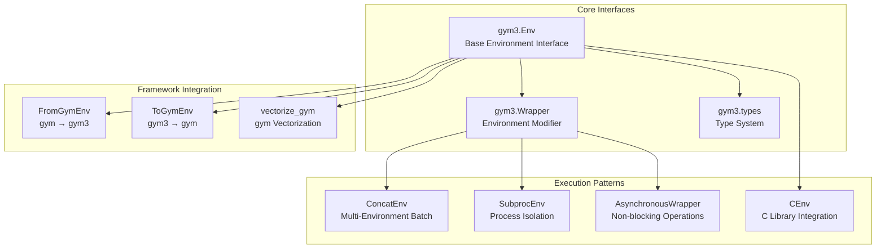
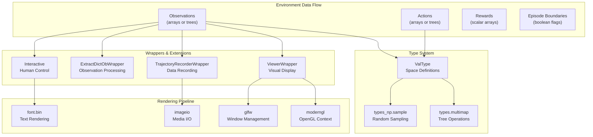
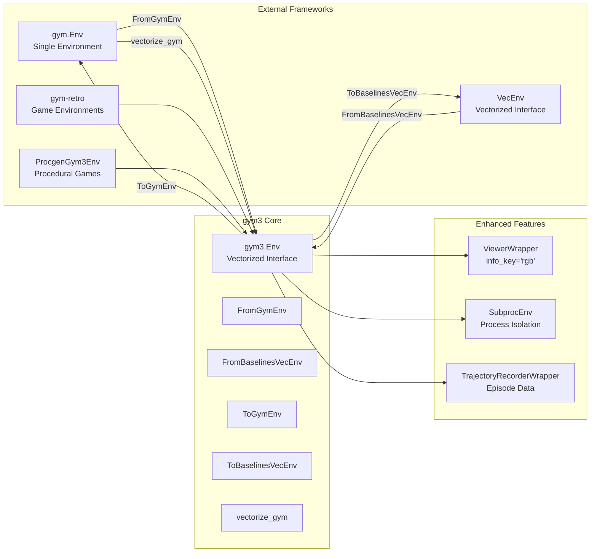

<!-- source: DeepWiki mcp.deepwiki.com · repo openai/gym3 · page 1 Overview · fetched 2026-10-26 -->

# Overview

<details>
<summary>Relevant source files</summary>

The following files were used as context for generating this wiki page:

- [README.md](README.md)
- [setup.py](setup.py)

</details>


This document provides a comprehensive introduction to gym3, its architecture, and key capabilities. It covers the purpose of gym3 as a vectorized reinforcement learning environment interface and explains how its components work together to provide enhanced performance and functionality over traditional RL frameworks.

For detailed installation instructions and first steps, see [Getting Started](#2). For in-depth technical details about specific components, see [Core Architecture](#3), [Environment Execution](#4), and [Visualization and Interaction](#5).

## What is gym3?

gym3 is a vectorized reinforcement learning environment interface that improves upon OpenAI Gym's design with built-in vectorization for enhanced performance. Unlike traditional RL interfaces that handle single environments, gym3's `Env` class is designed to manage multiple environment instances simultaneously, with automatic episode resets and batch operations.

The core value proposition centers on three key improvements:
- **Vectorization**: Native support for running multiple environments in parallel
- **Performance**: Optimized execution patterns including subprocess isolation and asynchronous operations  
- **Interoperability**: Seamless integration with existing RL frameworks like OpenAI Gym and Baselines

gym3 serves as both an interface specification and a toolkit, providing the foundational components without including actual game environments (beyond simple test cases).

**Sources:** [README.md:1-95](), [setup.py:32]()

## Core Architecture

The gym3 architecture is built around a small set of fundamental interfaces that enable flexible composition and extension:


**Core Interface Architecture**

The `gym3.Env` base class defines the fundamental contract for all environments, with methods like `act()`, `observe()`, and properties like `ac_space` and `ob_space`. The `gym3.Wrapper` class enables behavior modification through composition, while `gym3.types` provides the type system for defining observation and action spaces.

**Sources:** [README.md:25-26](), [README.md:30-39]()

## Key Capabilities

gym3 provides several major capability areas that distinguish it from traditional RL interfaces:

| Capability | Purpose | Key Components |
|------------|---------|----------------|
| **Vectorized Execution** | Run multiple environments simultaneously | `ConcatEnv`, batch operations |
| **Process Isolation** | Environment stability and fault tolerance | `SubprocEnv`, subprocess management |
| **Asynchronous Operations** | Non-blocking environment interactions | `AsynchronousWrapper`, thread pools |
| **Visualization** | Real-time environment observation | `ViewerWrapper`, OpenGL rendering |
| **Cross-Language Integration** | High-performance C/C++ environments | `CEnv`, `libenv.h` API |
| **Framework Compatibility** | Interoperability with existing code | `FromGymEnv`, `ToGymEnv`, `vectorize_gym` |

### Vectorization Example

The vectorized interface allows batch operations across multiple environment instances:

```python
# Traditional gym approach (conceptual)
envs = [gym.make("CartPole-v0") for _ in range(4)]
actions = [env.action_space.sample() for env in envs]

# gym3 vectorized approach  
env = gym3.vectorize_gym(num=4, env_kwargs={"id": "CartPole-v0"})
env.act(gym3.types_np.sample(env.ac_space, bshape=(env.num,)))
```

**Sources:** [README.md:67-75](), [setup.py:12-19]()

## System Components

gym3's modular design enables flexible composition of functionality through well-defined component interfaces:


**System Component Relationships**

The type system handles complex data structures through the `ValType` hierarchy, supporting both simple arrays and nested dictionaries ("trees"). The `gym3.types.multimap` function enables operations across these tree structures, while `gym3.types_np.sample` generates random samples from space definitions.

**Sources:** [README.md:62-63](), [setup.py:20](), [setup.py:12-19]()

## Integration Ecosystem

gym3 serves as a bridge between different RL frameworks and execution environments, enabling gradual migration and compatibility:


**Framework Integration and Migration Paths**

This integration layer allows existing gym and baselines code to leverage gym3's enhanced capabilities while maintaining compatibility. The conversion adapters handle differences in interface design, such as gym's single-environment model versus gym3's vectorized approach.

**Sources:** [README.md:64-75](), [README.md:41-54](), [README.md:27-39]()

## Development and Maintenance Status

gym3 is in maintenance mode, focusing on bug fixes and minor updates rather than major feature development. The project is primarily designed for use with OpenAI environments, though external users can leverage its capabilities for improved RL performance and visualization.

The codebase supports cross-platform deployment (Windows, macOS, Linux) and requires Python 3.6 or later. Core dependencies include `numpy` for numerical operations, `cffi` for C integration, and graphics libraries (`moderngl`, `glfw`) for visualization capabilities.

**Sources:** [README.md:1](), [README.md:7-8](), [README.md:9-17](), [setup.py:21](), [setup.py:12-19]()

---

