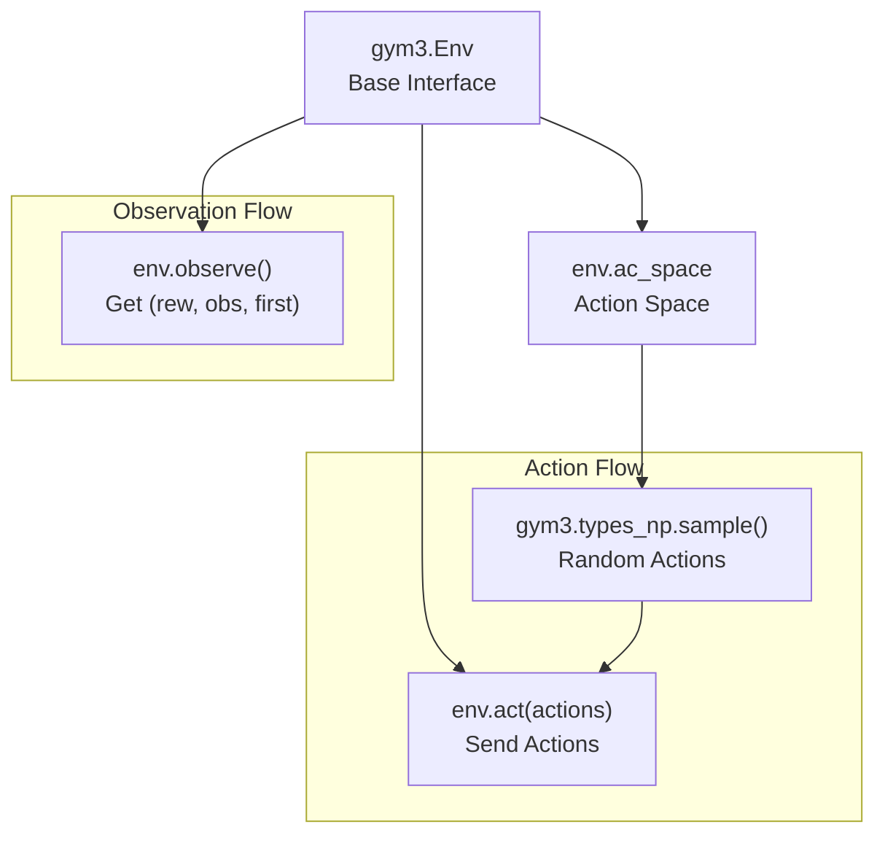
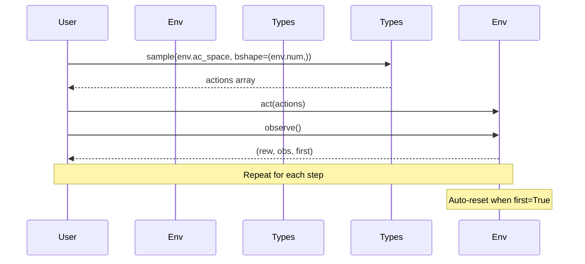

<!-- source: DeepWiki mcp.deepwiki.com · repo openai/gym3 · page 2 Getting Started · fetched 2026-10-26 -->

# Getting Started

<details>
<summary>Relevant source files</summary>

The following files were used as context for generating this wiki page:

- [README.md](README.md)
- [environment.yml](environment.yml)
- [setup.py](setup.py)

</details>


This document provides a complete introduction to gym3, covering installation, basic concepts, and your first steps with the library. It is designed to get you up and running quickly with gym3's vectorized reinforcement learning environment interface.

For detailed installation instructions and dependency management, see [Installation and Dependencies](#2.1). For more comprehensive usage examples and patterns, see [Basic Usage Examples](#2.2). For understanding gym3's core architecture and design principles, see [Core Architecture](#3).

## What is gym3?

gym3 is a vectorized reinforcement learning environment interface that improves upon the OpenAI Gym interface. Unlike traditional `gym.Env` which handles single environments, `gym3.Env` natively supports running multiple environment instances simultaneously, providing significant performance benefits for RL training.

Key features include:
- **Vectorized execution**: Run multiple environments in parallel
- **Automatic episode management**: Environments reset automatically when episodes complete  
- **Rich type system**: Support for both array and nested dictionary observations/actions
- **Interoperability**: Seamless conversion to/from OpenAI Gym and Baselines VecEnv
- **Visualization**: Built-in rendering and human interaction capabilities

Sources: [README.md:5-6](), [setup.py:32]()

## Quick Installation

gym3 requires Python 3.6 or higher and can be installed via pip:

```bash
pip install gym3
```

This installs gym3 with its core dependencies including `numpy`, `cffi`, `moderngl`, `glfw`, and imaging libraries. For development or testing, additional dependencies like `pytest`, `gym-retro`, and `tensorflow` may be needed.

**System Requirements:**
- **Platforms**: Windows, macOS, Linux
- **Python**: >= 3.6.0
- **OpenGL**: Required for visualization features

Sources: [setup.py:12-19](), [setup.py:21](), [README.md:15-21]()

## Core gym3 Interface

The following diagram shows the essential components you'll interact with when getting started with gym3:

**gym3 Core Interface Components**


Sources: [README.md:29-39](), [README.md:62]()

## Your First gym3 Environment

Here's the minimal code to create and interact with a gym3 environment using the vectorized gym wrapper:

```python
import gym3

# Create a vectorized environment with 2 CartPole instances
env = gym3.vectorize_gym(num=2, env_kwargs={"id": "CartPole-v0"})

# Basic interaction loop
step = 0
while step < 10:  # Run for 10 steps
    # Sample random actions for both environments
    actions = gym3.types_np.sample(env.ac_space, bshape=(env.num,))
    
    # Send actions to environments
    env.act(actions)
    
    # Get observations, rewards, and episode flags
    rew, obs, first = env.observe()
    
    print(f"step {step} reward {rew} first {first}")
    step += 1
```

This example demonstrates the core gym3 pattern:
1. **`env.act(actions)`**: Send vectorized actions to all environments
2. **`env.observe()`**: Retrieve rewards, observations, and episode completion flags
3. **`gym3.types_np.sample()`**: Generate random actions matching the action space shape

Sources: [README.md:67-75]()

## Environment Interface Flow

**gym3 Environment Interaction Cycle**


Sources: [README.md:35-36]()

## Adding Visualization

To see what your environments are doing, wrap them with `ViewerWrapper`:

```python
import gym3

# Create environment with rgb rendering
env = gym3.vectorize_gym(num=2, render_mode="rgb_array", 
                        env_kwargs={"id": "CartPole-v0"})

# Add visualization
env = gym3.ViewerWrapper(env, info_key="rgb")

# Same interaction loop as before - now with visual display
step = 0
while True:
    env.act(gym3.types_np.sample(env.ac_space, bshape=(env.num,)))
    rew, obs, first = env.observe()
    print(f"step {step} reward {rew} first {first}")
    step += 1
```

The `ViewerWrapper` extracts RGB arrays from the environment's info dictionary and displays them in a window using gym3's OpenGL-based rendering system.

Sources: [README.md:43-54]()

## Command Line Interface

gym3 includes a command-line script for quick experimentation:

```bash
python -m gym3.scripts.random_agent --fn_path procgen:ProcgenGym3Env --env_name coinrun --render_mode rgb_array
```

This runs a random agent on the specified environment with visualization enabled.

Sources: [README.md:56-60]()

## Next Steps

Once you've successfully run your first gym3 environment, explore these areas:

- **[Installation and Dependencies](#2.1)**: Detailed setup including optional dependencies and development environment
- **[Basic Usage Examples](#2.2)**: More comprehensive examples including different environment types and wrappers  
- **[Environment Interface](#3.1)**: Deep dive into the `gym3.Env` class and its methods
- **[Interoperability](#7)**: Converting between gym3, OpenAI Gym, and Baselines VecEnv formats
- **[Visualization and Interaction](#5)**: Advanced rendering features and human-in-the-loop interaction

The vectorized nature of gym3 makes it particularly powerful for RL research and training at scale, where running multiple environment instances simultaneously provides significant performance advantages over sequential execution.

Sources: [README.md:77-82]()

---

