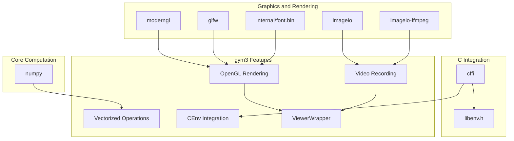
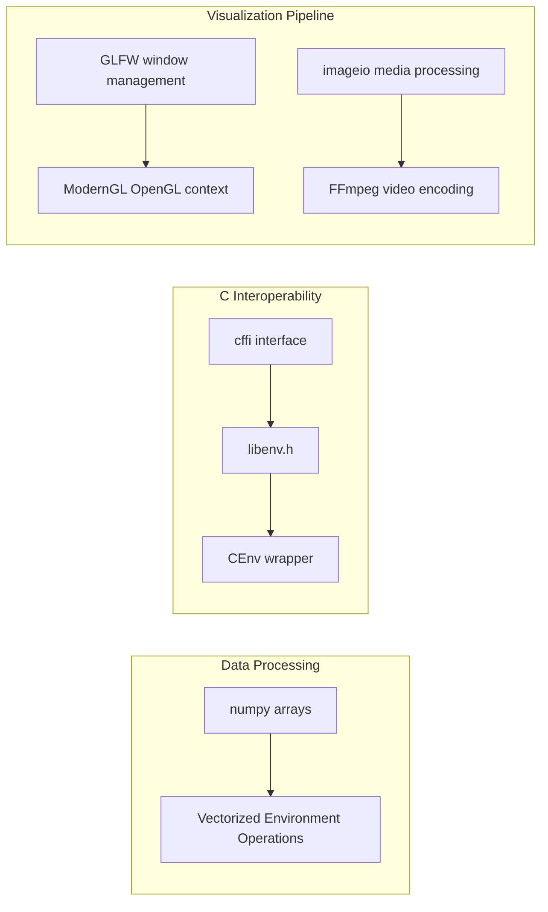

<!-- source: DeepWiki mcp.deepwiki.com · repo openai/gym3 · page 2.1 Installation and Dependencies · fetched 2026-10-26 -->

# Installation and Dependencies

<details>
<summary>Relevant source files</summary>

The following files were used as context for generating this wiki page:

- [environment.yml](environment.yml)
- [setup.py](setup.py)

</details>


This page covers installing gym3 and understanding its dependency requirements. For basic usage examples after installation, see [Basic Usage Examples](#2.2). For framework interoperability setup, see [Framework Conversion](#7.1).

## Installation Methods

### Package Installation

Install gym3 from PyPI using pip:

```bash
pip install gym3
```

The package requires Python 3.6 or higher as specified in [setup.py:21]().

### Development Installation

For development or to install from source:

```bash
git clone https://github.com/openai/gym3
cd gym3
pip install -e .
```

To install with test dependencies:

```bash
pip install -e .[test]
```

**Sources:** [setup.py:8-39]()

## Core Dependencies

gym3 has six core dependencies that enable its main functionality areas:

| Dependency | Version Range | Purpose |
|------------|---------------|---------|
| `numpy` | >=1.11.0,<2.0.0 | Numerical computing and array operations |
| `cffi` | >=1.13.0,<2.0.0 | C Foreign Function Interface for libenv integration |
| `imageio` | >=2.6.0,<3.0.0 | Image and video I/O operations |
| `imageio-ffmpeg` | >=0.3.0,<0.4.0 | FFmpeg backend for video processing |
| `glfw` | >=1.8.6,<2.0.0 | OpenGL window and context management |
| `moderngl` | >=5.5.4,<6.0.0 | Modern OpenGL rendering interface |

### Dependency Architecture



**Sources:** [setup.py:12-19](), [setup.py:20]()

### Core Dependency Functions



**Sources:** [setup.py:13-18]()

## Optional Dependencies

### Test Dependencies

The `test` extras group includes dependencies for running the test suite and benchmarks:

| Package | Version | Purpose |
|---------|---------|---------|
| `pytest` | 5.2.1 | Testing framework |
| `pytest-benchmark` | 3.2.2 | Performance benchmarking |
| `gym-retro` | 0.8.0 | Retro game environment testing |
| `gym` | 0.17.2 | OpenAI Gym interoperability testing |
| `tensorflow` | 1.15.0 | ML framework integration testing |
| `mpi4py` | 3.0.3 | MPI parallel processing testing |

### Development Environment

The conda environment configuration in [environment.yml:1-19]() pins specific versions for reproducible development:

```yaml
dependencies:
  - pip:
    - numpy==1.17.0
    - cffi==1.13.0
    - imageio==2.6.0
    - imageio-ffmpeg==0.3.0
    - glfw==1.8.6
    - moderngl==5.5.4
```

**Sources:** [setup.py:22-31](), [environment.yml:6-19]()

## System Requirements

### Platform Support

gym3 supports systems where the core dependencies are available:
- **Linux**: Full support with hardware-accelerated OpenGL
- **macOS**: Full support with system OpenGL
- **Windows**: Supported with appropriate OpenGL drivers

### Hardware Requirements

- **Graphics**: OpenGL 3.3+ compatible GPU for rendering features
- **Memory**: Sufficient RAM for vectorized environment operations
- **CPU**: Multi-core recommended for subprocess environments

### Package Data Files

gym3 includes essential data files:
- `libenv.h`: C header file for native environment integration
- `internal/font.bin`: Binary font data for text rendering

**Sources:** [setup.py:20]()

## Installation Verification

Verify installation by importing core modules:

```python
import gym3
import numpy as np

# Test basic functionality
env = gym3.Env()  # Base environment interface
print("gym3 version:", gym3.__version__)
```

For rendering verification:
```python
import moderngl
import glfw

# Test OpenGL context creation
if not glfw.init():
    print("GLFW initialization failed")
else:
    print("Graphics dependencies working")
```

For C integration verification:
```python
import cffi

# Test CFFI availability for CEnv
ffi = cffi.FFI()
print("C integration available")
```

**Sources:** [setup.py:8-39]()

---

