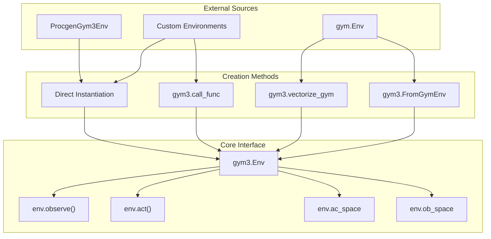
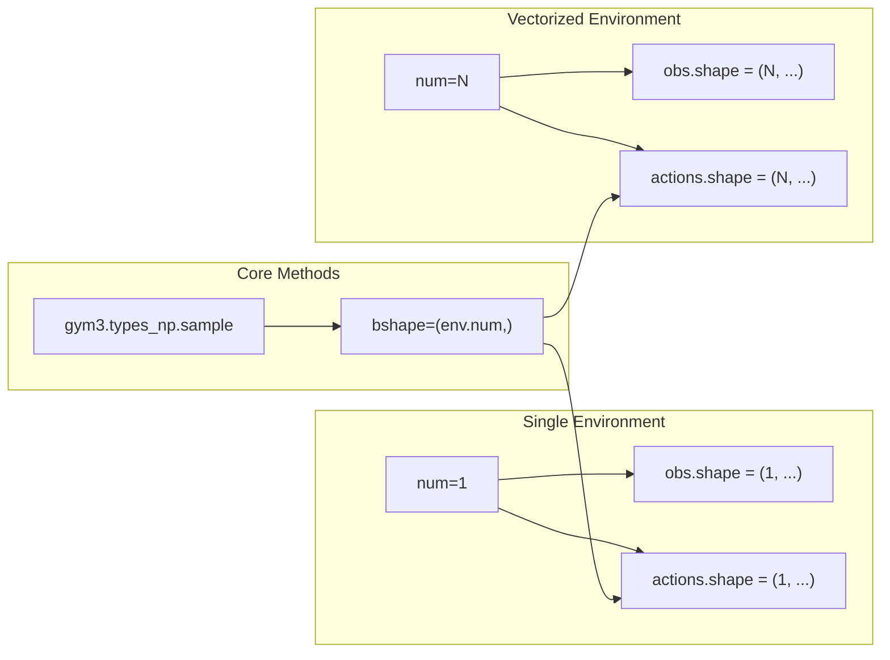
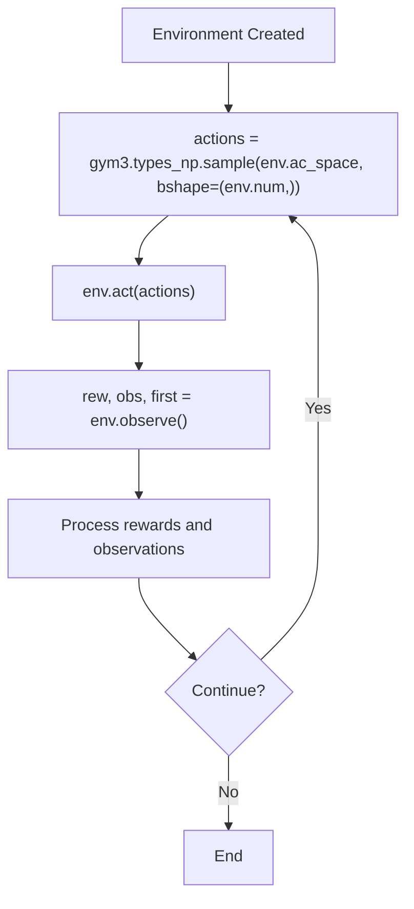
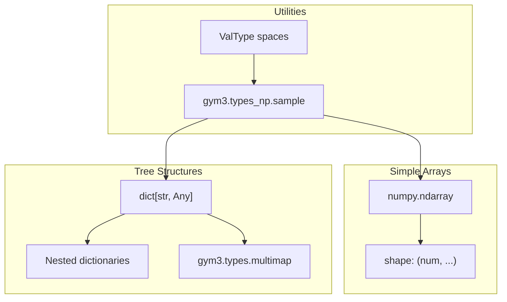
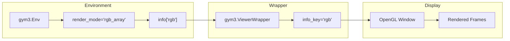
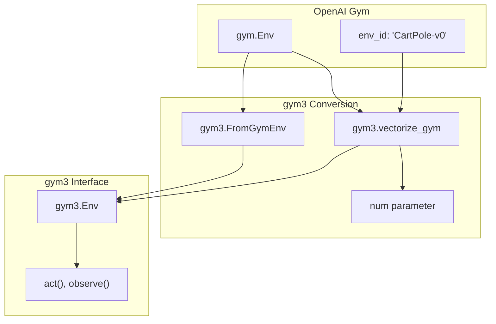
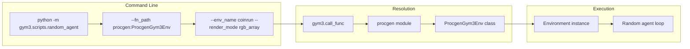

<!-- source: DeepWiki mcp.deepwiki.com · repo openai/gym3 · page 2.2 Basic Usage Examples · fetched 2026-10-26 -->

# Basic Usage Examples

Relevant source files

The following files were used as context for generating this wiki page:

- [README.md](README.md)
- [docs/gym3-for-gym-users.md](docs/gym3-for-gym-users.md)

This page demonstrates fundamental patterns for creating and interacting with gym3 environments through practical examples. It covers the core environment lifecycle, action/observation handling, and basic wrapper usage. For advanced environment execution patterns, see [Environment Execution](#4). For visualization and rendering details, see [Visualization and Interaction](#5). For framework interoperability, see [Interoperability](#7).

## Environment Creation Patterns

### Direct Environment Construction

The simplest way to create a gym3 environment is through direct instantiation. Many gym3 environments accept configuration parameters during construction:

| Pattern | Description | Use Case |
|---------|-------------|----------|
| Direct instantiation | `env = SomeGym3Env(num=2, param=value)` | Custom gym3 environments |
| Function call | `gym3.call_func("module:ClassName")` | String-based environment creation |
| Gym conversion | `gym3.vectorize_gym(num=2, env_kwargs={"id": "CartPole-v0"})` | Using existing gym environments |

The following diagram shows the relationship between creation methods and core gym3 components:

**Environment Creation Architecture**

Sources: [README.md:29-39](), [docs/gym3-for-gym-users.md:10-14](), [docs/gym3-for-gym-users.md:20-24]()

### Vectorized Environment Creation

gym3 environments are inherently vectorized, meaning they can run multiple environment instances simultaneously. The `num` parameter controls how many parallel environments to create:

**Vectorization Patterns**

Sources: [README.md:32](), [README.md:35]()

## Basic Interaction Loop

### Core Environment Methods

All gym3 environments follow a consistent interaction pattern using two primary methods:

| Method | Purpose | Returns |
|--------|---------|---------|
| `env.act(actions)` | Submit actions for all environments | None |
| `env.observe()` | Get latest observations, rewards, episode status | `(rew, obs, first)` tuple |

**Interaction Flow**

Sources: [README.md:34-38]()

### Action and Observation Handling

gym3 uses numpy arrays for all data exchange. Actions must be provided for all environments simultaneously:

- **Actions**: Shape `(env.num, *action_shape)` where `action_shape` depends on `env.ac_space`
- **Observations**: Shape `(env.num, *obs_shape)` where `obs_shape` depends on `env.ob_space`  
- **Rewards**: Shape `(env.num,)` - one scalar reward per environment
- **Episode status**: Shape `(env.num,)` - boolean array indicating episode starts

The `gym3.types_np.sample()` function generates random actions with the correct shape and data type for any action space.

Sources: [README.md:35](), [README.md:62]()

### Tree-Structured Data

gym3 supports "tree" observations and actions, which are nested dictionaries containing arrays:

**Data Structure Support**

Sources: [README.md:62]()

## Visualization and Basic Wrappers

### ViewerWrapper Usage

The `ViewerWrapper` displays environment observations or rendered frames in a window. It typically looks for RGB arrays in the environment's info dictionary:

**Visualization Pipeline**

Sources: [README.md:46-47](), [docs/gym3-for-gym-users.md:32]()

### Common Wrapper Patterns

gym3's wrapper system allows modification of environment behavior without changing the underlying environment:

| Wrapper Type | Purpose | Example Usage |
|--------------|---------|---------------|
| `ViewerWrapper` | Visual display | Showing environment state |
| `TrajectoryRecorderWrapper` | Data recording | Saving episodes for analysis |
| `ExtractDictObWrapper` | Observation filtering | Extracting specific observation components |

Sources: [README.md:47]()

## Framework Integration Examples

### OpenAI Gym Compatibility

gym3 provides seamless integration with existing OpenAI Gym environments through vectorization:

**Gym Integration Architecture**

The `vectorize_gym` function creates multiple instances of a gym environment and wraps them in a single gym3 interface, while `FromGymEnv` converts a single gym environment instance.

Sources: [README.md:67-75](), [docs/gym3-for-gym-users.md:5-14]()

### Command Line Interface

gym3 includes utilities for running environments from the command line using string-based environment specification:

**CLI Environment Loading**

Sources: [README.md:58-60](), [docs/gym3-for-gym-users.md:20-24]()

---

