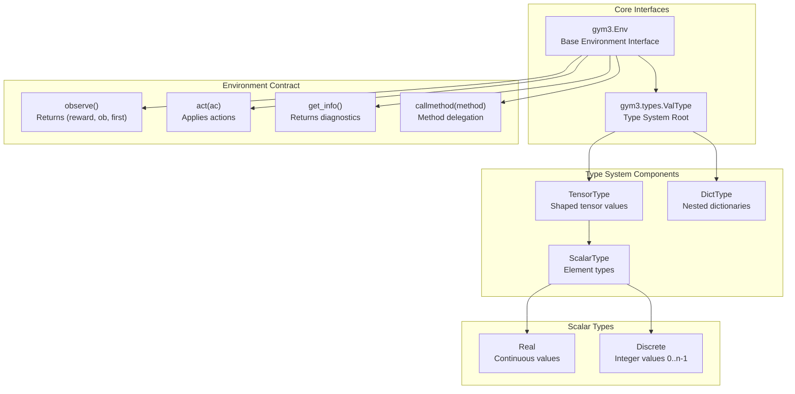
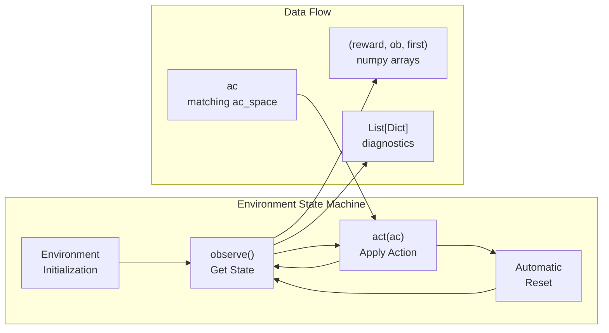
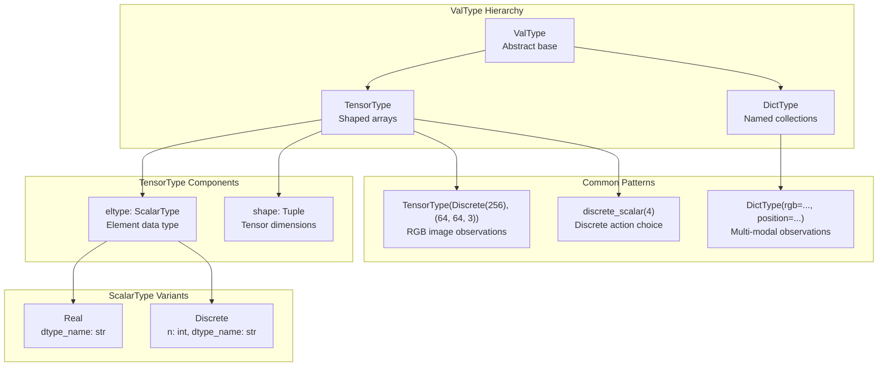
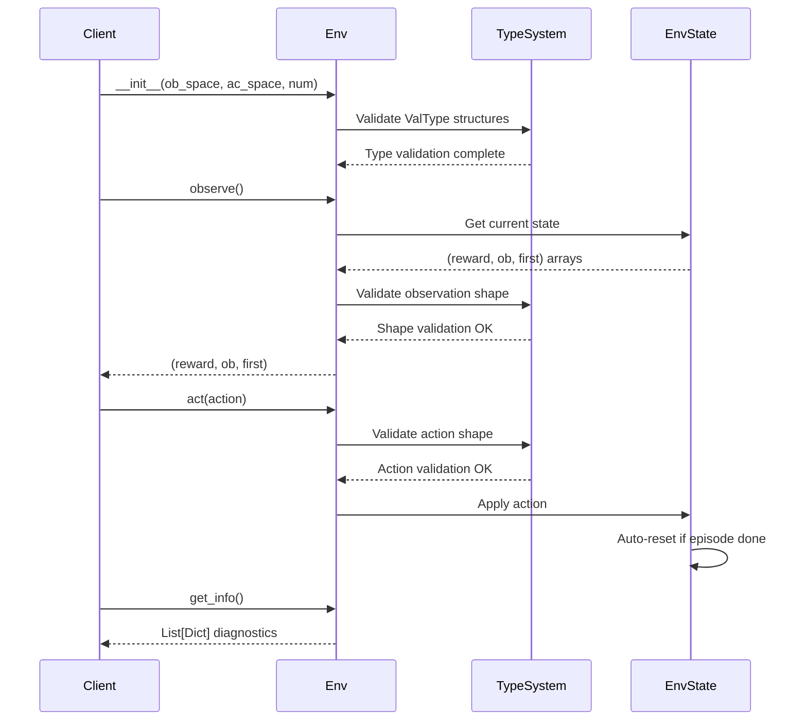

<!-- source: DeepWiki mcp.deepwiki.com · repo openai/gym3 · page 3 Core Architecture · fetched 2026-10-26 -->

# Core Architecture

Relevant source files

The following files were used as context for generating this wiki page:

- [docs/design.md](docs/design.md)
- [gym3/env.py](gym3/env.py)
- [gym3/types.py](gym3/types.py)

This document explains the fundamental design principles, interfaces, and type system that form the foundation of gym3. It covers the core `gym3.Env` interface and the `gym3.types` module that defines how data is structured throughout the framework.

For detailed documentation of specific environment methods, see [Environment Interface](#3.1). For comprehensive coverage of the type system, see [Type System and Spaces](#3.2). For information on extending environments through composition, see [Wrappers and Extensions](#3.3).

## Fundamental Design Principles

gym3's architecture is built around several key design decisions that distinguish it from other RL frameworks:

**Vectorized-First Design**: Unlike traditional RL interfaces that treat single environments as the base case, gym3 treats vectorized environments (running multiple episodes simultaneously) as the primary abstraction. Single environments are simply the special case where `num=1`.

**No Reset Function**: Environments automatically reset themselves when episodes end. This eliminates undefined behavior that occurred in other frameworks when running environments after `done=True` without explicit resets.

**Structured Type System**: Instead of using space objects, gym3 uses a compositional type system (`ValType`) that can represent arbitrary nested structures of tensors and dictionaries.

**Return Value Reordering**: The `observe()` method returns `(reward, observation, first)` rather than the traditional `(observation, reward, done)` ordering to emphasize temporal relationships and reduce common indexing errors.

Sources: [docs/design.md:3-23]()

## Architecture Overview

**Core Environment Interface Components**

| Component | Purpose | Key Properties |
|-----------|---------|----------------|
| `observe()` | Get current state | Idempotent, returns (reward, ob, first) |
| `act(ac)` | Apply actions | Advances environment state |
| `get_info()` | Get diagnostics | Returns list of dicts, one per environment |
| `callmethod()` | Delegate method calls | Enables wrapper method forwarding |

Sources: [gym3/env.py:6-82](), [gym3/types.py:79-162]()

## Environment Interface Overview

The `gym3.Env` class defines the core contract that all environments must implement. Every environment has three essential properties:

- `ob_space`: A `ValType` describing the structure of observations
- `ac_space`: A `ValType` describing the structure of actions  
- `num`: The number of parallel environments being run

The `observe()` method is idempotent and can be called multiple times between `act()` calls. The `first` array indicates which environments have just started new episodes, enabling algorithms to handle episode boundaries without explicit reset calls.

Sources: [gym3/env.py:15-48](), [docs/design.md:3-7]()

## Type System Overview

gym3's type system provides a compositional way to describe the structure of observations and actions. The system is built around `ValType`, which can represent either tensors or nested dictionaries of tensors.

**Type System Key Features**:

| Feature | Description | Example |
|---------|-------------|---------|
| Composition | Types can be arbitrarily nested | `DictType(obs=TensorType(...), mask=TensorType(...))` |
| Scalar Types | `Real` for continuous, `Discrete(n)` for integers 0..n-1 | `Discrete(256)` for pixel values |
| Shape Specification | Explicit tensor shapes | `TensorType(Real(), (64, 64, 3))` |
| Type Checking | Validates data structure matches declared types | Runtime validation of observation/action shapes |

The `multimap()` function enables applying operations uniformly across nested type structures, supporting efficient data processing and validation.

Sources: [gym3/types.py:28-187](), [docs/design.md:12-17]()

## Core Components Interaction

**Data Validation Flow**: The type system ensures that all data exchanged between clients and environments conforms to the declared `ob_space` and `ac_space` types. This validation happens at the boundaries between user code and environment implementations.

**Vectorization Handling**: All data structures automatically include a leading dimension of size `num` to handle vectorized environments. Single environments (`num=1`) are handled uniformly with multi-environment cases.

**Automatic Episode Management**: When environments detect episode completion, they automatically reset without requiring explicit client intervention. The `first` flag in observations indicates when new episodes have begun.

Sources: [gym3/env.py:20-66](), [gym3/types.py:163-187](), [docs/design.md:8-11]()

---

