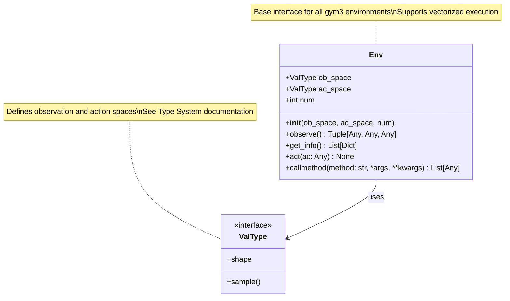
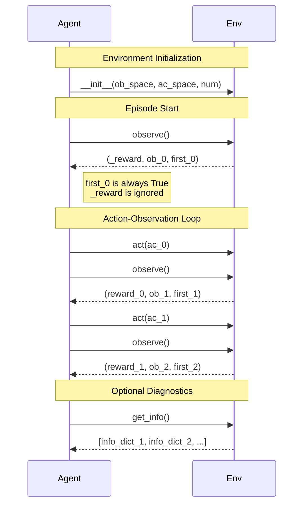
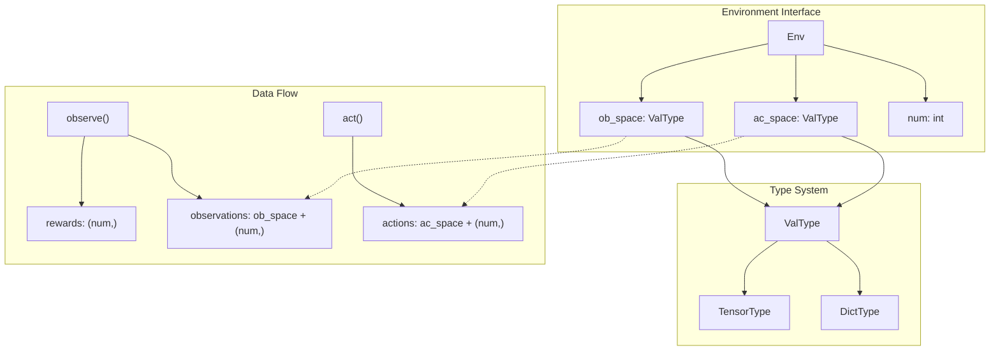

<!-- source: DeepWiki mcp.deepwiki.com · repo openai/gym3 · page 3.1 Environment Interface · fetched 2026-10-26 -->

# Environment Interface

Relevant source files

The following files were used as context for generating this wiki page:

- [docs/api.md](docs/api.md)
- [gym3/env.py](gym3/env.py)

This document covers the core `gym3.Env` interface, which defines the fundamental contract that all gym3 environments must implement. This interface provides a vectorized, synchronous API for reinforcement learning environments that supports multiple simultaneous episodes.

For information about specific environment implementations, see [Environment Execution](#4). For wrapper-based extensions to this interface, see [Wrappers and Extensions](#3.3). For the type system that defines observation and action spaces, see [Type System and Spaces](#3.2).

## Interface Overview

The `gym3.Env` class serves as the abstract base class for all environments in the gym3 framework. It establishes a standardized interface that enables consistent interaction patterns across different environment types and execution modes.

**Interface Structure and Responsibilities**

Sources: [gym3/env.py:6-82](), [docs/api.md:6-76]()

## Core Components

### Constructor Parameters

The `Env` constructor requires three essential parameters that define the environment's interface contract:

| Parameter | Type | Purpose |
|-----------|------|---------|
| `ob_space` | `ValType` | Defines the structure and constraints of observations |
| `ac_space` | `ValType` | Defines the structure and constraints of actions |
| `num` | `int` | Number of simultaneous episodes the environment manages |

The constructor implementation stores these parameters as instance attributes, establishing the environment's configuration for its entire lifecycle.

Sources: [gym3/env.py:15-18]()

### Primary Methods

#### observe() Method

The `observe()` method is the primary mechanism for retrieving environment state information. It returns a three-tuple containing reward, observation, and episode status data.

**Return Values:**
- `reward`: Float array shaped `(num,)` containing the reward from the last action
- `ob`: Observation data matching `ob_space` structure with `(num,)` prepended to each leaf shape
- `first`: Boolean array shaped `(num,)` indicating whether each episode has just started

**Key Properties:**
- Idempotent: Can be called multiple times without side effects
- State-consistent: Always returns data corresponding to the current environment state
- Initial state handling: The first call returns initial observations with ignored rewards

Sources: [gym3/env.py:20-48]()

#### act() Method

The `act()` method applies actions to advance the environment state. It accepts action data that must conform to the `ac_space` specification.

**Parameters:**
- `ac`: Action data matching `ac_space` structure with `(num,)` prepended to each leaf shape

**Behavior:**
- Synchronous execution: Method blocks until all environment steps complete
- Vectorized processing: Applies actions to all `num` environments simultaneously
- State modification: Updates internal environment state for subsequent `observe()` calls

Sources: [gym3/env.py:60-66]()

#### get_info() Method

The `get_info()` method provides access to auxiliary diagnostic information that is not part of the agent-observable state.

**Return Value:**
- List of dictionaries with length `self.num`, one per environment instance

**Common Use Cases:**
- Episode statistics and metrics
- Rendered images for visualization
- Debug information and performance metrics
- Custom environment-specific metadata

The default implementation returns empty dictionaries, allowing environments to override with specific diagnostic data.

Sources: [gym3/env.py:50-58]()

#### callmethod() Method

The `callmethod()` method provides a mechanism for invoking arbitrary methods on the underlying environment object, enabling extensibility beyond the core interface.

**Parameters:**
- `method`: String name of the method to invoke
- `*args`: Positional arguments, each must be a list of length `self.num`
- `**kwargs`: Keyword arguments, each must be a list of length `self.num`

**Return Value:**
- List of return values with length `self.num`

This method is particularly important for wrapper chains and subprocess environments where direct access to the underlying object may not be available.

Sources: [gym3/env.py:68-81]()

## Interaction Patterns

The gym3 environment interface follows a specific interaction pattern that differs from traditional single-environment APIs:

**Key Interaction Principles:**

1. **Initial Observation**: The first `observe()` call returns initial state with ignored rewards
2. **Action-Observation Cycle**: Each `act()` call should be followed by `observe()` to get the resulting state
3. **Vectorized Data**: All data flows handle `num` environments simultaneously
4. **Episode Boundaries**: The `first` flag indicates when episodes reset automatically

Sources: [gym3/env.py:27-41](), [docs/api.md:27-41]()

## Type System Integration

The environment interface is tightly coupled with gym3's type system through the `ob_space` and `ac_space` parameters:

**Type Constraints:**
- Observations must conform to `ob_space` structure
- Actions must conform to `ac_space` structure  
- All data includes an additional `(num,)` dimension for vectorization
- Type validation can be enforced using testing utilities

Sources: [gym3/env.py:10-12](), [gym3/env.py:44-45](), [gym3/env.py:64]()

## Implementation Requirements

When implementing a concrete environment, developers must:

1. **Override Abstract Methods**: Implement `observe()` and `act()` methods
2. **Respect Type Contracts**: Ensure data conforms to declared `ob_space` and `ac_space`
3. **Handle Vectorization**: Process all `num` environments simultaneously
4. **Manage Episode Lifecycle**: Set `first` flags appropriately when episodes end
5. **Optional Extensions**: Override `get_info()` and `callmethod()` as needed

The base `Env` class provides default implementations for `get_info()` and `callmethod()`, but `observe()` and `act()` must be implemented by concrete subclasses.

Sources: [gym3/env.py:48](), [gym3/env.py:66](), [gym3/env.py:58](), [gym3/env.py:81]()

---

