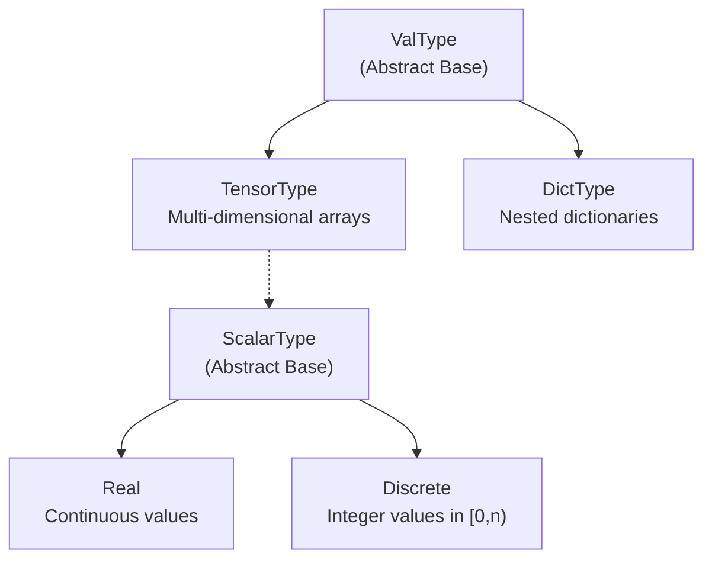
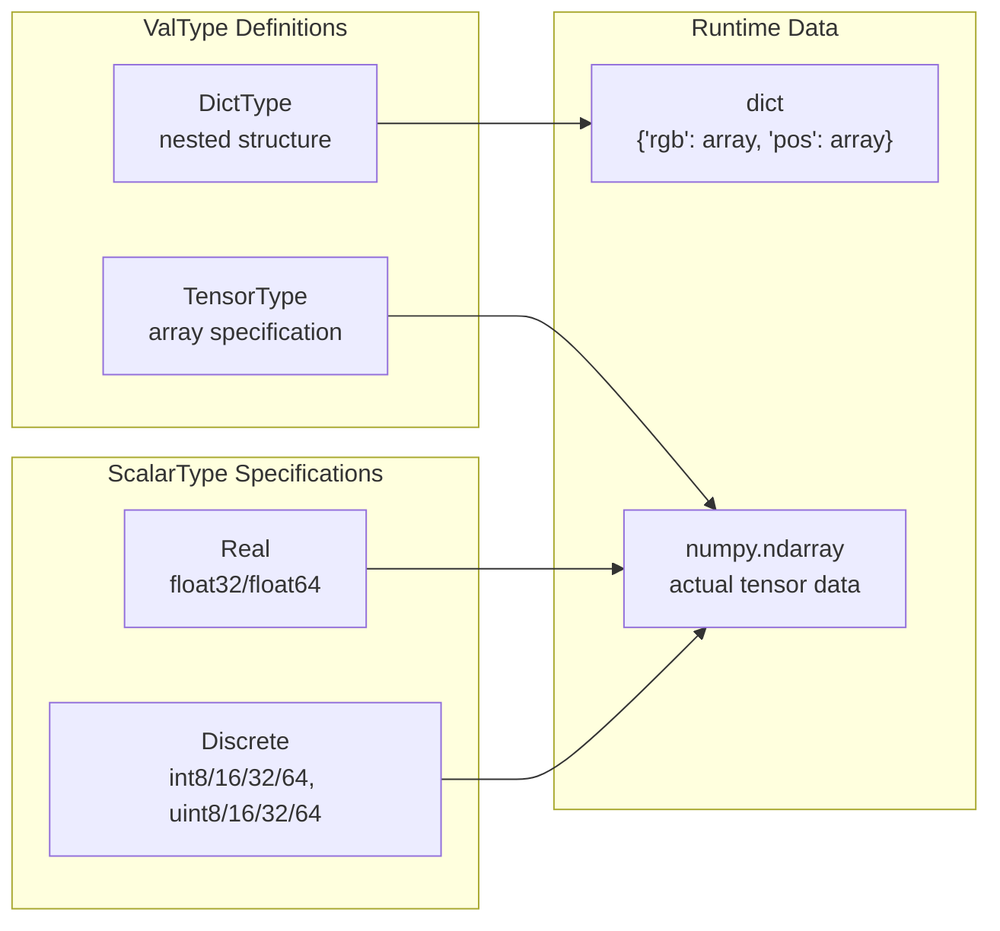

<!-- source: DeepWiki mcp.deepwiki.com · repo openai/gym3 · page 3.2 Type System and Spaces · fetched 2026-10-26 -->

# Type System and Spaces

<details>
<summary>Relevant source files</summary>

The following files were used as context for generating this wiki page:

- [docs/design.md](docs/design.md)
- [gym3/types.py](gym3/types.py)

</details>


## Purpose and Scope

This document covers gym3's `ValType` system, which defines the structure and types of observations and actions in gym3 environments. Unlike OpenAI Gym's `gym.spaces` module, gym3 uses a more flexible and composable type system that eliminates redundancy and supports complex nested structures.

For information about the core environment interface that uses these types, see [Environment Interface](#3.1). For examples of using these types in practice with wrappers, see [Wrappers and Extensions](#3.3).

## Type System Overview

gym3's type system is built around two main hierarchies: scalar types that define the element types of tensors, and value types that define the overall structure of observations and actions.

**Type System Class Hierarchy**


Sources: [gym3/types.py:28-162]()

## Scalar Types

Scalar types define the element types that can be stored in tensors. gym3 provides two concrete scalar type implementations.

### Real Type

The `Real` class represents continuous floating-point values:

```python
Real(dtype_name="float32")  # Default float32
Real(dtype_name="float64")  # Double precision
```

**Supported Data Types**
| Data Type | Description |
|-----------|-------------|
| `float32` | 32-bit floating point |
| `float64` | 64-bit floating point |

### Discrete Type

The `Discrete` class represents integer values in the range `[0, n)`:

```python
Discrete(n=10)                    # Values 0-9, stored as int64
Discrete(n=256, dtype_name="uint8")  # Values 0-255, stored as uint8
```

**Integer Data Types**
| Signed Types | Unsigned Types | Bit Width |
|--------------|----------------|-----------|
| `int8`       | `uint8`        | 8 bits    |
| `int16`      | `uint16`       | 16 bits   |
| `int32`      | `uint32`       | 32 bits   |
| `int64`      | `uint64`       | 64 bits   |

The constructor validates that `n` fits within the chosen data type's range.

Sources: [gym3/types.py:39-77](), [gym3/types.py:5-18]()

## Value Types

Value types define the structure of complete observations or actions. gym3 supports tensors and nested dictionaries.

### TensorType

`TensorType` represents multi-dimensional arrays with a specific scalar element type:

```python
# Scalar (0-dimensional tensor)
discrete_action = TensorType(eltype=Discrete(4), shape=())

# 1D tensor  
reward_history = TensorType(eltype=Real(), shape=(100,))

# 3D tensor (e.g., RGB image)
rgb_observation = TensorType(eltype=Discrete(256), shape=(64, 64, 3))
```

**TensorType Properties**
- `eltype`: The scalar type of elements
- `shape`: Tuple defining tensor dimensions
- `ndim`: Number of dimensions
- `size`: Total number of elements

### DictType

`DictType` represents nested dictionaries mapping string keys to other value types:

```python
observation_space = DictType(
    rgb=TensorType(eltype=Discrete(256), shape=(64, 64, 3)),
    position=TensorType(eltype=Real(), shape=(2,)),
    inventory=DictType(
        coins=TensorType(eltype=Discrete(1000), shape=()),
        health=TensorType(eltype=Real(), shape=())
    )
)
```

`DictType` supports dictionary-like operations: `keys()`, `values()`, `items()`, `__getitem__`, `__contains__`.

Sources: [gym3/types.py:87-161]()

## Convenience Functions

### discrete_scalar

Creates a scalar discrete tensor type:

```python
# Instead of TensorType(shape=(), eltype=Discrete(n))
action_space = discrete_scalar(4)  # 4 discrete actions
```

### multimap

Applies a function recursively to tree structures of dictionaries and `DictType` objects:

```python
def validate_shapes(val_type, data):
    """Validate that data matches the expected type structure"""
    return multimap(check_shape, val_type, data)
```

Sources: [gym3/types.py:122-186]()

## Design Rationale

**Type System Mapping to Data Structures**


The gym3 type system addresses several limitations of OpenAI Gym's `gym.spaces`:

1. **Eliminates Redundancy**: No separate `Discrete`/`MultiDiscrete` or `Binary`/`MultiBinary` classes
2. **Flexible Dimensions**: Any scalar type can be used in tensors of any dimensionality
3. **Nested Structures**: `DictType` naturally supports arbitrarily nested observation spaces
4. **Type Safety**: Clear separation between type specifications and runtime data

**Example: Image Observations**
```python
# gym3 approach - flexible and clear
rgb_space = TensorType(eltype=Discrete(256), shape=(84, 84, 3))

# Can easily extend to different image formats
grayscale_space = TensorType(eltype=Discrete(256), shape=(84, 84, 1))
depth_space = TensorType(eltype=Real(), shape=(84, 84, 1))
```

Sources: [docs/design.md:12-17](), [gym3/types.py:1-187]()

---

