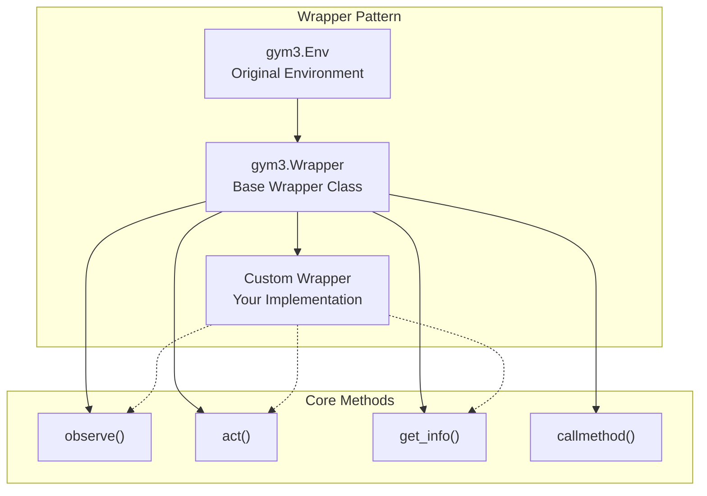
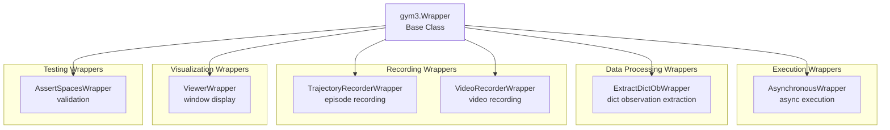
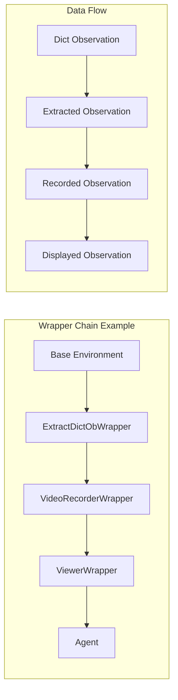
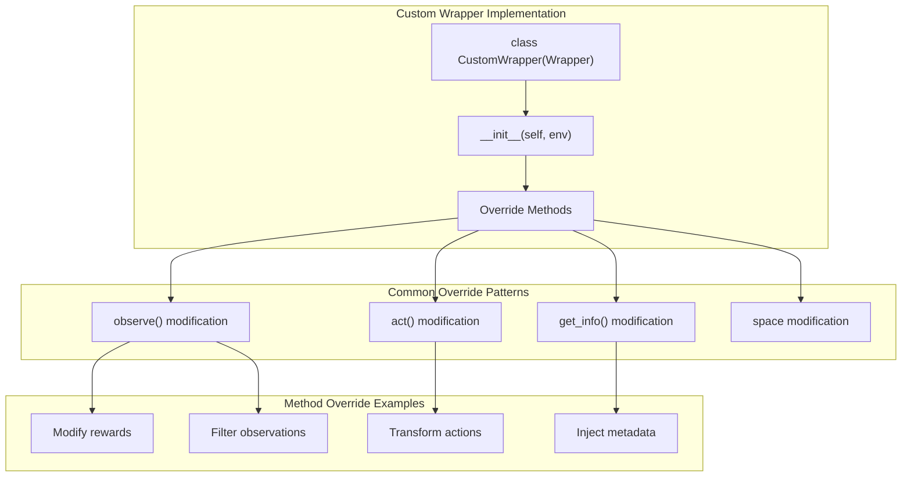
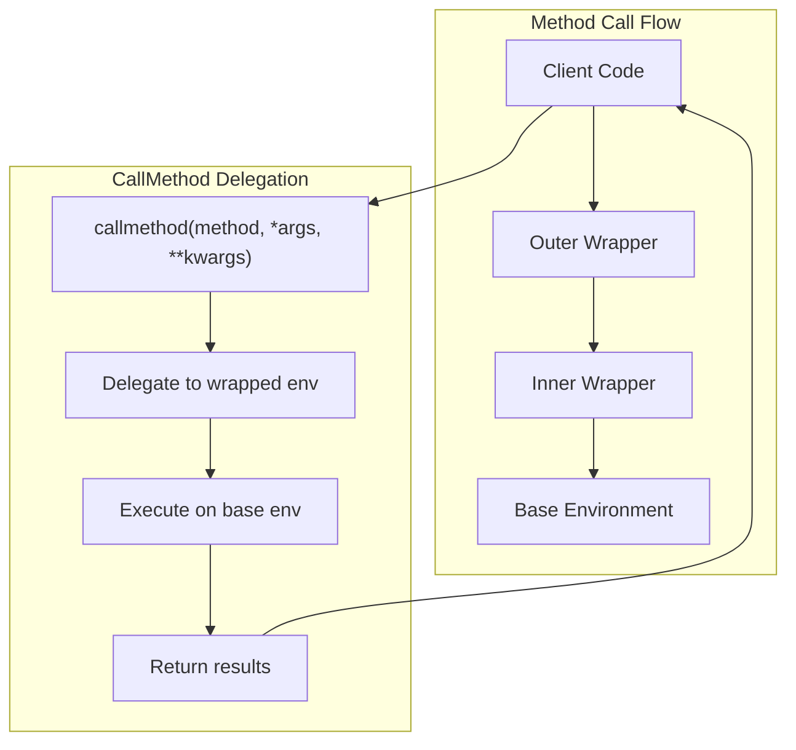

<!-- source: DeepWiki mcp.deepwiki.com · repo openai/gym3 · page 3.3 Wrappers and Extensions · fetched 2026-10-26 -->

# Wrappers and Extensions

Relevant source files

The following files were used as context for generating this wiki page:

- [docs/api.md](docs/api.md)
- [gym3/__init__.py](gym3/__init__.py)

This page covers gym3's wrapper system, which allows you to modify and extend environment behavior through composition. Wrappers enable adding functionality like recording, visualization, observation processing, and execution patterns to existing environments without modifying their core implementation.

For information about creating custom environments from scratch, see [3.1](#3.1). For environment execution patterns like subprocess and vectorization, see [4](#4). For visualization-specific features, see [5](#5).

## Base Wrapper Class

The `Wrapper` class in [gym3/wrapper.py]() serves as the foundation for all environment modifications in gym3. It implements the gym3 `Env` interface while wrapping another environment instance.

**Wrapper Method Delegation Pattern**

The base `Wrapper` class provides default pass-through behavior for all `Env` methods. Custom wrappers override specific methods to modify behavior while delegating others to the wrapped environment.

**Sources:** [gym3/__init__.py:18](), [docs/api.md:81]()

## Included Wrappers

gym3 provides several pre-built wrappers for common use cases. Each wrapper addresses specific functionality needs while maintaining the standard gym3 interface.

**Wrapper Categories and Functions**

| Wrapper | Module | Primary Function |
|---------|--------|------------------|
| `AsynchronousWrapper` | `gym3.asynchronous` | Convert synchronous `act()` to asynchronous execution |
| `ExtractDictObWrapper` | `gym3.extract_dict_ob` | Extract single key from dictionary observation space |
| `TrajectoryRecorderWrapper` | `gym3.trajectory_recorder` | Record complete episodes to pickle files |
| `VideoRecorderWrapper` | `gym3.video_recorder` | Save RGB observations as video files |
| `ViewerWrapper` | `gym3.viewer` | Display RGB observations in interactive window |
| `AssertSpacesWrapper` | `gym3.testing` | Validate actions/observations match declared spaces |

**Sources:** [gym3/__init__.py:2,14,16-19](), [docs/api.md:87-94,103]()

## Wrapper Composition and Chaining

Multiple wrappers can be composed to combine functionality. The order of wrapping affects the data flow and processing sequence.

**Wrapper Chain Data Processing**

In a wrapper chain, each wrapper processes data before passing it to the next wrapper. The outermost wrapper receives the final processed data, while the innermost wrapper interacts directly with the base environment.

The `unwrap` utility function in [gym3/wrapper.py]() can access the base environment at the bottom of a wrapper stack, though `callmethod()` is preferred for cross-process compatibility.

**Sources:** [docs/api.md:107](), [gym3/__init__.py:18]()

## Creating Custom Wrappers

Custom wrappers extend the base `Wrapper` class and override specific methods to modify environment behavior.

**Custom Wrapper Implementation Pattern**

When creating custom wrappers:

1. **Inherit from `Wrapper`**: Use `gym3.Wrapper` as the base class
2. **Call super().__init__(env)**: Initialize the base wrapper with the wrapped environment
3. **Override selectively**: Only override methods that need modification
4. **Preserve interface**: Maintain gym3 `Env` interface contract
5. **Handle spaces**: Update `ob_space`/`ac_space` if modifying observation/action structure

**Sources:** [docs/api.md:81](), [gym3/__init__.py:18]()

## Method Delegation and `callmethod()`

The `callmethod()` interface allows wrappers to expose underlying environment methods while maintaining encapsulation. This is particularly important for environments running in subprocesses.

**Method Delegation Behavior**

- `callmethod()` passes through wrapper chains to reach the base environment
- Works across process boundaries (unlike `unwrap()`)
- Arguments and return values must be lists with length equal to `env.num`
- Wrappers can intercept and modify method calls by overriding `callmethod()`

**Sources:** [docs/api.md:63-76,107]()

---

