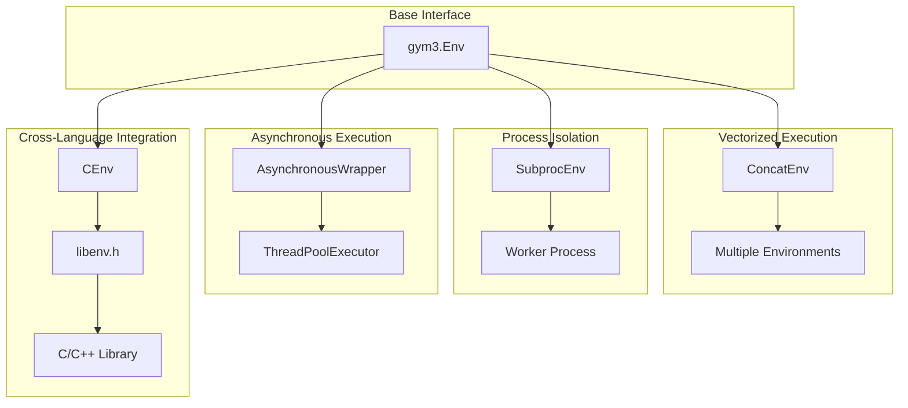
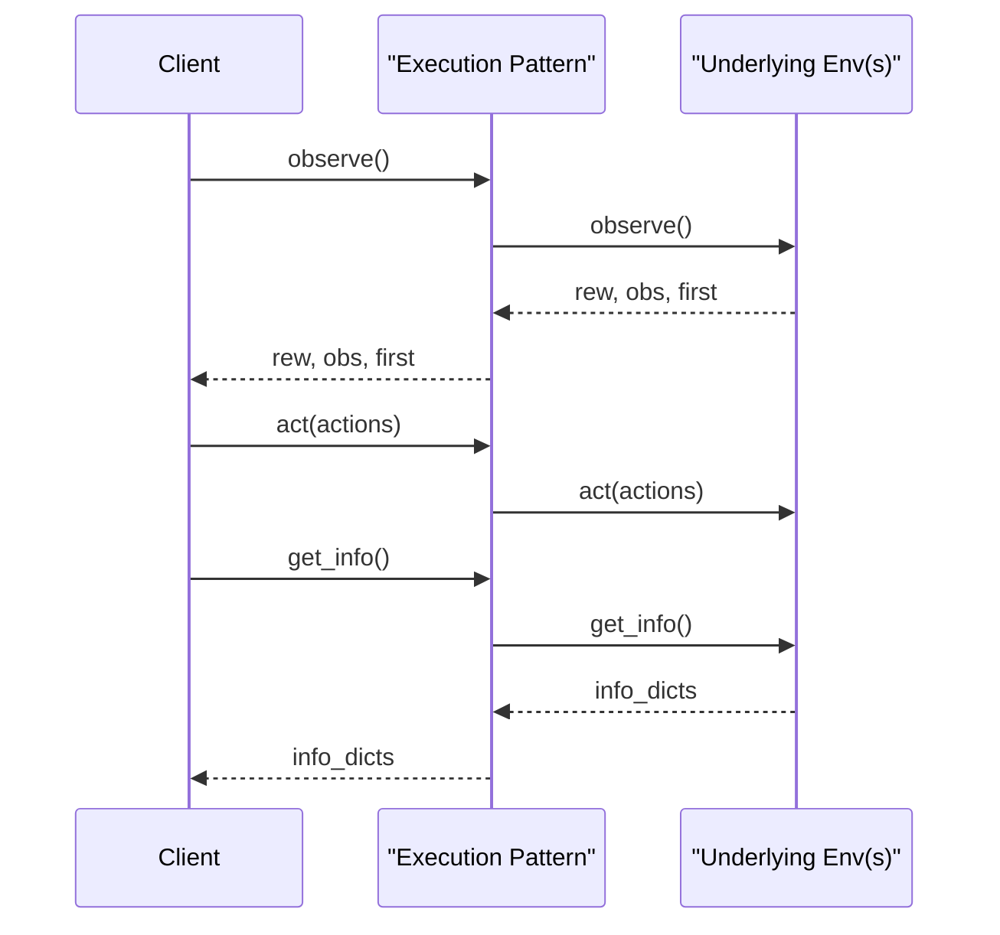

<!-- source: DeepWiki mcp.deepwiki.com · repo openai/gym3 · page 4 Environment Execution · fetched 2026-10-26 -->

# Environment Execution

<details>
<summary>Relevant source files</summary>

The following files were used as context for generating this wiki page:

- [gym3/asynchronous.py](gym3/asynchronous.py)
- [gym3/concat.py](gym3/concat.py)
- [gym3/libenv_test.py](gym3/libenv_test.py)
- [gym3/subproc_test.py](gym3/subproc_test.py)

</details>


This document covers the different patterns for executing gym3 environments, including vectorized execution, process isolation, asynchronous execution, and cross-language integration. These execution patterns allow gym3 to scale from single environments to high-performance parallel training scenarios while maintaining the same interface.

For detailed information about the core environment interface, see [Environment Interface](#3.1). For visualization and interaction during execution, see [Visualization and Interaction](#5).

## Execution Patterns Overview

gym3 provides four primary execution patterns that can be combined to achieve different performance and isolation characteristics:

**Execution Pattern Architecture**


Sources: [gym3/concat.py:21-33](), [gym3/asynchronous.py:8-19](), [gym3/subproc_test.py:39-48](), [gym3/libenv_test.py:26-31]()

## Execution Method Comparison

| Pattern | Class | Use Case | Isolation | Performance | Complexity |
|---------|-------|----------|-----------|-------------|------------|
| Vectorized | `ConcatEnv` | Batch processing multiple environments | Shared memory | High throughput | Low |
| Subprocess | `SubprocEnv` | Process isolation, fault tolerance | Full process | Medium | Medium |
| Asynchronous | `AsynchronousWrapper` | Non-blocking I/O, overlapped computation | Thread-level | Low latency | Low |
| C Integration | `CEnv` | High-performance native code | Shared memory | Highest | High |

## Core Execution Flow

All execution patterns follow the same basic gym3 interface while implementing different underlying execution strategies:

**Method Call Flow**


Sources: [gym3/concat.py:35-48](), [gym3/asynchronous.py:29-39]()

### Vectorized Execution

The `ConcatEnv` class combines multiple environments into a single vectorized environment, enabling batch processing of actions and observations. This is the most commonly used pattern for training RL agents.

```python
# Example from concat.py
def observe(self) -> Tuple[Any, Any, Any]:
    rews, obs, firsts = zip(*[env.observe() for env in self.envs])
    return np.concatenate(rews), concat(obs), np.concatenate(firsts)
```

Sources: [gym3/concat.py:35-37]()

### Process Isolation

The `SubprocEnv` class runs environments in separate processes, providing fault tolerance and memory isolation. This pattern is essential when environments may crash or consume excessive resources.

Key features include:
- Exception handling with `SubprocError` [gym3/subproc_test.py:87-98]()
- Method delegation via `callmethod()` [gym3/subproc_test.py:57-59]()
- Support for cloudpickle serialization [gym3/subproc_test.py:131-138]()

Sources: [gym3/subproc_test.py:39-48](), [gym3/subproc_test.py:87-107]()

### Asynchronous Execution

The `AsynchronousWrapper` uses a `ThreadPoolExecutor` to run environment `act()` calls on a separate thread, allowing computation to overlap with environment stepping.

```python
# From asynchronous.py
def act(self, ac: Any) -> None:
    future = self._executor.submit(self.env.act, ac)
    self._futures.append(future)
```

The wrapper ensures thread safety by waiting for all pending actions to complete before returning observations.

Sources: [gym3/asynchronous.py:37-39](), [gym3/asynchronous.py:21-27]()

### C Environment Integration

The `CEnv` class enables integration with environments written in C/C++ using the `libenv.h` API. This provides the highest performance for computationally intensive environments.

The integration requires:
- A shared library implementing the libenv interface
- Environment options passed during initialization
- Proper handling of observation and action space mapping

Sources: [gym3/libenv_test.py:26-38](), [gym3/libenv_test.py:42-66]()

## Performance Considerations

Each execution pattern has different performance characteristics:

- **ConcatEnv**: Highest throughput for batch operations, minimal overhead
- **SubprocEnv**: Medium throughput, higher latency due to IPC overhead
- **AsynchronousWrapper**: Reduces blocking time, good for I/O-bound environments
- **CEnv**: Highest raw performance for compute-intensive environments

## Choosing an Execution Pattern

Select the execution pattern based on your requirements:

1. **Use ConcatEnv** for most RL training scenarios with multiple environments
2. **Use SubprocEnv** when you need fault tolerance or memory isolation
3. **Use AsynchronousWrapper** to overlap computation with environment stepping
4. **Use CEnv** for maximum performance with custom C/C++ environments

These patterns can be combined - for example, using `SubprocEnv` with `ConcatEnv` to create process-isolated vectorized environments.

Sources: [gym3/subproc_test.py:152-158](), [gym3/concat.py:21-33](), [gym3/asynchronous.py:8-19](), [gym3/libenv_test.py:26-31]()

---

