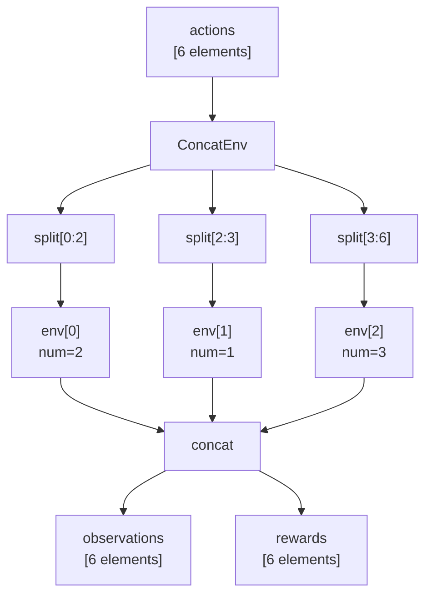
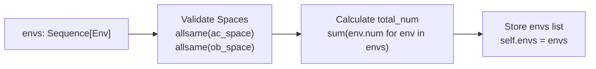
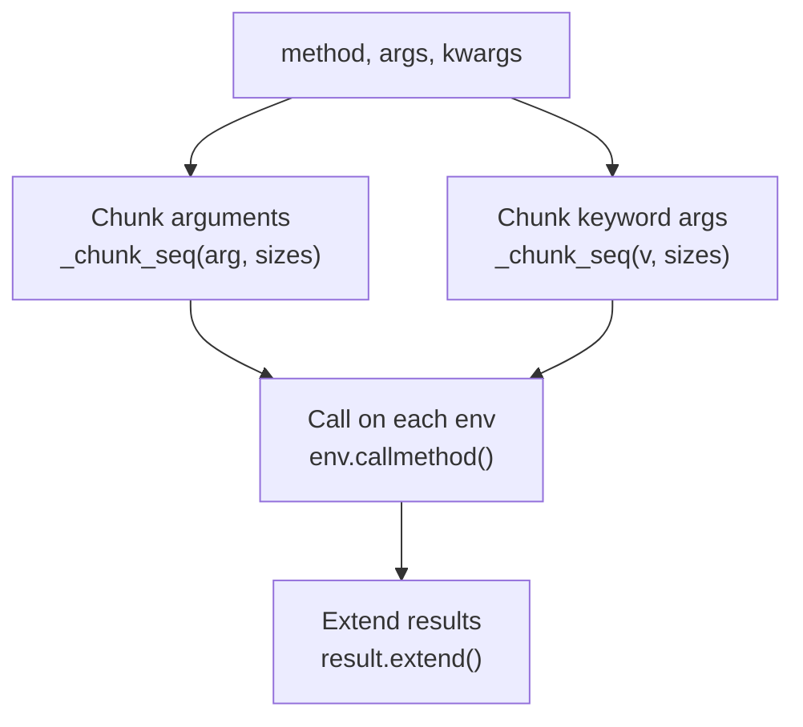

<!-- source: DeepWiki mcp.deepwiki.com · repo openai/gym3 · page 4.1 Vectorized Environments · fetched 2026-10-26 -->

# Vectorized Environments

<details>
<summary>Relevant source files</summary>

The following files were used as context for generating this wiki page:

- [gym3/concat.py](gym3/concat.py)
- [gym3/concat_test.py](gym3/concat_test.py)

</details>


This page covers gym3's vectorized environment execution using the `ConcatEnv` class, which enables running multiple environment instances in parallel within a single process. For subprocess-based parallel execution, see [Subprocess Environments](#4.2). For asynchronous execution patterns, see [Asynchronous Execution](#4.3).

## Purpose and Benefits

Vectorized environments allow multiple environment instances to be executed together in batches, providing significant performance improvements for reinforcement learning training. Rather than stepping through environments one at a time, vectorized execution processes observations, actions, and rewards across multiple environments simultaneously using efficient numpy operations.

The primary implementation is the `ConcatEnv` class, which concatenates multiple gym3 environments into a single vectorized interface while maintaining the standard `gym3.Env` API.

## ConcatEnv Architecture

The `ConcatEnv` class implements vectorization by aggregating multiple environment instances and coordinating their execution:



**Data Flow in ConcatEnv Vectorization**

Sources: [gym3/concat.py:21-62]()

## Class Definition and Interface

The `ConcatEnv` class extends the base `gym3.Env` interface and requires all constituent environments to have matching observation and action spaces:

| Method | Purpose | Implementation |
|--------|---------|----------------|
| `__init__(envs)` | Initialize with sequence of environments | Validates space compatibility, calculates total `num` |
| `observe()` | Get observations from all environments | Concatenates rewards, observations, and first flags |
| `act(ac)` | Send actions to all environments | Splits actions by environment sizes |
| `get_info()` | Retrieve info dictionaries | Extends lists from all environments |
| `callmethod()` | Call method on all environments | Chunks arguments and extends results |

Sources: [gym3/concat.py:21-34](), [gym3/concat.py:35-61]()

## Core Methods Implementation

### Environment Initialization

The constructor validates that all environments have identical observation and action spaces, then calculates the total number of environment instances:



**ConcatEnv Initialization Process**

The space validation uses `misc.allsame()` to ensure compatibility between environments [gym3/concat.py:31-32]().

Sources: [gym3/concat.py:28-33]()

### Observation Collection

The `observe()` method collects observations from all constituent environments and concatenates them into unified arrays:

- **Rewards**: Concatenated using `np.concatenate()`
- **Observations**: Concatenated using `concat()` from `gym3.types_np`
- **First flags**: Concatenated using `np.concatenate()`

Sources: [gym3/concat.py:35-37]()

### Action Distribution

The `act()` method splits incoming vectorized actions across the constituent environments based on their respective sizes:

The action splitting uses `split()` from `gym3.types_np` with cumulative size sections calculated by `np.cumsum([env.num for env in self.envs])` [gym3/concat.py:46]().

Sources: [gym3/concat.py:45-48]()

## Method Forwarding

The `callmethod()` implementation enables calling arbitrary methods on all constituent environments while properly handling argument distribution:



**Method Call Distribution in ConcatEnv**

The `_chunk_seq()` helper function splits sequences according to environment sizes, ensuring each environment receives the correct portion of arguments [gym3/concat.py:10-18]().

Sources: [gym3/concat.py:50-61](), [gym3/concat.py:10-18]()

## Usage Patterns

### Basic Vectorization

To create a vectorized environment from multiple instances:

```python
# Referenced pattern from test file
base_env1 = IdentityEnv(space=space, episode_len=1, seed=0)
base_env2 = IdentityEnv(space=space, episode_len=2, seed=1)
env = ConcatEnv([base_env1, base_env2])
```

The resulting environment will have `num = base_env1.num + base_env2.num` instances.

Sources: [gym3/concat_test.py:33-41]()

### Space Type Compatibility

`ConcatEnv` supports various space types including:

- **Discrete spaces**: `types.discrete_scalar(2)`
- **Dictionary spaces**: `types.DictType(degrees=types.discrete_scalar(360))`
- **Real-valued spaces**: `types.TensorType(shape=(), eltype=types.Real())`

All constituent environments must use the same space type [gym3/concat_test.py:22-31]().

Sources: [gym3/concat_test.py:22-31]()

## Performance Considerations

Vectorized execution with `ConcatEnv` provides several performance benefits:

- **Batch Operations**: Actions and observations are processed in batches using efficient numpy operations
- **Memory Efficiency**: Shared space definitions reduce memory overhead
- **Single Process**: Avoids inter-process communication overhead unlike subprocess-based approaches

The concatenation operations use gym3's optimized `concat()` and `split()` functions from `gym3.types_np`, which handle various data types efficiently.

Sources: [gym3/concat.py:1-8](), [gym3/concat.py:37](), [gym3/concat.py:46]()

---

