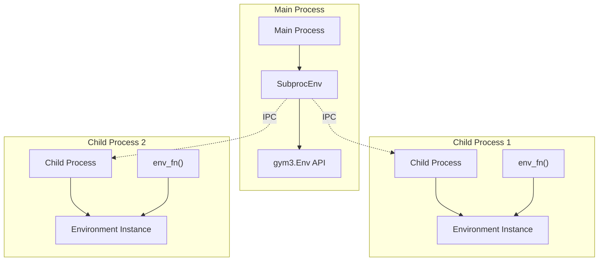
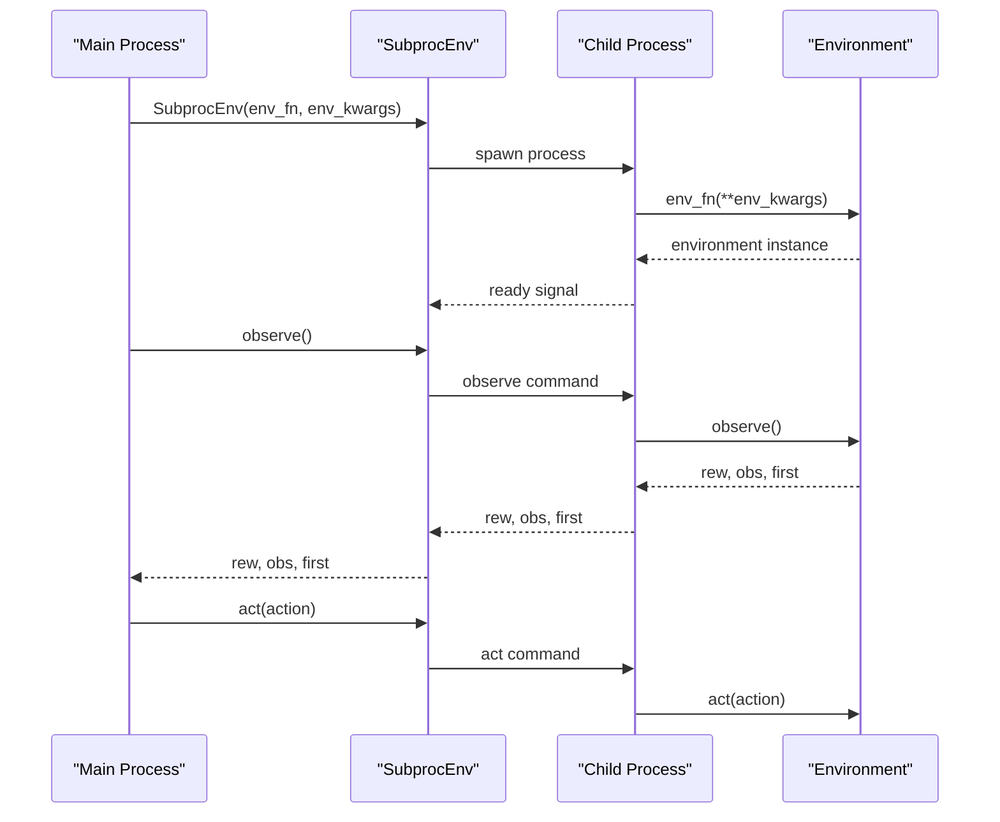
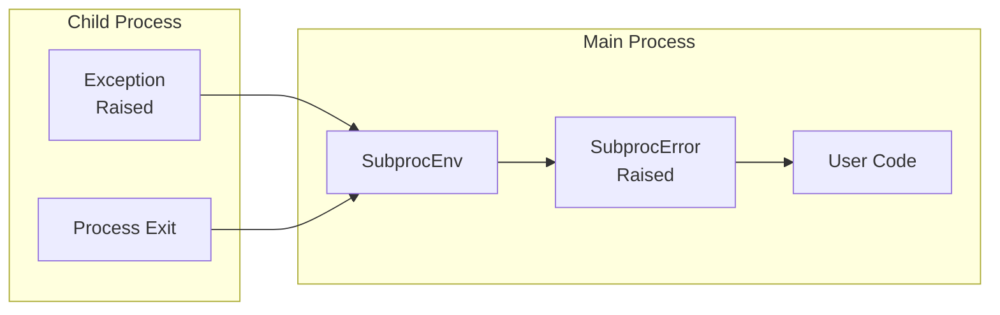

<!-- source: DeepWiki mcp.deepwiki.com · repo openai/gym3 · page 4.2 Subprocess Environments · fetched 2026-10-26 -->

# Subprocess Environments

<details>
<summary>Relevant source files</summary>

The following files were used as context for generating this wiki page:

- [gym3/libenv_test.py](gym3/libenv_test.py)
- [gym3/subproc_test.py](gym3/subproc_test.py)

</details>


## Purpose and Scope

This page documents gym3's subprocess environment system, which allows running environments in separate processes for isolation, stability, and parallel execution. The `SubprocEnv` class enables environments to run in child processes while maintaining the standard gym3 interface.

For information about running multiple environments in the same process, see [Vectorized Environments](#4.1). For asynchronous execution patterns, see [Asynchronous Execution](#4.3).

## Overview

The `SubprocEnv` class provides process isolation by running environments in separate child processes. This approach offers several benefits:

- **Process isolation**: Environment crashes don't affect the main process
- **Memory isolation**: Each environment runs in its own memory space  
- **Parallel execution**: Multiple environments can run concurrently
- **Library isolation**: Environments using conflicting libraries can coexist


*Process Architecture: SubprocEnv manages child processes running environment instances*

Sources: [gym3/subproc_test.py:39-49]()

## Basic Usage

The `SubprocEnv` constructor takes an environment factory function and optional keyword arguments:

```python
env = SubprocEnv(env_fn=create_test_env, env_kwargs=dict(episode_len=2))
```

The environment factory function must return a gym3 environment instance and will be called in the child process.


*Method Call Flow: Communication between main process and child environment*

Sources: [gym3/subproc_test.py:33-49]()

## Core Methods

### Environment Interaction

The `SubprocEnv` implements the standard gym3 environment interface:

- `observe()`: Get current rewards, observations, and first flags
- `act(action)`: Send actions to the environment
- `get_info()`: Retrieve environment info dictionaries

All method calls are transparently forwarded to the child process.

Sources: [gym3/subproc_test.py:41-48]()

### Cross-Process Method Calls

The `callmethod()` function allows calling arbitrary methods on the remote environment:

```python
env = SubprocEnv(env_fn=create_callmethod_test_env)
result = env.callmethod("square", 2)  # Returns 4
```

This enables access to custom environment methods beyond the standard gym3 interface.

Sources: [gym3/subproc_test.py:51-59]()

## Error Handling

### SubprocError Exception

When errors occur in the child process, they are wrapped in a `SubprocError` and re-raised in the main process:


*Error Propagation: Child process errors become SubprocError in main process*

### Error Scenarios

The system handles several error conditions:

1. **Environment creation errors**: Exceptions during `env_fn()` execution
2. **Runtime errors**: Exceptions during environment method calls  
3. **Process exits**: Child process termination (normal or abnormal)

Note that errors during `act()` may not be detected until the next `observe()` call due to the asynchronous nature of the communication.

Sources: [gym3/subproc_test.py:87-107]()

## Advanced Features

### Serialization Support

The subprocess system uses `cloudpickle` for serializing environment factory functions, enabling support for lambda functions and closures:

```python
def make_env():
    env = IdentityEnv()
    env.square = lambda x: x ** 2  # Lambda function preserved
    return env

env = SubprocEnv(env_fn=make_env)
```

Sources: [gym3/subproc_test.py:131-138]()

### MPI Compatibility

The system is designed to work with MPI (Message Passing Interface) environments, though MPI initialization in child processes requires careful handling:

Sources: [gym3/subproc_test.py:109-128]()

### Library Isolation

A key use case is isolating environments that use conflicting libraries. For example, the retro game environment can only be instantiated once per process, but multiple `SubprocEnv` instances can each run their own copy:

```python
envs = [
    SubprocEnv(env_fn=make_retro_env, env_kwargs=dict(game="Airstriker-Genesis"))
    for _ in range(2)  # Multiple instances possible with subprocess isolation
]
```

Sources: [gym3/subproc_test.py:141-158]()

## Integration with Other Systems

### Vectorized Environments

`SubprocEnv` instances can be combined with `ConcatEnv` to create vectorized subprocess environments:

```python
from gym3.concat import ConcatEnv

envs = [SubprocEnv(env_fn=make_env) for _ in range(4)]
vec_env = ConcatEnv(envs)  # 4 environments running in separate processes
```

This pattern provides both vectorization and process isolation.

### Wrapper Compatibility

Subprocess environments work with the gym3 wrapper system. Wrappers can be applied either in the main process (around `SubprocEnv`) or in the child process (within the `env_fn`):

```python
def create_wrapped_env():
    env = IdentityEnv(episode_len=2)
    env = StepInfo(env)  # Wrapper applied in child process
    return env
```

Sources: [gym3/subproc_test.py:17-36]()

## Considerations

### Performance Overhead

Process creation and inter-process communication add overhead compared to same-process execution. This trade-off is worthwhile when:

- Environment stability is critical
- Environments use conflicting dependencies
- Parallel execution across CPU cores is needed

### Memory Usage

Each subprocess maintains its own memory space, which increases total memory usage but provides complete isolation between environments.

### Debugging

Debugging across process boundaries can be more complex. The `SubprocError` exception preserves stack traces from the child process to aid in troubleshooting.

Sources: [gym3/subproc_test.py:1-159]()

---

