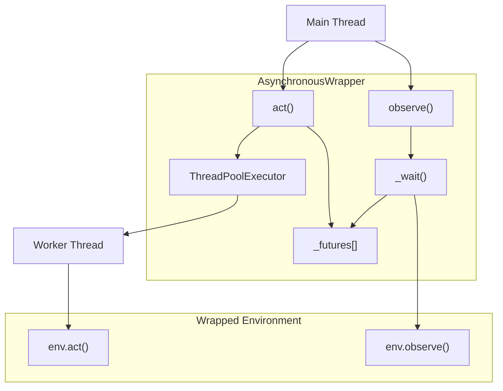
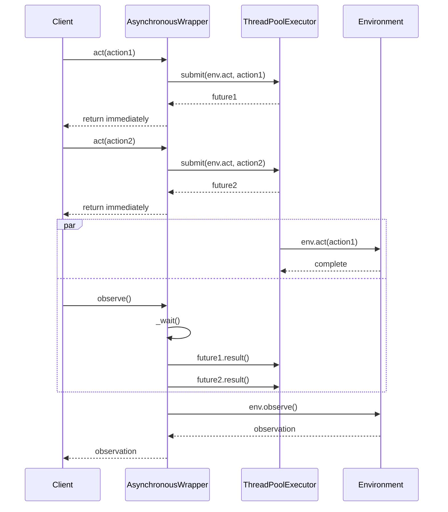
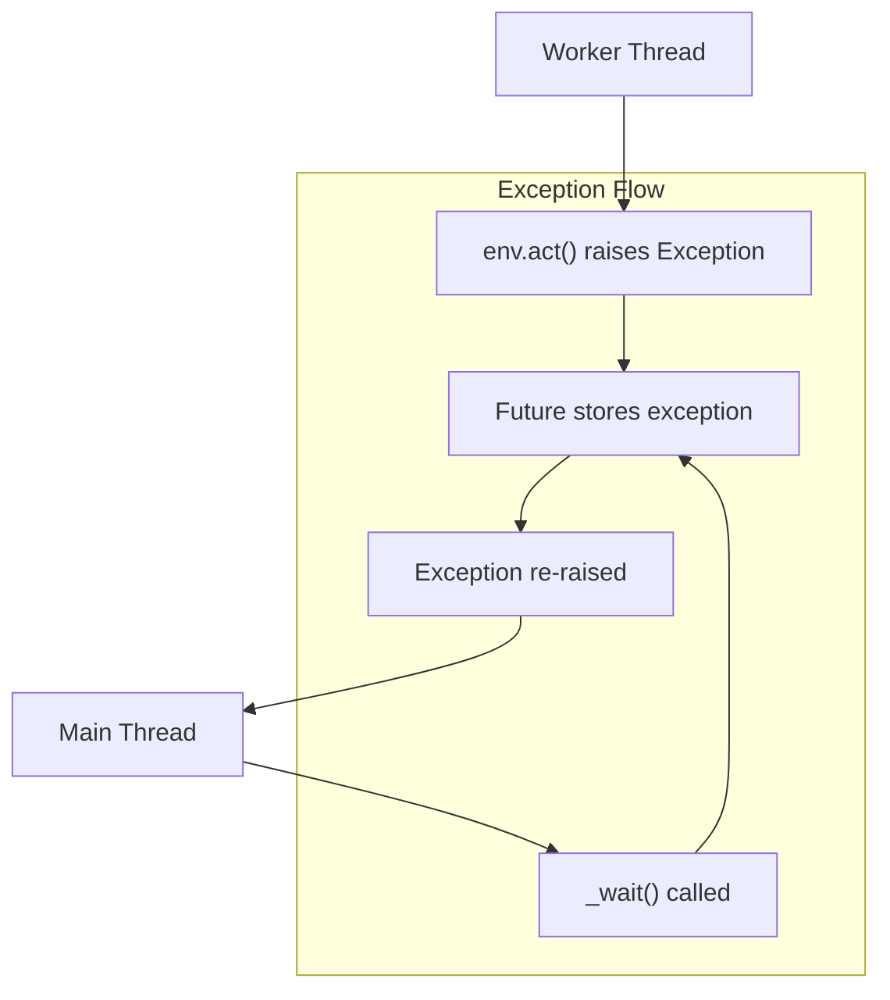

<!-- source: DeepWiki mcp.deepwiki.com · repo openai/gym3 · page 4.3 Asynchronous Execution · fetched 2026-10-26 -->

# Asynchronous Execution

<details>
<summary>Relevant source files</summary>

The following files were used as context for generating this wiki page:

- [gym3/asynchronous.py](gym3/asynchronous.py)
- [gym3/asynchronous_test.py](gym3/asynchronous_test.py)

</details>


This document covers gym3's asynchronous execution capabilities through the `AsynchronousWrapper` class, which enables non-blocking environment interactions by running `act()` calls on separate threads. This allows the main thread to continue processing while environment actions execute in the background.

For information about other execution patterns, see [Vectorized Environments](#4.1), [Subprocess Environments](#4.2), and [C Environment Integration](#4.4).

## Overview

The `AsynchronousWrapper` addresses a common performance bottleneck in reinforcement learning where environment `act()` calls are synchronous and can introduce significant latency. By moving these calls to a background thread, the wrapper enables overlapping computation and environment execution.

**Key Benefits:**
- Reduces perceived latency for `act()` calls
- Enables parallel processing while maintaining deterministic ordering  
- Provides transparent integration with existing gym3 environments
- Maintains proper exception propagation from background threads

Sources: [gym3/asynchronous.py:8-14]()

## AsynchronousWrapper Architecture



**Execution Flow:**
1. `act()` submissions are queued to `ThreadPoolExecutor` and return immediately
2. `Future` objects are stored in `_futures` list for tracking
3. `observe()` and `get_info()` calls trigger `_wait()` to synchronize
4. `_wait()` blocks until all pending futures complete

Sources: [gym3/asynchronous.py:16-40]()

## Implementation Details

### Core Components

The `AsynchronousWrapper` uses several key components to manage asynchronous execution:

| Component | Purpose | Implementation |
|-----------|---------|----------------|
| `ThreadPoolExecutor` | Manages worker thread for act() calls | Single worker thread (`max_workers=1`) |
| `_futures` | Tracks pending asynchronous operations | List of `Future` objects |
| `_wait()` | Synchronization point for pending operations | Blocks until futures complete |



Sources: [gym3/asynchronous.py:18-19](), [gym3/asynchronous.py:21-27](), [gym3/asynchronous.py:29-31]()

### Synchronization Strategy

The wrapper ensures deterministic behavior through careful synchronization:

**Action Queuing:** Actions are submitted to the thread pool in order and executed sequentially by the single worker thread.

**Observation Synchronization:** Both `observe()` and `get_info()` trigger `_wait()`, ensuring all pending actions complete before returning environment state.

**Exception Handling:** Exceptions from the worker thread are re-raised in the main thread during `_wait()` calls.

Sources: [gym3/asynchronous.py:37-39](), [gym3/asynchronous.py:22-27]()

## Usage Patterns

### Basic Usage

```python
from gym3 import AsynchronousWrapper

# Wrap any gym3 environment
async_env = AsynchronousWrapper(base_env)

# Actions return immediately
async_env.act(action1)  # Non-blocking
async_env.act(action2)  # Non-blocking

# Synchronization occurs on observe
obs, reward, done = async_env.observe()  # Blocks until actions complete
```

### Performance Optimization

The wrapper is most effective when:
- Environment `act()` calls have significant latency
- Multiple actions can be queued before observation is needed
- The ratio of computation to environment interaction is high

Sources: [gym3/asynchronous_test.py:28-45]()

## Exception Handling

The `AsynchronousWrapper` maintains proper exception semantics by propagating exceptions from the worker thread to the main thread:



**Exception Propagation:**
1. Exceptions in worker thread are captured by `Future` objects
2. `future.result()` re-raises the original exception in main thread
3. Exception timing matches synchronous behavior (on observe/get_info)

Sources: [gym3/asynchronous.py:24-26](), [gym3/asynchronous_test.py:58-65]()

## Performance Characteristics

### Timing Analysis

The asynchronous wrapper provides measurable performance improvements for environments with latency:

| Execution Pattern | Latency | Throughput |
|------------------|---------|------------|
| Synchronous | `act()` latency × num_actions | Sequential |
| Asynchronous | Minimal until `observe()` | Overlapped |

**Measured Benefits:**
- `act()` calls complete in sub-millisecond time
- Total execution time matches synchronous after `observe()`
- Enables computation overlap during environment processing

Sources: [gym3/asynchronous_test.py:33-44]()

### Ordering Guarantees

The single-threaded executor ensures deterministic action ordering:
- Actions execute in submission order
- Results maintain sequential consistency
- Environment state remains predictable

Sources: [gym3/asynchronous_test.py:47-55]()

## Limitations and Considerations

### Thread Safety Requirements
- Wrapped environment must be thread-safe for `act()` calls
- Single worker thread eliminates most concurrency issues
- State observation remains single-threaded

### Memory Overhead
- `Future` objects accumulate until `_wait()` is called
- ThreadPoolExecutor maintains persistent worker thread
- Minimal additional memory footprint

### Use Case Suitability
The `AsynchronousWrapper` is most beneficial when:
- Environment `act()` has measurable latency (>1ms)
- Multiple actions can be queued before observation
- Application can tolerate delayed exception reporting

Sources: [gym3/asynchronous.py:16-19](), [gym3/asynchronous_test.py:28-65]()

---

