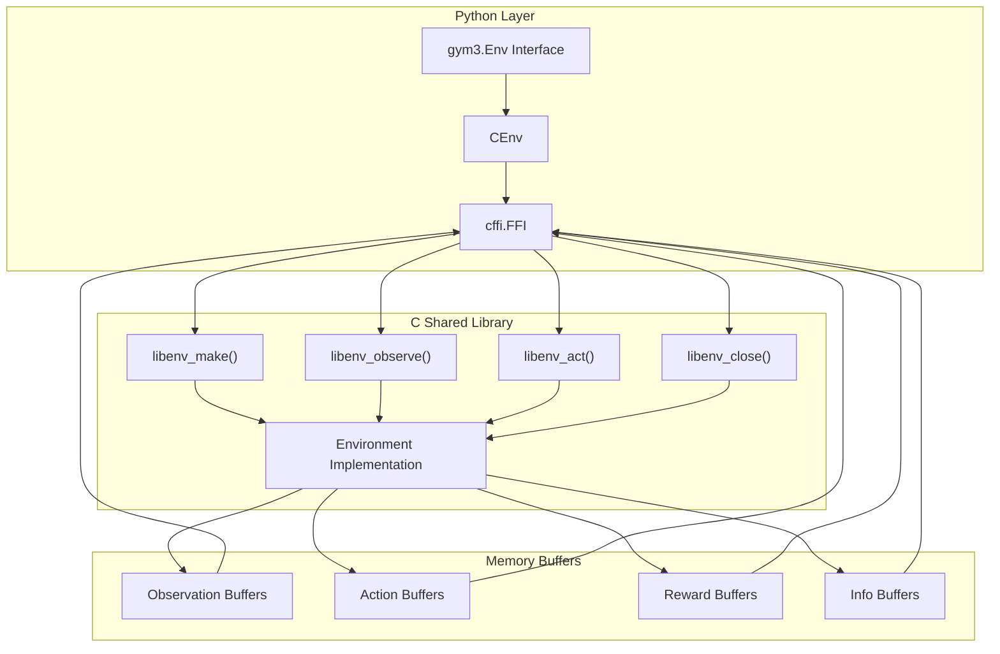
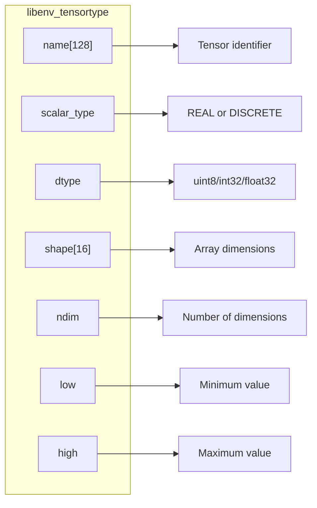
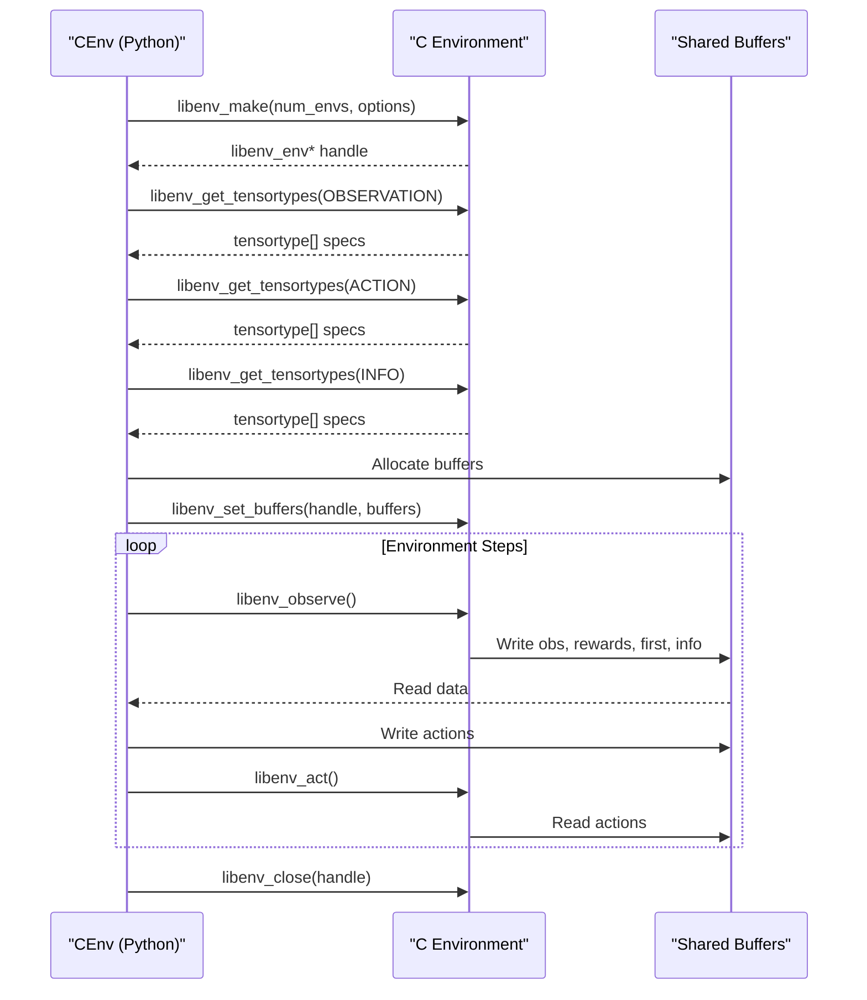
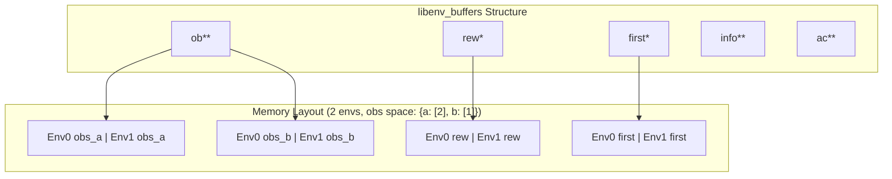
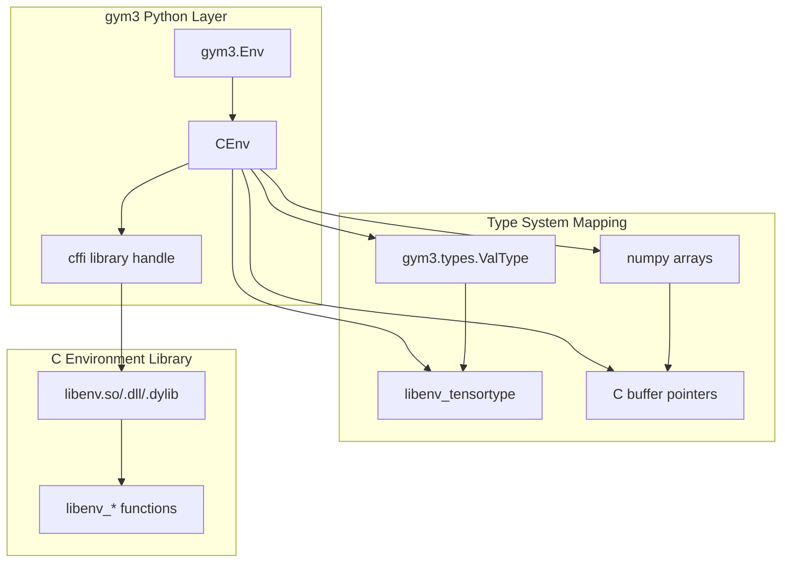
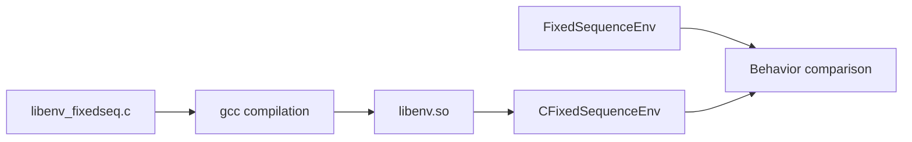

<!-- source: DeepWiki mcp.deepwiki.com · repo openai/gym3 · page 4.4 C Environment Integration · fetched 2026-10-26 -->

# C Environment Integration

<details>
<summary>Relevant source files</summary>

The following files were used as context for generating this wiki page:

- [gym3/libenv.h](gym3/libenv.h)
- [gym3/libenv_test.py](gym3/libenv_test.py)
- [gym3/subproc_test.py](gym3/subproc_test.py)

</details>


This document covers gym3's support for integrating environments written in C through the libenv API. This enables high-performance environment implementations in C while maintaining compatibility with gym3's vectorized interface. For information about running environments in separate processes, see [Subprocess Environments](#4.2). For asynchronous execution patterns, see [Asynchronous Execution](#4.3).

## Purpose and Scope

The C environment integration system allows developers to implement reinforcement learning environments in C and seamlessly use them within gym3's Python framework. This integration provides:

- **Performance**: Native C execution eliminates Python interpreter overhead
- **Language flexibility**: Any language that can export C shared libraries can be used
- **Vectorization**: Full support for gym3's vectorized environment interface
- **Zero-copy operation**: Direct memory access between Python and C for efficient data transfer

The integration is built around the `libenv` API defined in [gym3/libenv.h]() and the `CEnv` wrapper class that bridges Python and C.

## libenv API Architecture

The libenv API defines a standardized interface for C-based environments that can be loaded as shared libraries. The architecture separates the environment logic (implemented in C) from the gym3 integration layer (Python).

**libenv API Architecture**


Sources: [gym3/libenv.h:1-198]()

## Core Data Types and Structures

The libenv API defines several key data types that enable type-safe communication between Python and C environments.

### Fundamental Types

| Type | Purpose | Values |
|------|---------|--------|
| `libenv_dtype` | Data type enumeration | `UINT8`, `INT32`, `FLOAT32` |
| `libenv_scalar_type` | Logical type classification | `REAL`, `DISCRETE` |
| `libenv_space_name` | Space identification | `OBSERVATION`, `ACTION`, `INFO` |

### Data Structures

**libenv_tensortype Structure**


Sources: [gym3/libenv.h:84-92]()

The `libenv_tensortype` structure [gym3/libenv.h:84-92]() describes the shape and constraints of each tensor in the environment's observation, action, and info spaces. This corresponds directly to gym3's `ValType` system but uses a flattened representation suitable for C.

### Environment Configuration

Environments are configured through the `libenv_options` structure [gym3/libenv.h:105-109](), which contains an array of key-value pairs. Each option has a name, data type, count, and pointer to the data:

```c
struct libenv_option {
    char name[LIBENV_MAX_NAME_LEN];
    enum libenv_dtype dtype;
    int count;
    void *data;
};
```

Sources: [gym3/libenv.h:98-103]()

## Environment Lifecycle

C environments follow a structured lifecycle managed through the libenv API functions.

**Environment Lifecycle Flow**


Sources: [gym3/libenv.h:146-190]()

### Key Lifecycle Functions

1. **`libenv_make()`** [gym3/libenv.h:160](): Creates environment instances with specified options
2. **`libenv_get_tensortypes()`** [gym3/libenv.h:165](): Retrieves space specifications for observations, actions, and info
3. **`libenv_set_buffers()`** [gym3/libenv.h:171](): Provides shared memory buffers for data exchange
4. **`libenv_observe()`** [gym3/libenv.h:176](): Generates observations, rewards, and episode flags
5. **`libenv_act()`** [gym3/libenv.h:187](): Processes actions from the shared buffer
6. **`libenv_close()`** [gym3/libenv.h:190](): Cleanup and resource deallocation

## Buffer Management and Memory Layout

The libenv API uses a structure-of-arrays memory layout to efficiently handle vectorized environments. This design minimizes memory access overhead and enables efficient batch processing.

**Vectorized Memory Layout**


Sources: [gym3/libenv.h:132-138](), [gym3/libenv.h:118-131]()

The buffer layout [gym3/libenv.h:118-131]() arranges data so that all instances of the same tensor are stored contiguously. For example, with 2 environments and observation space `{'a': [1], 'b': [1]}`, the memory layout groups all 'a' observations together, then all 'b' observations together.

### Buffer Allocation Strategy

1. **Python allocates all buffers**: The `CEnv` class manages memory allocation based on space specifications
2. **Pointers passed to C**: Only buffer pointers are shared, not buffer ownership
3. **Lifetime guarantee**: Buffers remain valid until `libenv_close()` is called
4. **Zero-copy operation**: Direct memory access eliminates copying overhead

## Integration with gym3

The `CEnv` class serves as the bridge between gym3's Python interface and the C libenv API. It handles library loading, buffer management, and type conversions.

**CEnv Integration Architecture**


Sources: [gym3/libenv_test.py:26-38]()

### Example Usage Pattern

From the test implementation [gym3/libenv_test.py:26-38](), we can see how `CEnv` is typically subclassed:

```python
class CFixedSequenceEnv(CEnv):
    def __init__(self, num, n_actions, episode_len, sequence):
        options = dict(n_actions=n_actions, episode_len=episode_len, sequence=sequence)
        super().__init__(num=num, lib_dir=".", options=options)
        self.ob_space = self.ob_space["ignore"]
        self.ac_space = self.ac_space["action"]

    def observe(self):
        rew, ob, first = super().observe()
        return rew, ob["ignore"], first

    def act(self, ac):
        super().act({"action": ac})
```

This pattern shows how:
1. Environment-specific options are passed to the C library
2. Observation and action spaces can be adapted
3. Dictionary-based spaces are mapped to simpler interfaces

## Building and Testing C Environments

C environments must be compiled as shared libraries that export the required libenv functions. The build process varies by platform but follows consistent patterns.

### Build Requirements

| Platform | Compiler | Library Extension | Notes |
|----------|----------|-------------------|-------|
| Linux | gcc | `.so` | Position-independent code (`-fpic`) |
| macOS | clang/gcc | `.dylib` | Standard shared library flags |
| Windows | MSVC/MinGW | `.dll` | Export declarations required |

### Example Build Process

The test suite [gym3/libenv_test.py:47-59]() demonstrates building a C environment:

```bash
gcc -ggdb -shared -fpic libenv_fixedseq.c -o libenv.so
```

Key compiler flags:
- `-shared`: Create shared library
- `-fpic`: Position-independent code (required for shared libraries)
- `-ggdb`: Debug symbols for development

### Testing Integration

The test framework [gym3/libenv_test.py:42-78]() validates C environment behavior by:

1. **Building the C library**: Compiling source code to shared library
2. **Creating environment instances**: Using `CEnv` with the compiled library  
3. **Comparing against reference**: Verifying identical behavior to Python implementation
4. **Testing vectorization**: Ensuring correct multi-environment operation

**Testing Flow**


Sources: [gym3/libenv_test.py:42-78]()

The testing approach ensures that C environments produce identical results to their Python counterparts, validating both correctness and integration quality.

---

