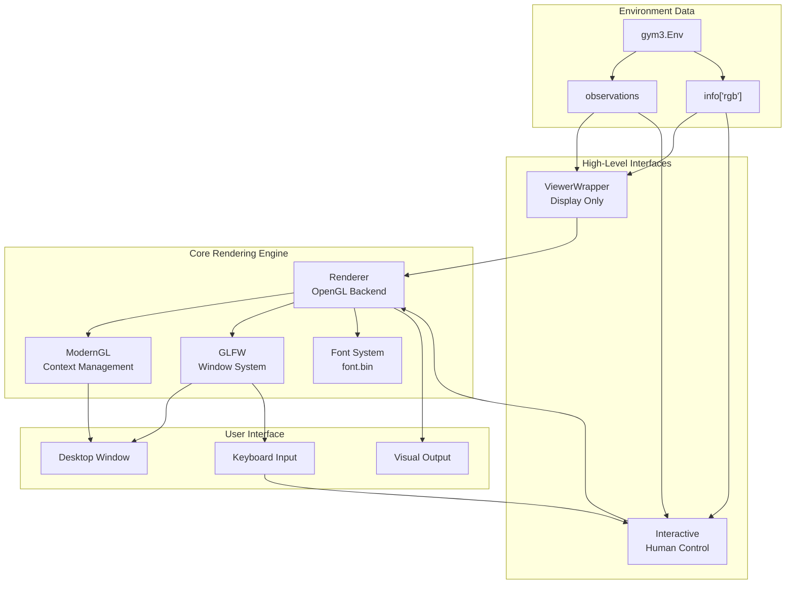
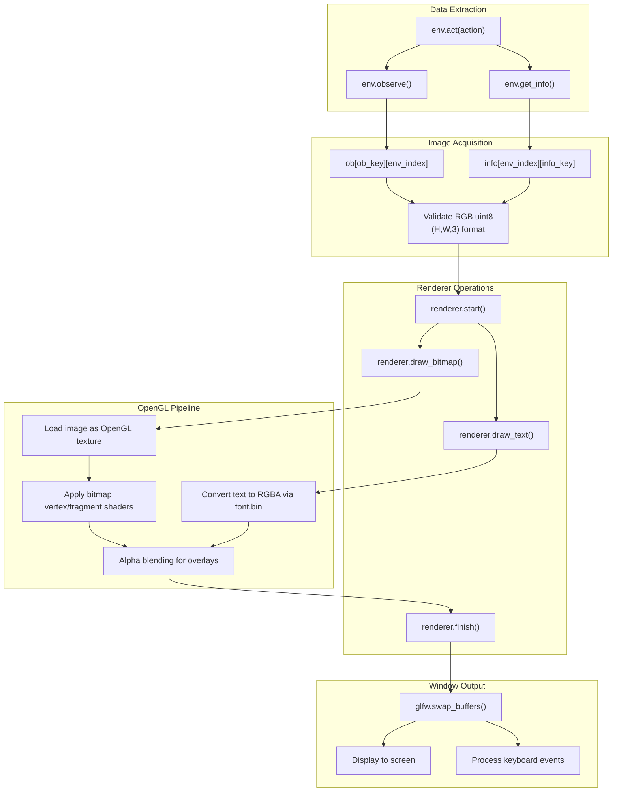
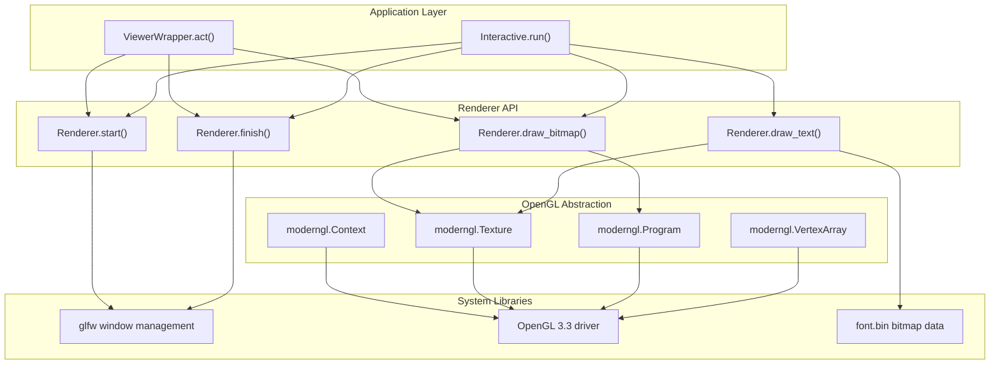
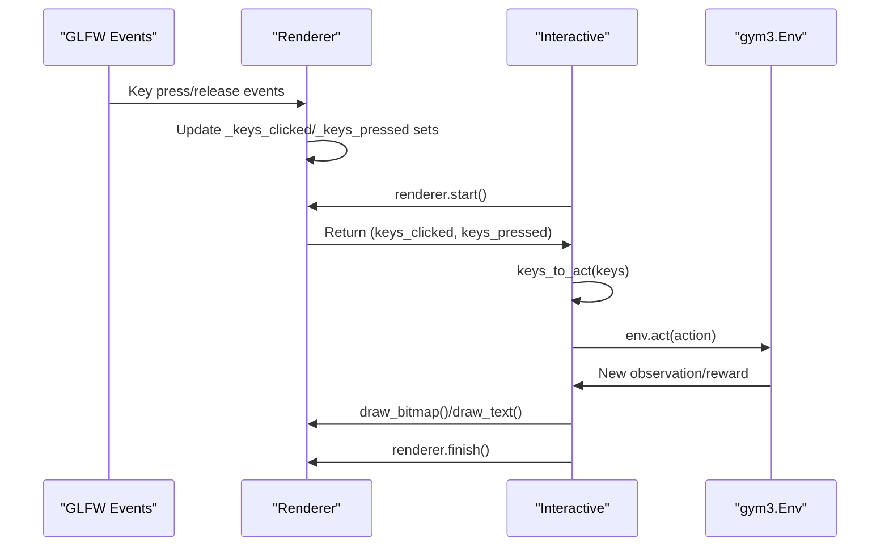

<!-- source: DeepWiki mcp.deepwiki.com · repo openai/gym3 · page 5 Visualization and Interaction · fetched 2026-10-26 -->

# Visualization and Interaction

<details>
<summary>Relevant source files</summary>

The following files were used as context for generating this wiki page:

- [gym3/interactive.py](gym3/interactive.py)
- [gym3/internal/renderer.py](gym3/internal/renderer.py)
- [gym3/viewer.py](gym3/viewer.py)

</details>


This document covers gym3's visualization and interaction capabilities, which enable human observation and control of environments through desktop windows. The system provides tools for displaying environment state visually and accepting keyboard input from users.

For information about recording environment data to files, see [Advanced Features](#6). For details about environment execution patterns, see [Environment Execution](#4).

## Overview

gym3's visualization system consists of three main components that work together to provide rich interactive experiences:



**System Architecture Overview**

Sources: [gym3/viewer.py:1-138](), [gym3/interactive.py:1-278](), [gym3/internal/renderer.py:1-307]()

## Core Components

### ViewerWrapper

The `ViewerWrapper` class provides a simple way to display environment images in a window without user interaction capabilities. It wraps any gym3 environment and automatically displays frames after each action.

| Feature | Description |
|---------|-------------|
| **Purpose** | Display-only environment visualization |
| **Data Source** | Observations or info dict RGB data |
| **Controls** | Basic playback controls (pause, fast mode, overlay) |
| **Threading** | Synchronous with environment steps |

Key characteristics:
- Inherits from `gym3.Wrapper`
- Supports both observation-based and info-based image sources
- Built-in frame rate limiting
- Overlay system for help text and status

Sources: [gym3/viewer.py:18-137]()

### Interactive

The `Interactive` class enables human-in-the-loop environment control through keyboard input. Unlike `ViewerWrapper`, it allows users to control the environment directly.

| Feature | Description |
|---------|-------------|
| **Purpose** | Human control of environment actions |
| **Input Method** | Keyboard mapping to environment actions |
| **Execution Modes** | Synchronous and asynchronous |
| **Display** | Episode statistics and environment info |

Key characteristics:
- Requires `keys_to_act` function for keyboard-to-action mapping
- Supports both synchronous (step-by-step) and asynchronous (real-time) control
- Automatically tracks episode statistics
- Built-in episode completion display

Sources: [gym3/interactive.py:18-277]()

### Renderer

The `Renderer` class provides the low-level OpenGL rendering engine used by both high-level interfaces. It handles window management, graphics rendering, and input processing.

| Component | Technology |
|-----------|------------|
| **Graphics API** | OpenGL 3.3 Core Profile |
| **Window System** | GLFW |
| **Context Management** | ModernGL |
| **Font Rendering** | Custom bitmap font system |

Sources: [gym3/internal/renderer.py:88-307]()

## Rendering Pipeline

The visualization system follows a structured rendering pipeline from environment data to screen display:



**Rendering Pipeline from Environment Data to Display**

Sources: [gym3/viewer.py:53-93](), [gym3/interactive.py:111-175](), [gym3/internal/renderer.py:195-284]()

## Usage Patterns

### Display-Only Visualization

For simple environment visualization without user interaction:

```python
# Basic usage pattern
env = SomeGym3Env()
env = ViewerWrapper(env, env_index=0, info_key="rgb")
# Viewer automatically displays frames during env.act() calls
```

The `ViewerWrapper` integrates into the environment's `act()` method, automatically displaying frames and handling basic controls like pause (`P`), fast mode (`F`), and overlay toggle (`O`).

Sources: [gym3/viewer.py:125-137]()

### Interactive Control

For human control of environment actions:

```python
# Interactive usage pattern  
env = SomeGym3Env(num=1)  # Must be single environment
interactive = Interactive(env, keys_to_act=my_key_mapping)
interactive.run()  # Enters main loop until window closed
```

The `Interactive` class requires a `keys_to_act` function that maps keyboard key names to environment actions. It supports both synchronous (step-by-step) and asynchronous (real-time) execution modes.

Sources: [gym3/interactive.py:268-277]()

## Technical Architecture

### Graphics System Stack

The rendering system is built on modern OpenGL with careful abstraction layers:



**Low-Level Graphics Architecture**

Sources: [gym3/internal/renderer.py:96-161](), [gym3/internal/renderer.py:152-154]()

### Font Rendering System

Text rendering uses a custom bitmap font system for reliable cross-platform display:

| Component | Details |
|-----------|---------|
| **Font Data** | Pre-rendered bitmap fonts in `font.bin` |
| **Text Processing** | `_str_to_array()` converts strings to character arrays |
| **Rendering** | `_convert_ascii_to_rgba()` maps characters to RGBA bitmaps |
| **Sizes** | Multiple font sizes available (16px, 32px, etc.) |

The font system converts text strings to numpy arrays, then maps each character to its corresponding bitmap in the font atlas, producing RGBA images that can be rendered as textures.

Sources: [gym3/internal/renderer.py:14-51](), [gym3/internal/renderer.py:253-284]()

### Input Processing

Keyboard input flows through GLFW's event system with custom key mapping:



**Input Processing Flow**

Sources: [gym3/internal/renderer.py:162-173](), [gym3/interactive.py:200-266]()

---

