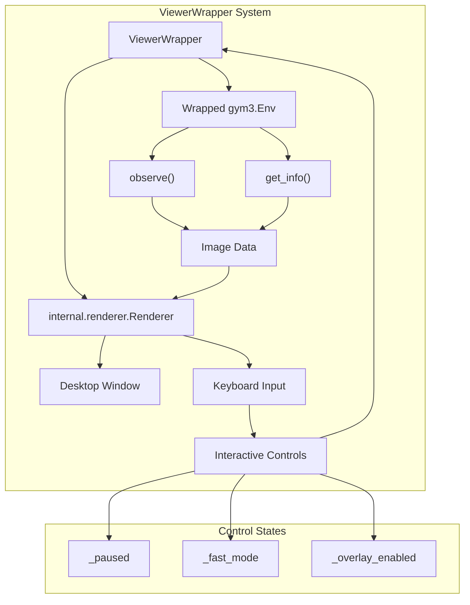
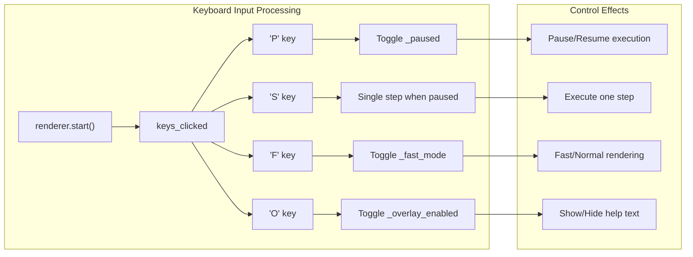
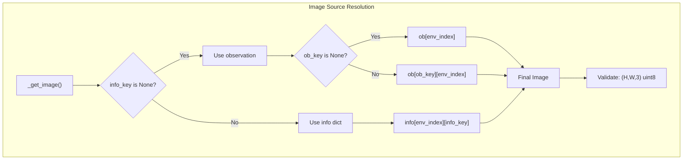
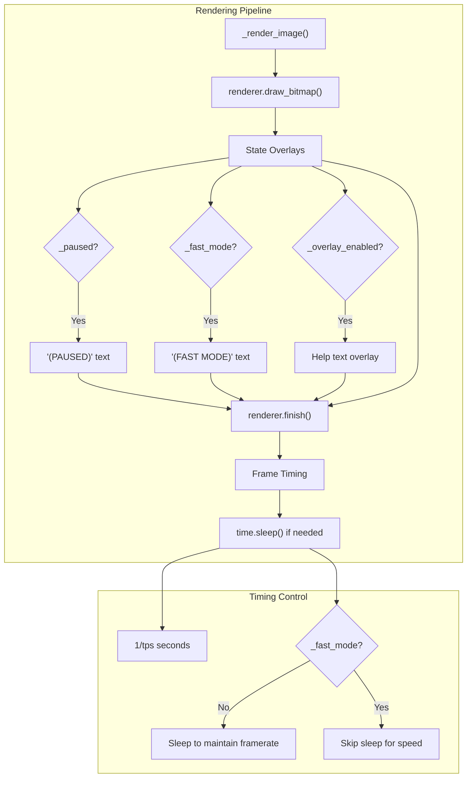

<!-- source: DeepWiki mcp.deepwiki.com · repo openai/gym3 · page 5.1 Environment Viewer · fetched 2026-10-26 -->

# Environment Viewer

Relevant source files

The following files were used as context for generating this wiki page:

- [CHANGES.md](CHANGES.md)
- [gym3/viewer.py](gym3/viewer.py)

## Purpose and Scope

The Environment Viewer provides real-time visualization of gym3 environments through the `ViewerWrapper` class. This wrapper displays environment observations or info dictionary images in a desktop window with interactive controls for pausing, stepping, and adjusting playback speed. The viewer enables human observation of environment dynamics and debugging of visual components.

For human-controlled environment interaction, see [Interactive Control](#5.2). For details about the underlying rendering engine, see [Rendering System](#5.3). For general information about gym3's wrapper system, see [Wrappers and Extensions](#3.3).

## ViewerWrapper Architecture

The `ViewerWrapper` integrates with gym3's rendering system to provide windowed visualization:

**ViewerWrapper Core Components**

Sources: [gym3/viewer.py:18-52]()

## Basic Usage

The `ViewerWrapper` wraps any gym3 environment to add visualization capabilities:

| Parameter | Type | Description | Default |
|-----------|------|-------------|---------|
| `env` | `Env` | Environment to visualize | Required |
| `env_index` | `int` | Index of environment to display | `0` |
| `ob_key` | `Optional[str]` | Observation dictionary key | `None` |
| `info_key` | `Optional[str]` | Info dictionary key (e.g., "rgb") | `None` |
| `width` | `int` | Window width in pixels | `768` |
| `height` | `int` | Window height in pixels | `768` |
| `tps` | `int` | Timesteps per second | `15` |

The wrapper intercepts `act()` calls to display the current environment state before proceeding with the action.

Sources: [gym3/viewer.py:32-42]()

## Interactive Controls

The viewer provides keyboard controls defined in the help text overlay:

**Interactive Control Implementation**

The control loop blocks execution when paused until the user presses step or unpause:

- **p**: Toggles pause state
- **s**: Single step when paused  
- **f**: Toggles fast mode (reduces rendering frequency)
- **o**: Toggles help text overlay

Sources: [gym3/viewer.py:11-15](), [gym3/viewer.py:112-122]()

## Image Source Selection

The viewer supports multiple image sources through a flexible selection system:

**Image Source Priority**

1. **Info Dictionary**: When `info_key` is specified, extracts image from environment info
2. **Observation Dictionary**: When `ob_key` is specified, extracts from observation dictionary  
3. **Direct Observation**: Uses observation directly when no keys specified

The system validates that images are 3-channel RGB with uint8 dtype before rendering.

Sources: [gym3/viewer.py:53-61](), [gym3/viewer.py:98-101]()

## Rendering and Timing Control

The viewer manages frame timing and visual overlays through the rendering pipeline:

**Frame Rate Management**

The viewer maintains consistent timing by calculating sleep duration based on the configured timesteps per second (`tps`). In fast mode, sleep is skipped to maximize rendering speed.

Sources: [gym3/viewer.py:63-93]()

## Integration Example

The viewer integrates with procgen environments as demonstrated in the main function:

| Component | Implementation |
|-----------|----------------|
| Environment | `procgen.ProcgenGym3Env` with `render_mode="rgb_array"` |
| Wrapper | `ViewerWrapper` with `info_key="rgb"` |
| Action Sampling | `types_np.sample()` for random actions |
| Execution Loop | Continuous `act()` calls with performance monitoring |

This pattern works with any gym3 environment that provides RGB image data through observations or info dictionary.

Sources: [gym3/viewer.py:125-137]()

---

