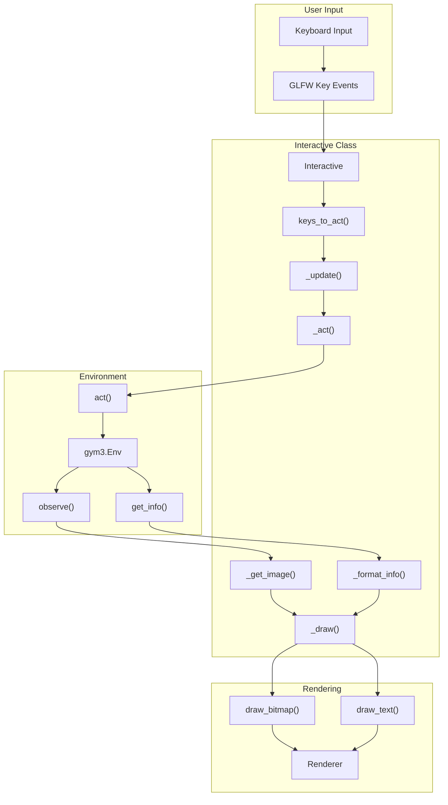
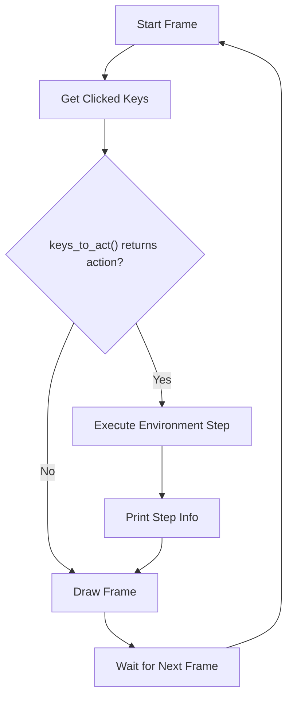
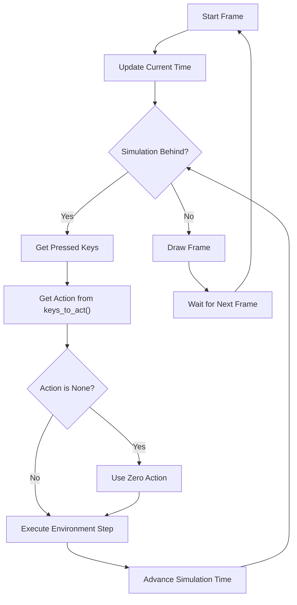
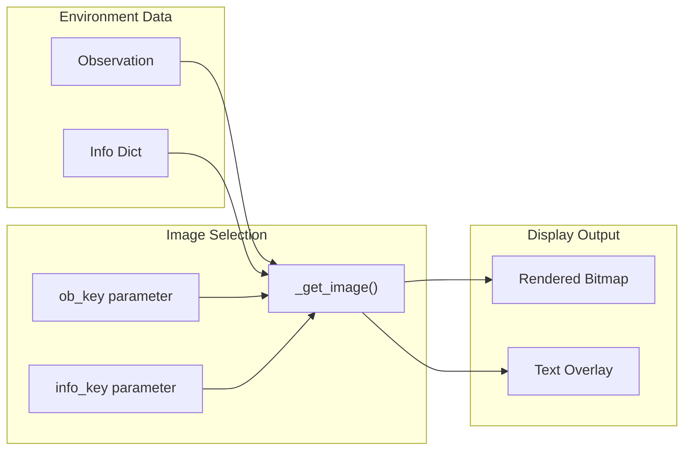

<!-- source: DeepWiki mcp.deepwiki.com · repo openai/gym3 · page 5.2 Interactive Control · fetched 2026-10-26 -->

# Interactive Control

<details>
<summary>Relevant source files</summary>

The following files were used as context for generating this wiki page:

- [gym3/interactive.py](gym3/interactive.py)

</details>


## Purpose and Scope

The Interactive Control system enables human-in-the-loop interaction with gym3 environments through keyboard input and visual display. This system allows users to manually control environments, observe their behavior, and gather debugging information through an interactive graphical interface.

For basic environment visualization without human control, see [Environment Viewer](#5.1). For details on the underlying rendering engine, see [Rendering System](#5.3).

## Core Architecture

The Interactive Control system is built around the `Interactive` class, which coordinates keyboard input, environment stepping, visual rendering, and timing control.

### Interactive Class Overview



Sources: [gym3/interactive.py:18-83]()

### Key Components

The `Interactive` class manages several core components:

| Component | Purpose | Key Methods |
|-----------|---------|-------------|
| Environment Interface | Manages gym3 environment interaction | `_act()`, `observe()`, `get_info()` |
| Input Handling | Processes keyboard input and maps to actions | `keys_to_act()` |
| Rendering Pipeline | Displays environment state and overlays | `_get_image()`, `_draw_step()` |
| Timing Control | Manages frame rate and simulation speed | `_update()` |
| Episode Tracking | Monitors episode statistics and completion | Episode counters, return tracking |

Sources: [gym3/interactive.py:45-83]()

## Interaction Modes

The Interactive Control system supports two distinct interaction modes that affect how keyboard input drives environment stepping.

### Synchronous Mode



In synchronous mode (`synchronous=True`), the environment only advances when the `keys_to_act` function returns a non-None action. This is useful for turn-based interaction or careful step-by-step debugging.

Sources: [gym3/interactive.py:208-223]()

### Asynchronous Mode



In asynchronous mode (`synchronous=False`), the environment runs continuously at a specified frame rate, with held keys providing continuous input. The system catches up simulation time to real time while respecting frame rate limits.

Sources: [gym3/interactive.py:224-259]()

## Display and Rendering

The Interactive Control system provides rich visual feedback through environment rendering and information overlays.

### Image Sources

The system can display images from multiple sources within the environment:



The image source priority is:
1. `info_key` - Key within environment info dictionary
2. `ob_key` - Key within observation dictionary  
3. Direct observation - Raw observation as image

Sources: [gym3/interactive.py:111-123]()

### Information Overlay

The system displays real-time episode statistics and environment information:

- **Episode Metrics**: Steps, return, reward
- **Environment Info**: Custom key-value pairs from `get_info()`
- **Toggle Control**: Press 'O' to toggle overlay visibility
- **Episode Completion**: Special display when episodes end

Sources: [gym3/interactive.py:124-151](), [gym3/interactive.py:152-176]()

## Configuration Options

The `Interactive` class provides extensive configuration for customizing the interaction experience:

| Parameter | Type | Default | Purpose |
|-----------|------|---------|---------|
| `env` | `Env` | Required | gym3 environment (must have `num=1`) |
| `keys_to_act` | `Callable` | `None` | Function mapping key lists to actions |
| `synchronous` | `bool` | `False` | Whether to wait for input before stepping |
| `ob_key` | `str` | `None` | Key in observation dict for display |
| `info_key` | `str` | `None` | Key in info dict for display (overrides `ob_key`) |
| `width` | `int` | `768` | Window width in pixels |
| `height` | `int` | `768` | Window height in pixels |
| `tps` | `int` | `15` | Target timesteps per second |

### Key Mapping Function

The `keys_to_act` function is the core interface for translating keyboard input to environment actions:

```python
# Function signature
def keys_to_act(keys: Sequence[str]) -> Optional[np.ndarray]:
    # keys contains GLFW key names (without "GLFW_KEY_" prefix)
    # Return None for no action, or numpy array for environment action
```

If not provided, the system calls `env.callmethod("keys_to_act", [keys])` to delegate key mapping to the environment.

Sources: [gym3/interactive.py:32-35](), [gym3/interactive.py:64-66]()

## Usage Patterns

### Basic Interactive Session

```python
# Create environment
env = SomeGym3Env(num=1)

# Define key mapping
def keys_to_act(keys):
    if "SPACE" in keys:
        return np.array([1])  # Some action
    return None  # No action

# Start interactive session  
interactive = Interactive(env, keys_to_act=keys_to_act)
interactive.run()  # Blocks until window closed
```

### Environment-Provided Key Mapping

Many environments provide their own `keys_to_act` method:

```python
# Environment handles key mapping internally
env = ProcgenGym3Env(num=1, env_name="coinrun")
interactive = Interactive(env)  # Uses env.callmethod("keys_to_act")
interactive.run()
```

### Custom Display Configuration

```python
# Use info dict for display with custom window size
interactive = Interactive(
    env,
    info_key="rgb",       # Display from info["rgb"]
    width=1024,           # Larger window
    height=768,
    tps=30,              # Higher frame rate
    synchronous=True     # Wait for input
)
```

Sources: [gym3/interactive.py:268-277]()

### Timing and Performance Control

The system includes several mechanisms for managing performance:

- **Frame Rate Limiting**: `tps` parameter controls maximum timesteps per second
- **Catch-up Logic**: Asynchronous mode catches up simulation to real time
- **Frame Dropping**: `_max_sim_frames_per_update` limits frames processed per render cycle
- **Sleep Control**: Automatic sleeping to maintain target frame rate

Sources: [gym3/interactive.py:80-83](), [gym3/interactive.py:224-258]()

---

