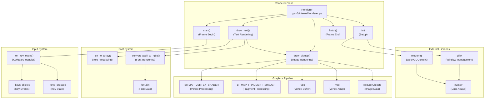
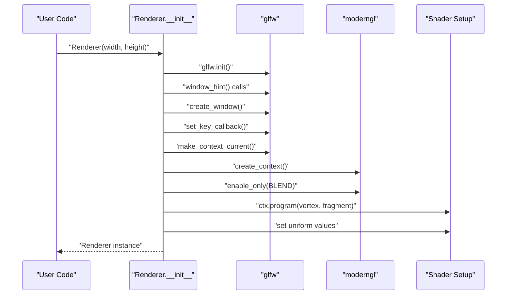
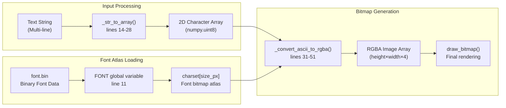
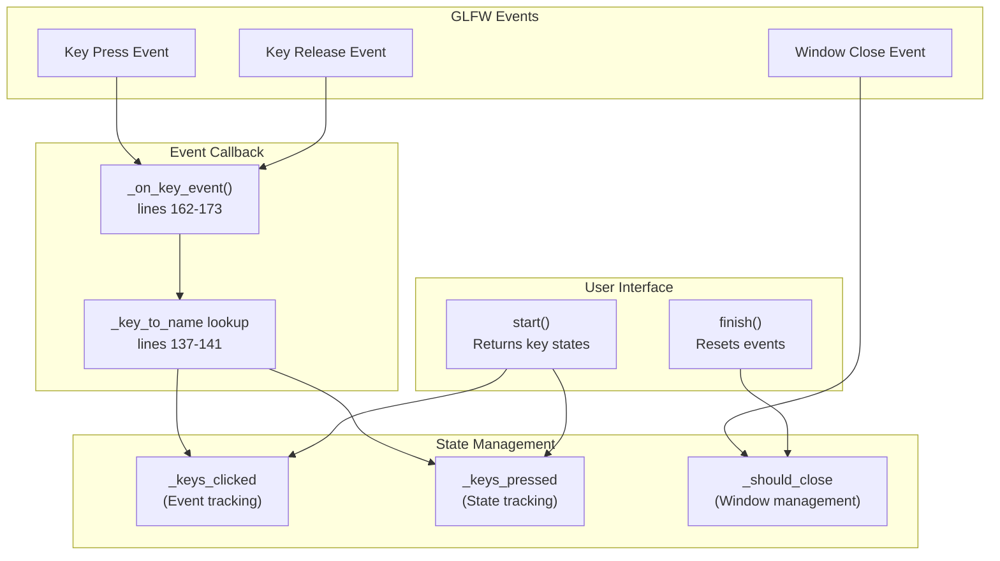

<!-- source: DeepWiki mcp.deepwiki.com · repo openai/gym3 · page 5.3 Rendering System · fetched 2026-10-26 -->

# Rendering System

<details>
<summary>Relevant source files</summary>

The following files were used as context for generating this wiki page:

- [gym3/internal/font.bin](gym3/internal/font.bin)
- [gym3/internal/renderer.py](gym3/internal/renderer.py)

</details>


This document covers gym3's low-level OpenGL-based rendering engine that provides hardware-accelerated bitmap and text rendering capabilities. The rendering system forms the foundation for gym3's visualization features, enabling efficient display of environment observations and text overlays in interactive windows.

For higher-level environment visualization using this rendering system, see [Environment Viewer](#5.1). For human interaction capabilities that build on this renderer, see [Interactive Control](#5.2).

## Architecture Overview

The rendering system is built around the `Renderer` class which provides a hardware-accelerated OpenGL-based rendering pipeline. It integrates multiple external libraries to create a complete graphics stack.

**Rendering System Architecture**


Sources: [gym3/internal/renderer.py:1-307]()

## Core Renderer Class

The `Renderer` class provides the main interface for creating and managing an OpenGL rendering context. It handles window creation, OpenGL setup, and provides methods for drawing bitmaps and text.

| Method | Purpose | Key Parameters |
|--------|---------|----------------|
| `__init__(width, height)` | Initialize renderer with window dimensions | `width`, `height` in pixels |
| `start()` | Begin new frame, process input events | Returns `keys_clicked`, `keys_pressed` |
| `draw_bitmap(x, y, w, h, image)` | Render bitmap at specified location | Position, size, `numpy` image array |
| `draw_text(x, y, text)` | Render text string using built-in font | Position, text string, font size |
| `finish()` | Complete frame and swap buffers | Handles window close events |
| `get_time()` | Get high-precision timestamp | Uses `glfw.get_time()` |

The renderer uses OpenGL 3.3 Core Profile with specific window hints for optimal compatibility and performance. Window creation includes double buffering and 24-bit depth buffer configuration.

**Renderer Initialization Flow**


Sources: [gym3/internal/renderer.py:96-161]()

## Font System

The font system converts text strings into rendered bitmap images using a precompiled font atlas stored in `font.bin`. This system supports multiple font sizes and handles multi-line text rendering.

| Component | Function | Implementation |
|-----------|----------|----------------|
| `font.bin` | Font atlas data | Numpy-serialized font bitmaps for different sizes |
| `_str_to_array()` | Text to array conversion | Converts UTF-8 strings to 2D character arrays |
| `_convert_ascii_to_rgba()` | Font rendering | Maps ASCII codes to RGBA bitmap using font atlas |
| `FONT` global | Font cache | Lazy-loaded font data from disk |

The font system supports different pixel sizes (e.g., "32px") and handles text alignment through the `centered` parameter in `draw_text()`. Background rendering is controlled via the `bg_alpha` parameter.

**Font Rendering Pipeline**


Sources: [gym3/internal/renderer.py:11-51](), [gym3/internal/renderer.py:253-285](), [gym3/internal/font.bin:1-27]()

## Shader System

The rendering pipeline uses OpenGL shaders for efficient GPU-accelerated bitmap rendering. The system includes vertex and fragment shaders optimized for 2D bitmap display.

| Shader | Purpose | Key Features |
|--------|---------|--------------|
| `BITMAP_VERTEX_SHADER` | Vertex processing | Screen pixel to NDC conversion, texture coordinate passthrough |
| `BITMAP_FRAGMENT_SHADER` | Fragment processing | Texture sampling, configurable alpha blending |

The vertex shader converts screen pixel coordinates to normalized device coordinates (NDC) and handles texture coordinate mapping. The fragment shader supports both fixed alpha values and original texture alpha channels.

**Shader Uniforms and Attributes**

| Type | Name | Purpose |
|------|------|---------|
| Uniform | `in_width`, `in_height` | Screen dimensions for coordinate conversion |
| Uniform | `in_alpha` | Global alpha value (-1.0 uses texture alpha) |
| Uniform | `sampler` | Texture sampler for bitmap data |
| Attribute | `in_pos` | Vertex position in screen pixels |
| Attribute | `in_tex_coord` | Texture coordinates (0.0-1.0) |

The rendering uses `TRIANGLE_STRIP` mode with four vertices to create rectangles for bitmap display. Texture coordinates are flipped vertically to match OpenGL's bottom-left origin with numpy's top-left array indexing.

Sources: [gym3/internal/renderer.py:54-85](), [gym3/internal/renderer.py:152-157](), [gym3/internal/renderer.py:230-251]()

## Input Handling

The renderer provides keyboard input processing through GLFW event callbacks. It maintains both instantaneous key events and continuous key state tracking.

| Input State | Storage | Purpose |
|-------------|---------|---------|
| `_keys_clicked` | Set of key names | Keys pressed since last `finish()` call |
| `_keys_pressed` | Set of key names | Keys currently held down |
| `_key_to_name` | Dictionary mapping | GLFW key codes to readable names |

The input system handles special cases like macOS function key behavior and provides automatic window close detection via the ESCAPE key. Key events are processed during `start()` and reset during `finish()`.

**Input Processing Flow**


Sources: [gym3/internal/renderer.py:137-173](), [gym3/internal/renderer.py:180-195](), [gym3/internal/renderer.py:286-295]()

## Usage Patterns

The renderer follows a frame-based rendering pattern suitable for real-time applications. Each frame begins with `start()`, includes drawing operations, and ends with `finish()`.

```python
# Typical usage pattern
renderer = Renderer(width=800, height=600)
while renderer.is_open:
    keys_clicked, keys_pressed = renderer.start()
    
    # Handle input
    if "SPACE" in keys_clicked:
        # Process space key press
        
    # Draw content
    renderer.draw_bitmap(x=100, y=200, w=64, h=64, image=bitmap_array)
    renderer.draw_text(x=10, y=10, text="Score: 100", size_px=24)
    
    renderer.finish()
```

The renderer supports various bitmap formats through numpy arrays and provides flexible text rendering with positioning options. Performance is optimized through OpenGL vertex buffer reuse and efficient texture management.

Sources: [gym3/internal/renderer.py:297-306]()

---

